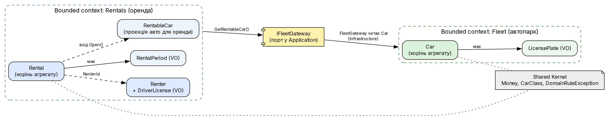
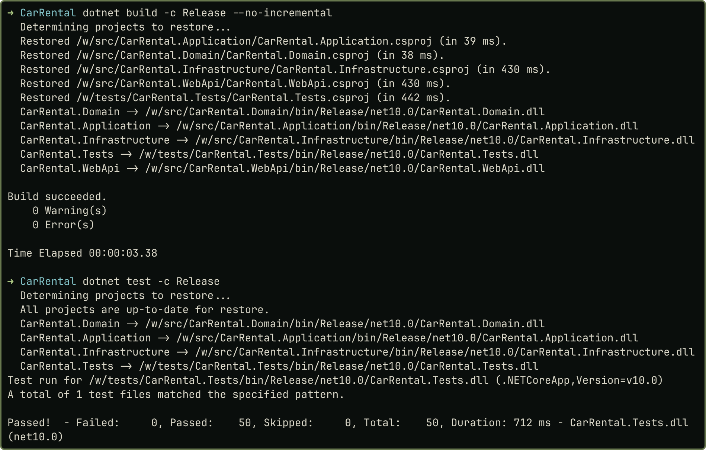

# Практичне заняття № 1

**Тема:** «Чиста архітектура та Domain-Driven Design»

## Мета роботи

Опанувати проєктування за принципами чистої архітектури й DDD та визначення меж bounded context на наскрізному проєкті `CarRental` («Прокат автомобілів»; предметна область довільна, варіантів немає). Код і докази: <https://github.com/brizzinck/krinzhrepoduta/tree/main/arch/pz-1>.

## Завдання та виконання

| Пункт методички | Що зроблено |
|---|---|
| Проєкт ASP.NET Core із шарами Clean Architecture | `Domain`, `Application`, `Infrastructure`, `WebApi`, `tests`; залежності закріплено в `.csproj` |
| Entity, Value Object, Aggregate | Entity `Car`, `Renter`, `Rental`; VO `Money`, `LicensePlate`, `RentalPeriod`, `DriverLicense`; корені `Car`, `Rental`, `Renter` (`Renter` окремий агрегат: власне сховище `IRenterStore`, `Rental` посилається на нього лише за `RenterId`) |
| Bounded context і контракти | Fleet і Rentals, контракт `IFleetGateway` (рис. 1) |
| Домен без фреймворків, шари через абстракції, логіка не в контролерах | Domain і Application без `PackageReference`; порти `I*Store`, `IFleetGateway`; контролери тонкі |
| Обґрунтування меж і рішень | розділ «Bounded contexts» |
| Придатність до розширення | сервіс оренди свідомо простий (тариф і побічні ефекти в ньому): основа ПЗ 2–4 |

## Теоретичні відомості

Чиста архітектура спрямовує залежності до бізнес-правил; фреймворк і БД залежать від домену [1, 3]. У DDD *Entity* має ідентичність, *Value Object* незмінний і рівний за значенням, *Aggregate* охороняє інваріанти через корінь, *Bounded Context* задає межу однозначності термінів [1, 2].

## Хід виконання роботи

Збірка й тести виконуються в docker-образі `dotnet/sdk:10.0` (SDK 10.0.403) через `tools/dotnet.sh`.

### Bounded contexts

{width=100%}

**Fleet** відповідає за стан автопарку (номер, клас, ставка, пробіг, обслуговування), **Rentals** за те, хто, коли і за скільки орендує. Контексти мають різні правила й лексику та змінюються з різних причин; третій контекст («Клієнти») не виділено, бо правила орендаря тісно пов'язані з орендою. Rentals не знає класу `Car`, а бере проєкцію `RentableCar` через порт; агрегати посилаються один на одного лише за `Guid`.

```csharp
public interface IFleetGateway
{
    Task<RentableCar?> GetRentableCar(Guid carId, CancellationToken ct);
    Task RecordMileage(Guid carId, int mileage, CancellationToken ct);
}
```

### Доменна модель і шари

Конструктори закриті, сеттери приватні, об'єкти створюють фабрики, тож інваріанти не обійти. Корінь `Rental` перевіряє правила у фабриці; перетин оренд Domain визначає за періодами, які передає Application (до БД він не звертається):

```csharp
public static Rental Open(RentableCar car, Renter renter, RentalPeriod period, Money total,
    DateOnly today, IEnumerable<RentalPeriod> busyPeriods)
{
    if (!car.IsRentable) throw new DomainRuleException("Автомобіль зараз недоступний для оренди.");
    if (period.Start < today) throw new DomainRuleException("Оренда не може починатися в минулому.");
    renter.EnsureCanRent(period);   // вік >= 21, посвідчення діє до кінця оренди
    if (busyPeriods.Any(p => p.Overlaps(period)))
        throw new DomainConflictException("На ці дати автомобіль уже орендований.");
    return new Rental { /* CarId, RenterId, Period, Total, Status = Active ... */ };
}
```

Дванадцять правил (формат номера, вік, період 1–30 днів, перетин тощо) реалізовано в Domain; унікальність номера перевіряє `CarService` і унікальний індекс БД. Domain не залежить ні від чого, Application від Domain, Infrastructure від Application, WebApi від обох; Application описує порти, Infrastructure їх реалізує. Помилки перетворює `ErrorHandlingMiddleware` (правило, 400; не знайдено, 404; конфлікт, 409). Конкретні типи відомі лише в `Program.cs`.

## Результати тестування та демонстрація працездатності

{width=60%}

Domain перевіряється без БД; інтеграційні тести працюють із SQLite у пам'яті. `dotnet list reference` і `grep` підтверджують, що в Domain та Application немає EF Core й ASP.NET Core. `demo.sh` у docker виконав реальні запити: оренда 3 доби за 800 грн (201, 2400), перетин дат (409), вік 20 років (400), період понад 30 днів (400), скасування (200), повторне скасування (400), неіснуюча оренда (404); після перезапуску контейнера дані збереглися.

## Висновки

Створено каркас `CarRental` із чотирма шарами чистої архітектури й двома bounded context (Fleet, Rentals), пов'язаними контрактом `IFleetGateway`. Доменна модель за DDD містить три сутності, чотири Value Objects і агрегати з коренями `Car` та `Rental`. Дванадцять правил зосереджено в Domain, який не залежить від фреймворків і покритий 50 тестами. Application залежить лише від абстракцій, Infrastructure їх реалізує, контролери не мають логіки. Працездатність підтверджено збіркою без попереджень, тестами й сценарієм API з перезапуском. Опановано розбиття на контексти, закріплення інваріантів у фабриках і напрям залежностей. Обмеження цієї версії (великий `RentalService`, прямий час) розвиваються в ПЗ 2–4.

## Джерела

1. Методичні вказівки до ПЗ № 1, розд. 1.1–1.4.
2. Лекція 1 «Архітектура ПЗ».
3. Martin R. Clean Architecture, розділи «The Clean Architecture», «The Dependency Rule».
