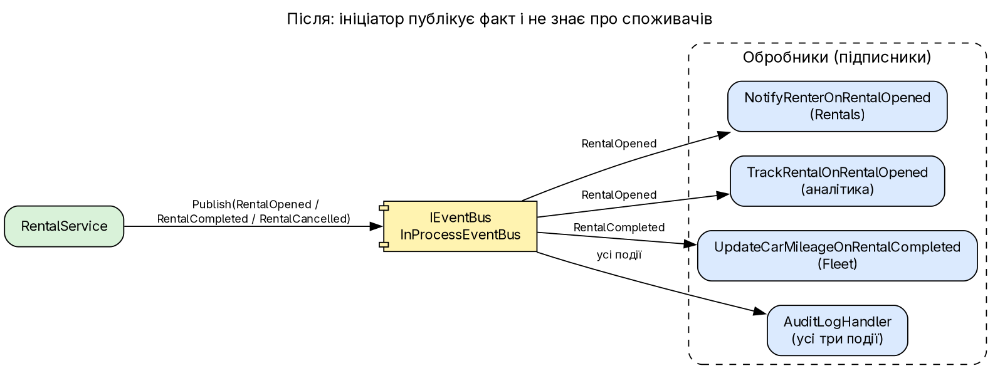
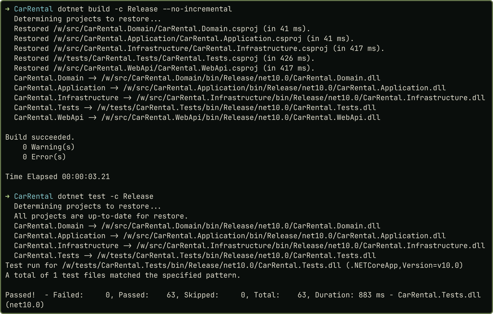

# Практичне заняття № 2

**Тема:** «Подієво-орієнтований підхід до проєктування програмних систем (Event-Driven Design)»

## Мета роботи

Опанувати подієво-орієнтовану взаємодію компонентів для слабкозв'язаних рішень. Роботу виконано в наскрізному проєкті `CarRental` (ПЗ № 1); варіантів немає. Вихідний код і докази лежать у <https://github.com/brizzinck/krinzhrepoduta/tree/main/arch/pz-2>.

## Завдання та виконання

| Пункт методички (§2.3) | Що зроблено |
|---|---|
| Взяти проєкт із ПЗ № 1 | Тека `CarRental/` = знімок ПЗ 1 + зміни; «до» це справжній код ПЗ 1 |
| Події про значущі зміни стану | `RentalOpened`, `RentalCompleted`, `RentalCancelled`: `sealed record` у минулому часі, мінімум даних, без логіки |
| Окремі обробники, одна реакція кожен, реакція в іншому класі чи контексті | `NotifyRenterOnRentalOpened`, `TrackRentalOnRentalOpened`, `AuditLogHandler`; `UpdateCarMileageOnRentalCompleted` у контексті Fleet |
| Слабка зв'язаність, без прямих викликів обробників | `RentalService` залежить лише від `IEventBus` (grep і тест підтверджують) |
| Працездатність і Clean Architecture | 63 тести; вивід `demo.sh` ідентичний ПЗ 1; посилання між проєктами не змінились |

## Теоретичні відомості

Подія це незмінний факт, що вже відбувся; *producer* публікує її, *consumer* підписується, між ними стоїть шина, тож нову реакцію додають без зміни видавця [1, 2]. Прямий виклик є командою конкретному отримувачу, подія повідомленням без очікування відповіді. Реалізовано domain events у межах одного процесу, брокер не потрібен. Синхронну бізнес-логіку (перевірка доступності авто, перетину дат) у події не виносять: вона лишається в `Rental.Open`.

## Хід виконання роботи

{width=95%}

Контракти `IEventBus.PublishAsync<TEvent>` і `IEventHandler<in TEvent>.HandleAsync` лежать в Application. `InProcessEventBus` зберігає реєстр, де кожному типу події відповідає список обробників, і викликає їх послідовно; подія без підписників не є помилкою. Підписки збирає `CompositionRoot` у WebApi (єдине місце, де відомо, хто на що підписаний). Нова реакція між контекстами: Fleet оновлює пробіг у відповідь на подію Rentals, а правило «пробіг лише зростає» лишається в `Car.RecordMileage`:

```csharp
public sealed class UpdateCarMileageOnRentalCompleted(ICarStore cars) : IEventHandler<RentalCompleted>
{
    public async Task HandleAsync(RentalCompleted evt, CancellationToken ct)
    {
        var car = await cars.Find(evt.CarId, ct);
        if (car is null || evt.EndMileage <= car.Mileage)
            return;                       // застаріле значення ігноруємо
        car.RecordMileage(evt.EndMileage);
        await cars.Save(ct);
    }
}
```

### До і після

`git diff --no-index --stat ПЗ1 ПЗ2` (19 файлів, переважно нові; повний `diff -ru` в `evidence/diff-pz1-pz2.patch`):

```
 …/Application/Common/Events/IEventBus.cs, IEventHandler.cs, InProcessEventBus.cs | 7+7+26 +
 …/Application/Rentals/Events/RentalOpened/Completed/Cancelled.cs                 | 3 x 4 +
 …/Application/Rentals/Handlers/NotifyRenter…, TrackRental…                       | 16+11 +
 …/Application/Rentals/RentalService.cs                                           | 17 ++--
 …/Application/Rentals/IFleetGateway.cs                                           |  2 -
 …/WebApi/CompositionRoot.cs                                                      | 31 +
 19 files changed, 445 insertions(+), 27 deletions(-)
```

Ключова зміна в `RentalService`: прямі виклики сповіщення й аналітики замінено публікацією факту, з `IFleetGateway` прибрано `RecordMileage`. Після збереження сервіс лише публікує подію; відхилена операція подій не породжує.

```diff
-    INotificationService notifications,
-    IAnalyticsService analytics)
+    IEventBus events)
 ...
-        await notifications.SendRentalOpenedAsync(rental.Id, renter.Email, ct);
-        await analytics.TrackRentalOpenedAsync(rental.Id, rental.Total.Amount, ct);
+        await events.PublishAsync(new RentalOpened(rental.Id, rental.CarId, rental.RenterId,
+            rental.Period.Start, rental.Period.End, rental.Total.Amount), ct);
```

`grep` за `INotificationService|IAnalyticsService|RecordMileage` у `RentalService.cs`: у ПЗ 1 три збіги, у ПЗ 2 збігів немає.

## Результати тестування та демонстрація працездатності

{width=60%}

Нові 13 тестів перевіряють шину (порядок підписників, подія без підписників), публікацію (`Rejected_operation_publishes_nothing`), слабку зв'язаність (`New_subscriber_is_added_without_changing_RentalService`) і реакції (`Fleet_updates_car_mileage_in_reaction_to_RentalCompleted`, аудит). Сценарій `demo.sh` після нормалізації GUID і дат дає вивід, ідентичний ПЗ 1 (`diff` порожній). Одна подія `RentalOpened` викликає лист, лічильник аналітики й рядок аудиту.

## Висновки

У проєкт додано три події, in-process шину та чотири обробники з різними реакціями (сповіщення, аналітика, оновлення пробігу в Fleet, аудит). `RentalService` більше не залежить від споживачів своїх подій, а нова реакція додається окремим обробником, що доводить тест. Прямі виклики прибрано, з `IFleetGateway` видалено `RecordMileage`, і реакцію виконує інший контекст. Поведінка API не змінилась: вивід демонстрації ідентичний, усі 63 тести проходять, шарова архітектура збережена. Опановано різницю між командою й фактом, правила іменування подій і межі застосування подій. Обмеження: синхронна доставка без транзакції й черги, ручне складання підписок, прямий запис аудиту у файл; їх розглянуто в ПЗ 3 і 4.

## Джерела

1. Методичні вказівки до ПЗ № 2, розд. 2.1–2.4.
2. Лекція 2 «Архітектура ПЗ».
3. Stopford B. Designing Event-Driven Systems, розд. 5.
