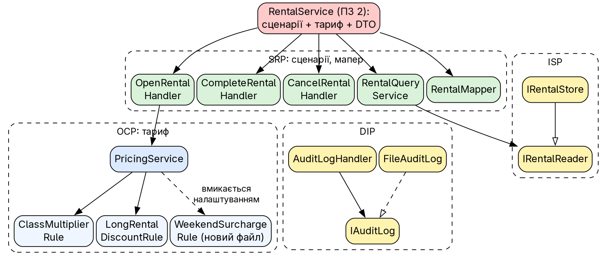
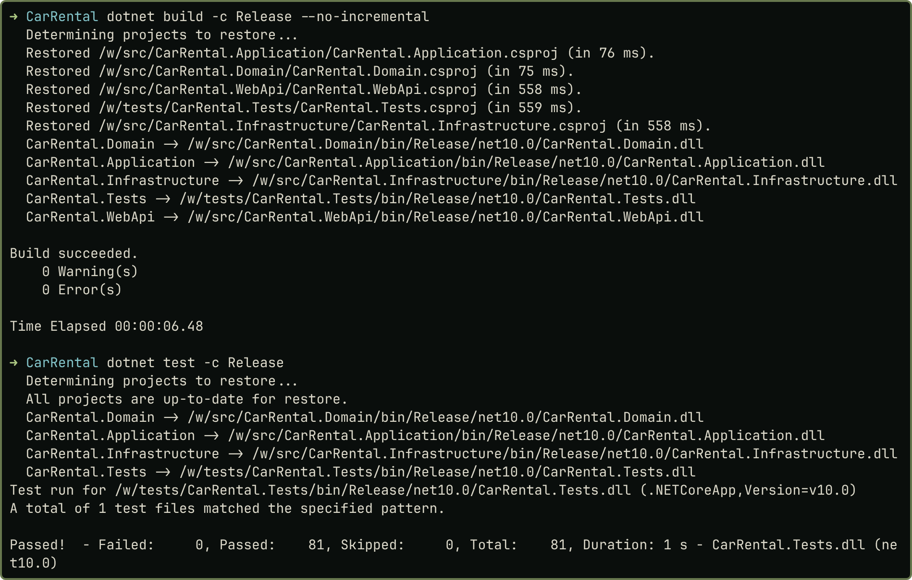

# Практичне заняття № 3

**Тема:** «Принципи SOLID у проєктуванні компонентів програмного забезпечення»

## Мета роботи

Опанувати застосування SOLID під час рефакторингу: знайти порушення у власному коді, виправити без зміни поведінки й обґрунтувати. Роботу виконано в наскрізному проєкті `CarRental` після ПЗ № 2; варіантів немає. Проєкт і докази в репозиторії: <https://github.com/brizzinck/krinzhrepoduta/tree/main/arch/pz-3>.

## Завдання та виконання

Методичка (§3.3) вимагає знайти порушення, обрати щонайменше два принципи (рекомендовано SRP і DIP), виправити без зміни поведінки й обґрунтувати; силабус додає OCP. Обрано SRP, OCP, DIP, ISP; LSP порушень не має.

| Принцип | Порушення в коді ПЗ 2 | Виправлення |
|---|---|---|
| SRP | `RentalService`: п'ять сценаріїв, тариф, DTO, події | `OpenRentalHandler`, `CompleteRentalHandler`, `CancelRentalHandler`, `RentalQueryService`, `PricingService`, `RentalMapper` |
| OCP | тариф у `switch` за класом авто та `if` для знижки | `IPricingRule`: окремий клас на правило; нове правило додано окремим файлом |
| DIP | `AuditLogHandler` сам пише у файл через `File.AppendAllTextAsync` | `IAuditLog` в Application, `FileAuditLog` в Infrastructure |
| ISP | `IRentalStore` змішує читання й запис | `IRentalReader`; `IRentalStore : IRentalReader` |
| LSP | не виявлено: `Car`, `Renter`, `Rental` можуть заміщати `Entity`, `Describe()` контракт не змінює | без змін |

Залишок: `DateTime.UtcNow` у сценаріях (прихована залежність) зафіксовано для ПЗ 4.

## Теоретичні відомості

SRP: клас має одну причину для змін. OCP: розширення новим кодом без правки наявного. LSP: похідний тип замінює базовий. ISP: клієнт не залежить від методів, яких не викликає. DIP: високі рівні залежать від абстракцій. Порушення дають жорсткість, крихкість і в'язкість коду [1, 2, 3, 4].

## Хід виконання роботи

{width=90%}

*OCP.* Замість `switch` за класом авто та `if` для знижки (метод довелося б змінювати для кожного нового правила) `PricingService` застосовує зареєстровані правила за порядком; коефіцієнти й знижка стали класами `ClassMultiplierRule` і `LongRentalDiscountRule`:

```csharp
public interface IPricingRule
{
    int Order { get; }                                      // правила виконуються за зростанням
    Money Apply(Money current, PricingContext context);
}

public sealed class PricingService(IEnumerable<IPricingRule> rules) : IPricingService
{
    private readonly IPricingRule[] _rules = rules.OrderBy(r => r.Order).ToArray();
    public Money Calculate(RentableCar car, RentalPeriod period)
    {
        var total = car.DailyRate.Multiply(period.Days);
        foreach (var rule in _rules) total = rule.Apply(total, new PricingContext(car, period));
        return total;
    }
}
```

Тест порівнює новий розрахунок зі старою формулою для всіх класів, п'яти ставок і днів 1–30 (450 комбінацій): результати збігаються до копійки. Розширення показано правилом `WeekendSurchargeRule` (надбавка 10% за вихідні, вимкнена за замовчуванням):

```
$ git diff --no-index --stat ДО_OCP ПІСЛЯ_OCP
 …/Rentals/Pricing/WeekendSurchargeRule.cs | 20 ++++++++++++++++++++
 …/WebApi/Program.cs                       |  2 ++
 …/Tests/Pricing/PricingTests.cs           | 13 +++++++++++++
 3 files changed, 35 insertions(+)
```

`PricingService` і наявні правила не змінювалися; з правилом оренда пт–пн на авто за 800 грн/доба коштує 2640 замість 2400.

*DIP.* Обробник більше не знає про файл і системний час: він викликає абстракцію, а запис виконує `FileAuditLog` в Infrastructure.

```csharp
public interface IAuditLog { Task WriteAsync(string eventName, object payload, CancellationToken ct); }

public sealed class AuditLogHandler(IAuditLog log) : IEventHandler<RentalOpened>, ...
{
    public Task HandleAsync(RentalOpened evt, CancellationToken ct) => log.WriteAsync(nameof(RentalOpened), evt, ct);
    // ... RentalCompleted, RentalCancelled
}
```

*SRP, ISP.* `OpenRentalHandler` має одну публічну операцію `HandleAsync`; `RentalQueryService` залежить лише від `IRentalReader` (тести `Each_command_handler_exposes_a_single_public_operation`, `Query_service_depends_only_on_the_read_side_of_the_store`).

### До і після

`git diff --no-index --stat ПЗ2 ПЗ3` (повний варіант в `evidence/diffstat.txt`):

```
 …/Rentals/RentalService.cs (видалено)          | 81 -----
 …/Rentals/UseCases/Open/Complete/Cancel…       | 33+21+21 +
 …/Rentals/UseCases/RentalQueryService.cs       | 13 +
 …/Rentals/Pricing/ (6 файлів)                  | 104 +
 …/IAuditLog.cs, Infrastructure/Audit/FileAuditLog.cs | 7+18 +
 25 files changed, 511 insertions(+), 115 deletions(-)
```

## Результати тестування та демонстрація працездатності

{width=50%}

Додано 18 тестів (тариф, структурні перевірки SOLID); старі проходять без змін логіки. Поведінку не змінено: вивід `demo.sh`, журнал контейнера, журнал аудиту й дані після перезапуску порівняно з ПЗ 2 після нормалізації GUID і дат, різниці немає (`evidence/regression-*.txt`).

## Висновки

У `CarRental` знайдено й виправлено порушення чотирьох принципів SOLID. SRP: великий `RentalService` розділено на сценарії, тариф і мапер. OCP: тариф став набором правил, нове правило додано одним файлом і двома рядками реєстрації, що підтверджує диф. DIP: журнал аудиту й тариф підключено через абстракції `IAuditLog` та `IPricingService`. ISP: читання відокремлено від запису в `IRentalReader`. LSP розглянуто, порушень немає. Поведінку не змінено: вивід демонстрації й журнали ідентичні, 63 старі тести проходять, 18 нових закріплюють результат. Залишок, свідомо перенесений на ПЗ 4: прямий доступ до `DateTime.UtcNow` і ручне складання залежностей.

## Джерела

1. Методичні вказівки до ПЗ № 3, розд. 3.1–3.4.
2. Лекція 3 «Архітектура ПЗ» (слайди 3–9).
3. Martin R. C. Agile Principles, Patterns, and Practices in C#.
4. Martin R. Clean Architecture, розділи про принципи SOLID.
