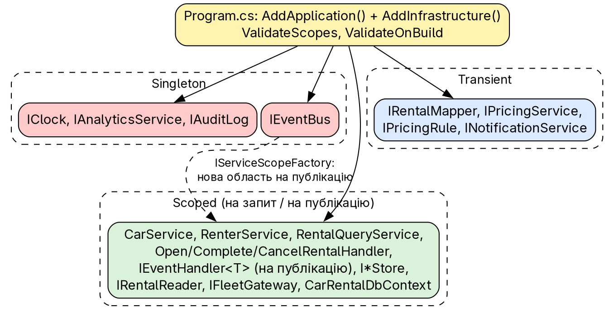
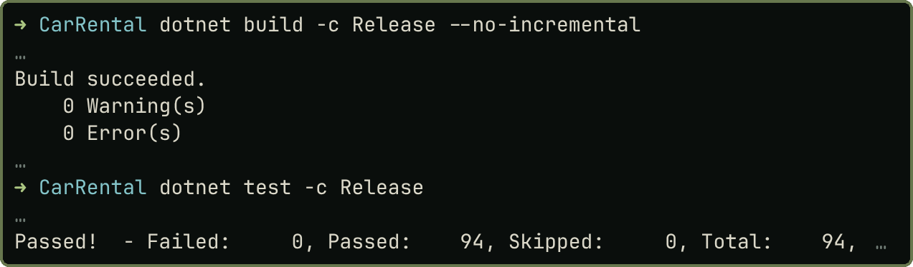

# Практичне заняття № 4

**Тема:** «Dependency Injection та інверсія керування в архітектурі програмних систем»

## Мета роботи

Перейти в наскрізному проєкті `CarRental` (після ПЗ № 3) на Dependency Injection: залежності створює й зберігає контейнер, а класи отримують їх через конструктор. Код, докази й знімки: <https://github.com/brizzinck/krinzhrepoduta/tree/main/arch/pz-4>.

## Завдання та виконання

| Пункт методички (§4.3) | Що зроблено |
|---|---|
| Проаналізувати залежності, знайти `new` усередині класів | `grep`-аудит коду ПЗ 3: п'ять місць (таблиця нижче), `evidence/audit-before.txt` |
| Замінити пряме створення на DI, залежності від абстракцій | конструкторна ін'єкція; `IClock`, `IRentalMapper`, обробники як `IEventHandler<T>` |
| Налаштувати контейнер із життєвими циклами (силабус: усі три) | `AddApplication()`, `AddInfrastructure()`: Singleton, Scoped, Transient (рис. 1) |
| Перевірити працездатність | 94 тести, вивід `demo.sh` ідентичний ПЗ 3 |

| Місце в ПЗ 3 | Проблема | Заміна |
|---|---|---|
| `CompositionRoot.cs` | ручні `new` шини й чотирьох обробників | видалено; обробники зареєстровано в контейнері |
| `Program.cs` | `new FileAuditLog(...)` у лямбді | реєстрація в `AddInfrastructure()` |
| 3 сценарії, `FileAuditLog` | `DateTime.UtcNow` (прихована залежність) | `IClock` |
| `FileAuditLog` | статичний `SemaphoreSlim` | поле екземпляра (Singleton) |
| `RentalMapper` | статичний клас | `IRentalMapper` (Transient) |

Виклики `new` для значень (`Money`, `RentalPeriod`, `PricingContext`) порушенням не є.

## Теоретичні відомості

DI передає залежності класу ззовні (конструктор, властивість, метод) і реалізує DIP; створенням і часом життя керує контейнер [1, 2]. Transient створюється щоразу, Scoped — один раз на запит, Singleton — один на застосунок [1, 2, 3]. Singleton не повинен залежати від Scoped.

## Хід виконання роботи

{width=85%}

*Годинник.* Контракт в Application, реалізація `SystemClock` в Infrastructure (Singleton). Було `DateOnly.FromDateTime(DateTime.UtcNow)` у сценарії, стало:

```csharp
public sealed class OpenRentalHandler(
    IRentalStore rentals, IRenterStore renters, IFleetGateway fleet,
    IPricingService pricing, IClock clock, IRentalMapper mapper, IEventBus events)
{   // ...
    var rental = Rental.Open(car, renter, period, pricing.Calculate(car, period), clock.Today, busy);
```

Тести підміняють годинник на `FakeClock` і явно задають «сьогодні».

*Шина подій.* Раніше підписки збирав `CompositionRoot` через `new`. Тепер обробники зареєстровано в контейнері, а шина є Singleton і на кожну публікацію створює власну область, щоб не тримати Scoped-залежностей:

```csharp
public sealed class InProcessEventBus(IServiceScopeFactory scopes) : IEventBus
{
    public async Task PublishAsync<TEvent>(TEvent evt, CancellationToken ct)
    {
        await using var scope = scopes.CreateAsyncScope();
        foreach (var handler in scope.ServiceProvider.GetServices<IEventHandler<TEvent>>())
            await handler.HandleAsync(evt, ct);   // порядок = порядок реєстрації
    }
}
```

З прикладного коду до контейнера звертається лише шина, тому я переніс її в Infrastructure; решта звернень лише в точці складання. Application залежить лише від пакета абстракцій DI; реалізацію контейнера знає WebApi.

*Реєстрації.* `Program.cs` лише викликає два методи розширення й вмикає перевірки `ValidateScopes` і `ValidateOnBuild`:

```csharp
// AddApplication(): Scoped сценарії та обробники, Transient правила й мапер
services.AddScoped<OpenRentalHandler>();   // ... Complete, Cancel, RentalQueryService
services.AddTransient<IRentalMapper, RentalMapper>();
services.AddTransient<IPricingRule, ClassMultiplierRule>();
services.AddScoped<IEventHandler<RentalOpened>, NotifyRenterOnRentalOpened>();
// AddInfrastructure(): Singleton без стану або з потокобезпечним станом, Scoped сховища
services.AddSingleton<IClock, SystemClock>();
services.AddSingleton<IEventBus, InProcessEventBus>();
services.AddDbContext<CarRentalDbContext>(configureDatabase);
services.AddScoped<IRentalStore, SqliteRentalStore>();
```

Вибір: Singleton для `IClock` (без стану), `IAnalyticsService` (спільні лічильники), `IAuditLog` (один файл, один замок), `IEventBus`; Scoped для `DbContext`, сховищ, сценаріїв (один запит — одна одиниця роботи) і обробників подій (шина створює для них область на кожну публікацію); Transient для правил тарифу, `PricingService`, мапера, адаптера сповіщень (без стану).

*Діагностика.* Ендпоінт `/api/_diag/lifetimes` лише в Development (у Production 404) двічі повернув: `SystemClock#58766839` в обох запитах (Singleton); `CarRentalDbContext` однаковий у межах запиту (`#59884855`), різний між запитами (`#1972295`) (Scoped); два `PricingService` різні в кожному запиті (Transient).

### До і після

`git diff --stat` між ПЗ 3 і ПЗ 4: 25 файлів, +550/−186; `CompositionRoot.cs` і старий `InProcessEventBus` з Application видалено (`evidence/diffstat.txt`).

## Результати тестування та демонстрація працездатності

{width=85%}

Тестова підготовка складає систему тими самими `AddApplication()` та `AddInfrastructure()`, підміняючи лише порти. 13 нових тестів перевіряють: усе розв'язується з контейнера; поведінку трьох циклів; залежність Singleton від Scoped кидає `InvalidOperationException`; пропущену реєстрацію видно під час побудови; Application залежить лише від абстракцій; `IClock` керує правилами дат. Вивід `demo.sh`, журнали й дані після перезапуску порівняно з ПЗ 3 після нормалізації GUID і дат: різниці немає.

## Висновки

Усі залежності проєкту тепер створює контейнер DI. Усунено ручну збірку шини через `new`, чотири читання системного часу (замінено на `IClock`), статичний `SemaphoreSlim` і статичний мапер. Журнал аудиту з `Program.cs` перенесено у фабрику в `AddInfrastructure()`, бо шлях до файлу є конфігурацією. Налаштовано всі три життєві цикли: Singleton для годинника, аналітики, аудиту й шини, Scoped для `DbContext`, сховищ і сценаріїв (на запит) та обробників (на одну публікацію), Transient для правил тарифу, мапера й адаптера сповіщень. Правило «Singleton не залежить від Scoped» тримається завдяки області на публікацію, `ValidateScopes` і тесту. Поведінку не змінено, 94 тести проходять.

## Джерела

1. Методичні вказівки до ПЗ № 4, розд. 4.1–4.5.
2. Лекція 4 «Архітектура ПЗ».
3. Microsoft Learn. Dependency injection in .NET.
