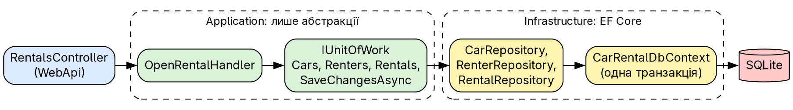
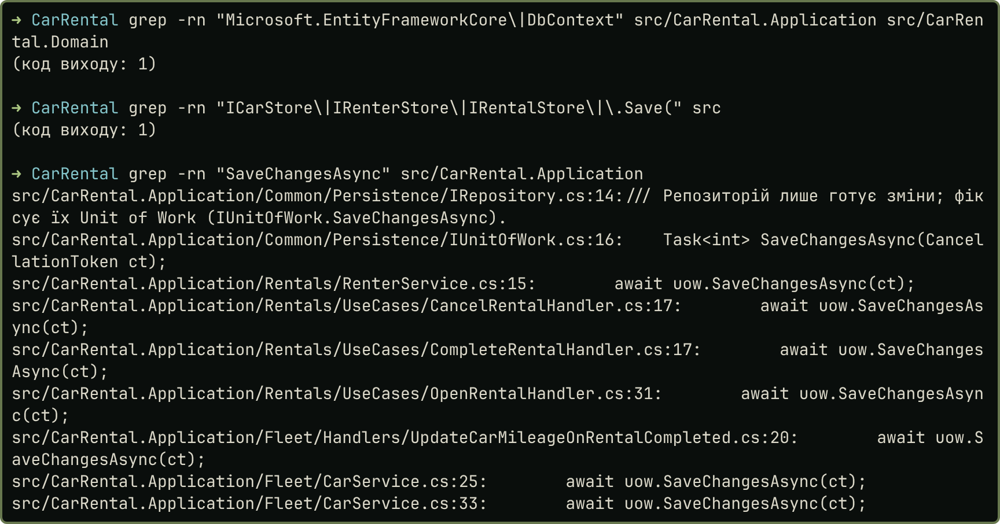
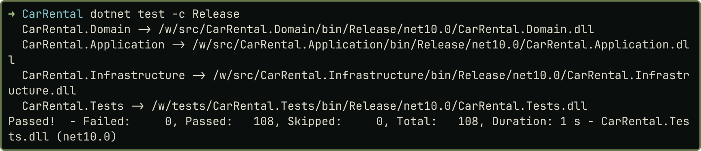

# Практичне заняття № 5

**Тема:** «Репозиторій та Unit of Work у багатошаровій архітектурі»

## Мета роботи

Винести доступ до даних наскрізного проєкту `CarRental` за абстракції Repository та Unit of Work, щоб прикладний шар не залежав від ORM, а зміни однієї одиниці роботи зберігалися атомарно. Код, докази й знімки: <https://github.com/brizzinck/krinzhrepoduta/tree/main/arch/pz-5>.

## Завдання та виконання

| Пункт (методичка §5.3, силабус 5.2) | Що зроблено |
|---|---|
| Проаналізувати доступ до даних | аудит коду ПЗ 4: `evidence/audit-before.txt` |
| Інтерфейс репозиторію | `IRepository<T>`: `GetByIdAsync`, `GetAllAsync`, `AddAsync`, `Update`, `Delete` |
| Реалізація в Infrastructure | `EfRepository<T>`, `CarRepository`, `RenterRepository`, `RentalRepository` |
| Unit of Work, кілька репозиторіїв | `IUnitOfWork`: `Cars`, `Renters`, `Rentals`, `SaveChangesAsync` |
| Application лише з абстракціями | сценарії й обробники подій переписано, `I*Store` видалено |
| Перевірка бізнес-операцій | 108 тестів, вивід `demo.sh` ідентичний ПЗ 4 |

## Теоретичні відомості

Репозиторій подає збережені об'єкти як колекцію й приховує запити до БД. Unit of Work збирає зміни однієї бізнес-операції та фіксує їх однією транзакцією [1, 2, 3]. Інтерфейси лежать у прикладному шарі, бо описують потреби сценаріїв, а реалізації в інфраструктурному: залежність спрямована всередину.

## Хід виконання роботи

*Аналіз.* На ПЗ 4 кожне сховище (`ICarStore`, `IRenterStore`, `IRentalStore`) мало власний `Save`. Сховище змішувало доступ до даних із фіксацією, а сценарій не мав спільної точки завершення операції. Витоку EF у Application не було, тому завдання тут полягало в розділенні відповідальностей.

*Контракти.* Інтерфейси в Application, зміни лише готуються, фіксує їх Unit of Work:

```csharp
public interface IRepository<T> : IReadRepository<T> where T : Entity
{
    Task AddAsync(T entity, CancellationToken ct);
    void Update(T entity);
    void Delete(T entity);
}
public interface IUnitOfWork
{
    ICarRepository Cars { get; }
    IRenterRepository Renters { get; }
    IRentalRepository Rentals { get; }
    Task<int> SaveChangesAsync(CancellationToken ct);
}
```

`IReadRepository<T>` виділено окремо (ISP): `RentalQueryService` залежить лише від читання. Запити предметної області лежать у конкретних інтерфейсах: `FindByPlateAsync`, `ListAvailableAsync`, `ListByRenterAsync` (LINQ-фільтр), `ActivePeriodsOfCarAsync`. Бізнес-правил у репозиторіях немає: перетин оренд перевіряє `Rental.Open`, репозиторій лише віддає періоди.

*Реалізація.* `UnitOfWork` і репозиторії працюють над одним Scoped `CarRentalDbContext`, тому `SaveChangesAsync` фіксує зміни всіх репозиторіїв разом. Це також єдине місце, де виняток EF про конфлікт версій стає типом Application:

```csharp
public async Task<int> SaveChangesAsync(CancellationToken ct)
{
    try { return await db.SaveChangesAsync(ct); }
    catch (DbUpdateConcurrencyException) { throw new ConcurrentChangeException(); }
}
```

*Сценарій оренди.* Операція використовує два репозиторії через одну одиницю роботи:

```csharp
var car = await fleet.GetRentableCar(cmd.CarId, ct) ?? throw new NotFoundException("Автомобіль");
var renter = await uow.Renters.GetByIdAsync(cmd.RenterId, ct) ?? throw new NotFoundException("Орендаря");
var busy = await uow.Rentals.ActivePeriodsOfCarAsync(car.Id, ct);
var rental = Rental.Open(car, renter, period, pricing.Calculate(car, period), clock.Today, busy);
await uow.Rentals.AddAsync(rental, ct);
await uow.SaveChangesAsync(ct);
```

{width=95%}

Силабус просить викликати Unit of Work у контролері. Я лишив контролер тонким: він викликає сценарій, а той уже працює з `IUnitOfWork`. Інакше бізнес-логіка потрапила б у WebApi, що суперечить ПЗ 1.

*Update.* Метод приймає об'єкт, відключений від відстеження, і викликати його треба до зміни об'єкта: EF запам'ятовує версію на момент приєднання. Перший варіант тесту змінював об'єкт раніше й отримував хибний конфлікт версій. Порядок закріплено в коментарі контракту, а застарілу копію перевіряє окремий тест.

## Результати тестування та демонстрація працездатності

{width=80%}

{width=80%}

| Вимога | Тест |
|---|---|
| Операції репозиторію | `Repository_supports_add_get_update_and_delete` |
| Без `SaveChanges` нічого не зберігається | `Nothing_is_stored_until_SaveChanges_is_called` |
| Атомарність: збій БД відкочує всі репозиторії | `Database_failure_during_save_rolls_back_all_repositories` |
| Конфлікт версій | `Concurrent_change_is_reported_as_ConcurrentChangeException_by_the_unit_of_work` |
| Сценарій без БД | `Open_scenario_runs_on_in_memory_repositories_without_any_database` |

У тесті атомарності в одну операцію входять орендар і два авто з однаковим номером. Унікальний індекс відхиляє збереження, і в БД не лишається ні авто, ні орендаря. Вивід `demo.sh` (15 запитів: коди 200, 201, 400, 404, 409) порівняно з ПЗ 4 після заміни GUID і дат: різниці немає (`evidence/regression-demo.txt`).

## Висновки

Доступ до даних у `CarRental` тепер проходить через `IRepository<T>` і три конкретні репозиторії. `IUnitOfWork` об'єднує їх і фіксує зміни операції одним викликом. Сховища з власним `Save` видалено, а сценарії та обробники подій переписано на абстракції. Application і Domain не залежать від EF Core, що підтверджує `grep` і окремий тест. Атомарність одного виклику `SaveChangesAsync` перевірено збоєм БД на SQLite: відкочуються зміни всіх репозиторіїв. Завершення оренди фіксується двічі, бо пробіг оновлює обробник події; цей компроміс я розбираю в ПЗ 7. Сценарій оренди можна запускати на репозиторіях у пам'яті, без БД. Поведінка API не змінилася, 108 тестів проходять.

## Джерела

1. Методичні вказівки до ПЗ № 5, розд. 5.1–5.4.
2. Лекція 5 «Repository Pattern та Unit of Work».
3. Fowler M. Patterns of Enterprise Application Architecture: Repository, Unit of Work.
