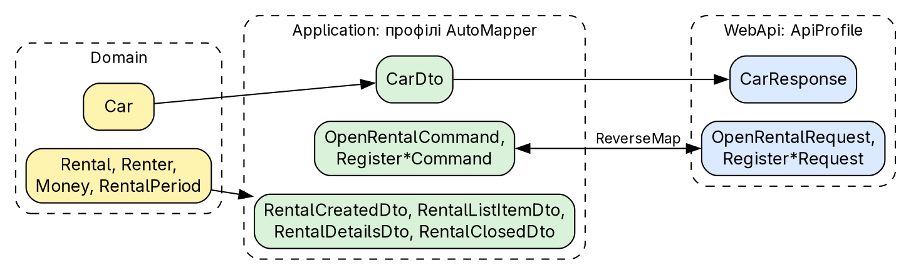
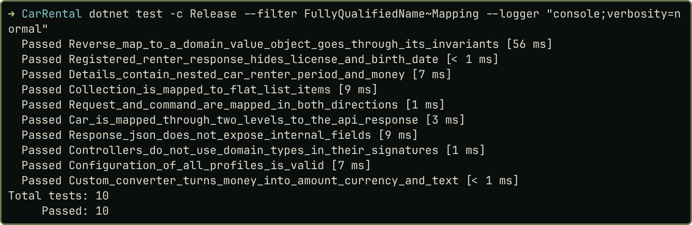
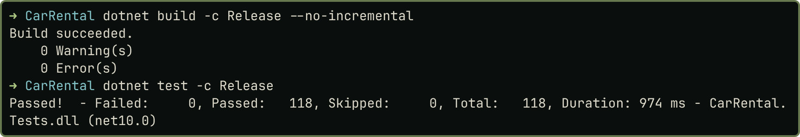

# Практичне заняття № 6

**Тема:** «Об'єкти передавання даних (DTO) та мапінг між шарами»

## Мета роботи

Відокремити доменну модель `CarRental` від API: операції з орендою отримують власні DTO, а перетворення виконує AutoMapper. Код, докази й знімки: <https://github.com/brizzinck/krinzhrepoduta/tree/main/arch/pz-6>.

## Завдання та виконання

| Пункт (методичка §6.3, силабус 6.1–6.2) | Що зроблено |
|---|---|
| Проаналізувати взаємодію Application і WebApi | один `RentalDto` на всі відповіді, `CarClass` у запиті WebApi, ручні `ToDto` |
| Виділити DTO для операцій | окремі DTO на створення, список, деталі, закриття оренди |
| Мапінг домену й DTO | профілі `CarProfile`, `RenterProfile`, `RentalProfile` |
| Контролери лише з DTO | контролери без доменних типів (`grep`, тест) |
| Кастомний конвертер `ITypeConverter` | `MoneyConverter` |
| Nested DTO | `RentalDetailsDto`: вкладені `Car`, `Renter`, `Period`, `Total` |
| `ReverseMap` | `OpenRentalRequest` і команда; `RentalPeriod` і `PeriodDto` |
| Кілька рівнів моделей | `Car`, далі `CarDto`, далі `CarResponse` |
| Колекції | список оренд і список авто |
| Перевірка роботи | 118 тестів, запити й коди `demo.sh` як у ПЗ 5 |

## Теоретичні відомості

DTO переносить дані між шарами й не містить логіки. Він приховує внутрішню будову домену й дає клієнту лише потрібні поля [1, 2]. Мапінг виконують у прикладному шарі або окремих компонентах. AutoMapper описує перетворення в профілях і дозволяє перевірити всю конфігурацію одним викликом [3].

## Хід виконання роботи

{width=95%}

*DTO за сценаріями.* Раніше всі відповіді про оренду мали одну форму. Тепер форма залежить від операції:

| Операція | DTO | Особливість |
|---|---|---|
| `POST /api/rentals` | `RentalCreatedDto` | період і сума |
| `GET /api/rentals` | `RentalListItemDto` | плоский: `periodStart`, `totalAmount` |
| `GET /api/rentals/{id}` | `RentalDetailsDto` | вкладені авто й орендар |
| `POST .../complete`, `.../cancel` | `RentalClosedDto` | статус і кінцевий пробіг |

Завершення й скасування мають однакову форму відповіді, тому ділять `RentalClosedDto`; для авто форма теж одна на всі операції.

Реєстрація орендаря тепер не повертає дату народження й посвідчення (`RenterRegisteredDto`), вони є лише в `GET /api/renters/{id}`.

*Вкладений мапінг і конвертер.* Деталі збираються з трьох джерел, а `Money` перетворює власний конвертер:

```csharp
public MoneyDto Convert(Money source, MoneyDto destination, ResolutionContext context) =>
    new(source.Amount, source.Currency, source.ToString());

CreateMap<RentalDetailsSource, RentalDetailsDto>()
    .ForCtorParam(nameof(RentalDetailsDto.Period), o => o.MapFrom(s => s.Rental.Period))
    .ForCtorParam(nameof(RentalDetailsDto.Total), o => o.MapFrom(s => s.Rental.Total)); // ...
```


*Зворотний мапінг.* `ReverseMap` для запитів і команд безпечний, бо це плоскі структури. У домен він іде лише через конструктор, щоб не обійти інваріанти. Для сутностей `Car` і `Rental` зворотного мапінгу немає навмисно: їх створюють фабрики.

```csharp
CreateMap<RentalPeriod, PeriodDto>().ReverseMap()
    .ConstructUsing(d => new RentalPeriod(d.Start, d.End));
```

*Контролери.* Контролер приймає запит, перетворює його на команду й викликає сценарій. Клас авто в запиті став рядком, тому `CarClass` не виходить за межі Application:

```csharp
var rental = await open.HandleAsync(mapper.Map<OpenRentalCommand>(request), ct);
return Created($"/api/rentals/{rental.Id}", rental);
```

*Версія бібліотеки.* Взято AutoMapper 14.0.0, останню версію під ліцензією MIT. Для неї NuGet показує попередження про вразливість GHSA-rvv3-g6hj-g44x: відмова в обслуговуванні на дуже глибоких графах об'єктів, що посилаються на свій тип. У наших DTO таких типів немає, тому попередження вимкнено лише для цього ідентифікатора, причину записано в `Directory.Build.props`.

## Результати тестування та демонстрація працездатності

Відповідь `GET /api/rentals/{id}` до і після (значення з виводу `demo.sh` двох запусків):

| Дані | ПЗ 5 | ПЗ 6 |
|---|---|---|
| Авто | `carId` | `car`: `id`, `plate` `AA0001BB`, `model` `Skoda Fabia` |
| Орендар | `renterId` | `renter`: `id`, `fullName`, `email` |
| Період | `start`, `end`, `days`: 3 | `period`: `start`, `end`, `days`: 3 |
| Сума | `total`: 2400.0 | `total`: `amount` 2400.0, `currency` `UAH`, `formatted` `2400.00 UAH` |

{width=90%}

{width=75%}

`grep "CarRental.Domain"` у контролерах і `Requests.cs` нічого не знаходить, ручних `ToDto` більше немає (`evidence/audit-after.txt`). Запити й коди відповідей `demo.sh` збігаються з ПЗ 5 (`evidence/regression-codes.txt`); змінилася лише форма тіл. Поза цими сценаріями є дві свідомі зміни: число в полі `class` тепер дає 400, а `model` у відповіді про авто замінено на `title`.

## Висновки

У `CarRental` доменні сутності більше не виходять за межі Application. Спільний `RentalDto` замінено чотирма DTO під конкретні операції, а реєстрація орендаря більше не повертає дату народження й посвідчення. Ручні `ToDto` замінено профілями AutoMapper, у яких є власний конвертер `Money`, вкладені DTO, плоский список, `ReverseMap` і колекції. Модель авто проходить три рівні: `Car`, `CarDto`, `CarResponse`. Зворотний мапінг у домен йде лише через конструктор значення, бо інакше обходив би інваріанти. Конфігурацію перевіряє `AssertConfigurationIsValid`, а відсутність доменних типів у контролерах закріплено тестом. Коди відповідей у сценаріях `demo.sh` не змінилися, 118 тестів проходять.

## Джерела

1. Методичні вказівки до ПЗ № 6, розд. 6.1–6.4.
2. Лекція 6 «DTO та AutoMapper».
3. AutoMapper documentation. <https://automapper.org/>
