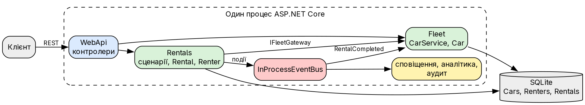
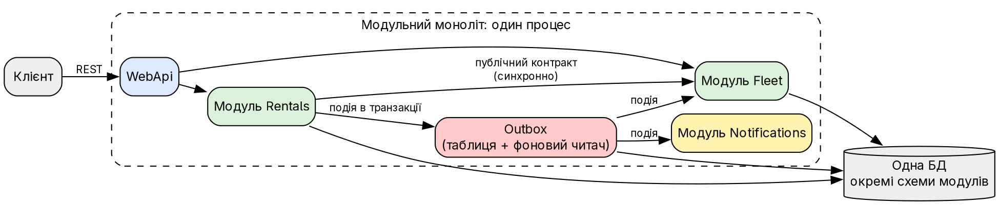
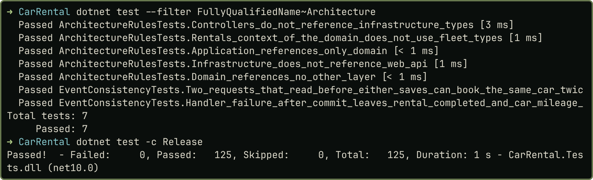

# Практичне заняття № 7

**Тема:** «Архітектурні стилі та компроміси в розподілених системах»

## Мета роботи

Визначити архітектурний стиль наскрізного проєкту `CarRental`, оцінити його проти мікросервісів і спроєктувати цільову архітектуру з урахуванням реальних обмежень. Код і докази: <https://github.com/brizzinck/krinzhrepoduta/tree/main/arch/pz-7>.

## Теоретичні відомості

Модульна архітектура ділить систему на модулі зі стабільними інтерфейсами, які розгортаються разом. Мікросервіси мають власний життєвий цикл і БД, але додають мережу й розподілені транзакції [1, 2]. За теоремою CAP під час розділення мережі доводиться обирати між узгодженістю й доступністю [2].

## Аналіз стилю

Код `src` такий самий, як у ПЗ 6, додано лише тести. Факти з проєкту (`evidence/references.txt`, `evidence/facts.txt`):

- чотири шари, залежності спрямовані всередину: Domain без посилань, Application лише на Domain;
- два контексти в одному процесі; Rentals читає авто лише через `IFleetGateway`;
- одна БД SQLite із таблицями `Cars`, `Renters`, `Rentals`;
- три події, шість реєстрацій обробників, шина в пам'яті процесу.

Стиль: **модульний моноліт** із шаровою структурою та елементами подієвого підходу. Модулі поки що логічні: контексти лежать в одних збірках і ділять `IUnitOfWork` та одну схему БД.

{width=78%}

## Сильні та слабкі сторони

| Сильні сторони | Слабкі сторони |
|---|---|
| простий запуск: один контейнер | події ненадійні: збій після фіксації втрачає реакцію |
| атомарність: одна транзакція `SaveChangesAsync` | подвійна оренда: у БД немає обмеження на перетин |
| 125 тестів в одному процесі | спільна схема: `IUnitOfWork` відкриває обидва контексти |
| межі шарів перевіряють 5 архітектурних тестів | Fleet і Rentals масштабуються лише разом |

Перші дві слабкості я перевірив тестами (`evidence/test-architecture.txt`). Якщо обробник падає після фіксації, оренда вже `Completed`, а пробіг авто лишається старим. Два запити, що прочитали дані до збереження, створюють дві оренди на ті самі дати. Обидві проблеми існують уже зараз, без жодного мікросервісу.

## Порівняння з альтернативою

Альтернатива: мікросервіси Fleet, Rentals, Notifications, кожен зі своєю БД, REST для запитів і брокер для подій. Навантаження я не вимірював, тому порівняння якісне.

| Критерій | Модульний моноліт | Мікросервіси |
|---|---|---|
| Супровід | один проєкт | кілька проєктів, версії контрактів |
| Розгортання | один контейнер | кілька сервісів і брокер |
| Масштабування | лише все разом | кожен сервіс окремо |
| Узгодженість | ACID-транзакція | кінцева, саги |
| Затримки | виклик у пам'яті | мережа на кожен виклик |
| Збої | падає весь процес | часткові, потрібні тайм-аути й повтори |
| Трасування | один журнал | кореляційні ідентифікатори |

## Компроміси при переході до розподіленої архітектури

*Узгодженість.* `Rental.Open` читає стан авто і в одному виклику отримує відповідь. Якщо Fleet стане сервісом, стан авто може застаріти між перевіркою й записом, а завершення оренди з оновленням пробігу перетвориться на сагу з компенсацією.

*Доступність.* Якщо Fleet недоступний, Rentals мусить вибрати: відмовити в оренді чи видати її за застарілими даними. За CAP для правила «не здавати авто двічі» я обрав би узгодженість і відмову: подвійна оренда дорожча за повторний запит.

*Спостережуваність і збої.* Один запит проходитиме кілька сервісів, тому знадобляться кореляційні ідентифікатори, збір журналів, повтори й ідемпотентні обробники.

## Доцільність подієвого підходу

| Сценарій | Рішення | Причина |
|---|---|---|
| Сповіщення, аналітика, аудит | доцільні | відповідь ініціатору не потрібна |
| Пробіг після завершення | доцільна, з outbox | кінцева узгодженість прийнятна, втрата ні |
| Перевірка доступності авто | недоцільна | відповідь потрібна до створення оренди |
| Розрахунок ціни | недоцільна | сума входить у відповідь клієнту |

## Проєкт цільової архітектури

{width=78%}

| Компонент | Відповідальність і межа | Взаємодія |
|---|---|---|
| WebApi | HTTP, DTO; лише сценарії модулів | REST назовні |
| Rentals | оренди, орендарі, ціна; своя схема БД | контракт Fleet, події назовні |
| Fleet | авто, стан, пробіг; своя схема БД | публічний контракт, підписка на події |
| Notifications | сповіщення, аудит, аналітика; чужих таблиць не читає | лише події |
| Outbox | надійна доставка подій | запис у транзакції, фоновий читач |

*Рішення (ADR).* Лишаюся на модульному моноліті. Контекст: два контексти, одна команда, навантаження не вимірювалося, вимоги незалежного масштабування немає. Наслідки: простий запуск і транзакції зберігаються, масштабування лише разом. Перші кроки: outbox для подій і обмеження проти перетину оренд у БД. Notifications можна винести в сервіс першим, якщо з'явиться реальна потреба, бо він спілкується лише подіями.

*Типові помилки.* Надмірна складність: не додавати брокер, поки вистачає outbox. Передчасна оптимізація: спершу вимірювати. Хибний вибір стилю: обирати за вимогами до узгодженості й розміром команди.

## Результати

{width=62%}

Реакції на події видно в `evidence/logs.txt` та `evidence/audit.log`.

## Висновки

`CarRental` є модульним монолітом із шаровою структурою та подіями в пам'яті процесу. Для двох контекстів і однієї команди цей стиль доцільний: запуск простий, транзакції атомарні, межі перевіряються тестами. Аналіз виявив дві реальні слабкості, підтверджені тестами: втрату реакції на подію після фіксації й подвійну оренду за одночасних запитів. Мікросервіси їх лише загострюють, бо транзакцію замінює сага. Тому цільовою архітектурою я обрав той самий стиль із чіткішими модулями, outbox і обмеженням у БД. Події доцільні для сповіщень, аналітики й пробігу, але не для перевірки доступності й ціни. Код `src` не змінювався, 125 тестів проходять.

## Джерела

1. Методичні вказівки до ПЗ № 7, розд. 7.1–7.4.
2. Лекція 7 «Архітектурні стилі та компроміси».
