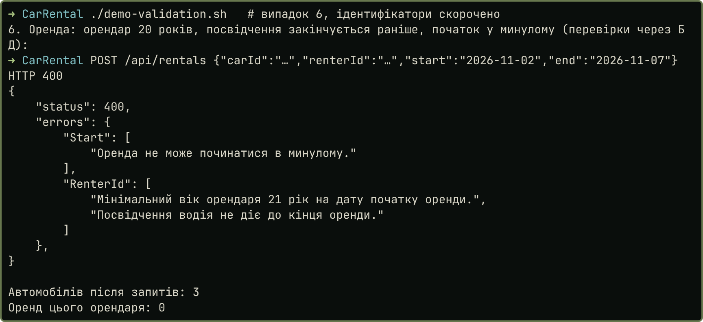
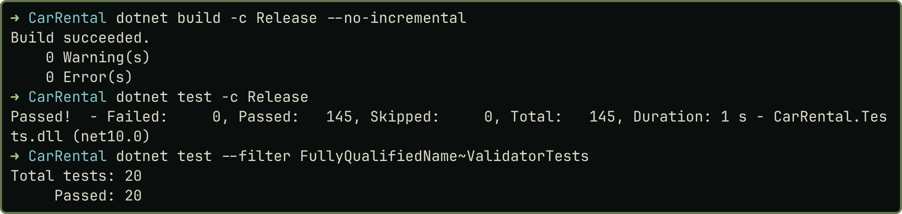

# Практичне заняття № 8

**Тема:** «Валідація даних у прикладному рівні засобами FluentValidation»

## Мета роботи

Винести перевірку вхідних даних `CarRental` у декларативні правила FluentValidation, щоб некоректний запит зупинявся до виконання сценарію, а клієнт отримував усі помилки разом. Код, докази й знімки: <https://github.com/brizzinck/krinzhrepoduta/tree/main/arch/pz-8>.

## Завдання та виконання

| Пункт (методичка §8.3, силабус 8.2) | Що зроблено |
|---|---|
| Додати FluentValidation, інтегрувати у WebApi | `FluentValidation.AspNetCore` 11.3.1, `AddFluentValidationAutoValidation()` |
| Валідатор команди створення | `OpenRentalCommandValidator` і `OpenRentalRequestValidator` |
| Перевірка до виконання use-case | запити автоматично, команди першим рядком сценарію |
| Структурована відповідь про помилки | `ValidationProblemDetails`: 400 і словник `errors` за полями |
| Семантична перевірка | вік, строк посвідчення, стан авто, унікальність номера |
| Валідатор на кожний клас (силабус) | 4 запити й 5 команд |

## Теоретичні відомості

Синтаксична валідація перевіряє формат і діапазони, семантична перевіряє бізнес-обмеження, а частині правил потрібні дані з БД [1]. FluentValidation описує правила окремим класом, тому контролер і модель лишаються чистими, а правила легко тестувати [2].

## Хід виконання роботи

*Де живе кожне правило.* Формат перевіряє межа API, семантику прикладний шар, а домен зберігає свої інваріанти незалежно від валідаторів:

| Рівень | Коли спрацьовує | Приклади правил |
|---|---|---|
| Запит, WebApi | автоматично до дії контролера | формат номера, email, ставка більша за 0, до 30 днів |
| Команда, Application | першим рядком сценарію, може читати БД | вік 21 рік, посвідчення, авто на обслуговуванні, унікальний номер, початок не в минулому |
| Домен | під час створення об'єкта | ті самі інваріанти `Rental.Open`, `RentalPeriod`, `LicensePlate` |
| Домен, конфлікт | під час відкриття оренди | перетин оренд, 409 |

*Чому два рівні.* Автоматична перевірка ASP.NET працює синхронно, тому асинхронні правила з БД у ній виконати не можна. Тому правила, яким потрібні БД або годинник, лежать у валідаторах команд, а сценарій викликає їх сам.

*Валідатор із доступом до БД.* Він відповідає на контрольне питання про перевірку, що потребує даних. Відсутній запис тут не помилка: сценарій поверне 404.

```csharp
RuleFor(x => x.RenterId)
    .NotEmpty().WithMessage("Вкажіть орендаря.")
    .CustomAsync(async (id, context, ct) =>
    {
        var renter = await uow.Renters.GetByIdAsync(id, ct);
        if (renter is null) return;
        var cmd = context.InstanceToValidate;
        if (renter.AgeOn(cmd.Start) < Renter.MinAge)
            context.AddFailure($"Мінімальний вік орендаря {Renter.MinAge} рік на дату початку оренди.");
        if (!renter.License.IsValidThrough(cmd.End))
            context.AddFailure("Посвідчення водія не діє до кінця оренди.");
    });
```

*Інтеграція.* У контролерах перевірок немає (`grep` порожній). Сценарій починається одним рядком:

```csharp
await validator.ValidateAndThrowAsync(cmd, ct);
```

`ErrorHandlingMiddleware` перетворює `ValidationException` на відповідь через `ProblemDetailsFactory` ASP.NET, тому обидва рівні повертають однаковий формат. Перевірку унікальності номера перенесено зі `CarService` у валідатор, тому дубль номера тепер дає 400 замість 409. Унікальний індекс у БД лишився.

## Результати тестування та демонстрація працездатності

Однакові некоректні запити до коду ПЗ 7 і ПЗ 8 (`demo-validation.sh`, `evidence/validation-before.txt`, `evidence/validation-after.txt`):

| Запит | ПЗ 7 | ПЗ 8 |
|---|---|---|
| Авто: номер, модель, ставка, пробіг неправильні | 400, одна помилка | 400, 4 поля |
| Авто: невідомий клас | 400, одна помилка | 400, поле `Class` |
| Авто: номер уже існує | 409 | 400, поле `Plate` |
| Орендар: ПІБ, email, посвідчення неправильні | 400, одна помилка | 400, 3 поля |
| Оренда: порожні Id, кінець раніше початку | 404 | 400, 3 поля |
| Оренда: 20 років, посвідчення, початок у минулому | 400, одна помилка | 400, 3 помилки у 2 полях |

{width=80%}

{width=75%}

Кількість авто до й після запитів однакова (3), оренд в орендаря 0. Тест `Failed_validation_runs_no_business_logic` показує, що за помилки валідації немає ні збереження, ні подій. Тест `Domain_keeps_its_invariants_without_any_validator` показує, що домен захищений і без валідаторів. Запити й коди `demo.sh` збігаються з ПЗ 7 (`evidence/regression-codes.txt`).

## Висновки

У `CarRental` тепер є валідатори на кожен вхідний клас: 4 для запитів і 5 для команд. Запити перевіряються автоматично до дії контролера, а команди на початку сценарію, бо правилам із БД потрібне асинхронне виконання. Клієнт отримує 400 і всі помилки валідації за полями в одному форматі замість першої знайденої. Семантичні перевірки охоплюють вік орендаря, строк посвідчення, стан авто й унікальність номера. Інваріанти лишилися в домені, тому він захищений і без API. За помилки валідації сценарій не виконує збереження й не публікує подій, це перевірено тестом. У контролерах перевірок немає, 145 тестів проходять.

## Джерела

1. Методичні вказівки до ПЗ № 8, розд. 8.1–8.4.
2. Лекція 8 «FluentValidation». FluentValidation documentation. <https://fluentvalidation.net/>
