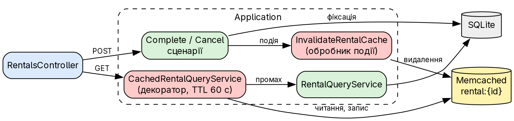
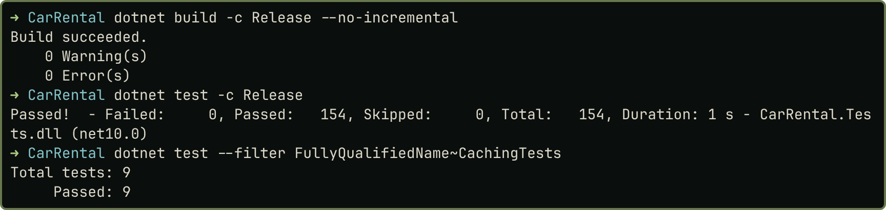

# Практичне заняття № 9

**Тема:** «Кешування в архітектурі програмних систем»

## Мета роботи

Додати до `CarRental` розподілений кеш на Memcached для читання оренди, забезпечити перехід до БД за відсутності кешу й інвалідацію після змін, а також оцінити вплив кешу на узгодженість даних. Варіантів немає. Код, докази й знімки: <https://github.com/brizzinck/krinzhrepoduta/tree/main/arch/pz-9>.

## Теоретичні відомості

In-memory кеш живе в пам'яті процесу й не підходить для кількох екземплярів застосунку. Розподілений кеш є окремим сервісом, спільним для всіх екземплярів, але потребує інфраструктури [1]. За схемою Cache-Aside застосунок спершу читає кеш, а за промаху читає БД і записує результат у кеш. TTL обмежує час, протягом якого дані можуть бути застарілими [1, 2].

## Хід виконання роботи

*Аналіз сценаріїв.* `GET /api/rentals/{id}` щоразу виконує 3 SQL-запити: оренда, орендар, авто. Це читання за ключем, і дані змінюються лише в кількох відомих місцях, тому я кешую саме його. Список оренд не кешую: він залежить від багатьох записів, і його важко інвалідувати. Записи й перевірку доступності авто не кешую взагалі: вони мають бачити актуальні дані.

{width=95%}

*Відокремлення від бізнес-логіки.* Кеш є декоратором над `IRentalQueryService`, а `RentalQueryService` про нього не знає. Порт `ICacheStore` лежить в Application, реалізація `MemcachedCacheStore` на `EnyimMemcachedCore` в Infrastructure. Ключ `rental:{id}`, значення JSON, TTL 60 с.

```csharp
var cached = await cache.GetAsync<RentalDetailsDto>(Key(id), ct);
if (cached is not null) return cached;      // HIT
var rental = await inner.Get(id, ct);       // MISS: читання з БД
await cache.SetAsync(Key(id), rental, Ttl, ct);
return rental;
```

Методичка називає пакет `Enyim.Caching`, але для .NET 10 потрібен його наступник `EnyimMemcachedCore`. Простір імен і `AddEnyimMemcached` ті самі. Реєстрація `AddSingleton<IMemcachedClient, MemcachedClient>` зайва: `AddEnyimMemcached` уже реєструє клієнта.

*Інвалідація.* Обробник `InvalidateRentalCache` реагує на `RentalCompleted` і `RentalCancelled`. Подія публікується після фіксації, тому наступне читання бачить нові дані. Обробник зареєстровано першим: шина не перехоплює винятків, тому збій обробника перериває наступні. Окремий тест підтверджує, що застарілого запису в такому разі не лишається. Деталі оренди містять дані авто й орендаря, але номер, модель, ПІБ і email у проєкті після реєстрації не змінюються, тому інших подій для інвалідації не потрібно.

*Недоступність кешу.* `MemcachedCacheStore` не передає збій далі: читання стає промахом, а запит іде в БД. Клієнт Enyim сам повертає невдалий результат, а в журналі лишається попередження.

## Результати тестування та демонстрація працездатності

| Перевірка | Результат |
|---|---|
| Без кешу (код ПЗ 8), два читання | 3 і 3 SQL-запити |
| З кешем, два читання | 3 і 0 SQL-запитів; сервер: `get_hits 1`, `get_misses 1` |
| Завершення оренди, потім читання | статус `Completed`, 3 SQL-запити, далі 0 |
| Memcached зупинено | HTTP 200, щоразу 3 SQL-запити |
| Memcached запущено знову | перше читання 3 SQL-запити, друге 0 |
| `UPDATE` у БД в обхід застосунку | старий статус до кінця TTL, через 61 с новий |

Головний показник тут кількість SQL-запитів. Час окремих запитів я не порівнював: БД локальна, різниця мала, а значення коливаються між запусками, навантажувального тесту не було.

{width=82%}

{width=72%}

## Вплив кешування на узгодженість і поведінку системи

*Застарілі дані.* Зміну через застосунок клієнт бачить одразу. Зміну в обхід застосунку (ручний `UPDATE`, інший сервіс) кеш приховує до 60 с, це показав експеримент. TTL є верхньою межею такої застарілості.

*Вікна неузгодженості.* Між фіксацією й видаленням ключа інший запит може прочитати старе значення. Гірший випадок: запит прочитав БД до фіксації, а записав у кеш уже після видалення ключа. Тоді старе значення живе до кінця TTL. Якщо Memcached тимчасово недоступний під час видалення, ключ теж доживе до TTL. Ці випадки я проаналізував за кодом, але не відтворював.

*Вибір TTL.* 60 с прийнятно для перегляду оренди: це не грошова операція, а рішення про доступність авто кеш не читає. Більший TTL подовжив би застарілість, менший зменшив би користь.

*Інші ризики.* Після закінчення TTL популярного ключа кілька запитів одночасно підуть у БД (cache stampede); для нашого обсягу це прийнятно. Обсяг обмежено параметром `-m 64`, Memcached сам витісняє старі записи. Система не залежить від кешу: без нього вона працює, але виконує більше запитів до БД.

## Висновки

У `CarRental` додано розподілений кеш на Memcached для `GET /api/rentals/{id}` за схемою Cache-Aside. Логіка кешу лежить у декораторі, тому сервіс читання й сценарії про неї не знають. Повторне читання тепер не виконує SQL-запитів замість трьох, а лічильники сервера це підтверджують. Завершення чи скасування оренди видаляє ключ через обробник події, тому клієнт бачить нові дані одразу. Зупинка Memcached не ламає API: запити ідуть у БД, а після повернення кешу він знову наповнюється. Експеримент показав і ціну кешу: зміну в обхід застосунку не видно до кінця TTL. Список оренд і записи я свідомо не кешував. 154 тести проходять, запити й коди `demo.sh` збігаються з ПЗ 8.

## Джерела

1. Методичні вказівки до ПЗ № 9, розд. 9.1–9.4.
2. Лекція 9 «Кешування». Memcached documentation. <https://memcached.org/>
