::: toc
:::

# Вступ

Предметна область роботи: прокат електросамокатів і електровелосипедів, які належать кільком операторам. Клієнт має один гаманець і користується транспортом будь-якого оператора. Система бере з оператора комісію за кожну поїздку, а клієнт її не бачить.

Навчальний проєкт. Дані операторів імітовані, проєкт не пов'язаний з Bolt, Jet і Zelektra. Назви операторів узято лише як приклад: телефони й пошти операторів вигадані, клієнти, поїздки і платежі створені скриптом початкових даних. Реальних персональних даних у базі й у записці немає.

Задачі, які потрібно розв'язати:

- виділити сутності предметної області, їхні атрибути, зв'язки та бізнес-правила;
- побудувати інфологічну і даталогічну моделі та описати таблиці бази даних;
- реалізувати базу в MySQL так, щоб цілісність даних охороняла сама СУБД, а не лише програма;
- написати веб-застосунок з ORM: введення, редагування, видалення і відображення даних, не менше п'яти інформаційно-пошукових запитів.

Шляхи розв'язання. Спершу проведено системний аналіз і складено перелік правил. Потім на їх основі побудовано моделі (метод і засоби взято з практичної роботи 1.1 [2], предметна область інша). Таблиці створює одна міграція Flyway [6], а Hibernate лише перевіряє, що відображення сутностей збігається зі схемою. Правила, які сама СУБД перевірити не може, бо вони потребують кількох рядків, виконує застосунок в одній транзакції.

Мета роботи: спроєктувати і реалізувати реляційну базу даних та інформаційну систему прокату транспорту мікромобільності, яку можна запустити однією командою і перевірити автоматичними тестами. Код системи лежить у репозиторії: https://github.com/brizzinck/krinzhrepoduta/tree/main/db/coursework (додаток А).

# 1. Стратегія автоматизації предметної області

## 1.1. Загальні положення

Стратегічне планування почалося з побажань уявного замовника. Це міський сервіс, який об'єднує самокати і велосипеди кількох компаній в одному застосунку, з одним гаманцем на клієнта. Оператори залишаються власниками транспорту і самі встановлюють тарифи, а система бере комісію.

Етапи створення продукту: стратегія автоматизації, системний аналіз предметної області, концептуальне моделювання, логічне та фізичне проєктування, реалізація інформаційної системи. У роботі кожному етапу відповідає окремий розділ записки.

Організаційні й технічні обмеження: роботу виконує один розробник, середовище запускається в Docker без встановлення чого-небудь на комп'ютер, СУБД безкоштовна (MySQL 8.4). Із повного сервісу в роботу не входять карта з координатами, оплата карткою, справжня інтеграція з Дією, керування замками самокатів, вхід у систему: ці частини не потрібні для демонстрації проєктування бази даних. Підтвердження особи через Дію імітується: у базі зберігається лише час підтвердження.

Результат етапу: ціль і задачі системи (підрозділ 1.2) та вимоги до інформаційного забезпечення (підрозділ 1.3).

## 1.2. Мета, цілі та задачі створення бази даних і додатка

Мета: дати клієнтам можливість швидко знайти вільний транспорт і оплатити поїздку з єдиного гаманця, а власникові сервісу бачити виручку, комісію і стан парку.

Цілі створення бази даних:

- зберігати операторів, їхні тарифи, станції та транспорт зі станом кожної одиниці;
- зберігати клієнтів і журнал гаманця, з якого видно кожну операцію з грошима;
- зберігати поїздки так, щоб ціна й комісія завершеної поїздки більше ніколи не змінювалися;
- не допускати суперечливих даних: двох активних поїздок одного клієнта, поїздки на недоступному транспорті, платежу чужого клієнта.

Операційні задачі застосунку: реєстрація клієнта з бонусом 200 грн, підтвердження особи, розблокування транспорту, завершення і скасування поїздки, поповнення гаманця, повернення коштів за поїздку, ведення довідників.

Інформаційні задачі, на які відповідають запити R1-R7 (розділ 5.2):

- R1: який транспорт можна розблокувати зараз і скільки коштуватимуть перші 10 хвилин;
- R2: які поїздки були за період, у якого клієнта, на якому транспорті, скільки вони коштували і чи було повернення;
- R3: яка виручка, повернення і комісія за кожен місяць і кожного оператора;
- R4: хто з клієнтів витратив найбільше;
- R5: зведена таблиця: скільки поїздок і яка середня тривалість у кожного оператора за типами транспорту;
- R6: у кого з клієнтів баланс нижче порога і хто не зможе розблокувати транспорт;
- R7: який транспорт треба поставити на зарядку.

## 1.3. Вимоги до інформаційного забезпечення

Вимоги до бази даних:

- цілісність: кожне правило, яке можна записати як обмеження рядка, індексу чи зовнішнього ключа, записано в схемі; кожне обмеження має ім'я, за яким застосунок показує зрозуміле повідомлення;
- гроші зберігаються цілими копійками, без дробових чисел; час зберігається в UTC, інтерфейс показує київський час;
- фінансова історія незмінна: рядки платежів лише додаються, ціна поїздки записується один раз, виправлення оформлюється новим рядком;
- зайві похідні дані не зберігаються (баланс, статус поїздки, тривалість обчислюються); кілька копій залишено свідомо і описано в підрозділі 3.2;
- усе в базі англійською або числами, підписи українською існують лише в застосунку;
- схема відтворюється з нуля міграцією, база запускається в контейнері;
- запити з фільтрами й агрегатами мають індекси за стовпцями фільтрів.

Вимоги до застосунку: ORM для доступу до даних, CRUD не менше ніж для п'яти сутностей, не менше п'яти запитів з фільтрами й агрегатами, зрозуміла українська мова інтерфейсу, повідомлення про помилки без технічних подробиць.

# 2. Аналіз предметної області

## 2.1. Загальні положення системного аналізу

Під час системного аналізу з опису бізнесу виділяють сутності (про що потрібно зберігати дані), їхні атрибути, зв'язки між сутностями та бізнес-правила. Для кожного атрибута перевіряли, хто його читає: екран, звіт, зовнішній ключ чи правило. Атрибути без читача до схеми не потрапили.

Похідні дані не зберігаються: баланс гаманця дорівнює сумі платежів, статус поїздки видно з порожнього часу завершення, оплачені хвилини обчислюються з часу початку і кінця. Винятки (шість копій) названо і обґрунтовано в підрозділі 3.2.

Правила розділено за місцем контролю. СУБД охороняє те, що можна перевірити за одним рядком, одним індексом або одним зовнішнім ключем. Правила, яким потрібні інші рядки або підрахунок, перевіряє застосунок в одній транзакції (підрозділ 2.4). Тригерів і процедур немає навмисно: так усі міжрядкові правила лежать в одному місці, у сервісах.

## 2.2. Опис предметної області

У системі працюють оператори (у прикладі Bolt, Jet, Zelektra). Кожен оператор володіє транспортом двох типів: електросамокат або електровелосипед. Для кожного типу в оператора є один тариф: ціна розблокування і ціна за хвилину. Транспорт чекає клієнта на станції (парковці), спільній для всіх операторів. Станція має місткість.

Клієнт реєструється і отримує бонус 200 грн. Перед першою поїздкою він підтверджує особу через Дію (в роботі імітація). Розблокувати транспорт може підтверджений клієнт, у якого немає іншої активної поїздки, а на гаманці є не менше 100 грн. Транспорт має мати статус «чекає клієнта» і заряд не менше 10 %.

Під час розблокування поїздка запам'ятовує тариф. Після завершення клієнт залишає транспорт на обраній станції, а система рахує вартість: ціна розблокування плюс ціна хвилини, помножена на кількість розпочатих хвилин (не менше однієї). Із гаманця списується вартість, а з оператора система бере комісію за відсотком, що діяв у момент завершення. Якщо поїздка була невдалою, клієнт отримує повернення на суму до вартості поїздки, один раз.

Вартість і комісія обчислюються за формулами:

::: formula
вартість = unlock + rate × max(1, ceil(t / 60))

(2.1)
:::

::: formula
комісія = round(вартість × pct / 100)

(2.2)
:::

де unlock — це ціна розблокування в копійках, rate — це ціна хвилини в копійках, t — це тривалість поїздки в секундах, ceil — це округлення вгору, pct — це відсоток комісії оператора на момент завершення, round — це округлення до цілої копійки (половина вгору). Розрахунок за формулою 2.1 для поїздки на 13 хвилин за тарифом 10,00 грн і 5,20 грн за хвилину: 1000 + 520 × 13 = 7760 копійок; комісія за формулою 2.2 при 10 %: 776 копійок.

Навчальний проєкт. Дані операторів імітовані, проєкт не пов'язаний з Bolt, Jet і Zelektra.

## 2.3. Системний аналіз предметної області

У предметній області виділено сім сутностей; кожну описано за формою «Студент» з методичних вказівок [1]. Перелік правил BR1-BR22 і те, хто саме (БД чи застосунок) кожне контролює, зведено в підрозділі 2.4; нижче правила названо за номерами.

### 2.3.1. Сутність Operator (оператор)

*Короткий опис.* Оператор — це компанія, якій належить транспорт і яка встановлює тарифи. Система бере з оператора комісію за кожну поїздку; поточний відсоток зберігається в операторі й діє на поїздки, завершені після його зміни.

*Атрибути.* Оператор характеризується такими атрибутами:

- назва бренду;
- телефон і пошта підтримки;
- поточний відсоток комісії системи.

*Зв'язки.* Оператор встановлює від нуля до багатьох ТАРИФІВ і володіє від нуля до багатьох одиниць ТРАНСПОРТУ.

*Бізнес-правила.* Назва унікальна без урахування регістру (BR1). Телефон має форму +380 і дев'ять цифр (BR2). Комісія від 0 до 50 %, за замовчуванням 10 % (BR3). Оператора з тарифами або транспортом видалити не можна (BR16).

### 2.3.2. Сутність Tariff (тариф)

*Короткий опис.* Тариф — це ціна одного типу транспорту в одного оператора: вартість розблокування і вартість розпочатої хвилини.

*Атрибути.* Оператор, тип транспорту (електросамокат або електровелосипед), вартість розблокування в копійках, вартість хвилини в копійках.

*Зв'язки.* Тариф належить одному ОПЕРАТОРУ. Тариф визначає ціну від нуля до багатьох одиниць ТРАНСПОРТУ того самого оператора й типу. Із ПОЇЗДКАМИ тариф не пов'язаний: поїздка копіює ціни.

*Бізнес-правила.* Один тариф на пару оператор і тип (BR5). Розблокування від 0 до 100 грн, хвилина від 0,01 до 50 грн (BR5). Тариф, за яким є транспорт, не можна видалити і не можна змінити в ньому оператора чи тип, а ціни змінювати можна (BR5, BR16). Поїздка, що вже почалася, зберігає стару ціну (BR9).

### 2.3.3. Сутність Station (станція)

*Короткий опис.* Станція — це міська парковка, де чекає доступний транспорт. Станції спільні для всіх операторів, тому в станції немає оператора.

*Атрибути.* Назва, адреса, місткість.

*Зв'язки.* На станції стоїть від нуля до багатьох одиниць ТРАНСПОРТУ (лише зі статусом «чекає клієнта»).

*Бізнес-правила.* Назва унікальна. Місткість від 1 до 50. На станції не більше транспорту, ніж місткість, і місткість не можна зменшити нижче поточної кількості (BR22). Станцію, на якій стоїть транспорт, видалити не можна (BR16).

### 2.3.4. Сутність Vehicle (транспортний засіб)

*Короткий опис.* Одна фізична одиниця: самокат або велосипед. Стан транспорту описує статус: чекає клієнта, у поїздці, на зарядці, у ремонті, списано.

*Атрибути.* Код на корпусі, оператор, тип, модель, заряд у відсотках, статус, станція.

*Зв'язки.* Транспорт належить одному ОПЕРАТОРУ, має тариф (пара оператор і тип), стоїть на одній СТАНЦІЇ або не стоїть ні на якій, бере участь у від нуля до багатьох ПОЇЗДОК.

*Бізнес-правила.* Код має форму AAA-0000 і унікальний, заряд від 0 до 100 % (BR6). Розблокувати можна лише транспорт зі статусом «чекає клієнта», зарядом від 10 %, без активної поїздки і з тарифом оператора (BR7). Статус «у поїздці» стоїть тоді й лише тоді, коли є активна поїздка (BR21). Транспорт стоїть на станції лише у статусі «чекає клієнта» (BR22). Оператор і тип не змінюються після першої поїздки (BR18). Транспорт, за яким є поїздки, не видаляють, його списують (BR16).

### 2.3.5. Сутність Customer (клієнт)

*Короткий опис.* Клієнт — це людина, яка орендує транспорт. Вікових обмежень немає, дати народження в базі немає. Гаманець клієнта — це не стовпець, а сума його платежів.

*Атрибути.* Прізвище, ім'я, телефон, пошта (необов'язкова), час реєстрації, час підтвердження через Дію (порожній, поки клієнт не підтверджений).

*Зв'язки.* Клієнт здійснює від нуля до багатьох ПОЇЗДОК і має від одного до багатьох ПЛАТЕЖІВ (бонус за реєстрацію є завжди).

*Бізнес-правила.* Телефон має форму +380 і дев'ять цифр та унікальний, пошта унікальна, якщо вказана (BR2). Нового клієнта створюють разом із бонусом 200 грн (BR12). Розблокувати транспорт може лише підтверджений клієнт без іншої активної поїздки і з балансом від 100 грн (BR8). Час підтвердження ставиться один раз і не раніше реєстрації (BR19). Клієнта без поїздок і без платежів, окрім бонусу, можна видалити разом із бонусом, інакше база відмовить (BR16).

### 2.3.6. Сутність Ride (поїздка)

*Короткий опис.* Поїздка — це одна оренда одного транспорту одним клієнтом. Поки час завершення порожній, поїздка активна. Поїздка зв'язує клієнтів і транспорт зв'язком «багато до багатьох», тому вона є асоціативною сутністю.

*Атрибути.* Клієнт, транспорт, час початку, час завершення, ціна розблокування і ціна хвилини (копії з тарифу), комісія системи (фіксується при завершенні).

*Зв'язки.* Поїздка належить одному КЛІЄНТУ і одному ТРАНСПОРТУ; має до двох ПЛАТЕЖІВ: списання і, можливо, одне повернення.

*Бізнес-правила.* Не більше однієї активної поїздки на клієнта і на транспорт (BR7, BR8). Під час розблокування копіюються ціни тарифу (BR9). Завершення за одну транзакцію записує час, комісію, платіж і повертає транспорт на станцію (BR10). Комісія зберігається в поїздці, тож зміна відсотка оператора минулі звіти не змінює (BR17). Завершену поїздку не редагують і не видаляють, активну можна скасувати без списання (BR15).

### 2.3.7. Сутність Payment (платіж)

*Короткий опис.* Платіж — це рядок журналу гаманця. Є чотири види: бонус за реєстрацію, поповнення, оплата поїздки (від'ємна сума, вона ж квитанція) і повернення за поїздку.

*Атрибути.* Клієнт, поїздка (для оплати й повернення), вид, сума в копійках зі знаком, час операції.

*Зв'язки.* Платіж належить одному КЛІЄНТУ; оплата й повернення належать ПОЇЗДЦІ того самого клієнта.

*Бізнес-правила.* Рядки лише додаються, гроші після факту не редагуються (BR14). Поповнення 100, 200 або 500 грн (BR13). Одне списання і не більше одного повернення на поїздку, повернення не більше списання, лише для завершеної поїздки її клієнта (BR20). Баланс може стати від'ємним (BR11).

## 2.4. Бізнес-правила і місце їх контролю

Таблиця 2.1 показує, хто контролює кожне правило. Скорочення: БД означає обмеження в схемі (CHECK, UNIQUE, зовнішній ключ, функціональний індекс), застосунок означає перевірку в `@Transactional`-методі сервісу. Коли вказано обидва, застосунок перевіряє першим, щоб показати зрозуміле повідомлення, а БД лишається останнім захистом.

::: tcap
Таблиця 2.1

Бізнес-правила і місце їх контролю
:::

| № | Правило | Контроль | Чому саме там |
|---------|------------------------------|------------------------|-------------------------------------|
| BR1 | Назва оператора унікальна без урахування регістру, не коротша за 2 символи | БД | Умова одного рядка й одного індексу |
| BR2 | Телефон: +380 і 9 цифр; телефон клієнта унікальний; пошта клієнта необов'язкова, унікальна, якщо є | БД | Умови одного рядка й індексу; кілька порожніх пошт не конфліктують |
| BR3 | Комісія 0-50 %, за замовчуванням 10 %; платить оператор, у квитанції її немає | БД (діапазон); застосунок (квитанція) | Діапазон — це умова стовпця; склад квитанції належить інтерфейсу |
| BR4 | Тип транспорту: код 1 або 2; підписи в Java-переліку | БД (діапазон); застосунок (підписи) | У БД лише англійські слова й числа, підписи українською тримає застосунок |
| BR5 | Один тариф на оператора й тип; розблокування 0-100 грн, хвилина 0,01-50 грн; використаний тариф не видаляється | БД | Унікальний ключ, CHECK і складений зовнішній ключ |
| BR6 | Код AAA-0000 унікальний; заряд 0-100 %; статус 1-5 | БД | Умови одного рядка |
| BR7 | Розблокування: статус «чекає», заряд від 10 %, немає активної поїздки, є тариф | Застосунок (статус, заряд); БД (немає активної поїздки, тариф) | Поріг заряду — це бізнес-налаштування, яке змінюють без міграції; решту рядок і ключ перевіряють самі |
| BR8 | Клієнт підтверджений через Дію, без іншої активної поїздки, баланс від 100 грн | Застосунок (підтвердження, баланс); застосунок і БД (одна активна поїздка) | CHECK у `rides` не бачить `customers`, а баланс — це сума інших рядків; тригерів немає |
| BR9 | Поїздка копіює ціни тарифу при старті | Застосунок | Копіювання з іншої таблиці; далі стовпці незмінні (`updatable = false`) |
| BR10 | Завершення: час, хвилини `max(1, ceil(c/60))`, вартість, комісія, платіж, повернення транспорту на станцію | БД (CHECK періоду й комісії, унікальність і форма платежу, складений ключ); застосунок (формула, одна транзакція) | БД перевіряє результат, але рахувати і зберегти все разом може лише сервіс |
| BR11 | Баланс може стати від'ємним; наступне розблокування знову вимагає 100 грн | Застосунок | Баланс — це агрегат |
| BR12 | Новий клієнт отримує бонус 200 грн | Застосунок | Два рядки двох таблиць в одній транзакції |
| BR13 | Поповнення 100, 200 або 500 грн | Застосунок (вибір); БД (знак, стеля 10 000 грн) | Кнопки форми — це інтерфейс, знак і стеля умови рядка |
| BR14 | Гроші після факту не редагуються | Застосунок (`@Immutable`, `updatable = false`, немає шляхів оновлення); БД (RESTRICT) | ORM просто не генерує UPDATE; RESTRICT не дає стерти історію |
| BR15 | Завершена поїздка незмінна і не видаляється; активну можна скасувати | Застосунок і БД | Складений ключ платежу не дає видалити поїздку з платежем |
| BR16 | Заборони видалення (оператор, тариф, станція, транспорт, клієнт) | БД (RESTRICT); застосунок (перевірка, повідомлення, списання, видалення бонусу) | БД не дає порушити зв'язок, застосунок пояснює і виконує видалення бонусу разом з клієнтом |
| BR17 | Комісія зберігається в поїздці | БД (стовпець, CHECK); застосунок (R3 читає збережене) | Минулі звіти не залежать від поточного відсотка |
| BR18 | Оператор і тип транспорту не змінюються після першої поїздки | Застосунок | CHECK не бачить `rides` |
| BR19 | Підтвердження через Дію: один раз, не очищується, не на формі редагування | Застосунок; БД (не раніше реєстрації) | Підтвердження виконує лише окрема операція сервісу |
| BR20 | Повернення: завершена поїздка, не більше списання, раз, того ж клієнта | Застосунок (завершена, не більше списання); БД (той самий клієнт, один раз, знак) | Порівняння з іншим рядком робить сервіс, решту ключ і CHECK |
| BR21 | Статус «у поїздці» тоді й лише тоді, коли є активна поїздка | Застосунок; БД лише діапазон | CHECK не бачить `rides`; сервіс змінює статус умовним UPDATE в одній транзакції з поїздкою |
| BR22 | Транспорт стоїть на станції лише у статусі «чекає»; станція не переповнена | БД (форма рядка, ключ, діапазон місткості); застосунок (підрахунок) | Кількість рядків на станції — це підрахунок; станцію блокують на час перевірки |

# 3. Концептуальне моделювання предметної області

## 3.1. Теоретичні положення концептуального моделювання

Проєктування бази даних іде від загального до конкретного, через три моделі [2].

Інфологічна модель описує предметну область мовою сутностей, атрибутів і зв'язків. Вона не залежить від СУБД і зрозуміла замовникові. Тут застосовано нотацію Чена: сутність — це прямокутник, атрибут — це овал, зв'язок — це ромб з кратностями 1 і N, асоціативна сутність показана шестикутником.

Даталогічна модель переводить інфологічну в реляційну: кожна сутність стає таблицею з первинним ключем, зв'язок «один до багатьох» стає зовнішнім ключем у таблиці на боці «багато», зв'язок «багато до багатьох» розв'язується асоціативною таблицею. Модель ще не прив'язана до конкретної СУБД і показує таблиці, ключі, кратності та імена зв'язків у двох напрямках. Тут застосовано нотацію «воронячої лапки».

Фізична модель додає все, що залежить від СУБД: типи стовпців MySQL, обов'язковість значень, обмеження, індекси, дії зовнішніх ключів.

Принципи: моделі прості й зрозумілі і технікові, і користувачеві; кожна сутність і кожен зв'язок мають ім'я; кожен атрибут має читача. Діаграми намальовано Graphviz: інфологічну за описом сутностей, даталогічну й фізичну за `information_schema` запущеної бази, тож вони не розходяться зі схемою. Метод і скрипти адаптовано з практичної роботи 1.1.

## 3.2. Інфологічна і даталогічна моделі

На рисунку 3.1 показано інфологічну модель. Сім сутностей: Оператор, Тариф, Станція, Засіб (транспортний засіб), Клієнт, Поїздка, Платіж. Поїздка є асоціативною сутністю між клієнтом і транспортом: клієнт їздить на багатьох одиницях транспорту, одна одиниця возить багатьох клієнтів. Платіж пов'язаний із клієнтом (гаманець) і з поїздкою (оплата і повернення).

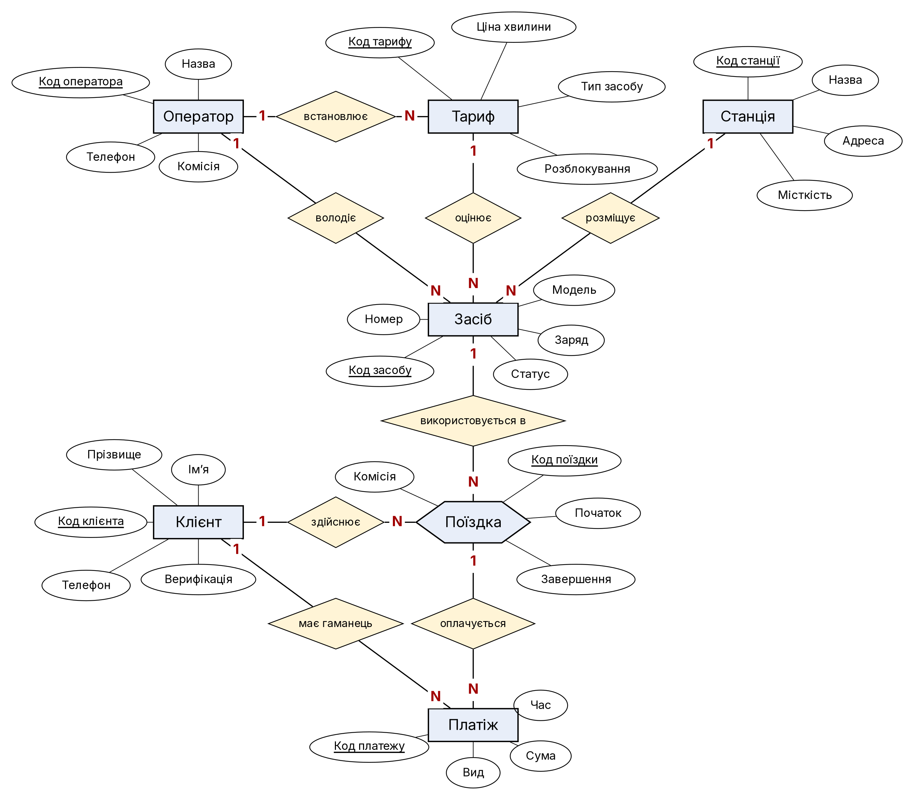{width=88%}

Рисунок 3.2 показує даталогічну модель. Блок у нижньому правому куті розшифровує коди стовпців: підписи списків зберігає застосунок, а база перевіряє діапазон кодів обмеженням CHECK. Стовпець із зірочкою допускає NULL.

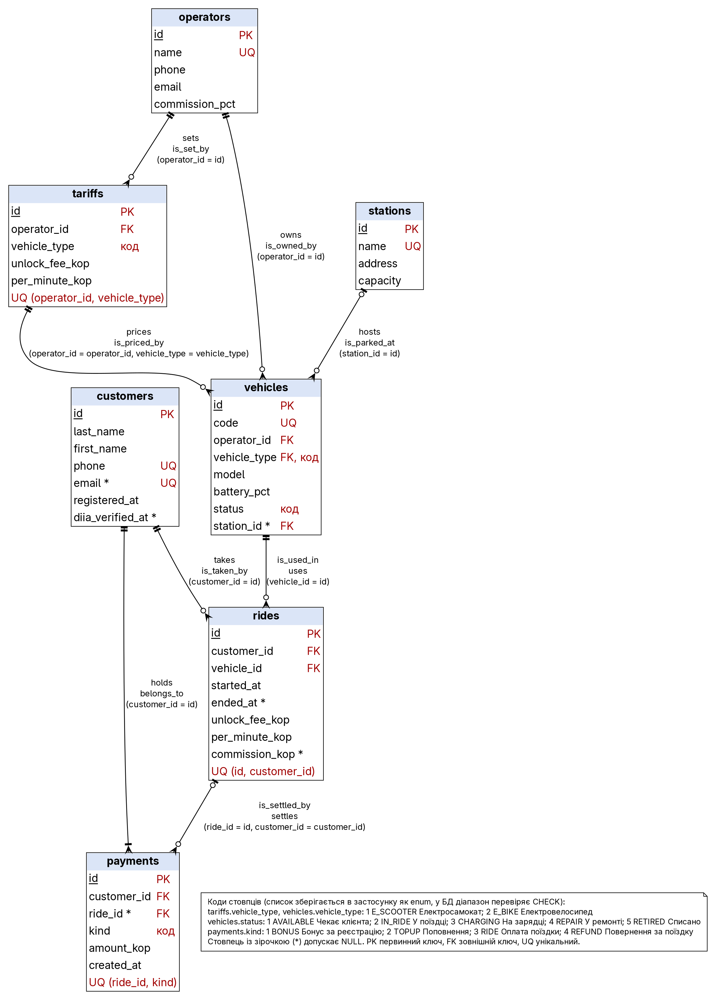{width=80%}

Таблиця 3.1 перелічує вісім зовнішніх ключів. Усі вони RESTRICT: каскадних видалень немає, видалення кількох рядків (клієнта з його бонусом) застосунок виконує явно, після перевірки правила BR16.

::: tcap
Таблиця 3.1

Зв'язки між таблицями
:::

| Батьківська | Дочірня (зовнішній ключ) | Кратність | Обов'язковий | Імена (від батька, від дитини) |
|----------------|------------------------|--------------|-----------------|-----------------------------|
| operators | tariffs.operator_id | 1 : 0..N | так | sets, is_set_by |
| operators | vehicles.operator_id | 1 : 0..N | так | owns, is_owned_by |
| tariffs | vehicles (operator_id, vehicle_type) | 1 : 0..N | так | prices, is_priced_by |
| stations | vehicles.station_id | 1 : 0..N | ні (лише для статусу 1) | hosts, is_parked_at |
| customers | rides.customer_id | 1 : 0..N | так | takes, is_taken_by |
| vehicles | rides.vehicle_id | 1 : 0..N | так | is_used_in, uses |
| customers | payments.customer_id | 1 : 1..N (бонус) | так | holds, belongs_to |
| rides | payments (ride_id, customer_id) | 1 : 0..2 | ні (порожній для бонусу й поповнення) | is_settled_by, settles |

Нормальна форма. Модель у третій нормальній формі (і в нормальній формі Бойса-Кодда), крім шести документованих копій. Кожен неключовий стовпець залежить від ключа цілком і ні від чого іншого, окрім копій з таблиці 3.2, які залишено свідомо, щоб баланс і квитанція читалися без складних з'єднань, і які записує одна транзакція разом із джерелом.

::: tcap
Таблиця 3.2

Прийняті копії похідних даних
:::

| № | Копія | Джерело | Чому зберігається | Охорона |
|------|--------------------|------------------|----------------------------|----------------------------|
| a | `rides.unlock_fee_kop`, `rides.per_minute_kop` | тариф у момент старту | Тариф зміниться, а поїздка має зберегти свою ціну | записується один раз (`updatable = false`); BR9 |
| b | `rides.commission_kop` | ціна поїздки і відсоток оператора в момент завершення | Зміна відсотка не змінює минулі звіти | `chk_rides_commission` (не більше ціни); BR17 |
| c | `vehicles.status = 2` | наявність поїздки з порожнім `ended_at` | Статуси 3-5 не вивести, один стовпець описує весь стан | BR21; запит узгодженості дає 0 рядків |
| d | `payments.customer_id` для видів 3 і 4 | клієнт поїздки | Журнал самодостатній: баланс — це одна сума за одним індексом | БД: складений ключ `fk_payments_ride_customer` |
| e | `amount_kop` платежу виду 3 | мінус ціна поїздки | Квитанція є фіксованим фінансовим документом | клас `Billing`; перевірка початкових даних |
| f | `created_at` платежу виду 3 | `rides.ended_at` | Журнал упорядковується за часом без з'єднання | записується в транзакції завершення |

Копія (d) — це транзитивна залежність усередині `payments` (`id`, потім `ride_id`, потім `customer_id` для видів 3 і 4). Вона безпечна, бо складений зовнішній ключ не дає записати платіж, клієнт якого відрізняється від клієнта поїздки.

# 4. Логічне та фізичне проектування бази даних

## 4.1. Логічне проектування

Перехід від інфологічної моделі до таблиць виконано за п'ятьма кроками:

- кожну сутність перетворено на таблицю;
- кожен атрибут став стовпцем;
- ідентифікатор сутності став первинним ключем `id`;
- зв'язок «один до багатьох» став зовнішнім ключем у таблиці на боці «багато» (`vehicles.operator_id` вказує на `operators.id`), а зв'язок «багато до багатьох» між клієнтами й транспортом розв'язано таблицею `rides`;
- кожному стовпцю дібрано тип MySQL, обов'язковість і обмеження, кожному обмеженню дано ім'я.

Прийняті угоди. Таблиці мають імена в множині. Ключі — це `INT AUTO_INCREMENT`. Гроші — це цілі копійки (`*_kop`). Час — це `DATETIME` у UTC без дробової частини. Списки з фіксованим складом — це числові коди `TINYINT UNSIGNED` з іменованим CHECK на діапазон, а підписи й смисл кодів тримає застосунок (таблиця 4.8). Типу MySQL `ENUM` не використано: нове значення списку — це зміна коду застосунку і міграція CHECK. Колація `utf8mb4_0900_ai_ci` робить унікальні імена нечутливими до регістру. Формат, чутливий до регістру (код транспорту), перевіряє `REGEXP_LIKE(..., 'c')`. Умови CHECK із можливим NULL записано з явним `IS NOT NULL`, бо CHECK, що дає NULL, вважається виконаним.

Таблиці 4.1-4.7 побудовано за формою з методичних вказівок [1]. У них стовпець «Довжина» показує довжину рядка, кількість цифр цілого (`INT` — це 10, `TINYINT UNSIGNED` — це 3), точність десяткового (4,2) або довжину часу (19). Кожне обмеження названо за схемою `pk_`, `uq_`, `ux_` (функціональний унікальний індекс), `fk_`, `chk_`, `ix_` і пояснено один раз, там, де воно вперше трапляється.

::: tcap
Таблиця 4.1

OPERATORS (оператори)
:::

| Ім'я стовпця | Тип | Довжина | Призначення | Обмеження цілісності стовпців |
|---------------|-------------------|-------------|-----------------|------------------------------------|
| id | ціле, автоінкремент | 10 | Унікальний номер оператора | Первинний ключ `pk_operators` |
| name | рядок VARCHAR | 40 | Назва бренду, яку бачить клієнт | Обов'язковий; `uq_operators_name` (унікальна без урахування регістру, BR1); `chk_operators_name` (не менше 2 символів після обрізання пробілів) |
| phone | рядок VARCHAR | 13 | Телефон підтримки | Обов'язковий; `chk_operators_phone` (форма +380 і 9 цифр, BR2) |
| email | рядок VARCHAR | 100 | Пошта підтримки | Обов'язковий; `chk_operators_email` (форма `x@y.z`, шаблон `_%@_%._%`) |
| commission_pct | десяткове DECIMAL | 4,2 | Поточна комісія системи, % від вартості поїздки; діє на поїздки, завершені після зміни | Обов'язковий, за замовчуванням 10.00; `chk_operators_commission` (від 0 до 50, BR3) |

Обмежень рівня таблиці немає, окрім названих у стовпцях. Тип DECIMAL(4,2) точний: 4 цифри загалом, 2 після коми, тож 12.35 зберігається саме як 12.35, а не як двійковий дріб. Значення з трьома знаками (12.345) база округлює до 12.35, а значення поза діапазоном (100) відхиляє помилкою 1264 ще до перевірки CHECK; обидва випадки перевірено тестами.

::: tcap
Таблиця 4.2

TARIFFS (тарифи)
:::

| Ім'я стовпця | Тип | Довжина | Призначення | Обмеження цілісності стовпців |
|---------------|-------------------|-------------|-----------------|------------------------------------|
| id | ціле, автоінкремент | 10 | Унікальний номер тарифу | Первинний ключ `pk_tariffs` |
| operator_id | ціле | 10 | Оператор, якому належить тариф | Обов'язковий; зовнішній ключ `fk_tariffs_operator` на `operators.id`, RESTRICT: оператора з тарифами не можна видалити (BR16) |
| vehicle_type | мале ціле TINYINT UNSIGNED | 3 | Тип транспорту: 1 електросамокат, 2 електровелосипед | Обов'язковий; `chk_tariffs_vehicle_type` (від 1 до 2, BR4) |
| unlock_fee_kop | ціле | 10 | Ціна розблокування, копійки | Обов'язковий; `chk_tariffs_unlock_fee` (від 0 до 10 000, тобто до 100 грн, BR5) |
| per_minute_kop | ціле | 10 | Ціна однієї розпочатої хвилини, копійки | Обов'язковий; `chk_tariffs_per_minute` (від 1 до 5 000, тобто від 0,01 до 50 грн, BR5) |

Обмеження рівня таблиці: `uq_tariffs_operator_type` UNIQUE (`operator_id`, `vehicle_type`): один тариф на пару оператор і тип (BR5). Цей ключ одночасно є індексом для `fk_tariffs_operator` і цільовим ключем складеного зовнішнього ключа `fk_vehicles_tariff`.

::: tcap
Таблиця 4.3

STATIONS (станції)
:::

| Ім'я стовпця | Тип | Довжина | Призначення | Обмеження цілісності стовпців |
|---------------|-------------------|-------------|-----------------|------------------------------------|
| id | ціле, автоінкремент | 10 | Унікальний номер станції | Первинний ключ `pk_stations` |
| name | рядок VARCHAR | 60 | Назва станції (власна назва) | Обов'язковий; `uq_stations_name` (унікальна, нечутлива до регістру); `chk_stations_name` (не менше 2 символів) |
| address | рядок VARCHAR | 100 | Адреса станції | Обов'язковий |
| capacity | мале ціле TINYINT UNSIGNED | 3 | Скільки одиниць транспорту вміщує станція | Обов'язковий; `chk_stations_capacity` (від 1 до 50, BR22) |

Станція не має стовпця оператора: вона спільна для всіх операторів, і транспорт будь-якого з них може стояти на будь-якій станції.

::: tcap
Таблиця 4.4

VEHICLES (транспорт)
:::

| Ім'я стовпця | Тип | Довжина | Призначення | Обмеження цілісності стовпців |
|---------------|-------------------|-------------|-----------------|------------------------------------|
| id | ціле, автоінкремент | 10 | Унікальний номер транспорту | Первинний ключ `pk_vehicles` |
| code | рядок VARCHAR | 8 | Номер на корпусі, наприклад BLT-0001 | Обов'язковий; `uq_vehicles_code`; `chk_vehicles_code` (три великі латинські літери, дефіс, чотири цифри, перевірка чутлива до регістру, BR6) |
| operator_id | ціле | 10 | Оператор-власник | Обов'язковий; `fk_vehicles_operator` на `operators.id`, RESTRICT; входить до `fk_vehicles_tariff` |
| vehicle_type | мале ціле TINYINT UNSIGNED | 3 | Тип: 1 електросамокат, 2 електровелосипед | Обов'язковий; `chk_vehicles_vehicle_type` (від 1 до 2); входить до `fk_vehicles_tariff` |
| model | рядок VARCHAR | 40 | Модель виробника | Обов'язковий |
| battery_pct | мале ціле TINYINT UNSIGNED | 3 | Рівень заряду, % | Обов'язковий; `chk_vehicles_battery` (не більше 100; нижня межа 0 дає тип UNSIGNED) |
| status | мале ціле TINYINT UNSIGNED | 3 | Стан: 1 чекає клієнта, 2 у поїздці, 3 на зарядці, 4 у ремонті, 5 списано | Обов'язковий, за замовчуванням 1; `chk_vehicles_status` (від 1 до 5, BR6) |
| station_id | ціле | 10 | Станція, де транспорт чекає клієнта | Необов'язковий (NULL); `fk_vehicles_station` на `stations.id`, RESTRICT; `chk_vehicles_station` |

Обмеження рівня таблиці:

- `fk_vehicles_tariff` FOREIGN KEY (`operator_id`, `vehicle_type`) REFERENCES `tariffs` (`operator_id`, `vehicle_type`): транспорт існує лише для оператора й типу, для яких є тариф (BR7), а тариф, який використовує транспорт, не можна видалити чи змінити в ключі (BR5). Окремий `fk_vehicles_operator` залишено, бо власність — це окремий зв'язок і окреме повідомлення про помилку при видаленні оператора.
- `chk_vehicles_station`: `(status = 1 AND station_id IS NOT NULL) OR (status <> 1 AND station_id IS NULL)`. Транспорт стоїть на станції рівно тоді, коли чекає клієнта (BR22). Це умова одного рядка, тому її охороняє CHECK. Місткість станції — це підрахунок за кількома рядками, тому її перевіряє застосунок.
- Між зарядом і статусом CHECK немає навмисно: заряд змінюється поза системою, транспорт може лишатися доступним із низьким зарядом, а розблокування від нього відмовляє правило BR7 (такі машини показує R7).
- Індекси `ix_vehicles_operator_type` (`operator_id`, `vehicle_type`) для обох зовнішніх ключів і пошуку тарифу та `ix_vehicles_station` (`station_id`) для `fk_vehicles_station` і фільтра станції в R1.

::: tcap
Таблиця 4.5

CUSTOMERS (клієнти)
:::

| Ім'я стовпця | Тип | Довжина | Призначення | Обмеження цілісності стовпців |
|---------------|-------------------|-------------|-----------------|------------------------------------|
| id | ціле, автоінкремент | 10 | Унікальний номер клієнта | Первинний ключ `pk_customers` |
| last_name | рядок VARCHAR | 40 | Прізвище | Обов'язковий; `chk_customers_names` (і прізвище, і ім'я не коротші за 2 символи) |
| first_name | рядок VARCHAR | 40 | Ім'я | Обов'язковий; `chk_customers_names` |
| phone | рядок VARCHAR | 13 | Телефон, ідентифікатор клієнта | Обов'язковий; `uq_customers_phone`; `chk_customers_phone` (форма +380 і 9 цифр, BR2) |
| email | рядок VARCHAR | 100 | Пошта для квитанцій | Необов'язковий (NULL); `uq_customers_email` (кілька NULL не конфліктують); `chk_customers_email` (NULL або форма `x@y.z`) |
| registered_at | дата й час DATETIME | 19 | Час реєстрації (UTC) | Обов'язковий, за замовчуванням поточний час |
| diia_verified_at | дата й час DATETIME | 19 | Коли особу підтверджено через Дію (імітація); NULL означає, що клієнт не підтверджений і їздити не може | Необов'язковий; `chk_customers_verified` (NULL або не раніше `registered_at`, BR19) |

Обмеження рівня таблиці: індекс `ix_customers_last_name` (`last_name`) для пошуку за початком прізвища. Баланс гаманця стовпцем не є: він дорівнює сумі платежів клієнта.

::: tcap
Таблиця 4.6

RIDES (поїздки)
:::

| Ім'я стовпця | Тип | Довжина | Призначення | Обмеження цілісності стовпців |
|---------------|-------------------|-------------|-----------------|------------------------------------|
| id | ціле, автоінкремент | 10 | Номер поїздки (номер квитанції) | Первинний ключ `pk_rides` |
| customer_id | ціле | 10 | Хто їде | Обов'язковий; `fk_rides_customer` на `customers.id`, RESTRICT: клієнта з поїздками не можна видалити (BR16) |
| vehicle_id | ціле | 10 | На чому їде | Обов'язковий; `fk_rides_vehicle` на `vehicles.id`, RESTRICT: транспорт з поїздками не видаляють, а списують |
| started_at | дата й час DATETIME | 19 | Час розблокування (UTC, цілі секунди) | Обов'язковий |
| ended_at | дата й час DATETIME | 19 | Час завершення; NULL, поки поїздка активна | Необов'язковий; `chk_rides_period` (NULL або не раніше `started_at`; рівність дозволено, бо завершення в ту саму секунду тарифікується як одна хвилина) |
| unlock_fee_kop | ціле | 10 | Ціна розблокування, скопійована з тарифу (копія a) | Обов'язковий; `chk_rides_unlock_fee` (від 0 до 10 000) |
| per_minute_kop | ціле | 10 | Ціна хвилини, скопійована з тарифу (копія a) | Обов'язковий; `chk_rides_per_minute` (від 1 до 5 000) |
| commission_kop | ціле | 10 | Комісія системи, зафіксована при завершенні (копія b) | Необов'язковий; `chk_rides_commission` |

Обмеження рівня таблиці:

- `chk_rides_commission`: поки поїздка активна, комісії немає; після завершення вона є і лежить між 0 та ціною поїздки `unlock_fee_kop + per_minute_kop * GREATEST(1, CEIL(TIMESTAMPDIFF(SECOND, started_at, ended_at) / 60))`. CHECK сам обчислює ціну зі стовпців свого рядка, тож комісія не може перевищити вартість (BR10, BR17).
- `uq_rides_id_customer` UNIQUE (`id`, `customer_id`): ключ, на який посилається складений зовнішній ключ платежу. `id` унікальний і сам, але MySQL вимагає ключ саме з такими початковими стовпцями.
- Функціональні унікальні індекси [3] `ux_rides_active_customer` на `(CASE WHEN ended_at IS NULL THEN customer_id END)` і `ux_rides_active_vehicle` на `(CASE WHEN ended_at IS NULL THEN vehicle_id END)`: не більше однієї активної поїздки на клієнта й на транспорт (BR7, BR8). Завершені поїздки дають NULL, а значення NULL у унікальному індексі між собою не конфліктують. Звичайний UNIQUE тут не підходить, бо в одного клієнта має бути багато завершених поїздок. Застосунок перевіряє правило першим заради повідомлення, індекс захищає від двох одночасних натискань.
- Індекси: `ix_rides_customer` (`customer_id`, `started_at`) і `ix_rides_vehicle` (`vehicle_id`, `started_at`) для зовнішніх ключів та історії; `ix_rides_started_at` для R2 і R5; `ix_rides_ended_at` для R3 і R4.

::: tcap
Таблиця 4.7

PAYMENTS (платежі)
:::

| Ім'я стовпця | Тип | Довжина | Призначення | Обмеження цілісності стовпців |
|---------------|-------------------|-------------|-----------------|------------------------------------|
| id | ціле, автоінкремент | 10 | Унікальний номер платежу | Первинний ключ `pk_payments` |
| customer_id | ціле | 10 | Чий гаманець; для видів 3 і 4 клієнт поїздки (копія d) | Обов'язковий; `fk_payments_customer` на `customers.id`, RESTRICT; входить до `fk_payments_ride_customer` |
| ride_id | ціле | 10 | Поїздка, яку списано чи повернено (види 3 і 4) | Необов'язковий (NULL для бонусу й поповнення); входить до `fk_payments_ride_customer` |
| kind | мале ціле TINYINT UNSIGNED | 3 | Вид: 1 бонус, 2 поповнення, 3 оплата поїздки, 4 повернення | Обов'язковий; `chk_payments_kind` (від 1 до 4) |
| amount_kop | ціле | 10 | Сума зі знаком: плюс гроші в гаманець, мінус списання (для виду 3 мінус ціна, копія e) | Обов'язковий; `chk_payments_amount` (не більше 1 000 000, тобто 10 000 грн) |
| created_at | дата й час DATETIME | 19 | Час операції (UTC); для виду 3 — це `rides.ended_at` (копія f) | Обов'язковий, за замовчуванням поточний час |

Обмеження рівня таблиці:

- `fk_payments_ride_customer` FOREIGN KEY (`ride_id`, `customer_id`) REFERENCES `rides` (`id`, `customer_id`): каже і що поїздка існує, і що вона належить цьому клієнтові, тому повернення на чужий гаманець база відхиляє (BR20), а поїздку з платежем не можна видалити (BR15). Рядки з порожнім `ride_id` (бонус, поповнення) не перевіряються: так працює стандартне порівняння MATCH SIMPLE.
- `uq_payments_ride_kind` UNIQUE (`ride_id`, `kind`): одне списання й не більше одного повернення на поїздку (BR20); порожні `ride_id` бонусів і поповнень не конфліктують.
- `chk_payments_shape`: вид 3 вимагає поїздки і від'ємної суми, вид 4 вимагає поїздки і додатної суми, види 1 і 2 не мають поїздки і мають додатну суму. Це гарантує, що списання від'ємне, а гроші на гаманець додатні, і що вид відповідає наявності поїздки (BR10, BR13).
- `chk_payments_amount` обмежує тільки гроші на гаманець: списання обмежує формула вартості, тож поїздка будь-якої тривалості може завершитися (триденну поїздку перевірено, її списання 22 474 грн).
- Індекси: `ix_payments_customer` (`customer_id`, `created_at`) для `fk_payments_customer`, баланс і історію гаманця; `ix_payments_ride_customer` (`ride_id`, `customer_id`) для складеного зовнішнього ключа.

Таблиця 4.8 зводить усі списки кодів. У базі зберігається лише число, а смисл і український підпис тримає перелік Java (BR4, BR6).

::: tcap
Таблиця 4.8

Коди стовпців-переліків
:::

| Стовпець | Код | Константа Java | Підпис в інтерфейсі | Примітка |
|--------------------------|-----|-------------|----------------------|----------------------------------|
| `tariffs.vehicle_type`, `vehicles.vehicle_type` | 1 | E_SCOOTER | Електросамокат | CHECK від 1 до 2 |
| те саме | 2 | E_BIKE | Електровелосипед | |
| `vehicles.status` | 1 | AVAILABLE | Чекає клієнта | станція обов'язкова |
| те саме | 2 | IN_RIDE | У поїздці | ставить лише початок поїздки (BR21); станції немає |
| те саме | 3 | CHARGING | На зарядці | станції немає |
| те саме | 4 | REPAIR | У ремонті | станції немає |
| те саме | 5 | RETIRED | Списано | замінює видалення, коли є поїздки; станції немає |
| `payments.kind` | 1 | BONUS | Бонус за реєстрацію | без поїздки, сума більше 0 |
| те саме | 2 | TOPUP | Поповнення | без поїздки, сума більше 0 |
| те саме | 3 | RIDE | Оплата поїздки | поїздка обов'язкова, сума менше 0 |
| те саме | 4 | REFUND | Повернення за поїздку | поїздка обов'язкова, сума більше 0 |

Підсумок логічного проєктування: 7 таблиць, 43 стовпці, 25 іменованих CHECK, 8 зовнішніх ключів (2 складені), 10 унікальних обмежень разом з двома функціональними індексами.

## 4.2. Фізичне проектування

Фізичну модель реалізовано в MySQL 8.4 з рушієм InnoDB: він підтримує транзакції, зовнішні ключі й (з версії 8.0.16) обмеження CHECK, які справді виконуються [3]. Кодування `utf8mb4`, колація `utf8mb4_0900_ai_ci`, часовий пояс сервера UTC (`--default-time-zone=+00:00`), тож `DEFAULT CURRENT_TIMESTAMP` дає UTC.

Усі зовнішні ключі мають `ON DELETE RESTRICT ON UPDATE RESTRICT`. Схему створює міграція Flyway [6] `V1__schema.sql`, початкові дані кладе `V2__seed.sql`. Застосовану міграцію не редагують: зміна — це нова версія `V3`. Hibernate працює з `ddl-auto=validate` і лише перевіряє, що відображення збігається з таблицями.

Рисунок 4.1 (після таблиці 4.9 і результатів перевірки) показує фізичну модель з типами, обов'язковістю, ключами, індексами та діями зовнішніх ключів.

Індекси: 26 у цілому (7 первинних ключів, 10 унікальних, з яких 2 функціональні, і 9 звичайних). Унікальні описано разом із таблицями. Таблиця 4.9 пояснює звичайні індекси.

::: tcap
Таблиця 4.9

Звичайні індекси
:::

| Індекс | Стовпці | Для чого |
|------------------------|------------------------------|----------------------------------------------|
| `ix_vehicles_operator_type` | `vehicles (operator_id, vehicle_type)` | зовнішні ключі оператора й тарифу, пошук тарифу, фільтри R1 |
| `ix_vehicles_station` | `vehicles (station_id)` | `fk_vehicles_station`, фільтр станції в R1, підрахунок транспорту на станції |
| `ix_customers_last_name` | `customers (last_name)` | пошук за початком прізвища |
| `ix_rides_customer` | `rides (customer_id, started_at)` | `fk_rides_customer`, історія клієнта |
| `ix_rides_vehicle` | `rides (vehicle_id, started_at)` | `fk_rides_vehicle`, історія транспорту |
| `ix_rides_started_at` | `rides (started_at)` | період у R2 і R5 |
| `ix_rides_ended_at` | `rides (ended_at)` | період у R3 і R4 |
| `ix_payments_customer` | `payments (customer_id, created_at)` | `fk_payments_customer`, баланс, історія гаманця |
| `ix_payments_ride_customer` | `payments (ride_id, customer_id)` | складений зовнішній ключ платежу |

Перевірку обмежень виконано автоматично (`check.sh`, частина 1) на окремій тимчасовій базі: 45 негативних інструкцій (порушення кожного CHECK, кожного UNIQUE разом з обома функціональними індексами, зовнішніх ключів і видалень за RESTRICT) завершилися помилкою саме з очікуваним іменем обмеження. Справжній вивід (скорочено):

```
ok   negative statements failed (= 45)
ok   negative statements that failed on another constraint (= 0)
…
ok   DECIMAL(4,2) stores 12.345 as (= 12.35)
ok   charge of a 3-day ride, kopecks (= -2247400)
-- part 1: 11 ok, 0 failed
```

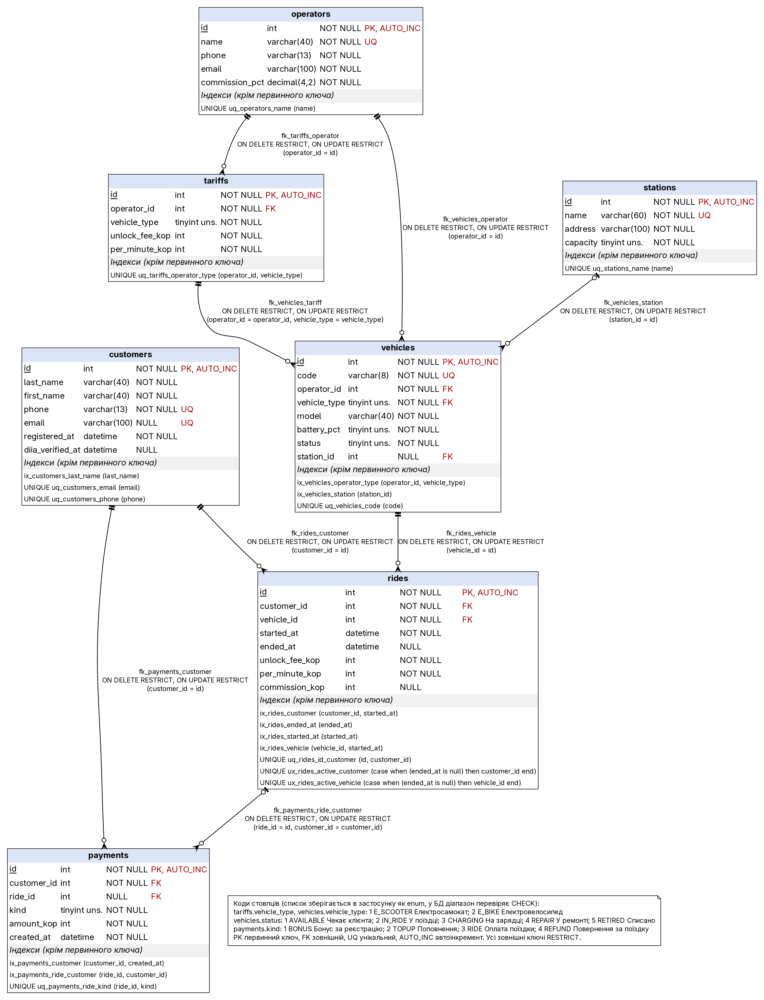{width=100%}

### 4.2.1. Код фізичного проектування бази даних

Нижче повний код міграції `V1__schema.sql` (файл `app/src/main/resources/db/migration/` репозиторію). Коментарі в коді англійською, як і всі ідентифікатори.

```{.sql .small}
-- Micromobility rental (e-scooters, e-bikes): physical model for MySQL 8.4 (InnoDB, utf8mb4).
-- Flyway migration V1. The database itself is created by Docker (MYSQL_DATABASE=micromobility).
-- Money is integer kopecks. Times are DATETIME in UTC. Every constraint and index has a name.
-- Every primary key is `id`; a foreign key column is `<entity>_id`. Every foreign key is RESTRICT.
-- Fixed lists are TINYINT UNSIGNED codes with a range CHECK; the app maps them to Java enums:
--   vehicle_type: 1 E_SCOOTER, 2 E_BIKE
--   vehicles.status: 1 AVAILABLE, 2 IN_RIDE, 3 CHARGING, 4 REPAIR, 5 RETIRED
--   payments.kind: 1 BONUS, 2 TOPUP, 3 RIDE, 4 REFUND

-- 1. Operators: companies whose vehicles are rented through the system
CREATE TABLE operators (
    id              INT          NOT NULL AUTO_INCREMENT,
    name            VARCHAR(40)  NOT NULL,
    phone           VARCHAR(13)  NOT NULL,
    email           VARCHAR(100) NOT NULL,
    commission_pct  DECIMAL(4,2) NOT NULL DEFAULT 10.00,
    CONSTRAINT pk_operators PRIMARY KEY (id),
    CONSTRAINT uq_operators_name UNIQUE (name),
    CONSTRAINT chk_operators_name CHECK (CHAR_LENGTH(TRIM(name)) >= 2),
    CONSTRAINT chk_operators_phone CHECK (phone REGEXP '^\\+380[0-9]{9}$'),
    CONSTRAINT chk_operators_email CHECK (email LIKE '_%@_%._%'),
    CONSTRAINT chk_operators_commission CHECK (commission_pct BETWEEN 0 AND 50)
) ENGINE = InnoDB;

-- 2. Tariffs: the price of one vehicle type at one operator
CREATE TABLE tariffs (
    id              INT              NOT NULL AUTO_INCREMENT,
    operator_id     INT              NOT NULL,
    vehicle_type    TINYINT UNSIGNED NOT NULL,
    unlock_fee_kop  INT              NOT NULL,
    per_minute_kop  INT              NOT NULL,
    CONSTRAINT pk_tariffs PRIMARY KEY (id),
    CONSTRAINT uq_tariffs_operator_type UNIQUE (operator_id, vehicle_type),
    CONSTRAINT fk_tariffs_operator FOREIGN KEY (operator_id)
        REFERENCES operators (id) ON DELETE RESTRICT ON UPDATE RESTRICT,
    CONSTRAINT chk_tariffs_vehicle_type CHECK (vehicle_type BETWEEN 1 AND 2),
    CONSTRAINT chk_tariffs_unlock_fee CHECK (unlock_fee_kop BETWEEN 0 AND 10000),
    CONSTRAINT chk_tariffs_per_minute CHECK (per_minute_kop BETWEEN 1 AND 5000)
) ENGINE = InnoDB;

-- 3. Stations: city parking places shared by all operators; an available vehicle waits at one of them
CREATE TABLE stations (
    id              INT              NOT NULL AUTO_INCREMENT,
    name            VARCHAR(60)      NOT NULL,
    address         VARCHAR(100)     NOT NULL,
    capacity        TINYINT UNSIGNED NOT NULL,
    CONSTRAINT pk_stations PRIMARY KEY (id),
    CONSTRAINT uq_stations_name UNIQUE (name),
    CONSTRAINT chk_stations_name CHECK (CHAR_LENGTH(TRIM(name)) >= 2),
    CONSTRAINT chk_stations_capacity CHECK (capacity BETWEEN 1 AND 50)
) ENGINE = InnoDB;

-- 4. Vehicles: one physical scooter or bike of an operator
CREATE TABLE vehicles (
    id              INT              NOT NULL AUTO_INCREMENT,
    code            VARCHAR(8)       NOT NULL,
    operator_id     INT              NOT NULL,
    vehicle_type    TINYINT UNSIGNED NOT NULL,
    model           VARCHAR(40)      NOT NULL,
    battery_pct     TINYINT UNSIGNED NOT NULL,
    status          TINYINT UNSIGNED NOT NULL DEFAULT 1,
    station_id      INT              NULL,
    CONSTRAINT pk_vehicles PRIMARY KEY (id),
    CONSTRAINT uq_vehicles_code UNIQUE (code),
    CONSTRAINT fk_vehicles_operator FOREIGN KEY (operator_id)
        REFERENCES operators (id) ON DELETE RESTRICT ON UPDATE RESTRICT,
    -- the operator has a tariff for this vehicle type (BR7)
    CONSTRAINT fk_vehicles_tariff FOREIGN KEY (operator_id, vehicle_type)
        REFERENCES tariffs (operator_id, vehicle_type) ON DELETE RESTRICT ON UPDATE RESTRICT,
    CONSTRAINT fk_vehicles_station FOREIGN KEY (station_id)
        REFERENCES stations (id) ON DELETE RESTRICT ON UPDATE RESTRICT,
    CONSTRAINT chk_vehicles_code CHECK (REGEXP_LIKE(code, '^[A-Z]{3}-[0-9]{4}$', 'c')),
    CONSTRAINT chk_vehicles_vehicle_type CHECK (vehicle_type BETWEEN 1 AND 2),
    CONSTRAINT chk_vehicles_battery CHECK (battery_pct <= 100),
    CONSTRAINT chk_vehicles_status CHECK (status BETWEEN 1 AND 5),
    -- a vehicle stands at a station exactly while it waits for a customer (status 1 AVAILABLE)
    CONSTRAINT chk_vehicles_station CHECK ((status = 1 AND station_id IS NOT NULL) OR (status <> 1 AND station_id IS NULL))
) ENGINE = InnoDB;
CREATE INDEX ix_vehicles_operator_type ON vehicles (operator_id, vehicle_type);
CREATE INDEX ix_vehicles_station ON vehicles (station_id);

-- 5. Customers: people who rent vehicles; one wallet each; identity verified through Diia (simulated)
CREATE TABLE customers (
    id              INT          NOT NULL AUTO_INCREMENT,
    last_name       VARCHAR(40)  NOT NULL,
    first_name      VARCHAR(40)  NOT NULL,
    phone           VARCHAR(13)  NOT NULL,
    email           VARCHAR(100) NULL,
    registered_at   DATETIME     NOT NULL DEFAULT CURRENT_TIMESTAMP,
    diia_verified_at DATETIME    NULL,
    CONSTRAINT pk_customers PRIMARY KEY (id),
    CONSTRAINT uq_customers_phone UNIQUE (phone),
    CONSTRAINT uq_customers_email UNIQUE (email),
    CONSTRAINT chk_customers_names CHECK (CHAR_LENGTH(TRIM(last_name)) >= 2 AND CHAR_LENGTH(TRIM(first_name)) >= 2),
    CONSTRAINT chk_customers_phone CHECK (phone REGEXP '^\\+380[0-9]{9}$'),
    CONSTRAINT chk_customers_email CHECK (email IS NULL OR email LIKE '_%@_%._%'),
    CONSTRAINT chk_customers_verified CHECK (diia_verified_at IS NULL OR diia_verified_at >= registered_at)
) ENGINE = InnoDB;
CREATE INDEX ix_customers_last_name ON customers (last_name);

-- 6. Rides: one rental of one vehicle by one customer; ended_at IS NULL means the ride is active.
--    Prices are copied from the tariff at the start; the commission is fixed at the finish.
CREATE TABLE rides (
    id              INT          NOT NULL AUTO_INCREMENT,
    customer_id     INT          NOT NULL,
    vehicle_id      INT          NOT NULL,
    started_at      DATETIME     NOT NULL,
    ended_at        DATETIME     NULL,
    unlock_fee_kop  INT          NOT NULL,
    per_minute_kop  INT          NOT NULL,
    commission_kop  INT          NULL,
    CONSTRAINT pk_rides PRIMARY KEY (id),
    -- target of fk_payments_ride_customer: a payment names the ride together with the ride's customer
    CONSTRAINT uq_rides_id_customer UNIQUE (id, customer_id),
    CONSTRAINT fk_rides_customer FOREIGN KEY (customer_id)
        REFERENCES customers (id) ON DELETE RESTRICT ON UPDATE RESTRICT,
    CONSTRAINT fk_rides_vehicle FOREIGN KEY (vehicle_id)
        REFERENCES vehicles (id) ON DELETE RESTRICT ON UPDATE RESTRICT,
    -- equal times are allowed: a finish in the same second is billed as one minute
    CONSTRAINT chk_rides_period CHECK (ended_at IS NULL OR ended_at >= started_at),
    CONSTRAINT chk_rides_unlock_fee CHECK (unlock_fee_kop BETWEEN 0 AND 10000),
    CONSTRAINT chk_rides_per_minute CHECK (per_minute_kop BETWEEN 1 AND 5000),
    -- the commission is fixed at the finish: none while active; 0 .. ride price when finished
    CONSTRAINT chk_rides_commission CHECK (
        (ended_at IS NULL AND commission_kop IS NULL)
        OR (ended_at IS NOT NULL AND commission_kop IS NOT NULL AND commission_kop BETWEEN 0 AND
            unlock_fee_kop + per_minute_kop * GREATEST(1, CEIL(TIMESTAMPDIFF(SECOND, started_at, ended_at) / 60))))
) ENGINE = InnoDB;
CREATE INDEX ix_rides_customer ON rides (customer_id, started_at);
CREATE INDEX ix_rides_vehicle ON rides (vehicle_id, started_at);
CREATE INDEX ix_rides_started_at ON rides (started_at);
CREATE INDEX ix_rides_ended_at ON rides (ended_at);
-- At most one active ride per customer and per vehicle (functional unique index; NULLs do not collide)
CREATE UNIQUE INDEX ux_rides_active_customer ON rides ((CASE WHEN ended_at IS NULL THEN customer_id END));
CREATE UNIQUE INDEX ux_rides_active_vehicle ON rides ((CASE WHEN ended_at IS NULL THEN vehicle_id END));

-- 7. Payments: the wallet ledger (1 bonus, 2 top-up, 3 ride charge, 4 ride refund); balance = SUM(amount_kop).
--    Rows are never edited: a correction is a new refund row.
CREATE TABLE payments (
    id              INT              NOT NULL AUTO_INCREMENT,
    customer_id     INT              NOT NULL,
    ride_id         INT              NULL,
    kind            TINYINT UNSIGNED NOT NULL,
    amount_kop      INT              NOT NULL,
    created_at      DATETIME         NOT NULL DEFAULT CURRENT_TIMESTAMP,
    CONSTRAINT pk_payments PRIMARY KEY (id),
    CONSTRAINT uq_payments_ride_kind UNIQUE (ride_id, kind),
    CONSTRAINT fk_payments_customer FOREIGN KEY (customer_id)
        REFERENCES customers (id) ON DELETE RESTRICT ON UPDATE RESTRICT,
    -- a charge or refund belongs to the ride's own customer (NULL ride_id of kinds 1, 2 is not checked)
    CONSTRAINT fk_payments_ride_customer FOREIGN KEY (ride_id, customer_id)
        REFERENCES rides (id, customer_id) ON DELETE RESTRICT ON UPDATE RESTRICT,
    CONSTRAINT chk_payments_kind CHECK (kind BETWEEN 1 AND 4),
    -- 3 RIDE: a charge of one ride, negative; 4 REFUND: money back for one ride, positive;
    -- 1 BONUS and 2 TOPUP: money in, positive, no ride
    CONSTRAINT chk_payments_shape CHECK (
        (kind = 3 AND ride_id IS NOT NULL AND amount_kop < 0)
        OR (kind = 4 AND ride_id IS NOT NULL AND amount_kop > 0)
        OR (kind IN (1, 2) AND ride_id IS NULL AND amount_kop > 0)),
    -- a cap on money in (10 000 UAH); a charge is bounded by the price formula instead
    CONSTRAINT chk_payments_amount CHECK (amount_kop <= 1000000)
) ENGINE = InnoDB;
CREATE INDEX ix_payments_customer ON payments (customer_id, created_at);
CREATE INDEX ix_payments_ride_customer ON payments (ride_id, customer_id);
```


# 5. Проектування інформаційної системи

## 5.1. Вибір технологій для створення інформаційної системи

::: tcap
Таблиця 5.1

Вибір технологій і причини
:::

| Технологія | Для чого | Чому обрана |
|----------------------|----------------------|--------------------------------------------------------|
| MySQL 8.4, InnoDB [3] | СУБД | Безкоштовна, є в матеріалах курсу. Виконує CHECK (з 8.0.16), підтримує транзакції, зовнішні ключі і функціональні індекси, потрібні для правил BR7 і BR8 |
| Flyway [6] | Створення схеми і даних | Схема лежить у файлі `V1__schema.sql` і однаково відтворюється на будь-якій машині. Змінювати схему можна лише новою версією, тож історія не губиться |
| Java 21, Spring Boot 3.5 [7] | Застосунок | Один запуск, готова веб-частина, інтеграція з ORM і Flyway; Java вивчається на курсі |
| Spring Data JPA [4], Hibernate 6.6 [5] | ORM, доступ до БД | Таблиці відображаються на класи, прості запити пишуться іменами методів, складні мовою JPQL. Вимога завдання: застосунок на ORM |
| Thymeleaf [8], Bootstrap (webjar) | Інтерфейс | Сторінки генерує сервер, окремий фронтенд не потрібен; Bootstrap підключено з пакета, без інтернету |
| Docker Compose, Makefile | Запуск | `make up` (обгортка над `docker compose up -d --build`) піднімає MySQL і застосунок і чекає, поки відповість адмінка; на комп'ютер нічого не встановлюється |

Чому ORM [4, 5]. Без ORM кожне читання потребує ручного SQL і ручного перенесення рядків у об'єкти. ORM сам перетворює рядок на об'єкт і назад і підставляє параметри (захист від SQL-ін'єкцій). Платимо за це тим, що треба знати, коли ORM звертається до бази, тому в роботі відображення зроблено явним: кожне поле має ім'я стовпця, обов'язковість і довжину.

Таблиця 5.2 показує відображення таблиць на класи пакета `micromobility.domain`.

::: tcap
Таблиця 5.2

Відображення таблиць на сутності Hibernate
:::

| Таблиця | Клас | Що важливо у відображенні |
|-------------|-------------|--------------------------------------------------------------------------|
| operators | Operator | `commissionPct` типу `BigDecimal` (`precision = 4, scale = 2`), початкове значення 10.00 повторює DEFAULT |
| tariffs | Tariff | `@ManyToOne(fetch = LAZY)` на Operator; тип транспорту через перелік і конвертер |
| stations | Station | `capacity` з `columnDefinition = "tinyint unsigned"` |
| vehicles | Vehicle | `@ManyToOne(LAZY)` на Operator і Station; `VehicleType`, `VehicleStatus` через конвертери; `tinyint unsigned` |
| customers | Customer | `registeredAt` з `updatable = false`; `diiaVerifiedAt` змінює лише сервіс підтвердження |
| rides | Ride | клієнт, транспорт, початок і обидві ціни з `updatable = false`; змінюються лише `endedAt` і `commissionKop` |
| payments | Payment | `@Immutable` [5]: Hibernate ніколи не виконує UPDATE; вид через конвертер |

Складені зовнішні ключі (`fk_vehicles_tariff`, `fk_payments_ride_customer`) і функціональні індекси не відображено на класи: це охоронці на боці бази, а перевірку наперед для зрозумілого повідомлення виконує сервіс.

Приклад сутності (`domain/Vehicle.java`, скорочено):

```java
@Entity
@Table(name = "vehicles")
public class Vehicle {
    @Id @GeneratedValue(strategy = GenerationType.IDENTITY)
    @Column(name = "id")
    private Integer id;

    @ManyToOne(fetch = FetchType.LAZY, optional = false)
    @JoinColumn(name = "operator_id", nullable = false)
    private Operator operator;

    @Column(name = "vehicle_type", nullable = false, columnDefinition = "tinyint unsigned")
    private VehicleType vehicleType;

    @Column(name = "status", nullable = false, columnDefinition = "tinyint unsigned")
    private VehicleStatus status = VehicleStatus.AVAILABLE;

    @ManyToOne(fetch = FetchType.LAZY)
    @JoinColumn(name = "station_id")
    private Station station;
    // ... code, model, batteryPct, getters and setters
}
```

Перелік у базі зберігається кодом, його перетворює `AttributeConverter` [5] (файл `domain/VehicleStatusConverter.java`): `convertToDatabaseColumn` повертає `value.getCode()`, `convertToEntityAttribute` викликає `VehicleStatus.fromCode(code)`. Не використано `@Enumerated(ORDINAL)`, бо порядковий номер залежить від порядку констант у коді, і перестановка змінила б смисл збережених даних. Не використано `@Enumerated(STRING)`, бо в базі лише числа.

Приклад репозиторію (`repository/VehicleRepository.java`): інтерфейс без реалізації, Spring Data будує запит за назвою методу і за анотацією [4].

```java
public interface VehicleRepository extends JpaRepository<Vehicle, Integer> {
    long countByStationId(Integer stationId);

    @EntityGraph(attributePaths = {"operator", "station"})
    List<Vehicle> findByStatusAndBatteryPctLessThanOrderByBatteryPctAscCodeAsc(
            VehicleStatus status, int level);
}
```

Поняття, які треба розуміти при роботі з Hibernate.

- `ddl-auto=validate`: під час старту Hibernate порівнює класи з таблицями (існування таблиць і стовпців, типи) і, якщо не збігається, зупиняє застосунок із `SchemaManagementException`. Таблиці він не створює: їх створює Flyway. Тому `tinyint unsigned` вказано в `columnDefinition`.
- Ліниве завантаження: `@ManyToOne(fetch = LAZY)` не читає оператора, поки до нього не звернулися. Це економить запити, але список транспорту з оператором для кожного рядка дав би 1 запит на список і N запитів на операторів (проблема N+1). Тому списки вантажать батьків одним запитом: `join fetch` у JPQL або `@EntityGraph`, як в R7. Режим `open-in-view=false` вимикає ліниве читання поза транзакцією, тож сторінка не може непомітно запустити зайвий запит.
- `@Transactional`: Spring відкриває транзакцію на вході в метод сервісу і фіксує на виході, а при винятку відкочує все. Завершення поїздки (`RideService.finish`) записує час, комісію, платіж і статус транспорту разом: або все, або нічого (BR10). Поїздку й станцію сервіс на час операції блокує запитом `SELECT ... FOR UPDATE` (`PESSIMISTIC_WRITE`), щоб два одночасні завершення не зайняли останнє місце на станції.

Фрагмент `service/RideService.java`, у якому правило BR21 виконується умовним UPDATE: якщо транспорт уже зайняли, рядків оновлено 0 і транзакція відкочується.

```java
int taken = vehicles.markInRide(vehicleId, VehicleStatus.AVAILABLE,
                                VehicleStatus.IN_RIDE, MIN_BATTERY);
if (taken != 1) {
    throw new BusinessException("Транспорт щойно зайняли або він більше не доступний.");
}
```

Помилки бази потрапляють у `DbErrors`: клас шукає в тексті виключення ім'я обмеження (`uq_operators_name`, `chk_vehicles_station`, ...) і показує на формі українське повідомлення. Саме тому кожне обмеження має ім'я.

## 5.2. Інформаційно-пошукові запити в інформаційній системі

Застосунок має сім звітів. R2 одночасно є списком поїздок, решта відкривається в меню «Звіти». Кожен звіт має форму з фільтрами; порожнє поле означає «без фільтра» (`:p is null or ...`). Пороги R6 і R7 заповнено наперед (100 грн і 20 %). Період користувач вибирає київськими календарними днями (дата «по» включно). База зберігає час у UTC, тому застосунок (клас `Times`) переводить початок першого дня і початок дня після останнього в межі UTC `[від, до)`, а на сторінках показує київський час. Наприклад, київський листопад 01.11-30.11 — це в SQL від `2026-10-31 22:00:00` до `2026-11-30 22:00:00` (взимку Київ UTC+2, влітку UTC+3), а поїздка 5, що почалася о 01:22 за Києвом 09.10 (літній час, UTC+3), у UTC має час 22:22 від 08.10 і все одно потрапляє у фільтр «з 09.10». Коди залишаються числами в запитах, а підписи перелічень (електросамокат, чекає клієнта) підставляє застосунок. Для кожного звіту нижче подано призначення, тип запиту «як у ЛБ2», код і знімок екрана. Повний SQL усіх звітів, з яким `check.sh` звіряє сторінки, лежить у файлі `sql/queries.sql` репозиторію (додаток А).

### R1. Транспорт, який можна розблокувати зараз {.unlisted}

Призначення: клієнт бачить доступний транспорт з ціною перших 10 хвилин, найдешевший першим. Тип запиту: фільтр, три з'єднання (JOIN) і підзапит `NOT EXISTS`. Параметри: оператор, тип, станція, мінімальний заряд (не менше 10). `NOT EXISTS` ще раз звіряє `rides`, джерело істини для правила BR21. Метод: `VehicleRepository.findAvailable`.

Повний шлях від контролера до SQL. Контролер `ReportController.r1` (адреса `/reports/r1`) читає параметри форми, кладе рядки в модель сторінки й передає параметри в сервіс `ReportService.r1`:

```java
@GetMapping("/r1")
public String r1(@RequestParam(required = false) Integer opId, @RequestParam(required = false) VehicleType type,
                 @RequestParam(required = false) Integer stationId,
                 @RequestParam(required = false) Integer minBattery, Model model) {
    model.addAttribute("rows", reports.r1(opId, type, stationId, minBattery));
    ...
    return "reports/r1";
}
```

Сервіс піднімає мінімум заряду до 10 і викликає репозиторій:

```java
public List<AvailableVehicleRow> r1(Integer opId, VehicleType type, Integer stationId, Integer minBattery) {
    int min = Math.max(RideService.MIN_BATTERY, minBattery == null ? 0 : minBattery);
    return vehicles.findAvailable(VehicleStatus.AVAILABLE, min, opId, type, stationId);
}
```

Запит JPQL у репозиторії:

```{.java .small}
@Query("""
    select new micromobility.report.AvailableVehicleRow(v.id, v.code, s.name, o.name, v.vehicleType,
               v.model, v.batteryPct, tr.unlockFeeKop, tr.perMinuteKop)
    from Vehicle v join v.operator o join v.station s
         join Tariff tr on tr.operator = o and tr.vehicleType = v.vehicleType
    where v.status = :available and v.batteryPct >= :minBattery
      and (:opId is null or o.id = :opId) and (:type is null or v.vehicleType = :type)
      and (:stationId is null or s.id = :stationId)
      and not exists (select 1 from Ride r where r.vehicle = v and r.endedAt is null)
    order by tr.unlockFeeKop + 10 * tr.perMinuteKop, v.batteryPct desc, v.code""")
List<AvailableVehicleRow> findAvailable(...);
```

Hibernate перетворює цей запит на SQL (він є у `sql/queries.sql`) і віддає рядки як записи `AvailableVehicleRow`, а шаблон `reports/r1.html` показує їх таблицею. На рисунку 5.1 (самокати, заряд від 20 %) знайдено 24 рядки, першим стоїть Bolt BLT-0002 за 62 грн за 10 хвилин.

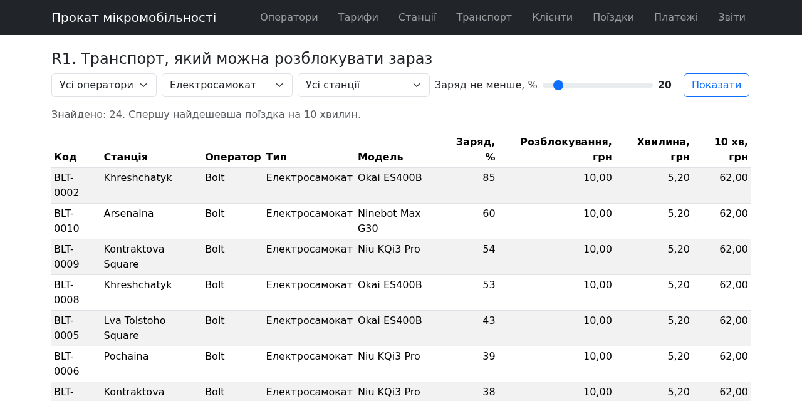{width=80%}

### R2. Пошук поїздок {.unlisted}

Призначення: знайти поїздки за період, оператором, типом, клієнтом (початок прізвища або кінець телефону) і станом (активна чи завершена); показано вартість, повернення і комісію. Тип запиту: розширений пошук, п'ять з'єднань, два з них `LEFT JOIN`. Метод: `RideRepository.searchRides`. Хвилини рахує клас `Billing.minutes` у Java, той самий, що й при списанні.

```{.java .small}
@Query("""
    select new micromobility.report.RideRow(r.id, c.lastName, c.firstName, v.code, o.name, v.vehicleType,
               r.startedAt, r.endedAt, ch.amountKop, rf.amountKop, r.commissionKop)
    from Ride r join r.customer c join r.vehicle v join v.operator o
         left join Payment ch on ch.ride = r and ch.kind = :charge
         left join Payment rf on rf.ride = r and rf.kind = :refund
    where (:periodFrom is null or r.startedAt >= :periodFrom) and (:periodTo is null or r.startedAt < :periodTo)
      and (:opId is null or o.id = :opId) and (:type is null or v.vehicleType = :type)
      and (:prefix is null or c.lastName like :prefix or c.phone like :suffix)
      and (:active is null or (:active = true and r.endedAt is null)
                           or (:active = false and r.endedAt is not null))
    order by r.startedAt desc, r.id desc""")
```

Два `LEFT JOIN` не множать рядки, бо `uq_payments_ride_kind` дозволяє один платіж кожного виду на поїздку. На рисунку 5.2 фільтр прізвища «Ко»: сім поїздок.

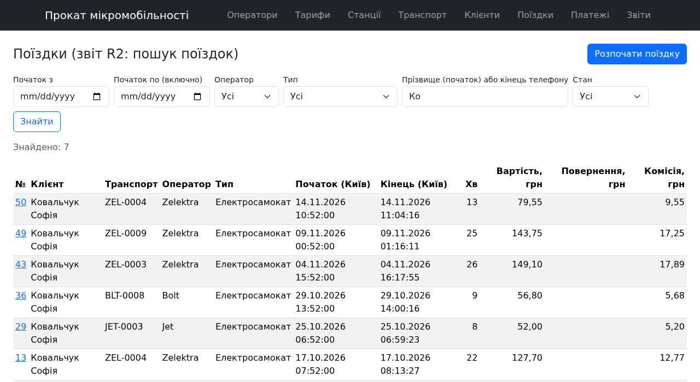{width=80%}

### R3. Виручка, повернення і комісія за місяцями й операторами {.unlisted}

Призначення: власник бачить виручку, повернення, чисту виручку і комісію за місяць завершення поїздки по кожному оператору. Тип запиту: групування `GROUP BY` із `SUM`, `COUNT` і датою, `LEFT JOIN`. Місяць визначається за київським часом завершення (функція `convert_tz` викликається з HQL через `function(...)`), межі періоду — це UTC, як описано на початку розділу. Комісія береться зі збереженого стовпця поїздки (BR17), тому зміна відсотка оператора минулі місяці не міняє. Період використовує `ix_rides_ended_at`. Метод: `RideRepository.revenue`.

```{.java .small}
@Query("""
    select new micromobility.report.RevenueRow(
               year(function('convert_tz', r.endedAt, '+00:00', 'Europe/Kyiv')),
               month(function('convert_tz', r.endedAt, '+00:00', 'Europe/Kyiv')), o.name, count(r),
               -sum(ch.amountKop), coalesce(sum(rf.amountKop), 0), sum(r.commissionKop))
    from Ride r join Payment ch on ch.ride = r and ch.kind = :charge
         left join Payment rf on rf.ride = r and rf.kind = :refund
         join r.vehicle v join v.operator o
    where (:periodFrom is null or r.endedAt >= :periodFrom) and (:periodTo is null or r.endedAt < :periodTo)
    group by <year and month of convert_tz(r.endedAt), o.id, o.name>
    order by <year and month>, sum(ch.amountKop), o.id""")
```

Списання від'ємні, тому сортування за зростанням суми ставить найбільшу виручку першою. На рисунку 5.3 шість рядків; для Zelektra у жовтні комісія 178,65 грн, бо тоді діяв відсоток 10, а зараз він 12.

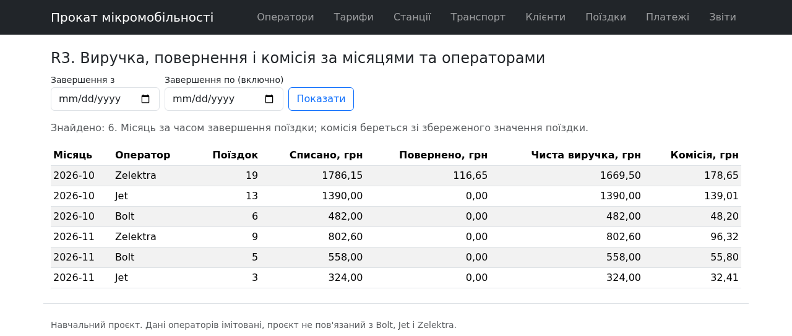{width=80%}

### R4. Клієнти з найбільшими витратами {.unlisted}

Призначення: п'ять клієнтів з найбільшою чистою витратою (списання мінус повернення) за період із не менше ніж N поїздок. Тип запиту: `GROUP BY` з `HAVING`, `COUNT(DISTINCT)`, сортування й обмеження числа рядків. `COUNT(DISTINCT)` потрібен, бо поїздка з поверненням має два платежі. Метод: `PaymentRepository.topCustomers`; замість `LIMIT 5` передається `PageRequest.of(0, 5)`, а види платежів `RIDE` і `REFUND` конвертер перетворює на коди 3 і 4.

```{.java .small}
@Query("""
    select new micromobility.report.TopCustomerRow(c.id, c.lastName, c.firstName,
               count(distinct r.id), -sum(p.amountKop))
    from Payment p join p.ride r join r.customer c
    where p.kind in :kinds
      and (:periodFrom is null or r.endedAt >= :periodFrom) and (:periodTo is null or r.endedAt < :periodTo)
    group by c.id, c.lastName, c.firstName
    having count(distinct r.id) >= :minRides
    order by sum(p.amountKop) asc, c.id""")
```

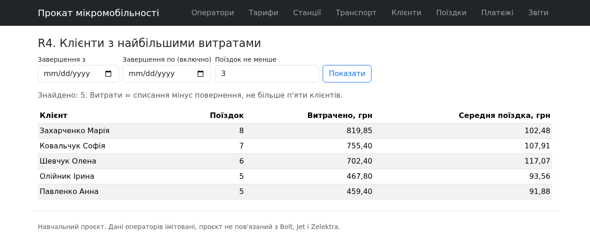{width=80%}

### R5. Зведена таблиця: оператори і типи транспорту {.unlisted}

Призначення: скільки завершених поїздок і яка середня кількість оплачених хвилин у кожного оператора окремо для самокатів і велосипедів, із підсумковим рядком. Тип запиту: умовна агрегація (`SUM(vehicle_type = 1)`, `AVG(CASE ...)`) і `GROUP BY ... WITH ROLLUP`, що додає підсумковий рядок. У JPQL немає відповідника `WITH ROLLUP` і `GROUPING()` [3], тому це єдиний звіт із нативним SQL; результат читає інтерфейсна проєкція `PivotRow`. Підсумковий рядок позначає `GROUPING(o.name) = 1`, а слово «Усього» додає сторінка, тож у SQL української мови немає. Метод: `RideRepository.pivot`.

```{.java .small}
@Query(value = """
    SELECT o.name AS operator, GROUPING(o.name) AS isTotal,
           SUM(v.vehicle_type = 1) AS scooterRides,
           ROUND(AVG(CASE WHEN v.vehicle_type = 1
                     THEN GREATEST(1, CEIL(TIMESTAMPDIFF(SECOND, r.started_at, r.ended_at) / 60)) END), 1) AS scooterAvgMin,
           SUM(v.vehicle_type = 2) AS bikeRides,
           ROUND(AVG(CASE WHEN v.vehicle_type = 2
                     THEN GREATEST(1, CEIL(TIMESTAMPDIFF(SECOND, r.started_at, r.ended_at) / 60)) END), 1) AS bikeAvgMin,
           COUNT(*) AS totalRides
    FROM rides r JOIN vehicles v ON v.id = r.vehicle_id JOIN operators o ON o.id = v.operator_id
    WHERE r.ended_at IS NOT NULL
      AND (:periodFrom IS NULL OR r.started_at >= :periodFrom) AND (:periodTo IS NULL OR r.started_at < :periodTo)
    GROUP BY o.name WITH ROLLUP
    ORDER BY GROUPING(o.name), o.name""", nativeQuery = true)
```

Два типи транспорту дають дві пари стовпців. Третій тип потребує нового коду, міграції CHECK і нової пари стовпців (у проєкті перелік свідомо фіксований).

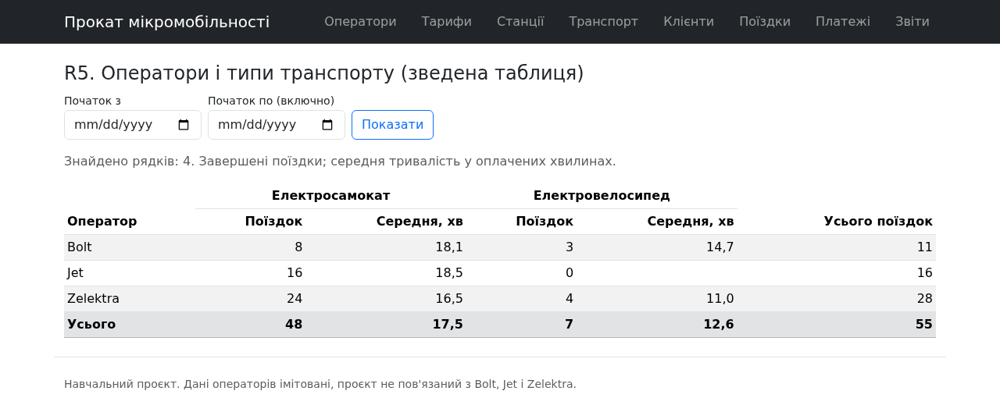{width=80%}

### R6. Баланси нижче порога {.unlisted}

Призначення: показати боржників і клієнтів, які не зможуть розблокувати транспорт (баланс менше 100 грн). Тип запиту: `LEFT JOIN` з `GROUP BY` і `HAVING`. Баланс обчислюється сумою платежів, бо окремого стовпця немає. `LEFT JOIN` потрібен, щоб не загубити клієнта без платежів. Метод: `CustomerRepository.findBelowBalance`.

```{.java .small}
@Query("""
    select new micromobility.report.BalanceRow(c.id, c.lastName, c.firstName, c.phone,
               coalesce(sum(p.amountKop), 0), coalesce(sum(case when p.kind = :topup then 1 else 0 end), 0))
    from Customer c left join Payment p on p.customer = c
    group by c.id, c.lastName, c.firstName, c.phone
    having coalesce(sum(p.amountKop), 0) < :threshold
    order by coalesce(sum(p.amountKop), 0), c.id""")
```

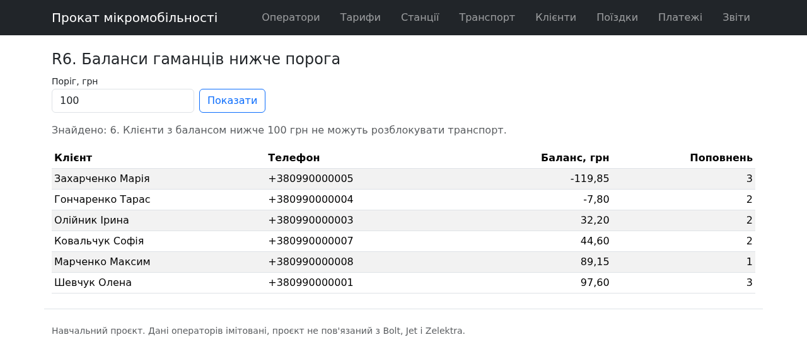{width=80%}

### R7. Транспорт, який треба поставити на зарядку {.unlisted}

Призначення: доступний транспорт із зарядом нижче порога, щоб персонал поставив його на зарядку. Тип запиту: простий фільтр із сортуванням. Запиту немає в коді: Spring Data будує його з імені методу [4], а `@EntityGraph` одразу підвантажує оператора і станцію без N+1:

```java
@EntityGraph(attributePaths = {"operator", "station"})
List<Vehicle> findByStatusAndBatteryPctLessThanOrderByBatteryPctAscCodeAsc(VehicleStatus status, int level);
```

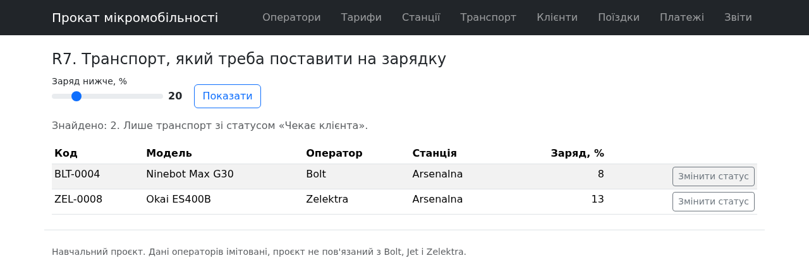{width=80%}

### Перевірка звітів {.unlisted}

Скрипт `check.sh` (частина 3) порівнює кожну сторінку звіту з тим самим SQL із `sql/queries.sql`, виконаним у базі: порівнюється весь упорядкований результат, а не лише кількість рядків. Для R2-R5 перевіряються й фільтри за київськими днями з їхніми межами в UTC, а для списку транспорту всі види порівняння заряду. Справжній вивід (скорочено):

```
== part 3: every report page equals its SQL in sql/queries.sql (the whole ordered result, not only the row count)
ok   R1 no filters: 33 rows, values and order equal
…
ok   vehicles, battery any: 40 rows, values and order equal
ok   vehicles, battery more than 50: 18 rows, values and order equal
ok   vehicles, battery less than 30: 7 rows, values and order equal
ok   vehicles, battery equal to 48: 3 rows, values and order equal
ok   vehicles, battery less than 0 is an empty list (= 0)
ok   R2 no filters: 59 rows, values and order equal
ok   R2 surname prefix Ко: 7 rows, values and order equal
…
ok   R2 date filter includes ride 5 (starts 01:22 Kyiv on 09.10, 22:22 UTC on 08.10) (= 1)
ok   R2 Kyiv days 01.11 to 30.11: 21 rows, values and order equal
ok   R3 no filters (months in Kyiv time): 6 rows, values and order equal
ok   R3 Kyiv days 01.10 to 30.11: 6 rows, values and order equal
…
ok   R4 no filters: 5 rows, values and order equal
…
ok   R4 Kyiv days 01.10 to 30.11, at least 3 rides: 5 rows, values and order equal
…
ok   R5 last row is the total row (= NULL|1)
ok   R6 default threshold 100 UAH: 6 rows, values and order equal
ok   R7 default level 20 %: 2 rows, values and order equal
ok   search text with a % is a plain character (no rides match) (= 0)
ok   unknown id gives a plain 404 page (= 404)
```

### CRUD і відмови за правилами {.unlisted}

CRUD реалізовано для п'яти сутностей: оператори, тарифи, станції, транспорт, клієнти. Поїздки мають лише операції, які дозволяють їхні правила: початок, пошук і квитанція, завершення, скасування. Платежі лише додаються (поповнення, повернення) і читаються. Рисунки 5.8-5.13 показують сторінки.

::: {.pair}
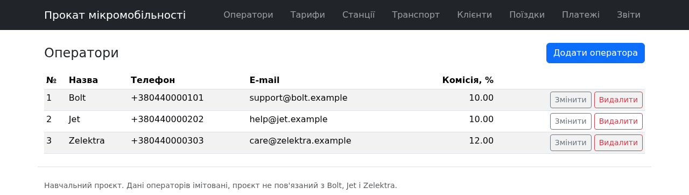{width=48%} 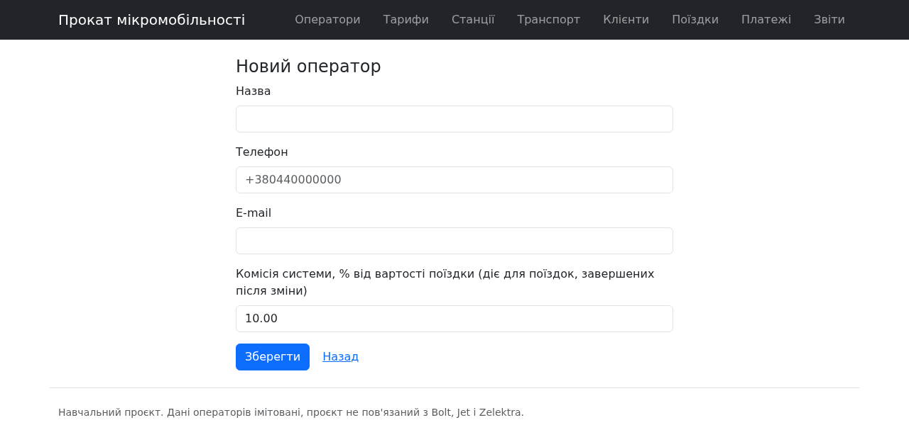{width=48%}

Рисунок 5.8 - Оператори: список і форма створення
:::

::: {.pair}
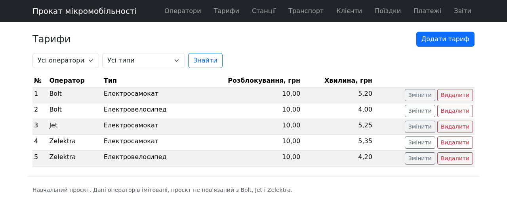{width=48%} 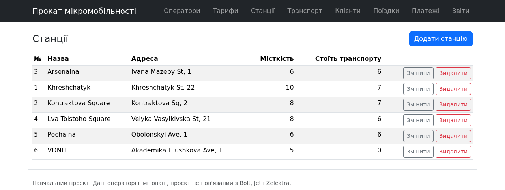{width=48%}

Рисунок 5.9 - Тарифи і станції (кількість транспорту на станції)
:::

::: {.pair}
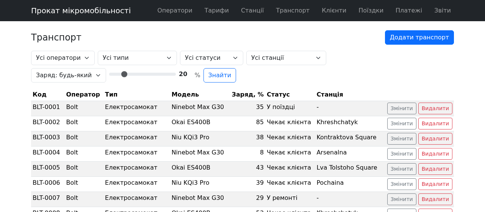{width=48%} 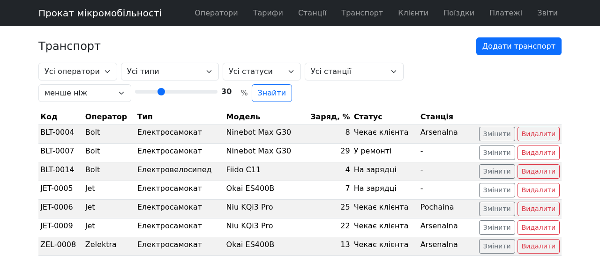{width=48%}

Рисунок 5.10 - Транспорт: список з фільтрами (оператор, тип, статус, станція) і фільтр за зарядом «менше ніж 30 %»
:::

Фільтр заряду на сторінці транспорту працює як розширений пошук: порівняння («більше ніж», «менше ніж», «дорівнює», «будь-який») і повзунок значення. Перелік `BatteryCompare` перетворює порівняння на замкнений діапазон `[min, max]`, тому в репозиторії один запит: `v.batteryPct between :minBattery and :maxBattery` разом з іншими необов'язковими умовами (оператор, тип, статус, станція). Той самий повзунок використовують звіти R1 і R7.


::: {.pair}
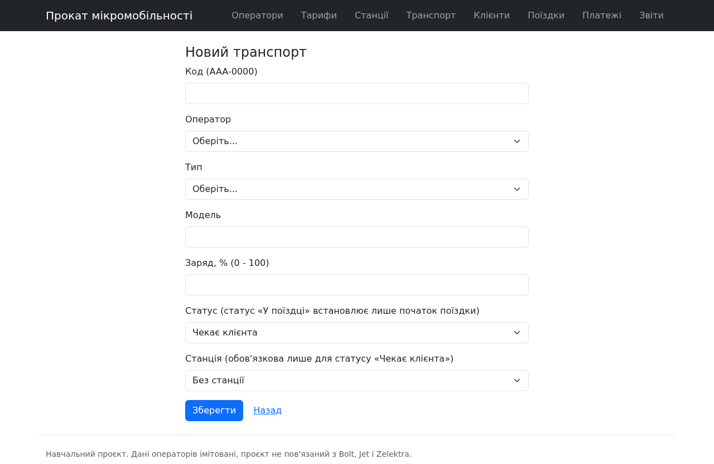{width=48%} 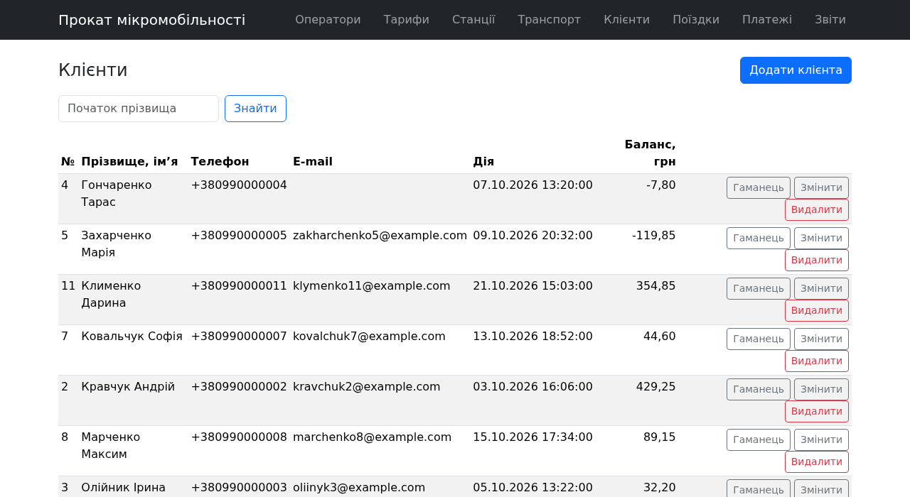{width=48%}

Рисунок 5.11 - Форма транспорту (станція лише для статусу «Чекає клієнта») і список клієнтів з балансом та підтвердженням через Дію
:::

::: {.pair}
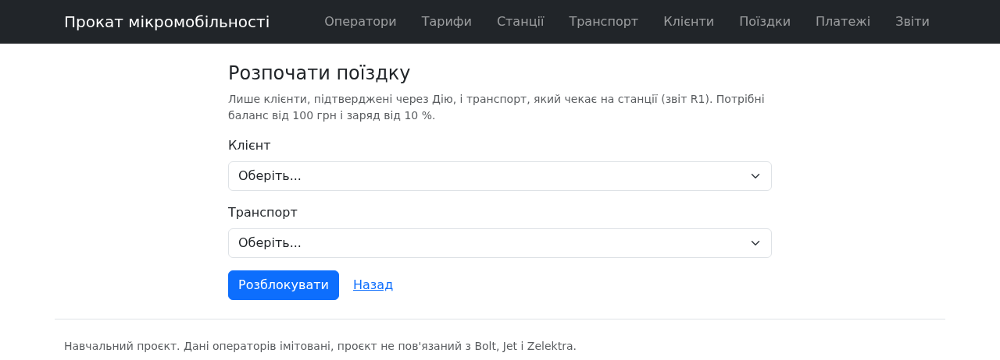{width=48%} 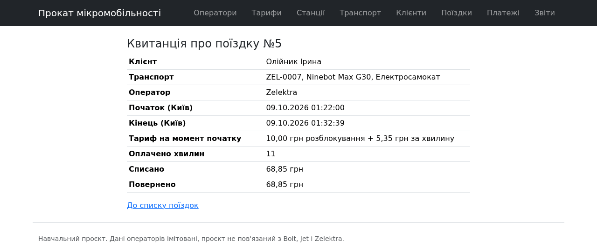{width=48%}

Рисунок 5.12 - Початок поїздки (лише підтверджені клієнти й доступний транспорт) і квитанція
:::

::: {.pair}
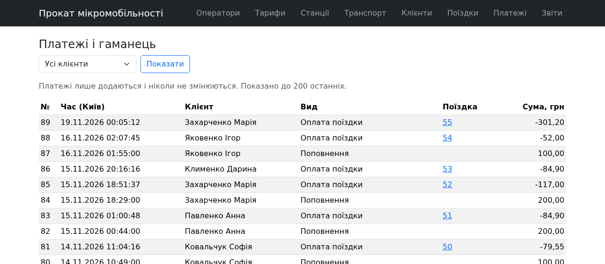{width=95%}

Рисунок 5.13 - Журнал гаманця: рядки лише додаються
:::

Відмови за правилами показують, що обмеження працюють. База або сервіс відхиляють дію, а застосунок виводить повідомлення за іменем обмеження.

::: {.pair}
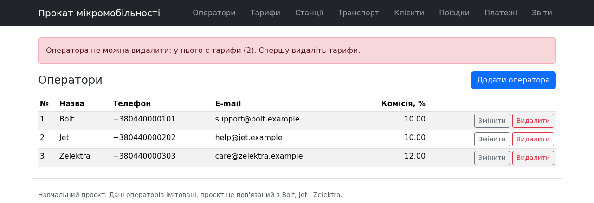{width=48%} 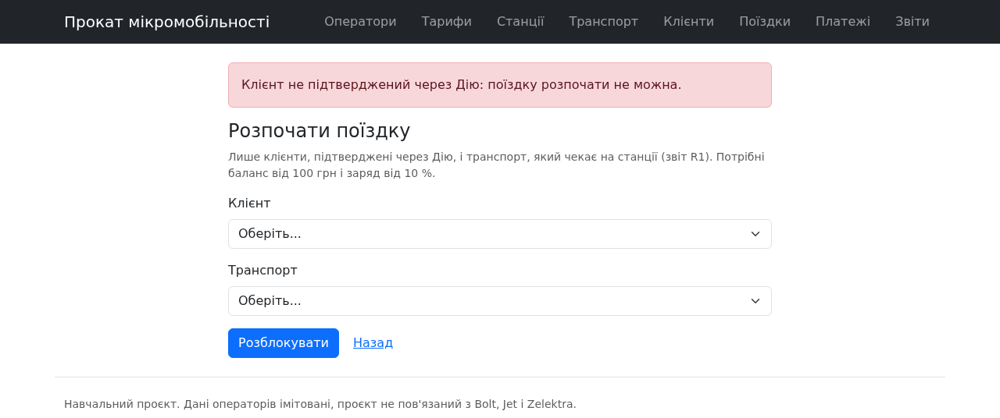{width=48%}

Рисунок 5.14 - Відмова: видалення оператора з тарифами (BR16, `fk_tariffs_operator`) і розблокування непідтвердженим клієнтом (BR8)
:::

Автоматичні перевірки `check.sh` проходять ті самі сценарії через HTTP-форми. Фрагмент виводу частини 2 про завершення, повернення і відмови (справжній вивід, скорочено):

```
ok   finish at a full station refused: page says «заповнена»
ok   finish: vehicle AVAILABLE (1) at the chosen station (= 1:6)
ok   finish: charge 10.00 + 5.20 for one started minute, kopecks (= -1520)
ok   finish: stored commission 10 % of 1520 (= 152)
ok   a ride finished in the same second as its start was accepted (= 1)
ok   second finish of a finished ride refused: page says «Поїздку вже завершено»
ok   refund above the charge refused: page says «Сума повернення має бути»
ok   refund: row of kind 4 with 500 kopecks (= 500)
ok   second refund of the same ride refused: page says «повернення вже було»
ok   refund leaves the stored commission unchanged (= 152)
…
-- part 2: 96 ok, 0 failed
```

Усього `check.sh` виконує 139 перевірок (6 для стека і міграцій, 11 для обмежень, 96 для CRUD і правил, 26 для звітів), помилок немає. Формулу тарифікації окремо перевіряють 9 модульних тестів `BillingTest` (0, 59, 60, 61 секунда, 55 хвилин 12 секунд, комісія 0 %, 50 % і округлення вгору).

# Висновки

У роботі спроєктовано і реалізовано базу даних та інформаційну систему прокату електросамокатів і електровелосипедів кількох операторів. За системним аналізом виділено сім сутностей і двадцять два бізнес-правила. Для кожного правила визначено, що його охороняє: база чи застосунок, і чому. Побудовано інфологічну, даталогічну і фізичну моделі, відповідна схема MySQL має 7 таблиць, 43 стовпці, 25 іменованих обмежень CHECK, 8 зовнішніх ключів (2 складені, усі RESTRICT) і 26 індексів, серед них 2 функціональні унікальні індекси. Вони забороняють дві активні поїздки одного клієнта й одного транспорту. Складений зовнішній ключ платежу гарантує, що списання й повернення належать клієнту поїздки. Шість копій похідних даних залишено свідомо, кожну описано з причиною і охороною.

Застосунок на Spring Data JPA і Hibernate має повний CRUD для п'яти сутностей, поїздки з початком, завершенням і скасуванням, журнал платежів лише для додавання і сім запитів R1-R7: фільтри, з'єднання, групування, `HAVING`, `NOT EXISTS`, зведену таблицю з `WITH ROLLUP`, розширений пошук. Схема й початкові дані створюються Flyway, Hibernate лише перевіряє відображення. Усе запускається однією командою в Docker, а 139 автоматичних перевірок і 9 модульних тестів проходять. Перевіркою на тимчасовій базі підтверджено, що 45 порушень правил відхиляє саме обмеження з очікуваним ім'ям.

Особисто для себе важливим вважаю розподіл відповідальності: схема бере на себе усе, що можна записати одним рядком, індексом чи ключем, а сервіси виконують решту в одній транзакції. Тому базу складно привести в суперечливий стан навіть поза застосунком. Цінним виявилося й те, що комісія і ціни зберігаються в поїздці: звіти за минулі місяці не змінюються, коли оператор міняє тариф чи відсоток.

Рекомендації щодо реального використання: підключити справжню перевірку особи через Дію і платіжний шлюз замість імітацій, додати координати транспорту і карту, API розблокування від операторів, вхід у систему з ролями (веб-адмін наразі без входу), історію змін статусів, попередження про низький баланс. Нерозв'язаним лишається питання навантаження: баланс обчислюється сумою платежів і для великої кількості рядків потребує окремої підсумкової таблиці або кешу, а підтвердження через Дію в роботі лише імітується.

# Список використаних джерел

1. Методичні вказівки та завдання для виконання курсової роботи з дисципліни «Технології проектування та адміністрування баз даних та сховищ даних» (ТПБД2024 - КР). Київ, 2022.
2. Матеріали курсу «Технології проектування та адміністрування баз даних та сховищ даних»: «Моделі БД», «Запити SQL», практичні та лабораторні роботи 1.1, 1.2, 3.1-3.3. Classroom, 2026.
3. MySQL 8.4 Reference Manual: CHECK Constraints, FOREIGN KEY Constraints, Functional Key Parts, GROUP BY Modifiers. https://dev.mysql.com/doc/refman/8.4/en/
4. Spring Data JPA Reference Documentation, розділи про методи запитів, `@Query`, `@EntityGraph`. https://docs.spring.io/spring-data/jpa/reference/
5. Hibernate ORM 6.6 User Guide: відображення, `AttributeConverter`, `@Immutable`, HQL. https://docs.jboss.org/hibernate/orm/6.6/userguide/html_single/Hibernate_User_Guide.html
6. Flyway Documentation: Migrations. https://documentation.red-gate.com/fd
7. Spring Boot Reference Documentation 3.5: Data, Web, Flyway. https://docs.spring.io/spring-boot/3.5/reference/
8. Thymeleaf Documentation: Using Thymeleaf. https://www.thymeleaf.org/documentation.html

# Додатки

## Додаток А. Посилання на код і запуск

Код застосунку, міграції, SQL-запити, скрипт перевірки та знімки екрана: https://github.com/brizzinck/krinzhrepoduta/tree/main/db/coursework

Запуск (потрібен лише Docker; команди незалежні, кожну запускають окремо):

```
make up      # зібрати й запустити
make reset   # видалити дані й запустити знову
make check   # повна перевірка з нуля
```

`make up` будує й піднімає MySQL і застосунок (це `docker compose up -d --build`), чекає відповіді й друкує адресу веб-адміна `http://127.0.0.1:18480/`. `make reset` видаляє дані й запускає знову (чистий запуск дає свіжі активні поїздки початкових даних). `make check` з нуля розгортає стек і виконує усі перевірки; код виходу 0 означає, що все пройшло. Список цілей показує `make help`.

Навчальний проєкт. Дані операторів імітовані, проєкт не пов'язаний з Bolt, Jet і Zelektra.
