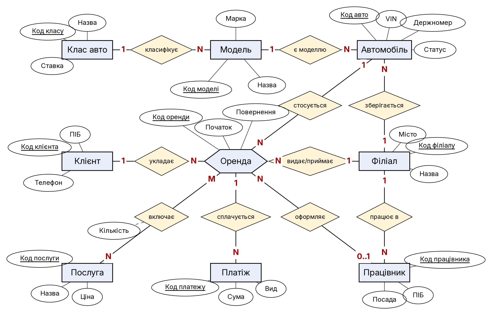
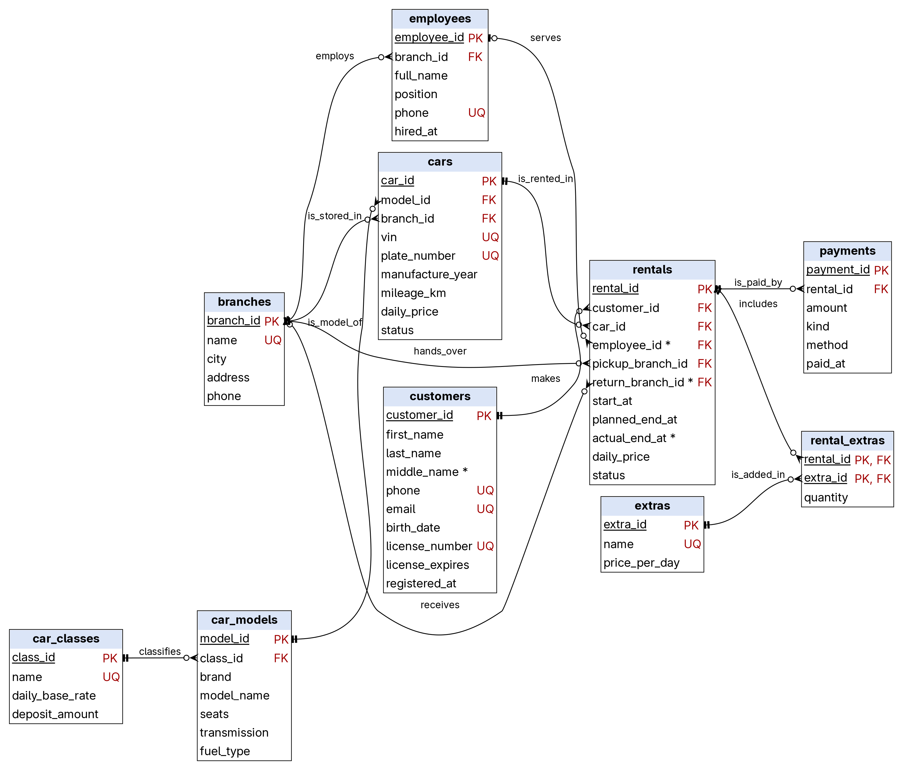
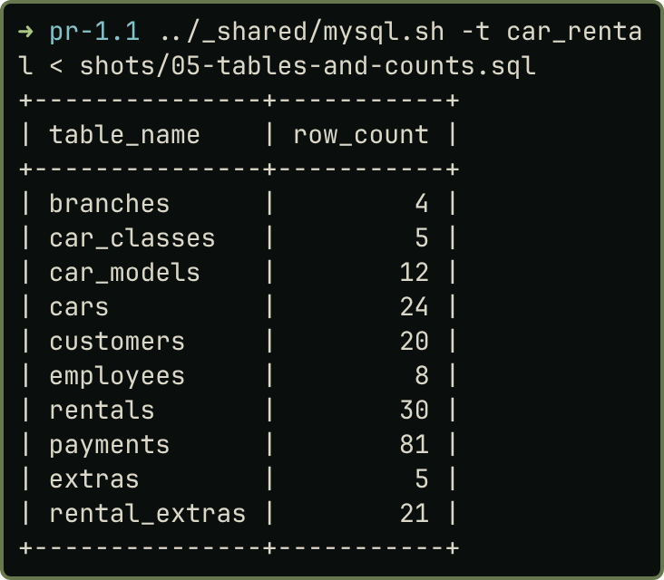
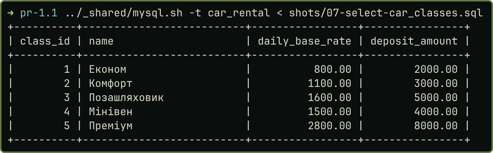

## Завдання

Варіант 22. Прокат автомобілів: філіали, класи й моделі авто, автомобілі, клієнти, працівники, оренди, платежі, додаткові послуги. Мета: побудувати інфологічну й даталогічну моделі, створити й наповнити базу, перевірити обмеження. СУБД: MySQL 8.4 (InnoDB, `utf8mb4`) у Docker.

## Розв'язання

### Інфологічна й даталогічна моделі

Інфологічна модель (рис. 1) має дев'ять сутностей. «Оренду» я позначив шестикутником як асоціативну сутність: вона пов'язує клієнта, авто, працівника й філіал. Зв'язок M:N між «Орендою» і «Послугою» має атрибут «Кількість».

{width=52%}

Даталогічна модель (рис. 2): зв'язок M:N розбито на два 1:N через `rental_extras` зі складеним ключем. Модель у 3НФ. Три ціни різні за змістом: `car_classes.daily_base_rate` — базова (довідкова) ставка класу, `cars.daily_price` — поточний тариф конкретного авто, `rentals.daily_price` — тариф, зафіксований у договорі. Тому ціна договору не дублює ціну авто: це історичний факт договору, а не залежна від авто величина, і 3НФ не порушено. Після зміни тарифу старі договори зберігають свою суму.

Позначення на рис. 2: `*` означає, що стовпець допускає `NULL`; кружок на кінці лінії означає «нуль» (зв'язок необов'язковий), риска «один», лапка «багато».

{width=78%}

**Опис таблиць** (тип подано з довжиною й точністю). `ON DELETE`: довідникові й фінансові зв'язки мають `RESTRICT`, склад оренди `CASCADE`, працівник у договорі `SET NULL`. Обмежень рівня таблиці немає, якщо не вказано.

| **Філіали (пункти прокату)** (`branches`) | Тип (довжина, точність) | Обмеження |
|:--------------|:------------|:------------------------------------|
| `branch_id` | INT | PK, автоінкремент |
| `name` | VARCHAR(60) | NOT NULL; Unique |
| `city` | VARCHAR(40) | NOT NULL |
| `address` | VARCHAR(100) | NOT NULL |
| `phone` | VARCHAR(20) | NOT NULL |

*Обмеження таблиці:* пара полів `city` і `address` є Unique.

| **Класи автомобілів** (`car_classes`) | Тип (довжина, точність) | Обмеження |
|:--------------|:------------|:------------------------------------|
| `class_id` | INT | PK, автоінкремент |
| `name` | VARCHAR(30) | NOT NULL; Unique |
| `daily_base_rate` | DECIMAL(8,2) | NOT NULL; більше 0 |
| `deposit_amount` | DECIMAL(8,2) | NOT NULL; не менше 0 |

| **Моделі автомобілів** (`car_models`) | Тип (довжина, точність) | Обмеження |
|:--------------|:------------|:------------------------------------|
| `model_id` | INT | PK, автоінкремент |
| `class_id` | INT | FK на `car_classes`, RESTRICT |
| `brand` | VARCHAR(30) | NOT NULL |
| `model_name` | VARCHAR(40) | NOT NULL |
| `seats` | TINYINT | NOT NULL; від 2 до 9 |
| `transmission` | VARCHAR(10) | NOT NULL; лише «manual» або «automatic» |
| `fuel_type` | VARCHAR(10) | NOT NULL; лише «petrol», «diesel», «hybrid», «electric» |

*Обмеження таблиці:* пара полів `brand` і `model_name` є Unique.

| **Автомобілі** (`cars`) | Тип (довжина, точність) | Обмеження |
|:--------------|:------------|:------------------------------------|
| `car_id` | INT | PK, автоінкремент |
| `model_id` | INT | FK на `car_models`, RESTRICT |
| `branch_id` | INT | FK на `branches`, RESTRICT |
| `vin` | CHAR(17) | NOT NULL; Unique |
| `plate_number` | VARCHAR(10) | NOT NULL; Unique |
| `manufacture_year` | SMALLINT | NOT NULL; від 2005 до 2030 |
| `mileage_km` | INT UNSIGNED | NOT NULL; за замовч. 0 |
| `daily_price` | DECIMAL(8,2) | NOT NULL; більше 0 |
| `status` | VARCHAR(12) | NOT NULL; лише «available», «rented», «maintenance», «retired»; за замовч. «available» |

| **Клієнти** (`customers`) | Тип (довжина, точність) | Обмеження |
|:--------------|:------------|:------------------------------------|
| `customer_id` | INT | PK, автоінкремент |
| `first_name` | VARCHAR(40) | NOT NULL |
| `last_name` | VARCHAR(40) | NOT NULL |
| `middle_name` | VARCHAR(40) | NULL |
| `phone` | VARCHAR(20) | NOT NULL; Unique |
| `email` | VARCHAR(80) | NOT NULL; Unique |
| `birth_date` | DATE | NOT NULL |
| `license_number` | VARCHAR(15) | NOT NULL; Unique |
| `license_expires` | DATE | NOT NULL |
| `registered_at` | DATETIME | NOT NULL; за замовч. поточні дата й час |

*Обмеження таблиці:* `license_expires > birth_date`.

| **Працівники** (`employees`) | Тип (довжина, точність) | Обмеження |
|:--------------|:------------|:------------------------------------|
| `employee_id` | INT | PK, автоінкремент |
| `branch_id` | INT | FK на `branches`, RESTRICT |
| `full_name` | VARCHAR(100) | NOT NULL |
| `position` | VARCHAR(10) | NOT NULL; лише «manager», «agent», «mechanic» |
| `phone` | VARCHAR(20) | NOT NULL; Unique |
| `hired_at` | DATE | NOT NULL |

| **Оренди** (`rentals`) | Тип (довжина, точність) | Обмеження |
|:--------------|:------------|:------------------------------------|
| `rental_id` | INT | PK, автоінкремент |
| `customer_id` | INT | FK на `customers`, RESTRICT |
| `car_id` | INT | FK на `cars`, RESTRICT |
| `employee_id` | INT | FK на `employees`, SET NULL; NULL |
| `pickup_branch_id` | INT | FK на `branches`, RESTRICT |
| `return_branch_id` | INT | FK на `branches`, RESTRICT; NULL |
| `start_at` | DATETIME | NOT NULL |
| `planned_end_at` | DATETIME | NOT NULL |
| `actual_end_at` | DATETIME | NULL |
| `daily_price` | DECIMAL(8,2) | NOT NULL; більше 0 |
| `status` | VARCHAR(10) | NOT NULL; лише «booked», «active», «closed», «cancelled»; за замовч. «booked» |

*Обмеження таблиці:* `planned_end_at > start_at`; `actual_end_at IS NULL OR actual_end_at >= start_at`.

| **Платежі** (`payments`) | Тип (довжина, точність) | Обмеження |
|:--------------|:------------|:------------------------------------|
| `payment_id` | INT | PK, автоінкремент |
| `rental_id` | INT | FK на `rentals`, RESTRICT |
| `amount` | DECIMAL(10,2) | NOT NULL; більше 0 |
| `kind` | VARCHAR(10) | NOT NULL; лише «deposit», «rent», «fine», «refund» |
| `method` | VARCHAR(10) | NOT NULL; лише «cash», «card», «online» |
| `paid_at` | DATETIME | NOT NULL; за замовч. поточні дата й час |

| **Додаткові послуги** (`extras`) | Тип (довжина, точність) | Обмеження |
|:--------------|:------------|:------------------------------------|
| `extra_id` | INT | PK, автоінкремент |
| `name` | VARCHAR(50) | NOT NULL; Unique |
| `price_per_day` | DECIMAL(6,2) | NOT NULL; не менше 0 |

| **Склад оренди** (`rental_extras`) | Тип (довжина, точність) | Обмеження |
|:--------------|:------------|:------------------------------------|
| `rental_id` | INT | PK (складений); FK на `rentals`, CASCADE |
| `extra_id` | INT | PK (складений); FK на `extras`, RESTRICT |
| `quantity` | TINYINT | NOT NULL; більше 0; за замовч. 1 |

### Фізична модель і наповнення

`schema.sql` створює базу й 10 таблиць з іменованими обмеженнями (фрагмент нижче); `seed.sql` вставляє вигадані дані українською. Повні скрипти наведено в додатках А і Б, вміст усіх таблиць у додатку В.

| Рисунок 3 — Рядки таблиць | Рисунок 4 — Вміст таблиці `car_classes` |
|:---------------------|:-------------------------------------|
| {width=161pt} | {width=289pt} |

```sql
CREATE DATABASE car_rental CHARACTER SET utf8mb4 COLLATE utf8mb4_0900_ai_ci;
CREATE TABLE rentals (
    rental_id          INT           NOT NULL AUTO_INCREMENT,
    -- … ще 10 стовпців і первинний ключ
    CONSTRAINT fk_rentals_employee FOREIGN KEY (employee_id)
        REFERENCES employees (employee_id) ON DELETE SET NULL,
    -- …
    CONSTRAINT chk_rentals_planned CHECK (planned_end_at > start_at),
    -- …
);
INSERT INTO car_classes (class_id, name, daily_base_rate, deposit_amount) VALUES
(1, 'Економ', 800.00, 2000.00),
-- …
(5, 'Преміум', 2800.00, 8000.00);
```

### Перевірка обмежень

`check.sql` я запускав на копії `car_rental_check`, бо невдалі `INSERT` спалюють `AUTO_INCREMENT`. Три порушення `CHECK` дали помилку 3819, дублікат VIN 1062, неіснуюча модель 1452, видалення філіалу з авто 1451 (`RESTRICT`, рис. 5). `CASCADE` прибрав склад видаленої оренди (було 2 рядки, стало 0). За `SET NULL` після видалення працівника його оренда лишилась із `employee_id = NULL` (оренд без працівника було 5, стало 6). `ON DELETE SET DEFAULT` InnoDB не виконує (1451), тому не застосовано.

{width=96%}

Скрипти й знімки:\
<https://github.com/brizzinck/krinzhrepoduta/tree/main/db/pr-1.1>.

## Висновки

Я спроєктував базу прокату авто з 10 таблиць, де зв'язок M:N оренди й послуги розбито таблицею `rental_extras`. Таблиці в 3НФ, обмеження мають власні імена, тому з помилки видно, яке з них спрацювало. Даталогічну діаграму зібрано з `information_schema`, тож вона збігається зі схемою. Для працівника в договорі обрано `SET NULL`: договір лишається в історії після звільнення. `check.sql` підтвердив роботу `CHECK`, `UNIQUE`, `FOREIGN KEY`, `RESTRICT`, `CASCADE` і `SET NULL`.

```{=openxml}
<w:p><w:r><w:br w:type="page"/></w:r></w:p>
```

## Додаток А. Скрипт створення бази даних (`schema.sql`) {style="break-before: page"}

```{.sql .small}
-- ПР 1.1. Предметна область «22. Прокат автомобілів».
-- Фізична модель для MySQL 8.4 (InnoDB, utf8mb4). Скрипт можна запускати повторно: базу буде створено заново.

DROP DATABASE IF EXISTS car_rental;
CREATE DATABASE car_rental
    CHARACTER SET utf8mb4
    COLLATE utf8mb4_0900_ai_ci;
USE car_rental;

-- 1. Пункти прокату (філіали)
CREATE TABLE branches (
    branch_id  INT          NOT NULL AUTO_INCREMENT,
    name       VARCHAR(60)  NOT NULL,
    city       VARCHAR(40)  NOT NULL,
    address    VARCHAR(100) NOT NULL,
    phone      VARCHAR(20)  NOT NULL,
    CONSTRAINT pk_branches PRIMARY KEY (branch_id),
    CONSTRAINT uq_branches_name UNIQUE (name),
    CONSTRAINT uq_branches_city_address UNIQUE (city, address)
);

-- 2. Класи автомобілів (економ, комфорт, позашляховик тощо)
CREATE TABLE car_classes (
    class_id         INT           NOT NULL AUTO_INCREMENT,
    name             VARCHAR(30)   NOT NULL,
    daily_base_rate  DECIMAL(8, 2) NOT NULL,
    deposit_amount   DECIMAL(8, 2) NOT NULL,
    CONSTRAINT pk_car_classes PRIMARY KEY (class_id),
    CONSTRAINT uq_car_classes_name UNIQUE (name),
    CONSTRAINT chk_car_classes_rate CHECK (daily_base_rate > 0),
    CONSTRAINT chk_car_classes_deposit CHECK (deposit_amount >= 0)
);

-- 3. Марки й моделі автомобілів
CREATE TABLE car_models (
    model_id      INT         NOT NULL AUTO_INCREMENT,
    class_id      INT         NOT NULL,
    brand         VARCHAR(30) NOT NULL,
    model_name    VARCHAR(40) NOT NULL,
    seats         TINYINT     NOT NULL,
    transmission  VARCHAR(10) NOT NULL,
    fuel_type     VARCHAR(10) NOT NULL,
    CONSTRAINT pk_car_models PRIMARY KEY (model_id),
    CONSTRAINT fk_car_models_class FOREIGN KEY (class_id)
        REFERENCES car_classes (class_id) ON DELETE RESTRICT,
    CONSTRAINT uq_car_models_brand_model UNIQUE (brand, model_name),
    CONSTRAINT chk_car_models_seats CHECK (seats BETWEEN 2 AND 9),
    CONSTRAINT chk_car_models_transmission CHECK (transmission IN ('manual', 'automatic')),
    CONSTRAINT chk_car_models_fuel CHECK (fuel_type IN ('petrol', 'diesel', 'hybrid', 'electric'))
);

-- 4. Автомобілі парку
CREATE TABLE cars (
    car_id            INT           NOT NULL AUTO_INCREMENT,
    model_id          INT           NOT NULL,
    branch_id         INT           NOT NULL,
    vin               CHAR(17)      NOT NULL,
    plate_number      VARCHAR(10)   NOT NULL,
    manufacture_year  SMALLINT      NOT NULL,
    mileage_km        INT UNSIGNED  NOT NULL DEFAULT 0,
    daily_price       DECIMAL(8, 2) NOT NULL,
    status            VARCHAR(12)   NOT NULL DEFAULT 'available',
    CONSTRAINT pk_cars PRIMARY KEY (car_id),
    CONSTRAINT fk_cars_model FOREIGN KEY (model_id)
        REFERENCES car_models (model_id) ON DELETE RESTRICT,
    CONSTRAINT fk_cars_branch FOREIGN KEY (branch_id)
        REFERENCES branches (branch_id) ON DELETE RESTRICT,
    CONSTRAINT uq_cars_vin UNIQUE (vin),
    CONSTRAINT uq_cars_plate UNIQUE (plate_number),
    CONSTRAINT chk_cars_year CHECK (manufacture_year BETWEEN 2005 AND 2030),
    CONSTRAINT chk_cars_price CHECK (daily_price > 0),
    CONSTRAINT chk_cars_status CHECK (status IN ('available', 'rented', 'maintenance', 'retired'))
);

-- 5. Клієнти
CREATE TABLE customers (
    customer_id      INT          NOT NULL AUTO_INCREMENT,
    first_name       VARCHAR(40)  NOT NULL,
    last_name        VARCHAR(40)  NOT NULL,
    middle_name      VARCHAR(40)  NULL,
    phone            VARCHAR(20)  NOT NULL,
    email            VARCHAR(80)  NOT NULL,
    birth_date       DATE         NOT NULL,
    license_number   VARCHAR(15)  NOT NULL,
    license_expires  DATE         NOT NULL,
    registered_at    DATETIME     NOT NULL DEFAULT CURRENT_TIMESTAMP,
    CONSTRAINT pk_customers PRIMARY KEY (customer_id),
    CONSTRAINT uq_customers_phone UNIQUE (phone),
    CONSTRAINT uq_customers_email UNIQUE (email),
    CONSTRAINT uq_customers_license UNIQUE (license_number),
    CONSTRAINT chk_customers_license_dates CHECK (license_expires > birth_date)
);

-- 6. Працівники пунктів прокату
CREATE TABLE employees (
    employee_id  INT          NOT NULL AUTO_INCREMENT,
    branch_id    INT          NOT NULL,
    full_name    VARCHAR(100) NOT NULL,
    position     VARCHAR(10)  NOT NULL,
    phone        VARCHAR(20)  NOT NULL,
    hired_at     DATE         NOT NULL,
    CONSTRAINT pk_employees PRIMARY KEY (employee_id),
    CONSTRAINT fk_employees_branch FOREIGN KEY (branch_id)
        REFERENCES branches (branch_id) ON DELETE RESTRICT,
    CONSTRAINT uq_employees_phone UNIQUE (phone),
    CONSTRAINT chk_employees_position CHECK (position IN ('manager', 'agent', 'mechanic'))
);

-- 7. Договори оренди
-- daily_price: тариф доби, зафіксований у договорі; тариф авто (cars.daily_price) з часом змінюється, тому це окремий факт договору, а не дублювання
CREATE TABLE rentals (
    rental_id          INT           NOT NULL AUTO_INCREMENT,
    customer_id        INT           NOT NULL,
    car_id             INT           NOT NULL,
    employee_id        INT           NULL,
    pickup_branch_id   INT           NOT NULL,
    return_branch_id   INT           NULL,
    start_at           DATETIME      NOT NULL,
    planned_end_at     DATETIME      NOT NULL,
    actual_end_at      DATETIME      NULL,
    daily_price        DECIMAL(8, 2) NOT NULL,
    status             VARCHAR(10)   NOT NULL DEFAULT 'booked',
    CONSTRAINT pk_rentals PRIMARY KEY (rental_id),
    CONSTRAINT fk_rentals_customer FOREIGN KEY (customer_id)
        REFERENCES customers (customer_id) ON DELETE RESTRICT,
    CONSTRAINT fk_rentals_car FOREIGN KEY (car_id)
        REFERENCES cars (car_id) ON DELETE RESTRICT,
    CONSTRAINT fk_rentals_employee FOREIGN KEY (employee_id)
        REFERENCES employees (employee_id) ON DELETE SET NULL,
    CONSTRAINT fk_rentals_pickup FOREIGN KEY (pickup_branch_id)
        REFERENCES branches (branch_id) ON DELETE RESTRICT,
    CONSTRAINT fk_rentals_return FOREIGN KEY (return_branch_id)
        REFERENCES branches (branch_id) ON DELETE RESTRICT,
    CONSTRAINT chk_rentals_planned CHECK (planned_end_at > start_at),
    CONSTRAINT chk_rentals_actual CHECK (actual_end_at IS NULL OR actual_end_at >= start_at),
    CONSTRAINT chk_rentals_price CHECK (daily_price > 0),
    CONSTRAINT chk_rentals_status CHECK (status IN ('booked', 'active', 'closed', 'cancelled'))
);

-- 8. Платежі за оренду
CREATE TABLE payments (
    payment_id  INT           NOT NULL AUTO_INCREMENT,
    rental_id   INT           NOT NULL,
    amount      DECIMAL(10, 2) NOT NULL,
    kind        VARCHAR(10)   NOT NULL,
    method      VARCHAR(10)   NOT NULL,
    paid_at     DATETIME      NOT NULL DEFAULT CURRENT_TIMESTAMP,
    CONSTRAINT pk_payments PRIMARY KEY (payment_id),
    CONSTRAINT fk_payments_rental FOREIGN KEY (rental_id)
        REFERENCES rentals (rental_id) ON DELETE RESTRICT,
    CONSTRAINT chk_payments_amount CHECK (amount > 0),
    CONSTRAINT chk_payments_kind CHECK (kind IN ('deposit', 'rent', 'fine', 'refund')),
    CONSTRAINT chk_payments_method CHECK (method IN ('cash', 'card', 'online'))
);

-- 9. Додаткові послуги
CREATE TABLE extras (
    extra_id       INT           NOT NULL AUTO_INCREMENT,
    name           VARCHAR(50)   NOT NULL,
    price_per_day  DECIMAL(6, 2) NOT NULL,
    CONSTRAINT pk_extras PRIMARY KEY (extra_id),
    CONSTRAINT uq_extras_name UNIQUE (name),
    CONSTRAINT chk_extras_price CHECK (price_per_day >= 0)
);

-- 10. Склад оренди (зв'язок «багато до багатьох» між орендами й послугами)
CREATE TABLE rental_extras (
    rental_id  INT     NOT NULL,
    extra_id   INT     NOT NULL,
    quantity   TINYINT NOT NULL DEFAULT 1,
    CONSTRAINT pk_rental_extras PRIMARY KEY (rental_id, extra_id),
    CONSTRAINT fk_rental_extras_rental FOREIGN KEY (rental_id)
        REFERENCES rentals (rental_id) ON DELETE CASCADE,
    CONSTRAINT fk_rental_extras_extra FOREIGN KEY (extra_id)
        REFERENCES extras (extra_id) ON DELETE RESTRICT,
    CONSTRAINT chk_rental_extras_qty CHECK (quantity > 0)
);
```

## Додаток Б. Скрипт наповнення бази даних (`seed.sql`)

```{.sql .small}
-- ПР 1.1. Наповнення бази car_rental (MySQL 8.4). Дані вигадані. Порядок вставки відповідає залежностям між таблицями.
USE car_rental;

INSERT INTO branches (branch_id, name, city, address, phone) VALUES
(1, 'Прокат «Київ-Центр»', 'Київ', 'вул. Володимирська, 45', '+380445550101'),
(2, 'Прокат «Львів-Свобода»', 'Львів', 'просп. Свободи, 28', '+380325550102'),
(3, 'Прокат «Одеса-Дерибасівська»', 'Одеса', 'вул. Дерибасівська, 12', '+380485550103'),
(4, 'Прокат «Дніпро-Яворницького»', 'Дніпро', 'просп. Дмитра Яворницького, 60', '+380565550104');

INSERT INTO car_classes (class_id, name, daily_base_rate, deposit_amount) VALUES
(1, 'Економ', 800.00, 2000.00),
(2, 'Комфорт', 1100.00, 3000.00),
(3, 'Позашляховик', 1600.00, 5000.00),
(4, 'Мінівен', 1500.00, 4000.00),
(5, 'Преміум', 2800.00, 8000.00);

INSERT INTO car_models (model_id, class_id, brand, model_name, seats, transmission, fuel_type) VALUES
(1, 1, 'Renault', 'Logan', 5, 'manual', 'petrol'),
(2, 1, 'Skoda', 'Fabia', 5, 'manual', 'petrol'),
(3, 2, 'Toyota', 'Corolla', 5, 'automatic', 'hybrid'),
(4, 2, 'Skoda', 'Octavia', 5, 'automatic', 'diesel'),
(5, 2, 'Volkswagen', 'Passat', 5, 'automatic', 'diesel'),
(6, 3, 'Toyota', 'RAV4', 5, 'automatic', 'hybrid'),
(7, 3, 'Hyundai', 'Tucson', 5, 'automatic', 'petrol'),
(8, 3, 'Nissan', 'Qashqai', 5, 'manual', 'diesel'),
(9, 4, 'Volkswagen', 'Caddy', 7, 'manual', 'diesel'),
(10, 4, 'Mercedes-Benz', 'Vito', 8, 'automatic', 'diesel'),
(11, 5, 'BMW', '5 Series', 5, 'automatic', 'diesel'),
(12, 5, 'Tesla', 'Model 3', 5, 'automatic', 'electric');

INSERT INTO cars (car_id, model_id, branch_id, vin, plate_number, manufacture_year, mileage_km, daily_price, status) VALUES
(1, 1, 1, 'VF17LZZ6ETYVF057J', 'AA8367AT', 2014, 312450, 450.00, 'retired'),
(2, 1, 2, 'VF1GNNRZ4M5JJW9K1', 'BC6956MK', 2020, 126912, 850.00, 'available'),
(3, 2, 3, 'TMBY7UZYSGTXZ1E83', 'HH8035MC', 2023, 48870, 700.00, 'available'),
(4, 2, 4, 'TMBWXGSKZXSUCJH02', 'AE8507OM', 2022, 60266, 900.00, 'available'),
(5, 3, 1, 'JTMYWZYU2JLW6VZGV', 'AA7975XM', 2020, 102924, 1100.00, 'rented'),
(6, 3, 2, 'JTMP6CT9V050V5CF7', 'BC9953HT', 2025, 20158, 1000.00, 'maintenance'),
(7, 4, 3, 'TMBLY8EX8ZJ5TA8KZ', 'HH7396CO', 2021, 105014, 1000.00, 'available'),
(8, 4, 4, 'TMBR43NN11ZXLKVL7', 'AE8644PP', 2021, 65605, 1150.00, 'available'),
(9, 5, 1, 'WVWDUMWE4S2CB23VC', 'KA1335CT', 2024, 30804, 1150.00, 'available'),
(10, 5, 2, 'WVW8ABRHUT5RKBNBG', 'BC9152KH', 2023, 42333, 1150.00, 'available'),
(11, 6, 3, 'JTMXV7H6DE05WMTB1', 'HH3568IO', 2025, 15112, 1650.00, 'rented'),
(12, 6, 3, 'JTMHDJH86G6UA63NB', 'AE9300IH', 2024, 22298, 1600.00, 'rented'),
(13, 7, 1, 'KMHAGG40TGT036F1K', 'AA2537TO', 2024, 40322, 1750.00, 'available'),
(14, 7, 2, 'KMHW2SLDWU7PZGRJN', 'BC8155AH', 2025, 19296, 1700.00, 'available'),
(15, 8, 3, 'SJN7KTL1MC37A7728', 'HH5951AK', 2024, 26364, 1600.00, 'available'),
(16, 8, 4, 'SJNRRFTE8B1SG9E11', 'AE9866MK', 2022, 76141, 1700.00, 'available'),
(17, 9, 1, 'WVW5B2ZGML30FX3EZ', 'AA7538XI', 2021, 85351, 1650.00, 'available'),
(18, 9, 2, 'WVWCPNWWXKCAT9Y0N', 'BC1614TC', 2020, 108381, 1550.00, 'maintenance'),
(19, 10, 3, 'WDFG861DK2SRAZ659', 'HH6465OH', 2022, 40755, 1550.00, 'rented'),
(20, 10, 4, 'WDFCAJJJN8RC0XUNA', 'AE3942IO', 2021, 70029, 1400.00, 'available'),
(21, 11, 1, 'WBAZ0P4PKD9F86LY6', 'AA7245HP', 2022, 48356, 2800.00, 'rented'),
(22, 11, 2, 'WBAY7FNWN545YKGEA', 'BC8087OO', 2022, 76928, 2900.00, 'available'),
(23, 12, 3, '5YJYSLBCWENNTRD9V', 'HH8066HI', 2020, 114272, 3250.00, 'available'),
(24, 12, 1, '5YJVG9HEM97HJWSS1', 'AE7711IB', 2025, 24930, 3200.00, 'available');

INSERT INTO customers (customer_id, first_name, last_name, middle_name, phone, email, birth_date, license_number, license_expires, registered_at) VALUES
(1, 'Олександр', 'Коваленко', 'Петрович', '+380675550107', 'o.kovalenko@example.com', '1988-03-14', 'AEK184512', '2031-05-20', '2025-02-11 10:15:00'),
(2, 'Наталія', 'Шевченко', 'Миколаївна', '+380935550114', 'n.shevchenko@example.com', '1992-07-02', 'BXA550231', '2030-09-01', '2025-03-19 14:40:00'),
(3, 'Андрій', 'Бондаренко', 'Олегович', '+380995550121', 'a.bondarenko@example.com', '1985-11-23', 'CKM702918', '2029-12-15', '2025-04-02 09:05:00'),
(4, 'Ірина', 'Ткаченко', 'Василівна', '+380635550128', 'i.tkachenko@example.com', '1995-01-30', 'EHT318807', '2032-02-10', '2025-05-27 16:22:00'),
(5, 'Максим', 'Кравченко', 'Сергійович', '+380665550135', 'm.kravchenko@example.com', '1990-06-18', 'AOP664120', '2028-08-30', '2025-06-08 11:50:00'),
(6, 'Оксана', 'Мельник', 'Іванівна', '+380685550142', 'o.melnyk@example.com', '1987-09-09', 'HIK295064', '2030-04-12', '2025-07-14 13:30:00'),
(7, 'Дмитро', 'Олійник', 'Андрійович', '+380955550149', 'd.oliinyk@example.com', '1998-12-05', 'KMB471935', '2033-01-25', '2025-08-21 18:10:00'),
(8, 'Тетяна', 'Мороз', 'Володимирівна', '+380505550156', 't.moroz@example.com', '1983-04-27', 'TXE836602', '2029-06-18', '2025-09-03 10:00:00'),
(9, 'Богдан', 'Лисенко', 'Романович', '+380675550163', 'b.lysenko@example.com', '1993-10-11', 'PCA127745', '2031-11-05', '2025-10-16 15:45:00'),
(10, 'Юлія', 'Савченко', 'Олексіївна', '+380935550170', 'y.savchenko@example.com', '1996-02-19', 'MAH590318', '2032-07-22', '2025-11-25 12:20:00'),
(11, 'Віталій', 'Руденко', 'Григорович', '+380995550177', 'v.rudenko@example.com', '1979-08-08', 'XTO743256', '2028-10-09', '2026-01-12 09:35:00'),
(12, 'Марина', 'Гончаренко', 'Павлівна', '+380635550184', 'm.honcharenko@example.com', '1991-05-16', 'BEC218479', '2030-03-03', '2026-02-05 17:05:00'),
(13, 'Євгеній', 'Поліщук', 'Михайлович', '+380665550191', 'y.polishchuk@example.com', '1986-12-29', 'ACM955012', '2029-09-27', '2026-03-18 11:15:00'),
(14, 'Анастасія', 'Бойко', 'Дмитрівна', '+380685550198', 'a.boiko@example.com', '1999-03-07', 'KHP360881', '2034-02-14', '2026-04-09 14:00:00'),
(15, 'Роман', 'Клименко', 'Юрійович', '+380955550205', 'r.klymenko@example.com', '1984-07-21', 'EAT682197', '2029-05-06', '2026-05-22 10:40:00'),
(16, 'Софія', 'Павленко', 'Артемівна', '+380505550212', 's.pavlenko@example.com', '1997-09-14', 'OKX417533', '2033-08-19', '2026-06-30 19:25:00'),
(17, 'Тарас', 'Іваненко', 'Богданович', '+380675550219', 't.ivanenko@example.com', '1982-01-03', 'IPM809624', '2028-12-01', '2026-07-11 08:55:00'),
(18, 'Світлана', 'Мазур', NULL, '+380935550226', 's.mazur@example.com', '1994-06-25', 'TCB273940', '2031-03-28', '2026-08-04 16:50:00'),
(19, 'Назар', 'Вовк', 'Олегович', '+380995550233', 'n.vovk@example.com', '2001-11-12', 'HAE556178', '2036-11-11', '2026-10-15 12:05:00'),
(20, 'Дарина', 'Левченко', 'Ігорівна', '+380635550240', 'd.levchenko@example.com', '2000-04-04', 'KEM904361', '2035-04-03', '2026-10-29 09:45:00');

INSERT INTO employees (employee_id, branch_id, full_name, position, phone, hired_at) VALUES
(1, 1, 'Сидоренко Ольга Миколаївна', 'manager', '+380675550201', '2021-03-15'),
(2, 1, 'Гриценко Павло Олексійович', 'agent', '+380675550202', '2022-06-01'),
(3, 2, 'Мартинюк Людмила Ярославівна', 'manager', '+380675550203', '2021-09-20'),
(4, 2, 'Дячук Остап Тарасович', 'agent', '+380675550204', '2023-02-10'),
(5, 3, 'Попов Георгій Анатолійович', 'agent', '+380675550205', '2022-11-07'),
(6, 3, 'Кушнір Денис Вікторович', 'mechanic', '+380675550206', '2020-05-18'),
(7, 4, 'Пономаренко Алла Леонідівна', 'manager', '+380675550207', '2022-01-24'),
(8, 1, 'Гнатюк Ігор Богданович', 'mechanic', '+380675550208', '2019-08-12');

INSERT INTO rentals (rental_id, customer_id, car_id, employee_id, pickup_branch_id, return_branch_id, start_at, planned_end_at, actual_end_at, daily_price, status) VALUES
(1, 6, 14, 4, 2, 2, '2026-08-09 09:00:00', '2026-08-13 09:00:00', '2026-08-13 09:10:00', 1620.00, 'closed'),
(2, 9, 21, 1, 1, 1, '2026-08-14 17:00:00', '2026-08-21 17:00:00', '2026-08-21 18:10:00', 2660.00, 'closed'),
(3, 1, 23, 5, 3, 3, '2026-08-18 14:15:00', '2026-08-25 14:15:00', '2026-08-25 16:15:00', 3090.00, 'closed'),
(4, 7, 12, 7, 4, 3, '2026-08-22 18:30:00', '2026-08-25 18:30:00', '2026-08-25 17:55:00', 1520.00, 'closed'),
(5, 16, 14, 3, 2, 2, '2026-08-26 14:15:00', '2026-08-30 14:15:00', '2026-08-31 20:15:00', 1620.00, 'closed'),
(6, 11, 3, 5, 3, 3, '2026-08-29 16:00:00', '2026-09-05 16:00:00', '2026-09-05 17:10:00', 660.00, 'closed'),
(7, 5, 24, 7, 4, 4, '2026-09-01 14:15:00', '2026-09-05 14:15:00', '2026-09-05 14:15:00', 3040.00, 'closed'),
(8, 1, 21, 2, 1, 1, '2026-09-05 14:15:00', '2026-09-08 14:15:00', '2026-09-08 14:15:00', 2660.00, 'closed'),
(9, 12, 16, 7, 4, 4, '2026-09-10 15:15:00', '2026-09-19 15:15:00', '2026-09-19 15:25:00', 1620.00, 'closed'),
(10, 11, 3, 5, 3, 3, '2026-09-13 09:30:00', '2026-09-18 09:30:00', '2026-09-18 07:30:00', 660.00, 'closed'),
(11, 4, 24, 7, 4, 1, '2026-09-16 17:45:00', '2026-09-23 17:45:00', '2026-09-24 23:45:00', 3200.00, 'closed'),
(12, 15, 20, 7, 4, 4, '2026-09-20 18:00:00', '2026-09-24 18:00:00', '2026-09-24 20:00:00', 1400.00, 'closed'),
(13, 15, 16, 7, 4, 4, '2026-09-25 18:15:00', '2026-09-30 18:15:00', '2026-09-30 20:25:00', 1700.00, 'closed'),
(14, 16, 20, 7, 4, 4, '2026-09-29 14:15:00', '2026-10-02 14:15:00', '2026-10-02 14:25:00', 1400.00, 'closed'),
(15, 7, 16, 7, 4, 4, '2026-10-02 17:00:00', '2026-10-04 17:00:00', '2026-10-04 17:25:00', 1700.00, 'closed'),
(16, 13, 12, 5, 3, 3, '2026-10-06 17:45:00', '2026-10-15 17:45:00', '2026-10-17 21:45:00', 1600.00, 'closed'),
(17, 1, 4, 7, 4, 4, '2026-10-10 10:45:00', '2026-10-17 10:45:00', '2026-10-17 11:55:00', 900.00, 'closed'),
(18, 10, 5, NULL, 1, NULL, '2026-10-12 12:00:00', '2026-10-15 12:00:00', NULL, 1100.00, 'cancelled'),
(19, 2, 10, 3, 2, 2, '2026-10-13 16:00:00', '2026-10-15 16:00:00', '2026-10-16 19:00:00', 1150.00, 'closed'),
(20, 8, 20, 7, 4, 4, '2026-10-16 17:45:00', '2026-10-20 17:45:00', '2026-10-20 17:45:00', 1400.00, 'closed'),
(21, 8, 7, 5, 3, 3, '2026-10-19 12:15:00', '2026-10-24 12:15:00', '2026-10-24 12:40:00', 1000.00, 'closed'),
(22, 9, 19, 5, 3, NULL, '2026-10-28 10:30:00', '2026-11-04 10:30:00', NULL, 1550.00, 'active'),
(23, 2, 11, 5, 3, NULL, '2026-10-29 15:00:00', '2026-11-03 15:00:00', NULL, 1650.00, 'active'),
(24, 18, 21, 1, 1, NULL, '2026-10-30 09:15:00', '2026-11-09 09:15:00', NULL, 2800.00, 'active'),
(25, 4, 5, 1, 1, NULL, '2026-10-31 18:20:00', '2026-11-04 18:20:00', NULL, 1100.00, 'active'),
(26, 14, 12, 5, 3, NULL, '2026-11-01 11:00:00', '2026-11-07 11:00:00', NULL, 1600.00, 'active'),
(27, 11, 23, NULL, 3, NULL, '2026-11-06 09:00:00', '2026-11-10 09:00:00', NULL, 3250.00, 'booked'),
(28, 16, 16, NULL, 4, NULL, '2026-11-09 16:00:00', '2026-11-14 16:00:00', NULL, 1700.00, 'cancelled'),
(29, 3, 24, NULL, 1, NULL, '2026-11-12 14:00:00', '2026-11-20 14:00:00', NULL, 3200.00, 'booked'),
(30, 17, 14, NULL, 2, NULL, '2026-11-20 10:00:00', '2026-11-23 10:00:00', NULL, 1700.00, 'booked');

INSERT INTO payments (payment_id, rental_id, amount, kind, method, paid_at) VALUES
(1, 1, 5000.00, 'deposit', 'card', '2026-08-09 09:00:00'),
(2, 1, 7080.00, 'rent', 'card', '2026-08-13 09:10:00'),
(3, 1, 5000.00, 'refund', 'card', '2026-08-13 09:20:00'),
(4, 2, 8000.00, 'deposit', 'online', '2026-08-14 17:00:00'),
(5, 2, 18970.00, 'rent', 'online', '2026-08-21 18:10:00'),
(6, 2, 8000.00, 'refund', 'online', '2026-08-21 18:20:00'),
(7, 3, 8000.00, 'deposit', 'card', '2026-08-18 14:15:00'),
(8, 3, 25440.00, 'rent', 'card', '2026-08-25 16:15:00'),
(9, 3, 8000.00, 'refund', 'card', '2026-08-25 16:25:00'),
(10, 4, 5000.00, 'deposit', 'card', '2026-08-22 18:30:00'),
(11, 4, 5130.00, 'rent', 'card', '2026-08-25 17:55:00'),
(12, 4, 5000.00, 'refund', 'card', '2026-08-25 18:05:00'),
(13, 5, 5000.00, 'deposit', 'card', '2026-08-26 14:15:00'),
(14, 5, 9720.00, 'rent', 'card', '2026-08-31 20:15:00'),
(15, 5, 600.00, 'fine', 'card', '2026-08-31 20:18:00'),
(16, 5, 4400.00, 'refund', 'card', '2026-08-31 20:25:00'),
(17, 6, 2000.00, 'deposit', 'cash', '2026-08-29 16:00:00'),
(18, 6, 4620.00, 'rent', 'cash', '2026-09-05 17:10:00'),
(19, 6, 2000.00, 'refund', 'cash', '2026-09-05 17:20:00'),
(20, 7, 8000.00, 'deposit', 'cash', '2026-09-01 14:15:00'),
(21, 7, 13320.00, 'rent', 'cash', '2026-09-05 14:15:00'),
(22, 7, 8000.00, 'refund', 'cash', '2026-09-05 14:25:00'),
(23, 8, 8000.00, 'deposit', 'card', '2026-09-05 14:15:00'),
(24, 8, 8280.00, 'rent', 'card', '2026-09-08 14:15:00'),
(25, 8, 8000.00, 'refund', 'card', '2026-09-08 14:25:00'),
(26, 9, 5000.00, 'deposit', 'card', '2026-09-10 15:15:00'),
(27, 9, 15480.00, 'rent', 'card', '2026-09-19 15:25:00'),
(28, 9, 5000.00, 'refund', 'card', '2026-09-19 15:35:00'),
(29, 10, 2000.00, 'deposit', 'cash', '2026-09-13 09:30:00'),
(30, 10, 3300.00, 'rent', 'cash', '2026-09-18 07:30:00'),
(31, 10, 2000.00, 'refund', 'cash', '2026-09-18 07:40:00'),
(32, 11, 8000.00, 'deposit', 'cash', '2026-09-16 17:45:00'),
(33, 11, 29250.00, 'rent', 'cash', '2026-09-24 23:45:00'),
(34, 11, 600.00, 'fine', 'cash', '2026-09-24 23:48:00'),
(35, 11, 7400.00, 'refund', 'cash', '2026-09-24 23:55:00'),
(36, 12, 4000.00, 'deposit', 'card', '2026-09-20 18:00:00'),
(37, 12, 7000.00, 'rent', 'card', '2026-09-24 20:00:00'),
(38, 12, 4000.00, 'refund', 'card', '2026-09-24 20:10:00'),
(39, 13, 5000.00, 'deposit', 'card', '2026-09-25 18:15:00'),
(40, 13, 10980.00, 'rent', 'card', '2026-09-30 20:25:00'),
(41, 13, 5000.00, 'refund', 'card', '2026-09-30 20:35:00'),
(42, 14, 4000.00, 'deposit', 'card', '2026-09-29 14:15:00'),
(43, 14, 4200.00, 'rent', 'card', '2026-10-02 14:25:00'),
(44, 14, 4000.00, 'refund', 'card', '2026-10-02 14:35:00'),
(45, 15, 5000.00, 'deposit', 'card', '2026-10-02 17:00:00'),
(46, 15, 3700.00, 'rent', 'card', '2026-10-04 17:25:00'),
(47, 15, 5000.00, 'refund', 'card', '2026-10-04 17:35:00'),
(48, 16, 5000.00, 'deposit', 'online', '2026-10-06 17:45:00'),
(49, 16, 21000.00, 'rent', 'online', '2026-10-17 21:45:00'),
(50, 16, 900.00, 'fine', 'online', '2026-10-17 21:48:00'),
(51, 16, 4100.00, 'refund', 'online', '2026-10-17 21:55:00'),
(52, 17, 2000.00, 'deposit', 'card', '2026-10-10 10:45:00'),
(53, 17, 6930.00, 'rent', 'card', '2026-10-17 11:55:00'),
(54, 17, 2000.00, 'refund', 'card', '2026-10-17 12:05:00'),
(55, 18, 3000.00, 'deposit', 'online', '2026-10-09 12:00:00'),
(56, 18, 3000.00, 'refund', 'online', '2026-10-10 14:00:00'),
(57, 19, 3000.00, 'deposit', 'card', '2026-10-13 16:00:00'),
(58, 19, 5000.00, 'rent', 'card', '2026-10-16 19:00:00'),
(59, 19, 600.00, 'fine', 'card', '2026-10-16 19:03:00'),
(60, 19, 2400.00, 'refund', 'card', '2026-10-16 19:10:00'),
(61, 20, 4000.00, 'deposit', 'online', '2026-10-16 17:45:00'),
(62, 20, 5600.00, 'rent', 'online', '2026-10-20 17:45:00'),
(63, 20, 4000.00, 'refund', 'online', '2026-10-20 17:55:00'),
(64, 21, 3000.00, 'deposit', 'card', '2026-10-19 12:15:00'),
(65, 21, 5750.00, 'rent', 'card', '2026-10-24 12:40:00'),
(66, 21, 3000.00, 'refund', 'card', '2026-10-24 12:50:00'),
(67, 22, 4000.00, 'deposit', 'card', '2026-10-28 10:30:00'),
(68, 22, 10850.00, 'rent', 'card', '2026-10-28 10:35:00'),
(69, 23, 5000.00, 'deposit', 'card', '2026-10-29 15:00:00'),
(70, 23, 8700.00, 'rent', 'card', '2026-10-29 15:05:00'),
(71, 24, 8000.00, 'deposit', 'card', '2026-10-30 09:15:00'),
(72, 24, 28500.00, 'rent', 'card', '2026-10-30 09:20:00'),
(73, 25, 3000.00, 'deposit', 'cash', '2026-10-31 18:20:00'),
(74, 25, 4600.00, 'rent', 'cash', '2026-10-31 18:25:00'),
(75, 26, 5000.00, 'deposit', 'card', '2026-11-01 11:00:00'),
(76, 26, 9600.00, 'rent', 'card', '2026-11-01 11:05:00'),
(77, 27, 8000.00, 'deposit', 'online', '2026-11-01 09:00:00'),
(78, 28, 5000.00, 'deposit', 'online', '2026-11-05 16:00:00'),
(79, 28, 5000.00, 'refund', 'online', '2026-11-06 18:00:00'),
(80, 29, 8000.00, 'deposit', 'online', '2026-11-10 12:00:00'),
(81, 30, 5000.00, 'deposit', 'online', '2026-11-17 10:00:00');

INSERT INTO extras (extra_id, name, price_per_day) VALUES
(1, 'Дитяче автокрісло', 100.00),
(2, 'GPS-навігатор', 80.00),
(3, 'Ланцюги протиковзання', 50.00),
(4, 'Додатковий водій', 150.00),
(5, 'Wi-Fi роутер', 90.00);

INSERT INTO rental_extras (rental_id, extra_id, quantity) VALUES
(1, 4, 1),
(2, 3, 1),
(3, 5, 1),
(4, 5, 1),
(4, 1, 1),
(7, 5, 1),
(7, 1, 2),
(8, 1, 1),
(9, 1, 1),
(11, 3, 1),
(13, 2, 1),
(13, 3, 1),
(15, 4, 1),
(16, 4, 1),
(17, 5, 1),
(19, 1, 1),
(21, 4, 1),
(23, 5, 1),
(24, 3, 1),
(25, 3, 1),
(30, 5, 1);
```

## Додаток В. Вміст таблиць

Знімки результату `SELECT` для всіх таблиць бази. Широкі таблиці розбито за стовпцями: у кожному знімку є ключ і частина стовпців, щоб текст читався без збільшення. Вміст `car_classes` показано на рис. 4.

{width=100%}

{width=100%}

{width=100%}

{width=100%}

{width=100%}

{width=100%}

{width=100%}

{width=100%}

{width=100%}

{width=100%}

{width=100%}

{width=100%}

{width=100%}

{width=100%}

{width=100%}

{width=100%}

{width=100%}

{width=100%}
