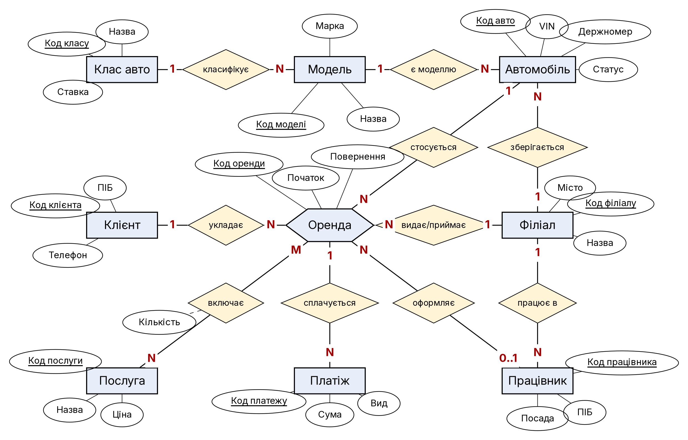
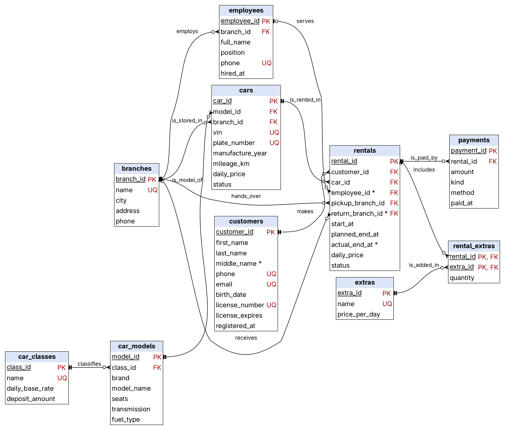
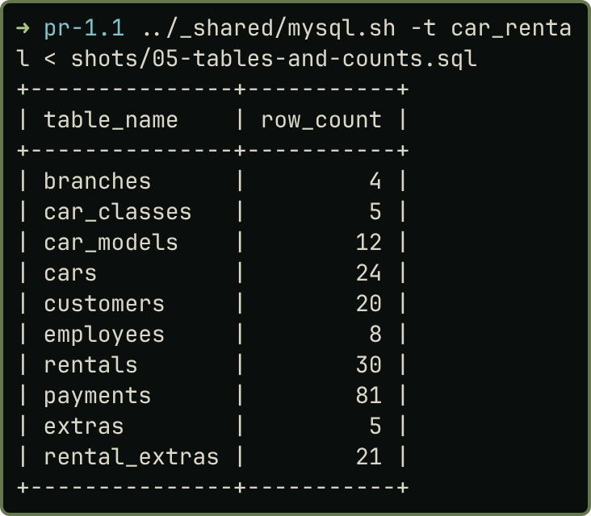
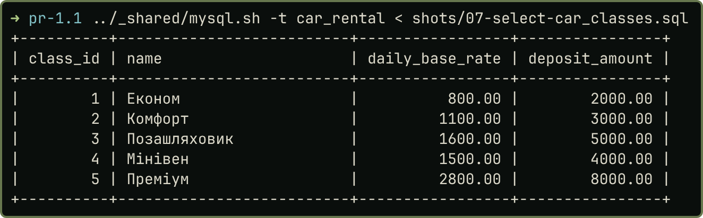

## Завдання

Варіант 22. Прокат автомобілів: філіали, класи й моделі авто, автомобілі, клієнти, працівники, оренди, платежі, додаткові послуги. Мета: побудувати інфологічну й даталогічну моделі, створити й наповнити базу, перевірити обмеження. СУБД: MySQL 8.4 (InnoDB, `utf8mb4`) у Docker.

## Розв'язання

### Інфологічна й даталогічна моделі

Інфологічна модель (рис. 1) має дев'ять сутностей. «Оренду» я позначив шестикутником як асоціативну сутність: вона пов'язує клієнта, авто, працівника й філіал. Зв'язок M:N між «Орендою» і «Послугою» має атрибут «Кількість».

{width=52%}

Даталогічна модель (рис. 2): зв'язок M:N розбито на два 1:N через `rental_extras` зі складеним ключем. Модель у 3НФ. Три ціни різні за змістом: `car_classes.daily_base_rate` — базова (довідкова) ставка класу, `cars.daily_price` — поточний тариф конкретного авто, `rentals.daily_price` — тариф, зафіксований у договорі. Тому ціна договору не дублює ціну авто: після зміни тарифу старі договори зберігають свою суму.

{width=78%}

Позначення на рис. 2: `*` означає, що стовпець допускає `NULL`; кружок на кінці лінії означає «нуль» (зв'язок необов'язковий), риска «один», лапка «багато».

**Опис таблиць** (тип подано з довжиною й точністю). `ON DELETE`: довідникові й фінансові зв'язки мають `RESTRICT`, склад оренди `CASCADE`, працівник у договорі `SET NULL`. Обмежень рівня таблиці немає, якщо не вказано.

| **Філіали (пункти прокату)** (`branches`) | Тип (довжина, точність) | Обмеження |
|:--------------|:------------|:------------------------------------|
| `branch_id` | INT | PK, автоінкремент |
| `name` | VARCHAR(60) | NOT NULL; Unique |
| `city` | VARCHAR(40) | NOT NULL |
| `address` | VARCHAR(100) | NOT NULL |
| `phone` | VARCHAR(20) | NOT NULL |

*Обмеження таблиці:* пара полів `city` і `address` є Unique.

| **Класи автомобілів** (`car_classes`) | Тип (довжина, точність) | Обмеження |
|:--------------|:------------|:------------------------------------|
| `class_id` | INT | PK, автоінкремент |
| `name` | VARCHAR(30) | NOT NULL; Unique |
| `daily_base_rate` | DECIMAL(8,2) | NOT NULL; більше 0 |
| `deposit_amount` | DECIMAL(8,2) | NOT NULL; не менше 0 |

| **Моделі автомобілів** (`car_models`) | Тип (довжина, точність) | Обмеження |
|:--------------|:------------|:------------------------------------|
| `model_id` | INT | PK, автоінкремент |
| `class_id` | INT | FK на `car_classes`, RESTRICT |
| `brand` | VARCHAR(30) | NOT NULL |
| `model_name` | VARCHAR(40) | NOT NULL |
| `seats` | TINYINT | NOT NULL; від 2 до 9 |
| `transmission` | VARCHAR(10) | NOT NULL; лише «manual» або «automatic» |
| `fuel_type` | VARCHAR(10) | NOT NULL; лише «petrol», «diesel», «hybrid», «electric» |

*Обмеження таблиці:* пара полів `brand` і `model_name` є Unique.

| **Автомобілі** (`cars`) | Тип (довжина, точність) | Обмеження |
|:--------------|:------------|:------------------------------------|
| `car_id` | INT | PK, автоінкремент |
| `model_id` | INT | FK на `car_models`, RESTRICT |
| `branch_id` | INT | FK на `branches`, RESTRICT |
| `vin` | CHAR(17) | NOT NULL; Unique |
| `plate_number` | VARCHAR(10) | NOT NULL; Unique |
| `manufacture_year` | SMALLINT | NOT NULL; від 2005 до 2030 |
| `mileage_km` | INT UNSIGNED | NOT NULL; за замовч. 0 |
| `daily_price` | DECIMAL(8,2) | NOT NULL; більше 0 |
| `status` | VARCHAR(12) | NOT NULL; лише «available», «rented», «maintenance», «retired»; за замовч. «available» |

| **Клієнти** (`customers`) | Тип (довжина, точність) | Обмеження |
|:--------------|:------------|:------------------------------------|
| `customer_id` | INT | PK, автоінкремент |
| `first_name` | VARCHAR(40) | NOT NULL |
| `last_name` | VARCHAR(40) | NOT NULL |
| `middle_name` | VARCHAR(40) | NULL |
| `phone` | VARCHAR(20) | NOT NULL; Unique |
| `email` | VARCHAR(80) | NOT NULL; Unique |
| `birth_date` | DATE | NOT NULL |
| `license_number` | VARCHAR(15) | NOT NULL; Unique |
| `license_expires` | DATE | NOT NULL |
| `registered_at` | DATETIME | NOT NULL; за замовч. поточні дата й час |

*Обмеження таблиці:* `license_expires > birth_date`.

| **Працівники** (`employees`) | Тип (довжина, точність) | Обмеження |
|:--------------|:------------|:------------------------------------|
| `employee_id` | INT | PK, автоінкремент |
| `branch_id` | INT | FK на `branches`, RESTRICT |
| `full_name` | VARCHAR(100) | NOT NULL |
| `position` | VARCHAR(10) | NOT NULL; лише «manager», «agent», «mechanic» |
| `phone` | VARCHAR(20) | NOT NULL; Unique |
| `hired_at` | DATE | NOT NULL |

| **Оренди** (`rentals`) | Тип (довжина, точність) | Обмеження |
|:--------------|:------------|:------------------------------------|
| `rental_id` | INT | PK, автоінкремент |
| `customer_id` | INT | FK на `customers`, RESTRICT |
| `car_id` | INT | FK на `cars`, RESTRICT |
| `employee_id` | INT | FK на `employees`, SET NULL; NULL |
| `pickup_branch_id` | INT | FK на `branches`, RESTRICT |
| `return_branch_id` | INT | FK на `branches`, RESTRICT; NULL |
| `start_at` | DATETIME | NOT NULL |
| `planned_end_at` | DATETIME | NOT NULL |
| `actual_end_at` | DATETIME | NULL |
| `daily_price` | DECIMAL(8,2) | NOT NULL; більше 0 |
| `status` | VARCHAR(10) | NOT NULL; лише «booked», «active», «closed», «cancelled»; за замовч. «booked» |

*Обмеження таблиці:* `planned_end_at > start_at`; `actual_end_at IS NULL OR actual_end_at >= start_at`.

| **Платежі** (`payments`) | Тип (довжина, точність) | Обмеження |
|:--------------|:------------|:------------------------------------|
| `payment_id` | INT | PK, автоінкремент |
| `rental_id` | INT | FK на `rentals`, RESTRICT |
| `amount` | DECIMAL(10,2) | NOT NULL; більше 0 |
| `kind` | VARCHAR(10) | NOT NULL; лише «deposit», «rent», «fine», «refund» |
| `method` | VARCHAR(10) | NOT NULL; лише «cash», «card», «online» |
| `paid_at` | DATETIME | NOT NULL; за замовч. поточні дата й час |

| **Додаткові послуги** (`extras`) | Тип (довжина, точність) | Обмеження |
|:--------------|:------------|:------------------------------------|
| `extra_id` | INT | PK, автоінкремент |
| `name` | VARCHAR(50) | NOT NULL; Unique |
| `price_per_day` | DECIMAL(6,2) | NOT NULL; не менше 0 |

| **Склад оренди** (`rental_extras`) | Тип (довжина, точність) | Обмеження |
|:--------------|:------------|:------------------------------------|
| `rental_id` | INT | PK (складений); FK на `rentals`, CASCADE |
| `extra_id` | INT | PK (складений); FK на `extras`, RESTRICT |
| `quantity` | TINYINT | NOT NULL; більше 0; за замовч. 1 |

### Фізична модель і наповнення

`schema.sql` створює базу й 10 таблиць з іменованими обмеженнями (фрагмент нижче); `seed.sql` вставляє вигадані дані українською (4 філіали, 24 авто, 20 клієнтів, 30 оренд, 81 платіж тощо).

| Рисунок 3 — Кількість рядків у таблицях | Рисунок 4 — Вміст таблиці `car_classes` |
|:-----------|:-----------|
| {width=88%} | {width=88%} |

```sql
CREATE DATABASE car_rental CHARACTER SET utf8mb4 COLLATE utf8mb4_0900_ai_ci;
CREATE TABLE rentals (
    rental_id          INT           NOT NULL AUTO_INCREMENT,
    -- … ще 10 стовпців
    CONSTRAINT pk_rentals PRIMARY KEY (rental_id),
    CONSTRAINT fk_rentals_employee FOREIGN KEY (employee_id)
        REFERENCES employees (employee_id) ON DELETE SET NULL,
    -- …
    CONSTRAINT chk_rentals_planned CHECK (planned_end_at > start_at),
    -- …
);
INSERT INTO car_classes (class_id, name, daily_base_rate, deposit_amount) VALUES
(1, 'Економ', 800.00, 2000.00),
(2, 'Комфорт', 1100.00, 3000.00),
-- …
(5, 'Преміум', 2800.00, 8000.00);
```

### Перевірка обмежень

`check.sql` я запускав на копії `car_rental_check`, бо невдалі `INSERT` спалюють `AUTO_INCREMENT`. Три порушення `CHECK` дали помилку 3819, дублікат VIN 1062, неіснуюча модель 1452, видалення філіалу з авто 1451 (`RESTRICT`, рис. 5). `CASCADE` прибрав склад видаленої оренди (було 2 рядки, стало 0). За `SET NULL` після видалення працівника його оренда лишилась із `employee_id = NULL` (оренд без працівника було 5, стало 6). `ON DELETE SET DEFAULT` InnoDB не виконує (1451), тому не застосовано.

{width=46%}

Скрипти й знімки лежать у репозиторії:

<https://github.com/brizzinck/krinzhrepoduta/tree/main/db/pr-1.1>.

## Висновки

Я спроєктував базу прокату авто з 10 таблиць, де зв'язок M:N оренди й послуги розбито таблицею `rental_extras`. Таблиці в 3НФ, обмеження мають власні імена, тому з помилки видно, яке з них спрацювало. Даталогічну діаграму зібрано з `information_schema`, тож вона збігається зі схемою. Для працівника в договорі обрано `SET NULL`: договір лишається в історії після звільнення. `check.sql` підтвердив роботу `CHECK`, `UNIQUE`, `FOREIGN KEY`, `RESTRICT`, `CASCADE` і `SET NULL`.
