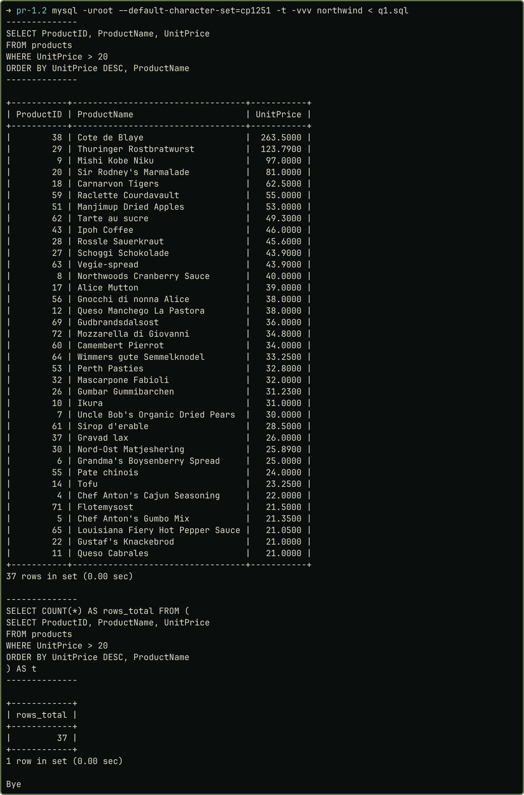
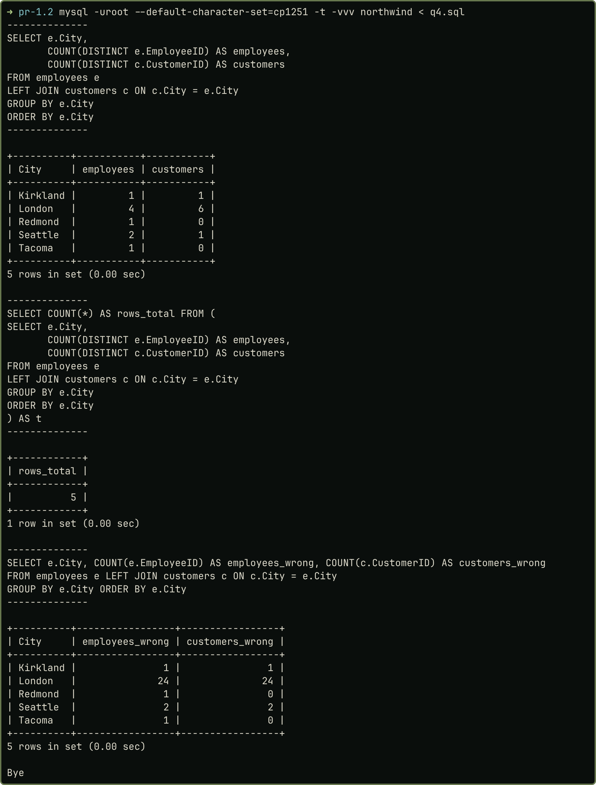
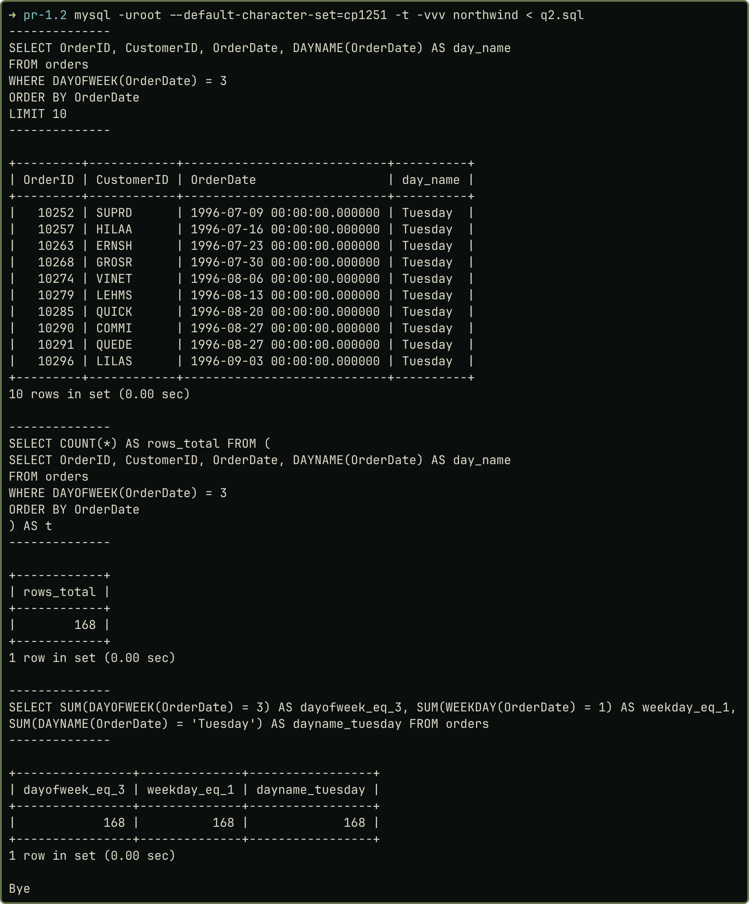
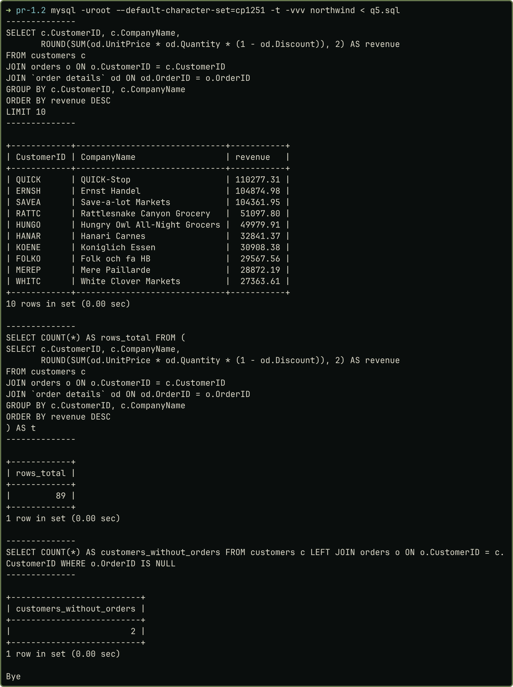
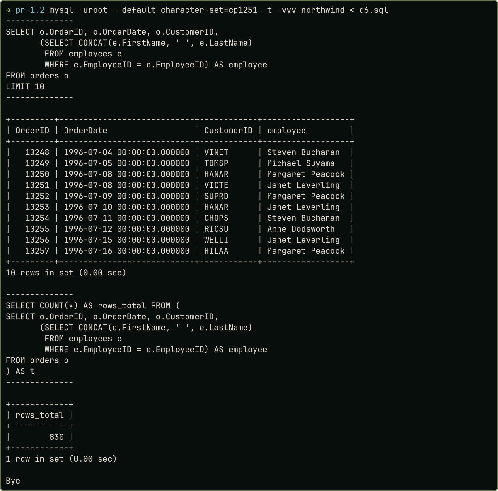
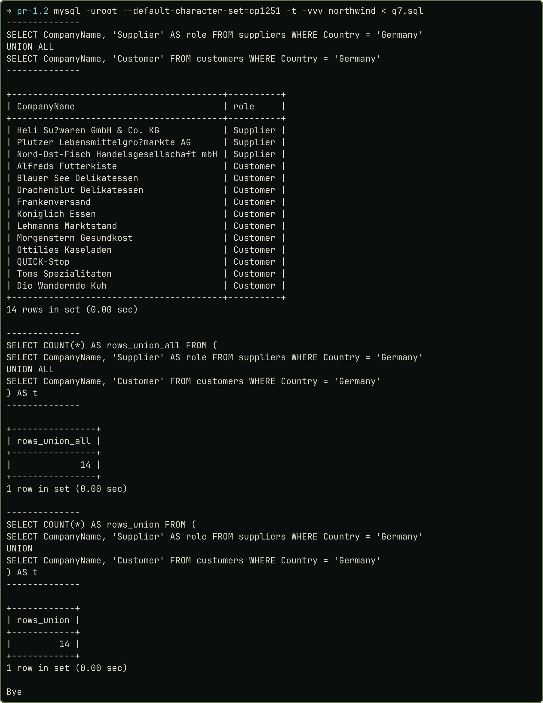
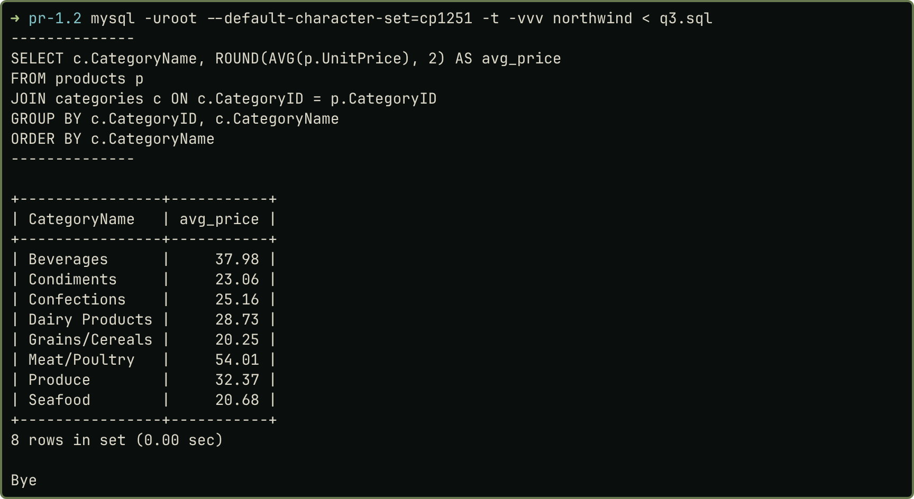

## Завдання

Мета: опанувати запити вибірки `SELECT`. БД Northwind (скрипт викладачки), MySQL 8.4 у Docker. Варіант 2: (1) продукти з ціною понад 20 $; (2) замовлення, зроблені у вівторок; (3) середня ціна продуктів по категоріях; (4) кількість співробітників і клієнтів у містах, де є співробітники (5 рядків, `JOIN`); (5) доходи від кожного клієнта; (6) замовлення й співробітники, відповідальні за доставку (830 рядків, підзапити); (7) постачальники й клієнти з Німеччини без видалення дублікатів. За умовою запит 7 виконується множинними операціями (не `JOIN`/підзапитами), а з запитів 5 і 6 один виконується через `JOIN`-и, інший підзапитами.

## Розв'язання

**Підготовка бази.** У дампі викладачки `Discount` має тип `float(24,0)`, тому всі знижки дорівнюють 0, а дохід 1997 р. виходить 658 388,75, а за T-SQL-версією скрипта 617 085,2. Знижки відновлено з T-SQL-версії (`DECIMAL(4,2)`, 838 значень), суми збіглися. У знімках видно запит і результат; для запитів 2, 5, 6 показано 10 перших рядків і окремий `COUNT(*)`.

### Запити 1–3

```sql
SELECT ProductID, ProductName, UnitPrice
FROM products
WHERE UnitPrice > 20
ORDER BY UnitPrice DESC, ProductName;

SELECT OrderID, CustomerID, OrderDate, DAYNAME(OrderDate) AS day_name
FROM orders
WHERE DAYOFWEEK(OrderDate) = 3
ORDER BY OrderDate;

SELECT c.CategoryName, ROUND(AVG(p.UnitPrice), 2) AS avg_price
FROM products p
JOIN categories c ON c.CategoryID = p.CategoryID
GROUP BY c.CategoryID, c.CategoryName
ORDER BY c.CategoryName;
```

Запит 1: 37 рядків. Запит 2: відповідник `DATEPART(weekday, …)` у MySQL: `DAYOFWEEK()` (вівторок = 3); `WEEKDAY()` і `DAYNAME()` дали ті самі 168 замовлень. Запит 3: `JOIN` із `categories` і `GROUP BY`, 8 категорій.

### Запит 4 (`JOIN`)

```sql
SELECT e.City,
       COUNT(DISTINCT e.EmployeeID) AS employees,
       COUNT(DISTINCT c.CustomerID) AS customers
FROM employees e
LEFT JOIN customers c ON c.City = e.City
GROUP BY e.City
ORDER BY e.City;
```

`LEFT JOIN` зберігає міста без клієнтів. `COUNT(DISTINCT …)` обов'язковий: з'єднання множить рядки (Лондон: 4 × 6 = 24), без нього лічильники хибні (рис. 2). Результат: 5 рядків, як в умові.

### Запити 5 (кілька `JOIN`-ів), 6 (підзапит), 7 (множинна операція)

```sql
SELECT c.CustomerID, c.CompanyName,
       ROUND(SUM(od.UnitPrice * od.Quantity * (1 - od.Discount)), 2) AS revenue
FROM customers c
JOIN orders o ON o.CustomerID = c.CustomerID
JOIN `order details` od ON od.OrderID = o.OrderID
GROUP BY c.CustomerID, c.CompanyName
ORDER BY revenue DESC;

SELECT o.OrderID, o.OrderDate, o.CustomerID,
       (SELECT CONCAT(e.FirstName, ' ', e.LastName)
        FROM employees e
        WHERE e.EmployeeID = o.EmployeeID) AS employee
FROM orders o;

SELECT CompanyName, 'Supplier' AS role FROM suppliers WHERE Country = 'Germany'
UNION ALL
SELECT CompanyName, 'Customer' FROM customers WHERE Country = 'Germany';
```

Запит 5: дохід рядка це `UnitPrice * Quantity * (1 - Discount)`; `INNER JOIN` дає 89 клієнтів (ще двоє з 91 замовлень не мають), перший — QUICK-Stop, 110 277,31. Запит 6: скалярний корельований підзапит у списку `SELECT`; «відповідальний» означає `orders.EmployeeID` (`ShipVia` веде на перевізників). Результат: 830 рядків, як в умові. Запит 7: `UNION ALL` не видаляє дублікатів, стовпець `role` показує, хто постачальник, а хто клієнт; 3 + 11 = 14 рядків (`UNION` дав би стільки ж, але `ALL` відповідає умові).

### Знімки результатів

| Рисунок 1 — Запит 1 (37 рядків) | Рисунок 2 — Запит 4 (5 рядків; знизу хибні лічильники без `DISTINCT`) |
|:-----------|:-----------|
| {width=80%} | {width=80%} |

| Рисунок 3 — Запит 2 (10 перших, 168 рядків) | Рисунок 4 — Запит 5 (10 перших, 89 клієнтів) |
|:-----------|:-----------|
| {width=80%} | {width=80%} |

| Рисунок 5 — Запит 6 (10 перших, 830 рядків) | Рисунок 6 — Запит 7 (`UNION ALL`, 14 рядків) |
|:-----------|:-----------|
| {width=80%} | {width=80%} |

{width=42%}

Скрипт `queries.sql`, виправлення дампа й знімки: <https://github.com/brizzinck/krinzhrepoduta/tree/main/db/pr-1.2>.

## Висновки

У роботі виконано сім запитів варіанта 2 на базі Northwind у MySQL 8.4: вибірку з умовою, відбір за днем тижня, агрегацію, з'єднання з лічильниками, дохід зі знижкою через `JOIN`-и, скалярний підзапит і `UNION ALL`. Результати збігаються з умовою: 5 рядків у запиті 4 і 830 у запиті 6. Звірка доходу 1997 р. (617 085,2) із T-SQL-версією скрипта виявила дефект наданого дампа (обнулені знижки). Опановано відповідники T-SQL у MySQL (`DATEPART` замінюється на `DAYOFWEEK`, `+` на `CONCAT`). Показано, що `COUNT(DISTINCT)` захищає лічильники від множення рядків у `JOIN`, а вибір між `INNER` і `LEFT JOIN` змінює результат (89 проти 91 клієнтів).
