## Мета і завдання

Мета: дослідити процедури, представлення, тригери, транзакції та доступ до БД. База Northwind, MySQL 8.4 у Docker, приклади викладачки перекладено з T-SQL. Варіант 2: (1) оновити адресу замовника в `Customers` і зробити `ROLLBACK` на рівні `READ UNCOMMITTED`; (2) процедура додавання запису в `Products`; (3) таблиця `Products Log` і тригер на додавання; (4) view на основі запиту 6 із ПР 1.2; (5) користувач `ПрізвищеІм'яГрупа` з привілеями `Create, Insert, Update, Delete, Select`, відкликання `Create`, видалення користувача.

## Завдання 1. Транзакція

```{.sql .small}
SET TRANSACTION ISOLATION LEVEL READ UNCOMMITTED;
START TRANSACTION;
UPDATE customers SET Address = 'вул. Тестова, 1' WHERE CustomerID = 'ALFKI';
SELECT CustomerID, Address FROM customers WHERE CustomerID = 'ALFKI';
ROLLBACK;
```

`SET TRANSACTION` без `SESSION` у MySQL діє лише на наступну транзакцію, тому команда стоїть безпосередньо перед `START TRANSACTION`. Після `ROLLBACK` адреса повернулася до `Obere Str. 57` (рис. 1). В одній сесії рівень ізоляції непомітний, тому я запустив дві одночасно: сесія A тримає незафіксовану зміну 6 с, сесія B читає той самий рядок. На `READ UNCOMMITTED` сесія B бачить `вул. Тестова, 1`, тобто брудне читання (рис. 2), а на `READ COMMITTED` лише стару адресу (рис. 3).

| Рисунок 1 — `UPDATE` і `ROLLBACK` | Рисунки 2 (згори) і 3 (знизу) — дві сесії |
|:-----------|:-----------|
| 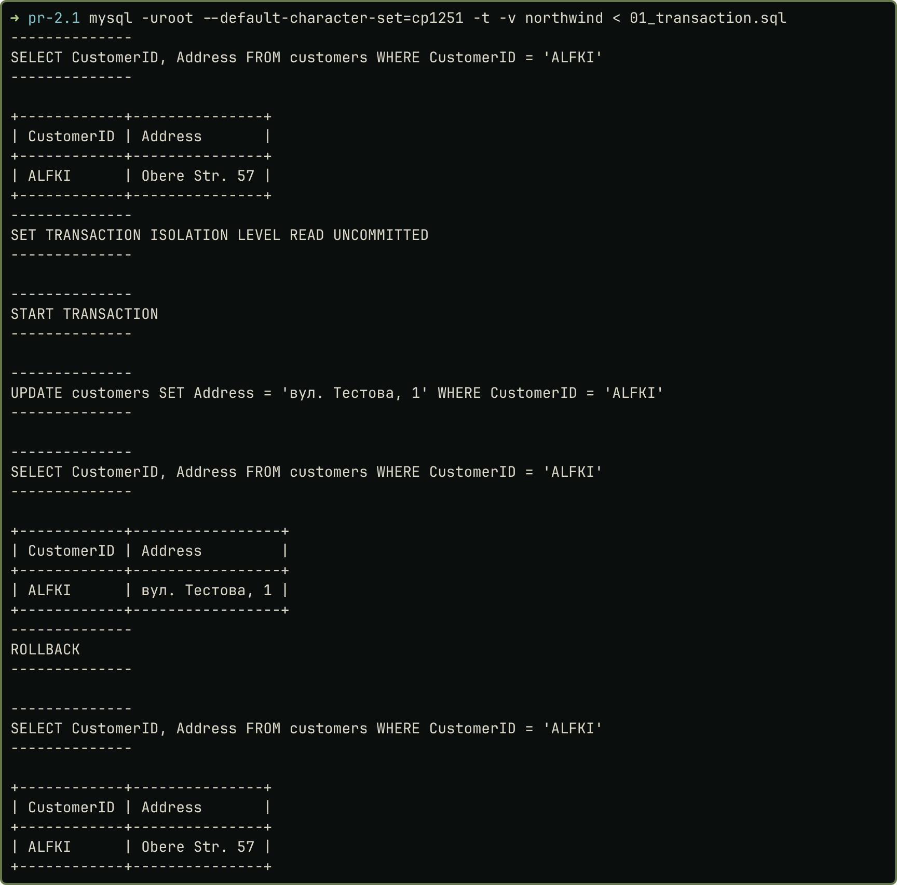 | 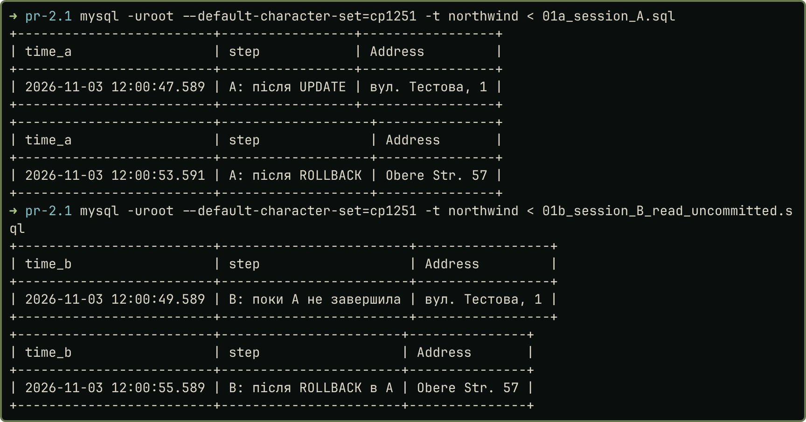 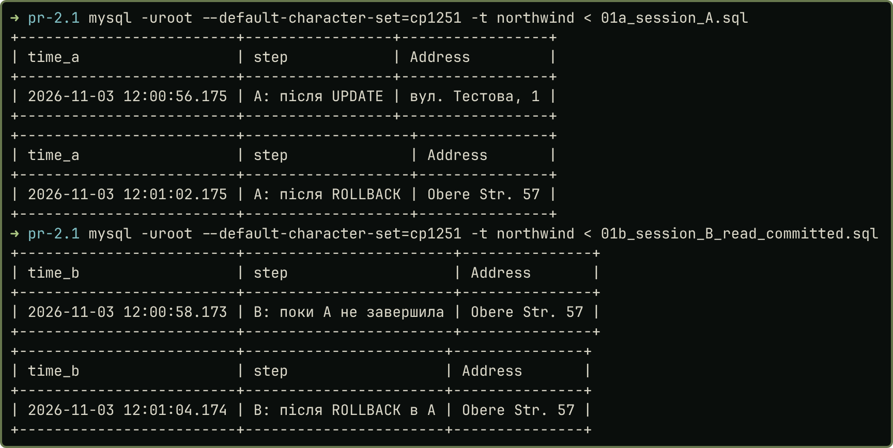 |

## Завдання 2. Процедура додавання в `products`

```{.sql .small}
DELIMITER $$
CREATE PROCEDURE AddProduct(
    IN p_name VARCHAR(40), IN p_supplier_id INT, IN p_category_id INT,
    IN p_qty_per_unit VARCHAR(20), IN p_unit_price DECIMAL(19,4),
    IN p_units_in_stock SMALLINT, IN p_units_on_order SMALLINT,
    IN p_reorder_level SMALLINT, IN p_discontinued TINYINT(1), OUT p_new_id INT)
BEGIN
    INSERT INTO products (ProductName, SupplierID, CategoryID, QuantityPerUnit, UnitPrice,
                          UnitsInStock, UnitsOnOrder, ReorderLevel, Discontinued)
    VALUES (p_name, p_supplier_id, p_category_id, p_qty_per_unit, p_unit_price,
            p_units_in_stock, p_units_on_order, p_reorder_level, p_discontinued);
    SET p_new_id = LAST_INSERT_ID();
END$$
DELIMITER ;
```

У дампі Northwind для MySQL втрачено `IDENTITY`, тому `ProductID` я перевів на `AUTO_INCREMENT`. Новий ключ процедура повертає через `OUT`-параметр. У T-SQL виклик робить `EXEC`, тут `CALL` (рис. 4).

## Завдання 3. Журнал і тригер

```{.sql .small}
CREATE TABLE productslog (
    LogID INT AUTO_INCREMENT PRIMARY KEY, ProductID INT, ProductName VARCHAR(40), SupplierID INT,
    CategoryID INT, UnitPrice DECIMAL(19,4), UnitsInStock SMALLINT,
    LogDate DATETIME DEFAULT CURRENT_TIMESTAMP);
CREATE TRIGGER trg_products_ai AFTER INSERT ON products FOR EACH ROW
    INSERT INTO productslog (ProductID, ProductName, SupplierID, CategoryID, UnitPrice, UnitsInStock)
    VALUES (NEW.ProductID, NEW.ProductName, NEW.SupplierID, NEW.CategoryID, NEW.UnitPrice, NEW.UnitsInStock);
```

Ім'я таблиці записане без пробілу. Замість таблиці `inserted` із T-SQL у MySQL є псевдорядок `NEW`, а тригер спрацьовує на кожен рядок. Тому `INSERT` із двома рядками дав два записи в журналі (рис. 5). Продукта 78 у журналі немає: його додано до створення тригера.

| Рисунок 4 — Виклик `AddProduct` | Рисунок 5 — Спрацювання тригера |
|:-----------|:-----------|
| 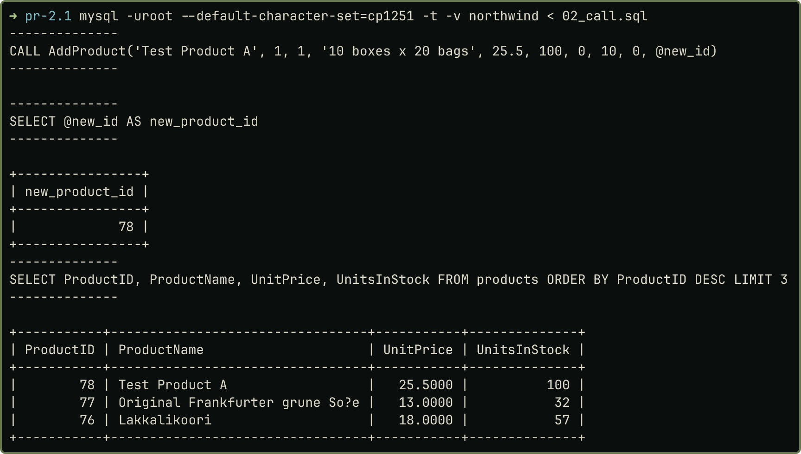 | 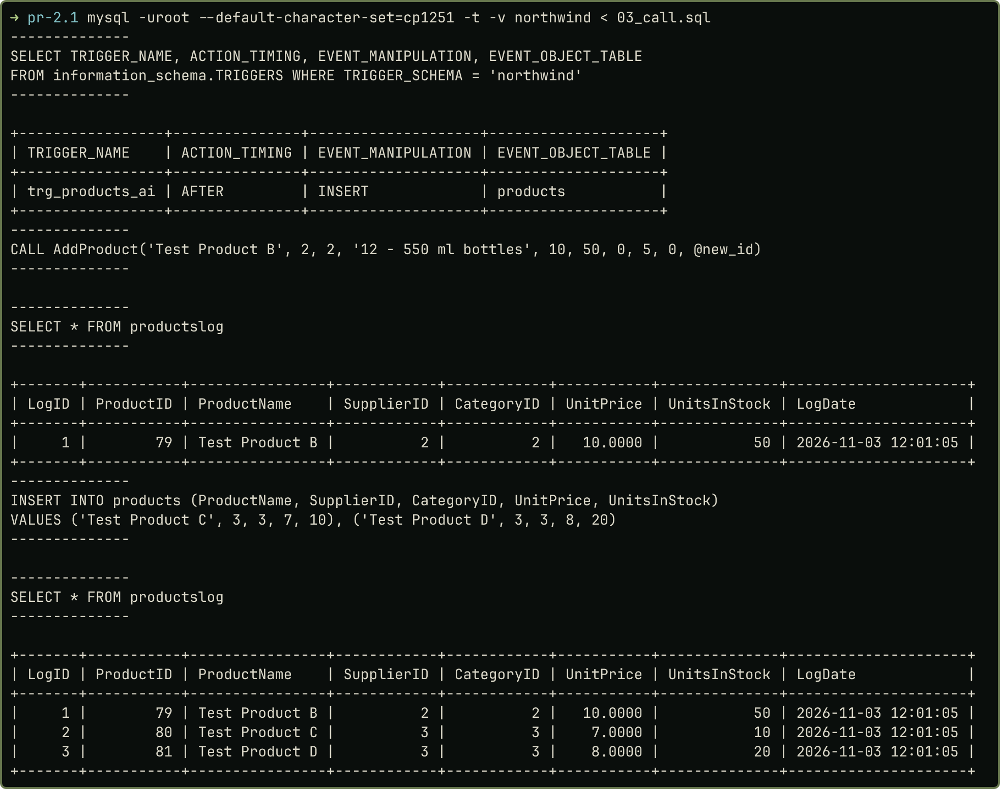 |

## Завдання 4. Представлення

```{.sql .small}
CREATE OR REPLACE VIEW v_orders_with_employees AS
SELECT o.OrderID, o.OrderDate, o.CustomerID,
       (SELECT CONCAT(e.FirstName, ' ', e.LastName)
        FROM employees e WHERE e.EmployeeID = o.EmployeeID) AS employee
FROM orders o;
```

Запит 6 із ПР 1.2 став view без змін. Вибірка дає ті самі 830 рядків (рис. 6).

## Завдання 5. Користувач

Ім'я записане латиницею: `LavrishkoVladyslavTCR32`. Команди видно на знімках. `DENY` у MySQL немає, забороною є відсутність привілею, тому `Create` відкликано через `REVOKE`. Після цього `CREATE TABLE` дає помилку 1142, а `INSERT` і `SELECT` працюють. Після `DROP USER` вхід дає помилку 1045.

| Рисунок 6 — Вибірка з view | Рисунок 7 — Створення користувача і `GRANT` |
|:-----------|:-----------|
| 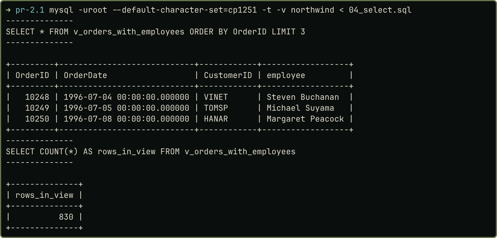 | 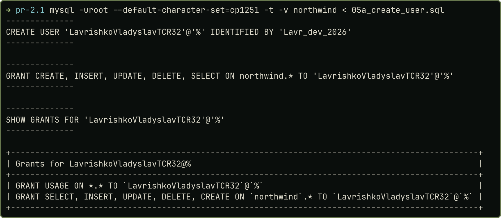 |

| Рисунок 8 — Усі п'ять привілеїв працюють | Рисунок 9 — `REVOKE CREATE` |
|:-----------|:-----------|
| 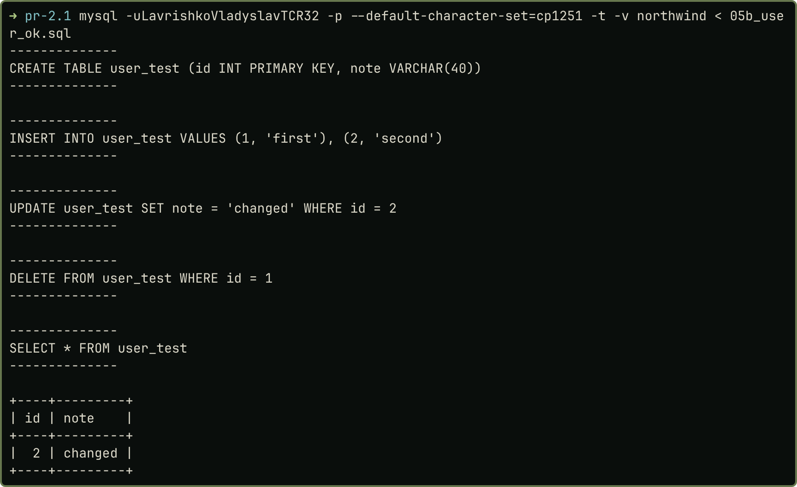 | 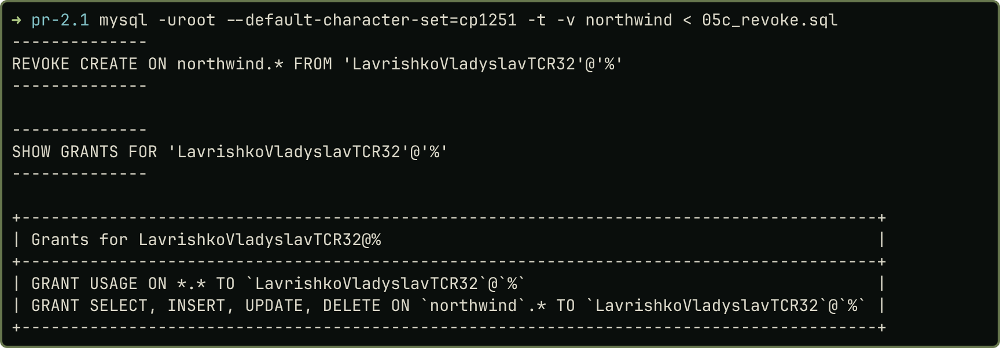 |

| Рисунок 10 — `CREATE` заборонено | Рисунок 11 (згори) — `DROP USER`; рисунок 12 (знизу) — вхід неможливий |
|:-----------|:-----------|
| 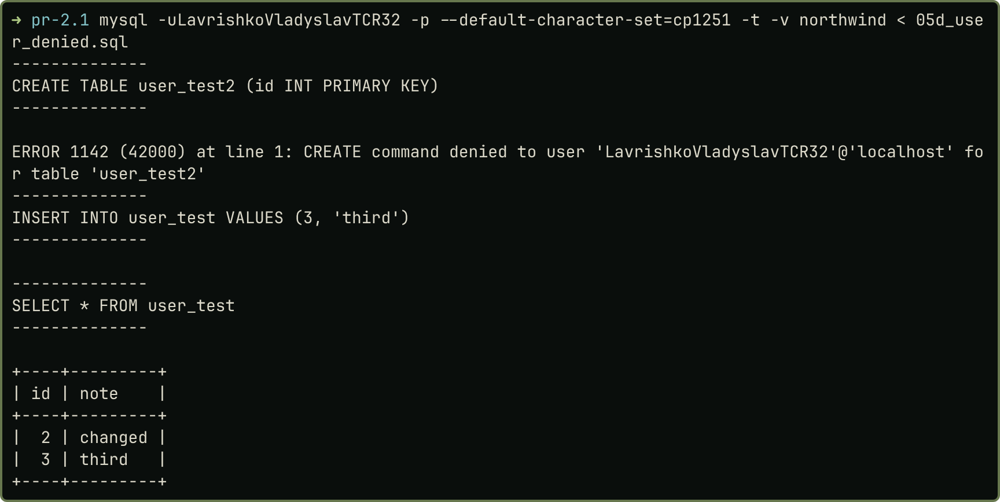 | 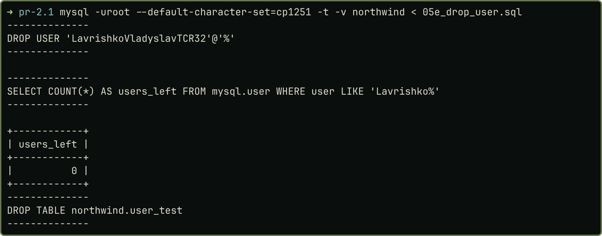 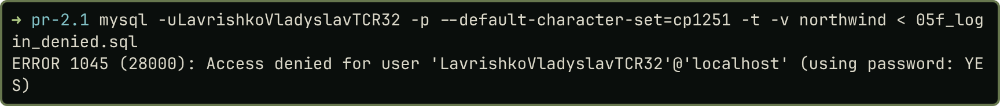 |

Скрипти: <https://github.com/brizzinck/krinzhrepoduta/tree/main/db/pr-2.1>.

## Висновки

Я виконав п'ять завдань варіанта 2 на базі Northwind. `ROLLBACK` скасував зміну адреси, а дві сесії показали брудне читання на `READ UNCOMMITTED` і його відсутність на `READ COMMITTED`. Процедура `AddProduct` додає продукт і повертає його ключ, а тригер записує кожен новий рядок у `productslog`. View на основі запиту 6 дає ті самі 830 рядків. Для користувача пройдено весь цикл від `CREATE USER` до `DROP USER`. Опановано відмінності MySQL від T-SQL: `CALL` замість `EXEC`, `NEW` замість `inserted`, `REVOKE` замість `DENY`.
