## Мета і завдання

Мета: дослідити сторінки, індекси й фрагментацію, плани виконання запитів та їх оптимізацію. Завдання: (1) виконати вказівки до завдання 1 на таблиці `test_index`; (2) створити БД оновленим скриптом; (3) дослідити плани запитів 3–7 варіанта 2 із ПР 1.2; (4) зробити висновок про потребу оптимізації; (5) оптимізувати індексами або зміною запиту й показати план і час до та після.

## Середовище і відмінності від SQL Server

Роботу виконано в MySQL 8.4 (InnoDB) у Docker, база `northwind_opt`. Оновлений скрипт викладачки написаний на T-SQL, тому базу я створив із MySQL-дампа Northwind: лише первинні ключі та індекси під зовнішні ключі. InnoDB сам створює індекс під `FOREIGN KEY` і не дає його видалити, тому стан «без індексів під FK» недосяжний.

Вказівки написані під SQL Server, тому кожен крок я адаптував:

| SQL Server | MySQL 8.4 (InnoDB) |
|:-------------|:-------------|
| куча, `sys.indexes` | купи немає: таблиця без ключа кластеризована за прихованим `GEN_CLUST_INDEX`; запит до `INNODB_INDEXES` |
| `sys.dm_db_index_physical_stats` | вбудованого аналога немає; мій скрипт `ibdstat.py` читає сторінки копії файлу `.ibd` |
| `sp_spaceused` | `ANALYZE TABLE` і запит до `information_schema.TABLES`; `TABLE_ROWS` це оцінка, тому поруч є `COUNT(*)` |
| сторінка 8 КБ, рядок 30 на сторінку | сторінка 16 КБ, порогові кількості рядків інші |
| кластеризований індекс, uniquifier | `PRIMARY KEY`, завжди унікальний; uniquifier немає |
| `REBUILD`, `REORGANIZE` | `OPTIMIZE TABLE` (перебудова); `REORGANIZE` немає |
| `SET SHOWPLAN_ALL`, `SET STATISTICS TIME` | `EXPLAIN`, `EXPLAIN ANALYZE` |

У знімках `ibdstat.py` стовпець `used_pct` це внутрішня заповненість (зі службовими байтами сторінки), а `frag_pct` зовнішня фрагментація: це мій розрахунок, а не вбудований засіб СУБД. Рядки зі знаком `#` на знімках містять текст кроку. Усі оператори лежать у `part1_test_index.sql`.

## Завдання 1. Дослідження кучі

Порожня таблиця вже займає одну сторінку (16 КБ), у SQL Server нуль (рис. 1). Один рядок дає 2,5 % заповненості (рис. 2), 30 рядків лише 52 % (рис. 3). Рядок займає близько 270 байтів, тому наступна сторінка з'являється на 55-му рядку: корінь розщеплюється на дві листові сторінки й новий корінь, тобто дерево має вже два рівні (рис. 4). У SQL Server це сталося б на 31-му рядку без другого рівня.

**Підзавдання 1.** Після 240 рядків маємо 5 листових сторінок із заповненістю 83 % і корінь (рис. 5). Зовнішньої фрагментації немає: рядки вставляються послідовно за внутрішнім `DB_ROW_ID`. **Підзавдання 2.** 241-й рядок нової сторінки не виділив, заповненість зросла до 83,31 % (рис. 6): на останній сторінці ще було місце.

| Рисунок 1 — Порожня таблиця без ключа | Рисунок 2 — Один рядок |
|:-----------|:-----------|
| 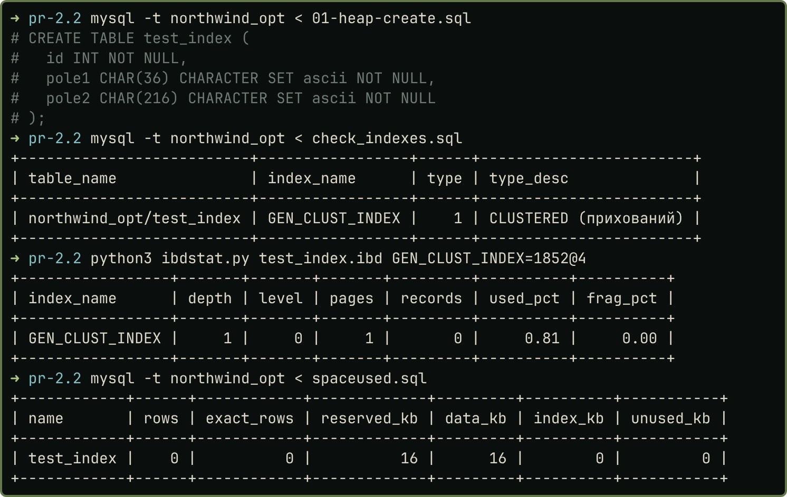 | 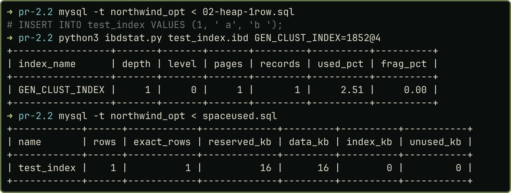 |

| Рисунок 3 — 30 рядків | Рисунок 4 — Рядок із новою сторінкою |
|:-----------|:-----------|
| 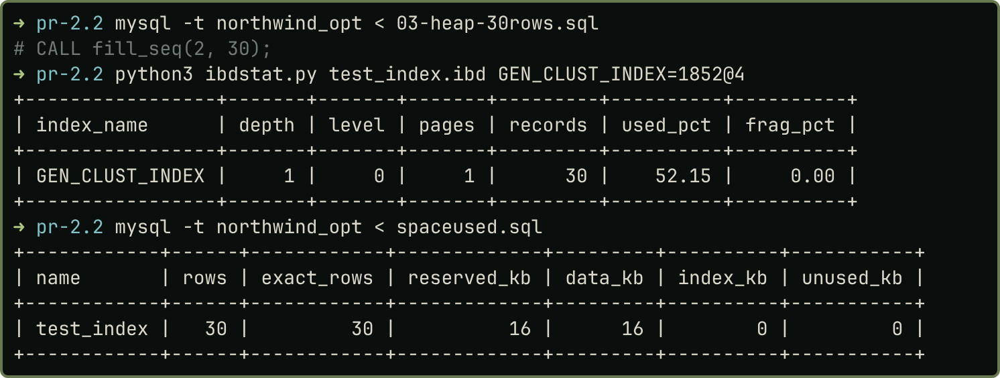 | 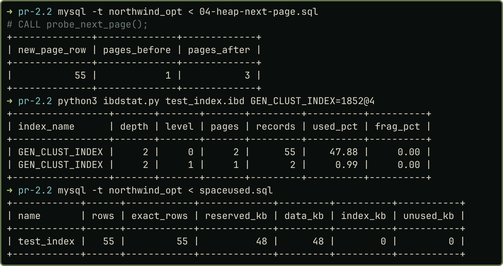 |

| Рисунок 5 — 240 рядків | Рисунок 6 — 241-й рядок |
|:-----------|:-----------|
| 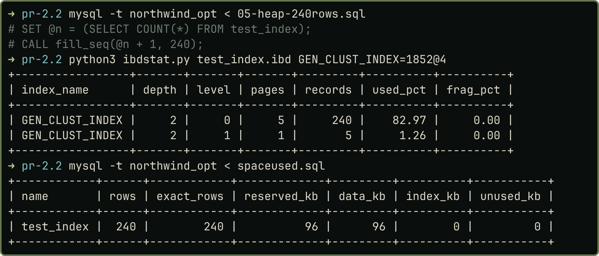 | 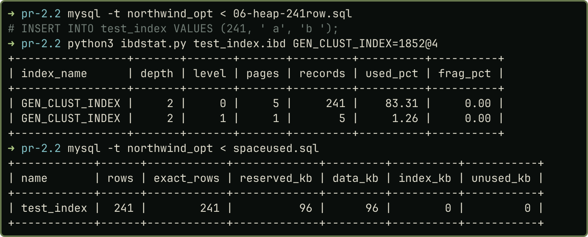 |

## Завдання 1. Кластеризований індекс

`ALTER TABLE ... ADD PRIMARY KEY (id)` реорганізує таблицю: прихований індекс змінився на `PRIMARY` (рис. 7). `CREATE CLUSTERED INDEX` у MySQL немає. На 18630 рядках у методичці 621 сторінка і два рівні, а в мене 340 сторінок (рис. 8). Рядок 18631 третього рівня не додав (рис. 9), бо на сторінці 16 КБ вміщується майже вдвічі більше рядків. Третій рівень у мене з'явився на 66138-му рядку (рис. 10): це я знайшов бінарним пошуком.

| Рисунок 7 — `PRIMARY KEY` | Рисунок 8 — 18630 рядків |
|:-----------|:-----------|
| 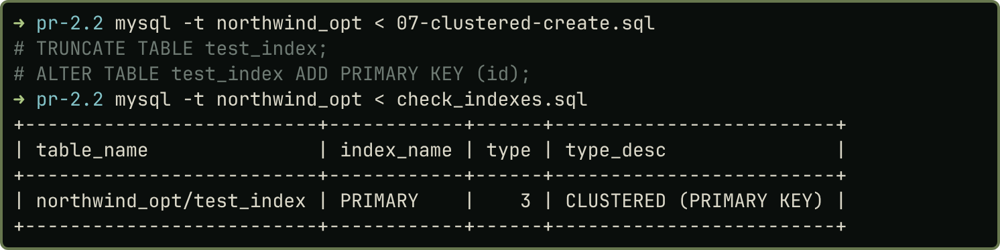 | 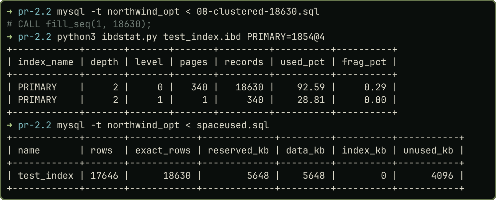 |

| Рисунок 9 — 18631 рядок | Рисунок 10 — Межа 2 і 3 рівнів |
|:-----------|:-----------|
| 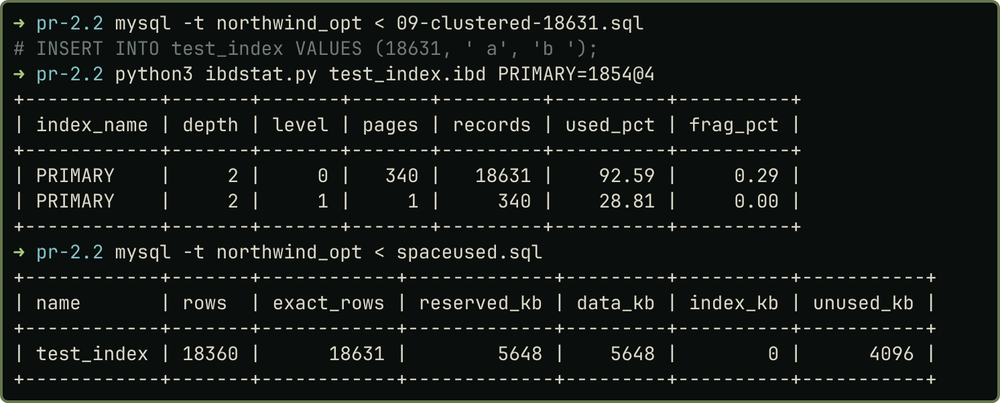 | 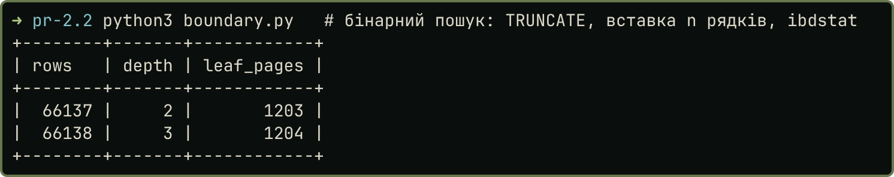 |

**Неунікальний ключ.** Кластеризований ключ InnoDB унікальний завжди: дубль дає помилку 1062 (рис. 11), тому uniquifier не потрібен, а експеримент із 8906 неунікальними рядками прямо не повторюється. Найближчий аналог я зробив на вторинному індексі `idx_id`: для `j % 100` він займає 14 сторінок із заповненістю 61 % і фрагментацією 93 % (рис. 12, 13), а для унікальних значень 9 сторінок, 94 % і 22 %. 8907-й рядок нічого не змінив. Причина різниці в порядку надходження ключів: вони приходять по колу, і сторінки розщеплюються посередині.

| Рисунок 11 — Дубль ключа | Рисунок 12 — Неунікальний індекс, 8906 рядків |
|:-----------|:-----------|
| 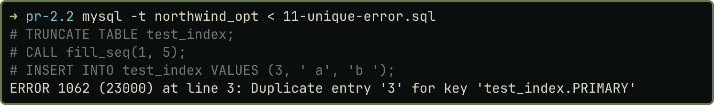 | 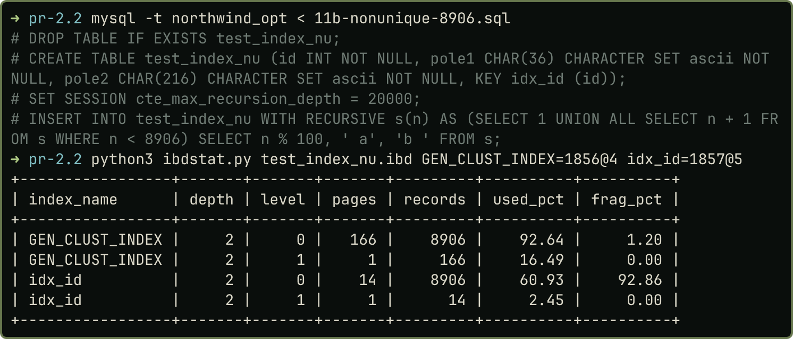 |

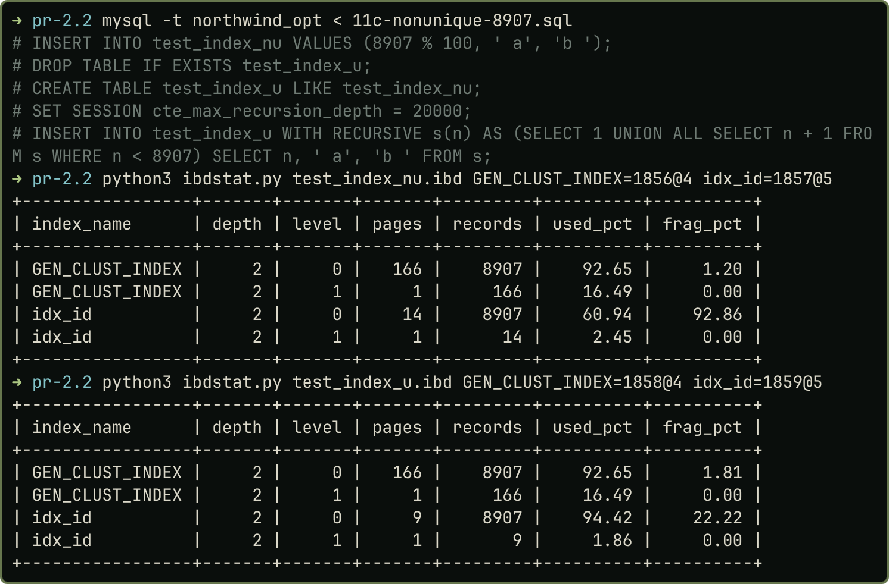{width=52%}

## Завдання 1. Фрагментація

Послідовний ключ `pole1` дає 165 сторінок, заповненість 92 % і фрагментацію 0,6 % (рис. 14). `UUID()` у MySQL має версію 1 і залежить від часу, тому значення йдуть майже за зростанням і результат такий самий (рис. 15). Аналог `NEWID()` я отримав через `RANDOM_BYTES`: 232 сторінки, заповненість 66 %, фрагментація 99,57 % (рис. 16). Це близько до методички (68 % і 99 %). `OPTIMIZE TABLE` перебудував таблицю: 164 сторінки, 93 %, фрагментація 4,88 % (рис. 17). Методичка радить реорганізацію за фрагментації до 30 % і перебудову понад 30 %; у MySQL доступна лише перебудова.

| Рисунок 14 — Послідовний ключ | Рисунок 15 — `UUID()` |
|:-----------|:-----------|
| 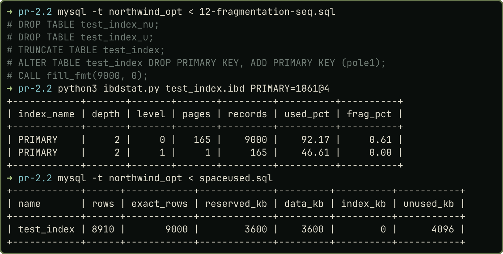 | 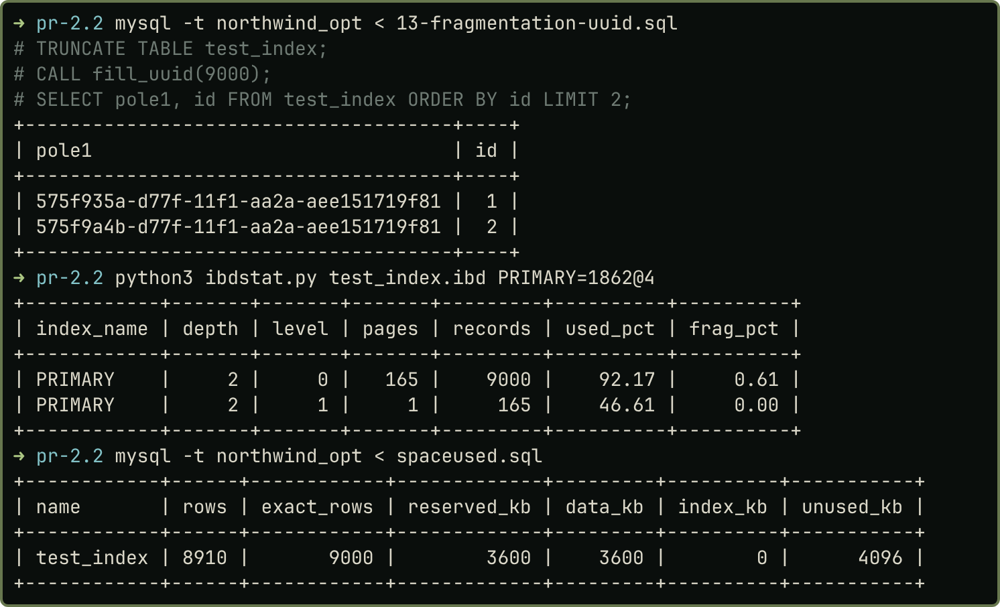 |

| Рисунок 16 — Випадковий ключ | Рисунок 17 — Після `OPTIMIZE TABLE` |
|:-----------|:-----------|
| 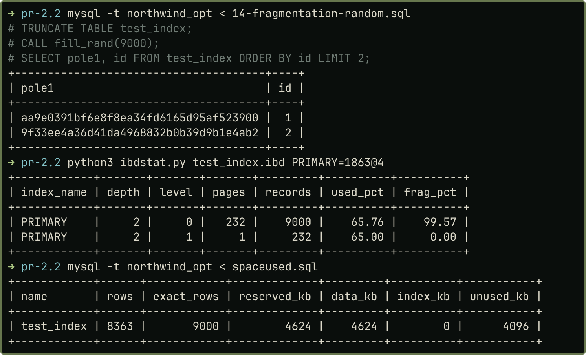 | 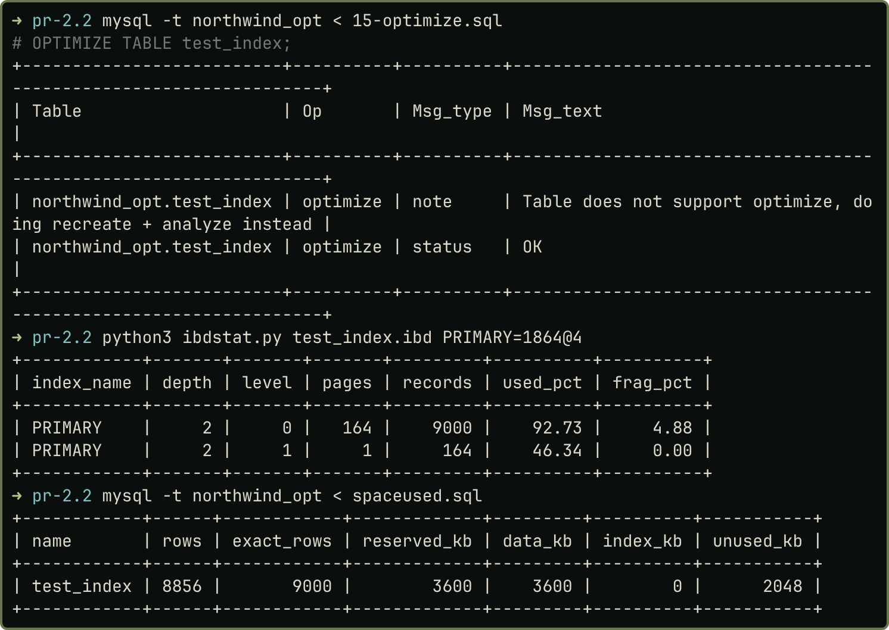 |

## Завдання 1. Некластеризований індекс

Індекс на `pole1` при таблиці без ключа: 94 сторінки на 24472 рядки, бо вторинний запис містить лише ключ і значення `DB_ROW_ID` (рис. 18). Рядки `'10000'` потрапляють між `'1000'` і `'1001'`, тому фрагментація 31,91 %, вище порога перебудови. Рядок 24473 нічого помітно не змінив (рис. 19). З кластеризованим `id` індекс на сталому значенні `pole1` (у циклі методички `format(@i)`, а не `@j`) заповнений на 98,55 % (рис. 20), а `OPTIMIZE TABLE` перебудував обидва індекси, фрагментація близько 5 % (рис. 21).

| Рисунок 18 — Індекс на таблиці без ключа | Рисунок 19 — Рядок 24473 |
|:-----------|:-----------|
| 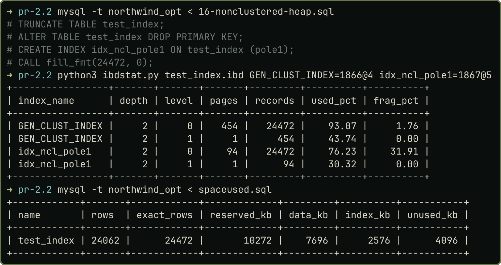 | 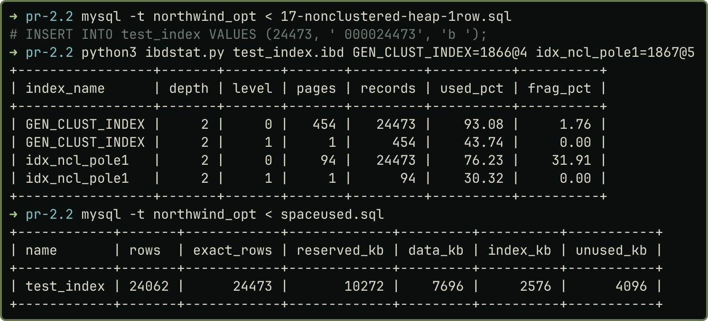 |

| Рисунок 20 — `PRIMARY KEY` та індекс | Рисунок 21 — Перебудова обох |
|:-----------|:-----------|
| 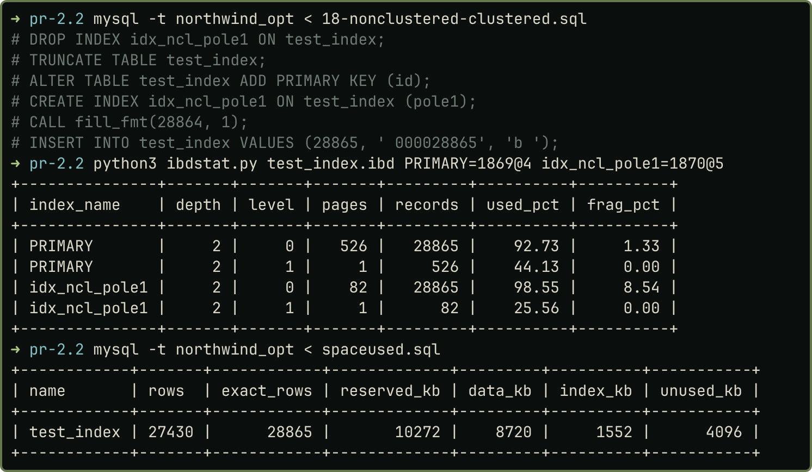 | 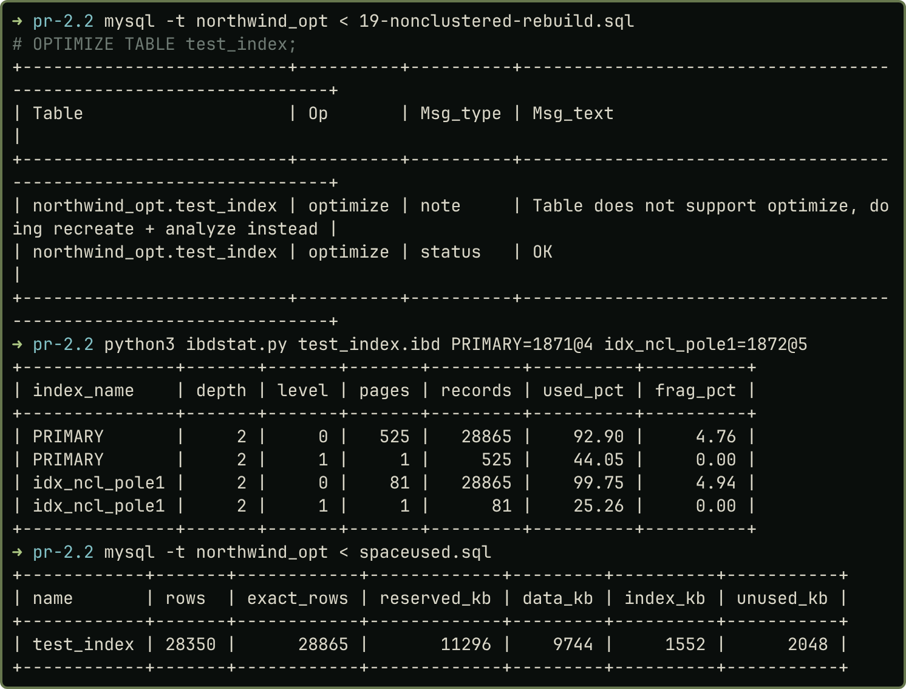 |

## Завдання 2–5. Плани виконання запитів 3–7

Тексти запитів наведені у звіті ПР 1.2 і в `part2_queries.sql`. Кожен знімок містить основні стовпці `EXPLAIN`, дерево `EXPLAIN ANALYZE`, `query_cost`, лічильники `Handler_read_*` (аналог логічних читань) і час 500 запусків за `performance_schema`. Повні плани лежать у `plans/`. У таблиці час узято як мінімальний: на такому малому обсязі середнє більше залежить від навантаження машини.

Індекси й переписані запити:

```{.sql .small}
CREATE INDEX idx_products_cat_price ON products (CategoryID, UnitPrice);          -- запит 3
CREATE INDEX idx_customers_city ON customers (City);                              -- запит 4
CREATE INDEX idx_employees_city ON employees (City);                              -- запит 4
CREATE INDEX idx_suppliers_country ON suppliers (Country, CompanyName);           -- запит 7
CREATE INDEX idx_customers_country ON customers (Country, CompanyName);           -- запит 7
-- запит 5: групування лише за первинним ключем (CompanyName від нього залежить)
... GROUP BY c.CustomerID ORDER BY revenue DESC;
-- запит 6: скалярний підзапит замінено на з'єднання
SELECT o.OrderID, o.OrderDate, o.CustomerID, CONCAT(e.FirstName, ' ', e.LastName) AS employee
FROM orders o LEFT JOIN employees e ON e.EmployeeID = o.EmployeeID;
```

| № | Висновок за планом «до» | `query_cost` | `min_ms` | `rows_exam` |
|:-|:-------------------|:--------|:--------|:------|
| 3 | `p` читається через індекс FK із зверненням до рядків; є сенс у покриваючому індексі | 22,66 і 18,70 | 0,063 і 0,043 | 93 і 93 |
| 4 | обидві таблиці `ALL`, hash join; оптимізація потрібна | 920,26 і 22,55 | 0,050 і 0,026 | 129 і 36 |
| 5 | тимчасова таблиця через `GROUP BY` за двома стовпцями; оптимізація потрібна | 762,21 і 762,21 | 1,743 і 1,232 | 3165 і 3165 |
| 6 | підзапит виконується 830 разів; оптимізація потрібна | 85,25 і 852,65 | 0,665 і 0,238 | 1660 і 839 |
| 7 | обидві таблиці `ALL`, відбір за `Country`; оптимізація потрібна | 12,50 і 1,98 | 0,024 і 0,019 | 120 і 14 |

У клітинках спочатку значення до оптимізації, потім після. Запит 3: `Using index` прибрав звернення до рядків, але кількість прочитаних рядків не змінилась. Запит 4 виграв найбільше: `ALL` змінився на `index` і `ref`. Запит 5: `tmp_tables` упав з 1 до 0 (`Group aggregate` у дереві), оцінка вартості не змінилась, хоча `EXPLAIN` і далі пише `Using temporary`. Запит 6: оцінка оптимізатора погіршилась у 10 разів через hash join, а фактичний час скоротився майже втричі, тому оцінці тут довіряти не можна. Запит 7: перехід на покриваючі індекси зменшив кількість прочитаних рядків у 8,6 раза, але час різниться в межах кількох мікросекунд, середній час не змінився. Результат переписаних запитів 5 і 6 збігається з оригіналом (рис. 32).

| Рисунок 22 — Запит 3, до | Рисунок 23 — Запит 3, після |
|:-----------|:-----------|
| 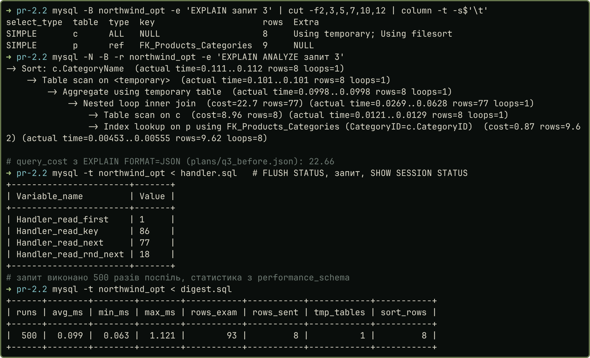 | 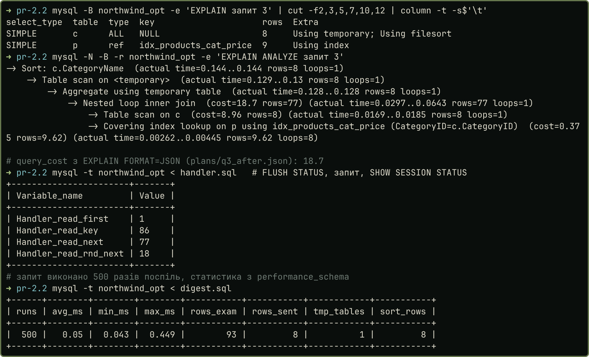 |

| Рисунок 24 — Запит 4, до | Рисунок 25 — Запит 4, після |
|:-----------|:-----------|
| 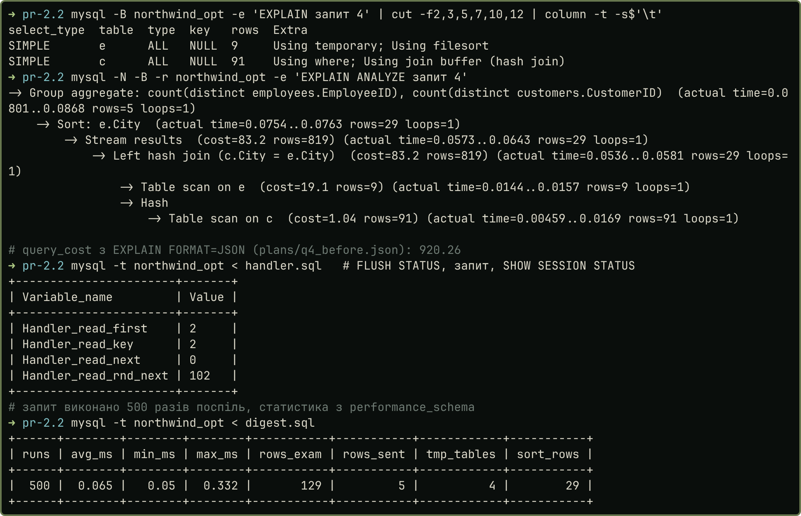 | 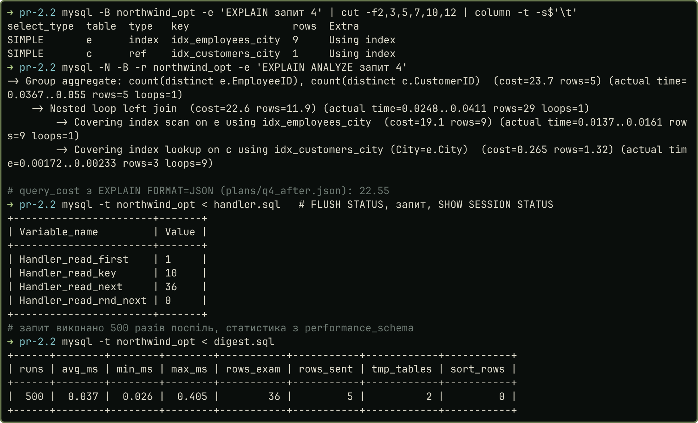 |

| Рисунок 26 — Запит 5, до | Рисунок 27 — Запит 5, після |
|:-----------|:-----------|
| 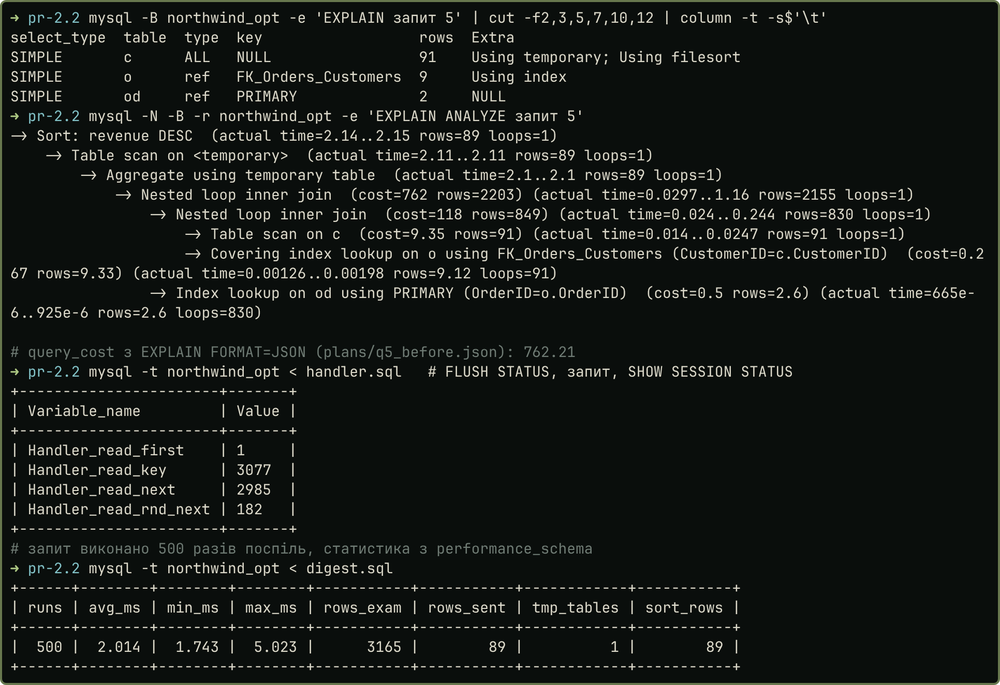 | 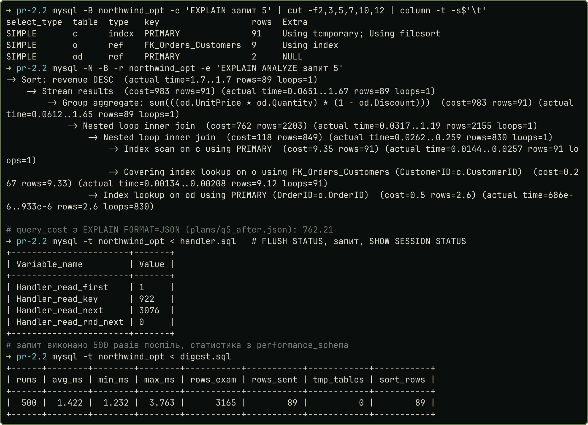 |

| Рисунок 28 — Запит 6, до | Рисунок 29 — Запит 6, після |
|:-----------|:-----------|
| 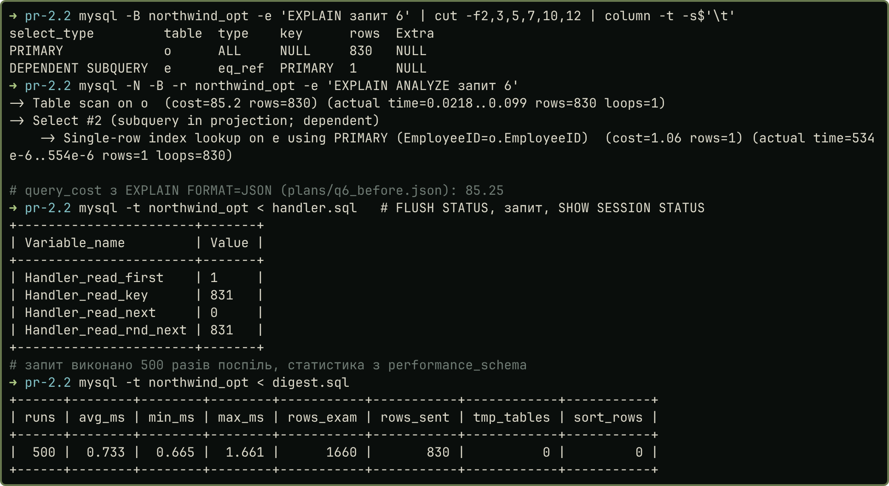 | 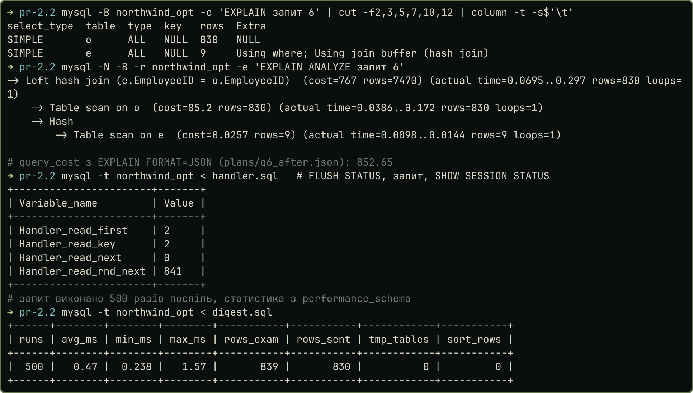 |

| Рисунок 30 — Запит 7, до | Рисунок 31 — Запит 7, після |
|:-----------|:-----------|
| 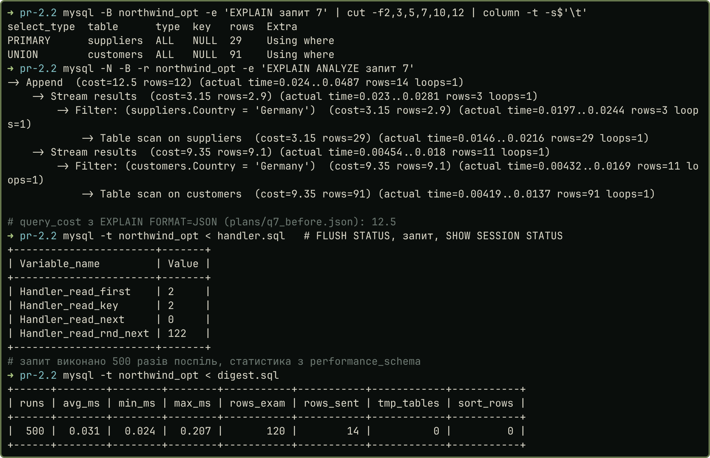 | 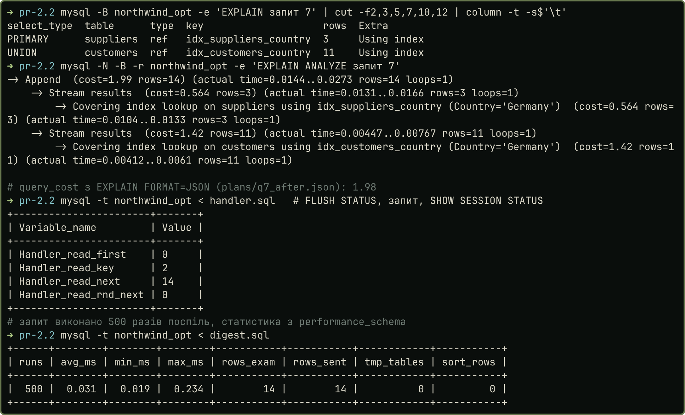 |

| Рисунок 32 — Той самий результат | Рисунок 33 — Створені індекси |
|:-----------|:-----------|
| 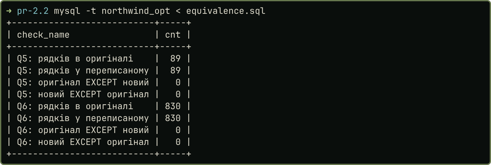 |  |

Скрипти: <https://github.com/brizzinck/krinzhrepoduta/tree/main/db/pr-2.2>.

## Висновки

Я виконав вказівки до завдання 1 в InnoDB і дослідив плани запитів 3–7 варіанта 2. Купи в InnoDB немає: таблиця завжди є деревом, а через сторінку 16 КБ усі порогові кількості рядків вищі, ніж у SQL Server. Випадковий ключ дав заповненість 66 % і фрагментацію 99,57 %, близько до методички, а `OPTIMIZE TABLE` прибрав цю фрагментацію. Плани показали потребу в оптимізації запитів 4, 5, 6, 7 і частково 3. Найбільший ефект дали індекси на `City` у запиті 4, запис `GROUP BY` за ключем у запиті 5 (мінус 29 % часу) і заміна підзапиту на з'єднання в запиті 6 (мінус 64 %). Запит 7 майже не прискорився, бо таблиці малі, хоча рядків читається у 8,6 раза менше. На 830 замовленнях усі запити виконуються за частки мілісекунди або 1–2 мс, тому для рішень точніші план і кількість прочитаних рядків, а не час. Оцінка `query_cost` не завжди збігається з реальним часом, що видно із запиту 6.
