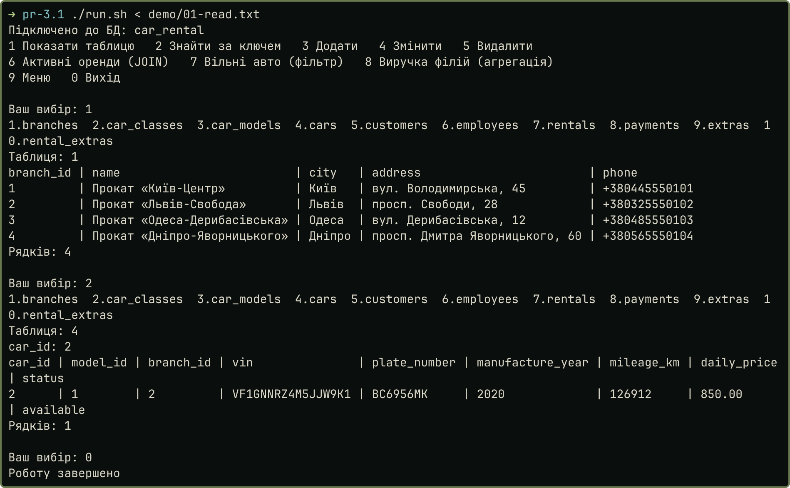
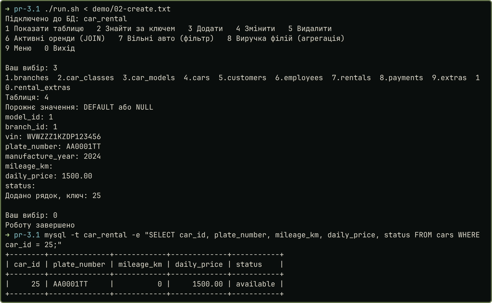
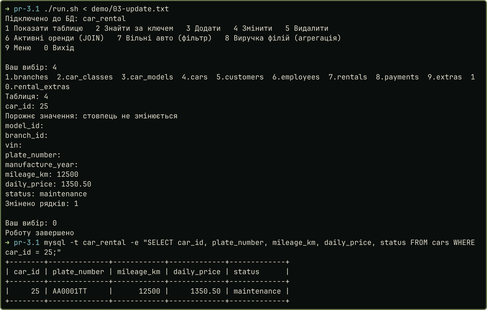
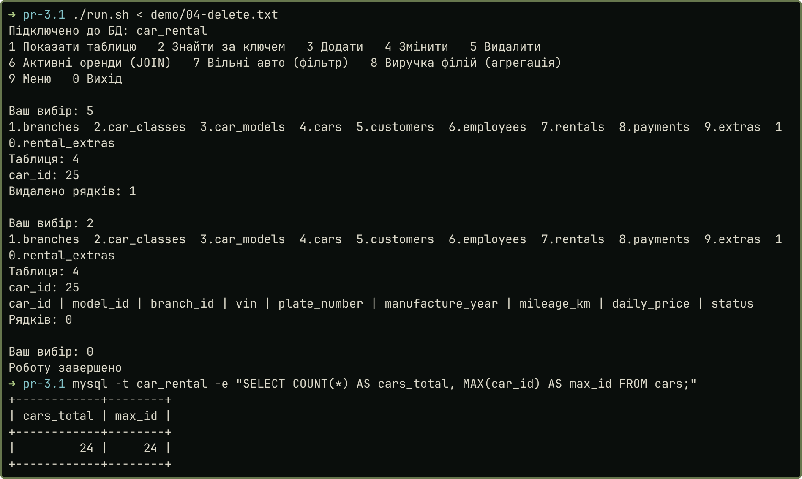
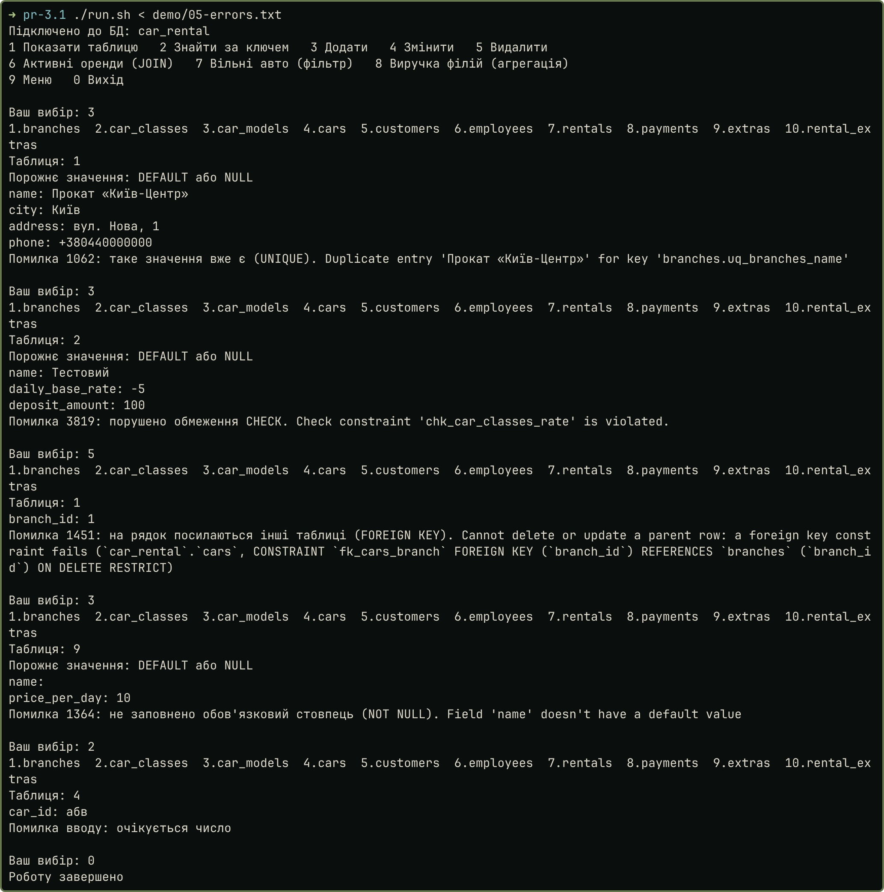
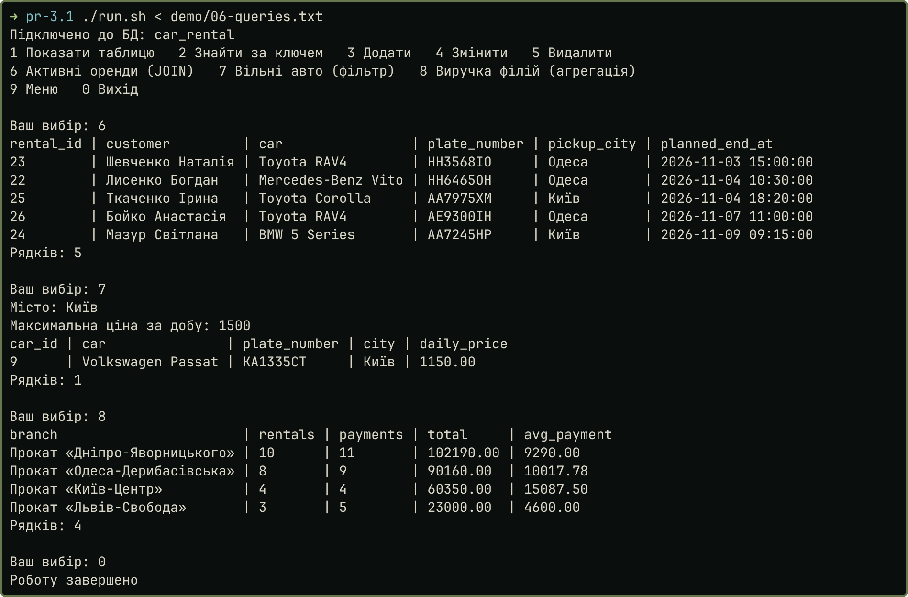

## Мета і завдання

Мета: навчитися працювати з БД із коду без ORM. Завдання: підключити БД із першої роботи (`car_rental`, 10 таблиць, MySQL 8.4), створити додаток типу ADO.NET із виводом у консоль, реалізувати CRUD і три запити: з об'єднанням, фільтрацією й агрегатними функціями.

## Хід виконання

**Технологія.** Я взяв Java 21 і чистий JDBC із конектором `mysql-connector-j`, запити організовані за шаблоном DAO: умова прямо дозволяє його для Java. ORM немає, весь SQL написаний вручну. `Connection` відповідає `SqlConnection` з ADO.NET, `PreparedStatement` це `SqlCommand`, `ResultSet` це `SqlDataReader`. Параметри підключення беруться зі змінних середовища, у коді паролів немає.

**Структура.** `Database` відкриває з'єднання. `Table` описує 10 таблиць: ім'я, ключ і стовпці. `TableDao` виконує CRUD для будь-якої таблиці з цього опису, тому код не повторюється. `QueryDao` містить три запити, `Printer` друкує `ResultSet`, `Main` це меню. Значення від користувача йдуть лише через параметри `?`, тому SQL-ін'єкція неможлива.

```{.java .small}
public int insert(Table table, Map<String, String> values) throws SQLException {
    String columns = String.join(", ", values.keySet());
    String marks = String.join(", ", values.keySet().stream().map(c -> "?").toList());
    String sql = "INSERT INTO " + table.name() + " (" + columns + ") VALUES (" + marks + ")";
    try (PreparedStatement ps = connection.prepareStatement(sql,
            Statement.RETURN_GENERATED_KEYS)) {
        int i = 1;
        for (String value : values.values()) {
            ps.setString(i++, value);
        }
        ps.executeUpdate();
        try (ResultSet keys = ps.getGeneratedKeys()) {
            return keys.next() ? keys.getInt(1) : 0;
        }
    }
}
```

Порожнє значення під час додавання означає `DEFAULT` або `NULL`, а під час зміни залишає стовпець без змін. Кожна операція виконується у своєму `try`, тому помилка БД не завершує програму: користувач бачить код і пояснення (рис. 5).

**Запити** реалізовані в додатку (пункти меню 6, 7, 8, рис. 6):

```{.sql .small}
-- Об'єднання таблиць: активні оренди з клієнтом, авто та філією
SELECT r.rental_id, CONCAT(c.last_name, ' ', c.first_name) AS customer,
       CONCAT(m.brand, ' ', m.model_name) AS car, a.plate_number,
       b.city AS pickup_city, r.planned_end_at
FROM rentals r
JOIN customers c ON c.customer_id = r.customer_id
JOIN cars a ON a.car_id = r.car_id
JOIN car_models m ON m.model_id = a.model_id
JOIN branches b ON b.branch_id = r.pickup_branch_id
WHERE r.status = 'active' ORDER BY r.planned_end_at;

-- Фільтрація: вільні авто в місті до заданої ціни (значення вводить користувач)
SELECT a.car_id, CONCAT(m.brand, ' ', m.model_name) AS car, a.plate_number, b.city,
       a.daily_price
FROM cars a
JOIN car_models m ON m.model_id = a.model_id
JOIN branches b ON b.branch_id = a.branch_id
WHERE a.status = 'available' AND b.city = ? AND a.daily_price <= ?
ORDER BY a.daily_price;

-- Агрегація: виручка філій (оренда і штрафи, без застав і повернень)
SELECT b.name AS branch, COUNT(DISTINCT r.rental_id) AS rentals,
       COUNT(p.payment_id) AS payments, SUM(p.amount) AS total, ROUND(AVG(p.amount), 2) AS avg_payment
FROM branches b
JOIN rentals r ON r.pickup_branch_id = b.branch_id
JOIN payments p ON p.rental_id = r.rental_id
WHERE p.kind IN ('rent', 'fine')
GROUP BY b.branch_id, b.name ORDER BY total DESC;
```

## Результати

Сценарії запуску лежать у `demo/`. На рис. 2–4 зміни перевірені окремим клієнтом `mysql`. CRUD для всіх 10 таблиць перевіряє сценарій `demo/07-crud-all.txt`: 10 додавань, 10 змін, 10 видалень, 0 помилок (`results/crud-all.txt`).

| Рисунок 1 — Читання | Рисунок 2 — Додавання авто (ключ 25) |
|:-----------|:-----------|
|  |  |

| Рисунок 3 — Зміна авто 25 | Рисунок 4 — Видалення авто 25 |
|:-----------|:-----------|
|  |  |

| Рисунок 5 — Обробка помилок | Рисунок 6 — Три запити |
|:-----------|:-----------|
|  |  |

Код: <https://github.com/brizzinck/krinzhrepoduta/tree/main/db/pr-3.1>.

## Висновки

Я створив консольний додаток на Java і JDBC, який підключається до бази `car_rental` із першої роботи. CRUD працює для всіх 10 таблиць через один клас `TableDao`, це перевірено сценарієм без жодної помилки. У додатку реалізовано три запити: `JOIN` п'яти таблиць, фільтр за містом і ціною з параметрами від користувача та виручку філій через `SUM`, `AVG`, `COUNT`. Порушення `UNIQUE`, `CHECK`, `FOREIGN KEY` і `NOT NULL` не зупиняють програму. Я опанував `Connection`, `PreparedStatement`, `ResultSet` і `try-with-resources`, а також шаблон DAO як відповідник класів ADO.NET.
