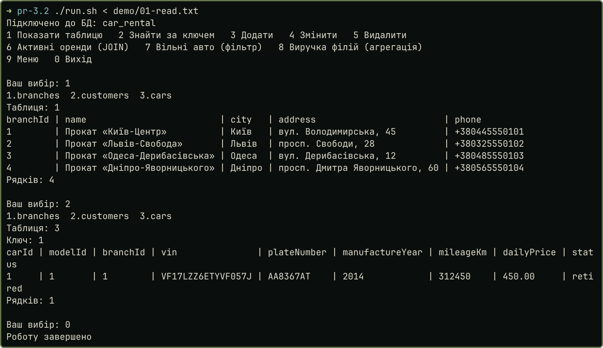
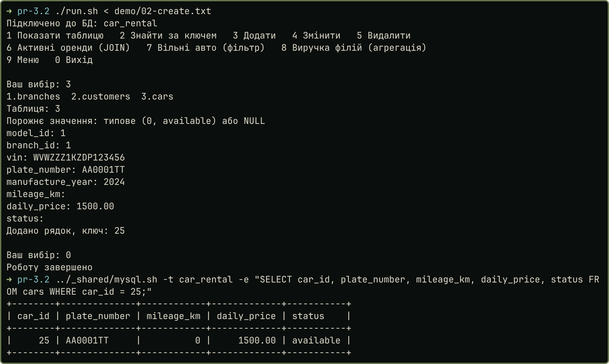
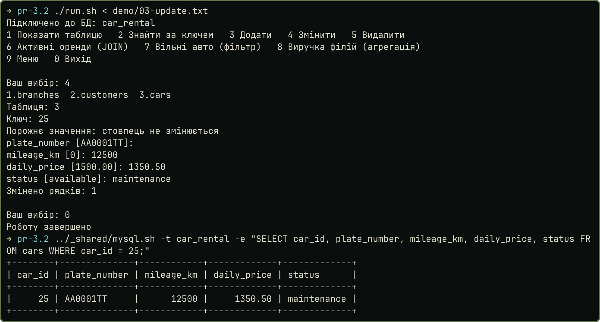
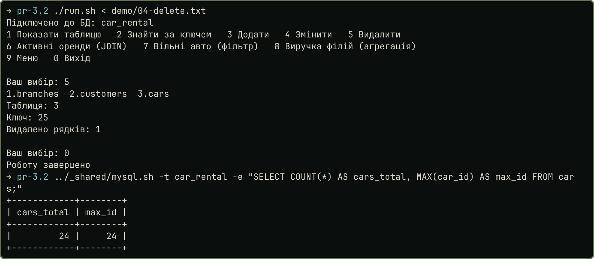
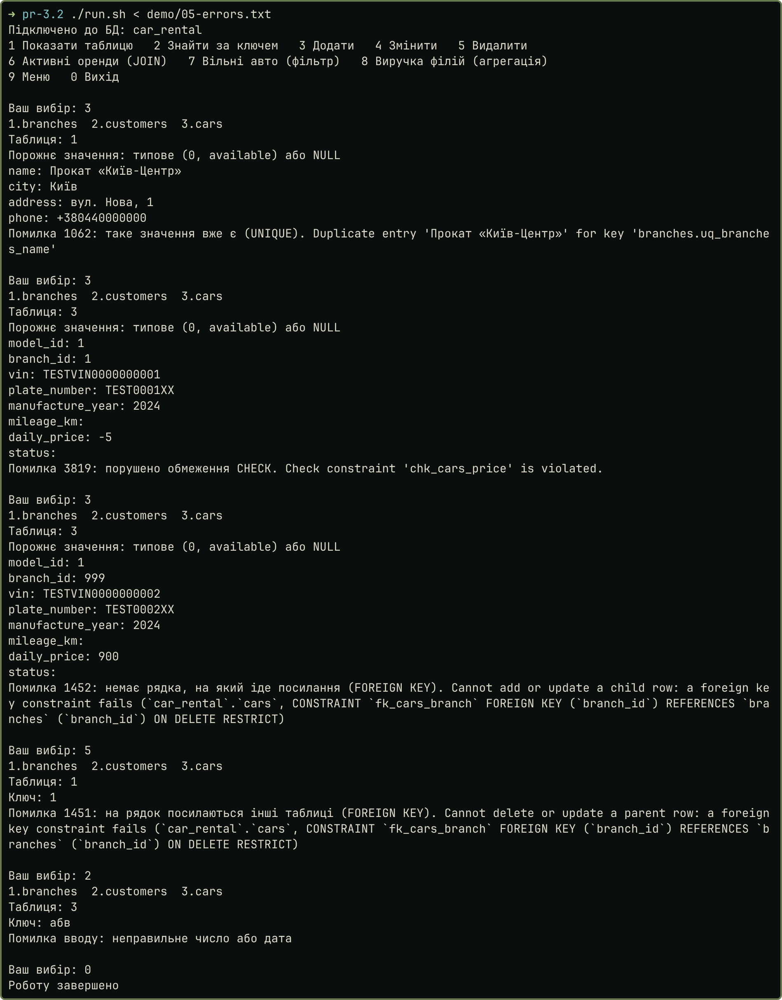
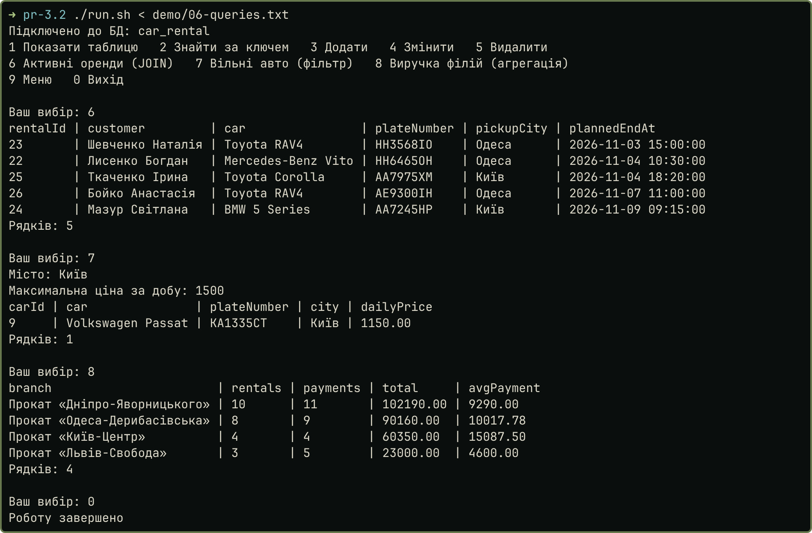

## Мета і завдання

Мета: навчитися працювати з БД через Micro ORM. Завдання: підключити БД із першої роботи (`car_rental`, MySQL 8.4), створити консольний додаток на Micro ORM, реалізувати CRUD та три запити: з об'єднанням таблиць, з фільтрацією й з агрегатними функціями.

## Хід виконання

**Технологія.** Для Java я взяв Jdbi 3.55.0 разом із `mysql-connector-j` 8.4.0. Jdbi це SQL mapper поверх JDBC, тобто відповідник Dapper із лекції: SQL лишається моїм, а відкриття з'єднання, передачу параметрів і перетворення рядків на об'єкти робить бібліотека.

| Dapper (.NET) | Jdbi (Java) |
|:-----------------|:------------------------------------|
| `Query<T>(sql)` | `@SqlQuery` і `mapTo`, рядки стають записами `record` |
| анонімний об'єкт параметрів | `@Bind("city")` або `@BindMethods` з усього запису |
| `Execute(sql, obj)` | `@SqlUpdate`, ключ нового рядка через `@GetGeneratedKeys` |

**Структура.** `Database` створює `Jdbi` і підключає `SqlObjectPlugin`. Записи `Branch`, `Customer`, `Car` описують рядки таблиць, а `ActiveRental`, `FreeCar`, `BranchRevenue` результати запитів. Інтерфейси `BranchDao`, `CustomerDao`, `CarDao` дають `findAll`, `findById`, `insert`, `update`, `delete` для трьох таблиць, `ReportDao` містить три запити. `Main` це меню, `Printer` друкує список записів. Реалізацію інтерфейсів створює Jdbi під час виклику `onDemand`. Назви стовпців у `snake_case` Jdbi сам зіставляє з компонентами запису в `camelCase` (`plate_number` це `plateNumber`).

```{.java .small}
@RegisterConstructorMapper(Car.class)
public interface CarDao {
    @SqlQuery("SELECT * FROM cars WHERE car_id = :id")
    Optional<Car> findById(@Bind("id") int id);

    // :modelId це car.modelId()
    @SqlUpdate("INSERT INTO cars (model_id, branch_id, vin, plate_number, manufacture_year, "
        + "mileage_km, daily_price, status) VALUES (:modelId, :branchId, :vin, :plateNumber, "
        + ":manufactureYear, :mileageKm, :dailyPrice, :status)")
    @GetGeneratedKeys
    int insert(@BindMethods Car car);

    @SqlUpdate("DELETE FROM cars WHERE car_id = :id")
    int delete(@Bind("id") int id);
}
```

Значення йдуть лише через іменовані параметри, тому SQL-ін'єкція неможлива. Під час зміни додаток читає запис, питає нові значення (порожнє залишає поточне) і передає змінений запис у `update`. Помилки БД Jdbi загортає у `JdbiException`: меню ловить її, бере код MySQL із причини й продовжує роботу (рис. 5).

**Запити** (пункти меню 6, 7, 8, рис. 6) ті самі, що в ПР 3.1, тому результати можна порівняти:

```{.sql .small}
-- Об'єднання п'яти таблиць: активні оренди (ActiveRental)
SELECT r.rental_id, CONCAT(c.last_name, ' ', c.first_name) AS customer,
       CONCAT(m.brand, ' ', m.model_name) AS car, a.plate_number,
       b.city AS pickup_city, r.planned_end_at
FROM rentals r JOIN customers c ON c.customer_id = r.customer_id
JOIN cars a ON a.car_id = r.car_id JOIN car_models m ON m.model_id = a.model_id
JOIN branches b ON b.branch_id = r.pickup_branch_id
WHERE r.status = 'active' ORDER BY r.planned_end_at;
-- Фільтрація: вільні авто, місто й ціна передаються як :city і :maxPrice (FreeCar)
... WHERE a.status = 'available' AND b.city = :city AND a.daily_price <= :maxPrice ...
-- Агрегація: виручка філій (BranchRevenue)
SELECT b.name AS branch, COUNT(DISTINCT r.rental_id) AS rentals, COUNT(p.payment_id) AS payments,
       SUM(p.amount) AS total, ROUND(AVG(p.amount), 2) AS avg_payment
FROM branches b JOIN rentals r ON r.pickup_branch_id = b.branch_id
JOIN payments p ON p.rental_id = r.rental_id
WHERE p.kind IN ('rent', 'fine') GROUP BY b.branch_id, b.name ORDER BY total DESC;
```

## Результати

Сценарії запуску лежать у `demo/`. На рис. 2–4 зміни перевірені окремим клієнтом `mysql`. Повний цикл CRUD для `branches`, `customers` і `cars` пройшов сценарій `demo/07-crud-all.txt`: 3 додавання, 3 зміни, 3 видалення, 0 помилок (`results/crud-all.txt`). Три запити дали ті самі рядки й суми, що в ПР 3.1: 5 оренд, одне вільне авто, 4 філії.

| Рисунок 1 — Читання: записи `Branch` і `Car` | Рисунок 2 — Додавання авто (ключ 25) |
|:-----------|:-----------|
|  |  |

| Рисунок 3 — Зміна авто 25 | Рисунок 4 — Видалення авто 25 |
|:-----------|:-----------|
|  |  |

| Рисунок 5 — Обробка помилок | Рисунок 6 — Три запити |
|:-----------|:-----------|
|  |  |

Код: <https://github.com/brizzinck/krinzhrepoduta/tree/main/db/pr-3.2>.

## Висновки

Я створив консольний додаток на Java і Jdbi, який працює з базою `car_rental` із першої роботи. Для `branches`, `customers` і `cars` реалізовано CRUD, а ще три запити: `JOIN` п'яти таблиць, фільтр за містом і ціною та виручку філій через `SUM`, `AVG`, `COUNT`. Порівняно з ПР 3.1 зникли ручні `PreparedStatement` і читання `ResultSet`: рядки одразу приходять як записи `Car` чи `Branch`, а параметри прив'язуються за іменем. Порушення `UNIQUE`, `CHECK` і `FOREIGN KEY` не зупиняють програму. Я опанував анотації `@SqlQuery`, `@SqlUpdate`, `@Bind`, `@BindMethods` і мапінг у `record`.
