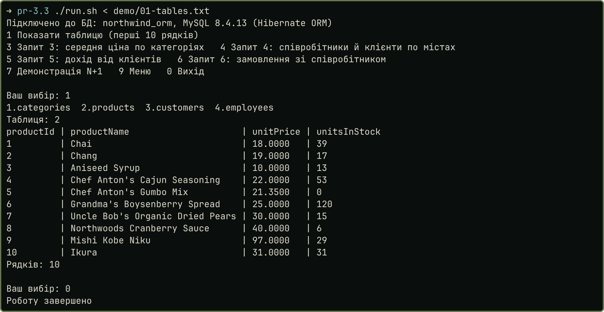
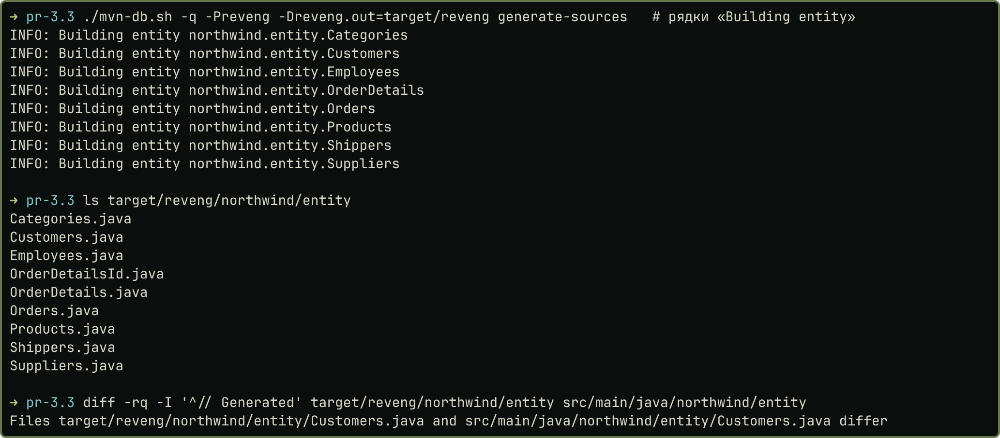
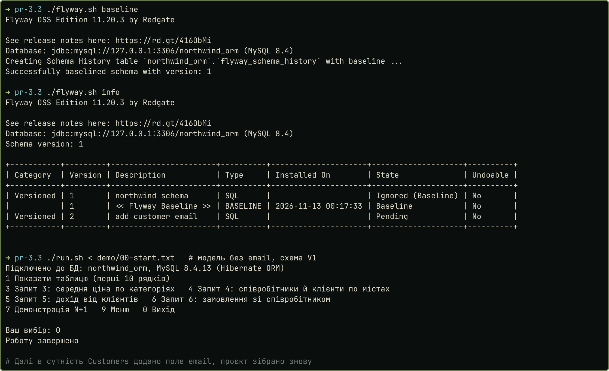
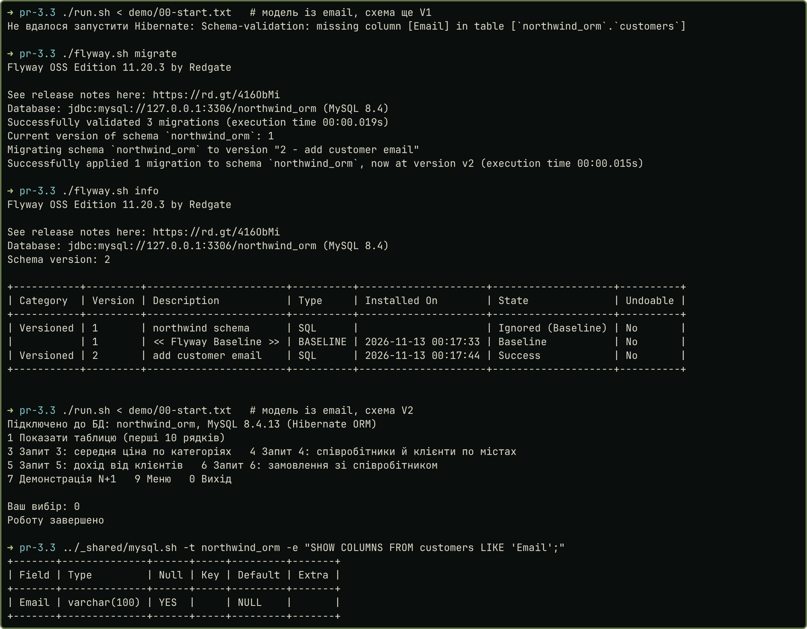
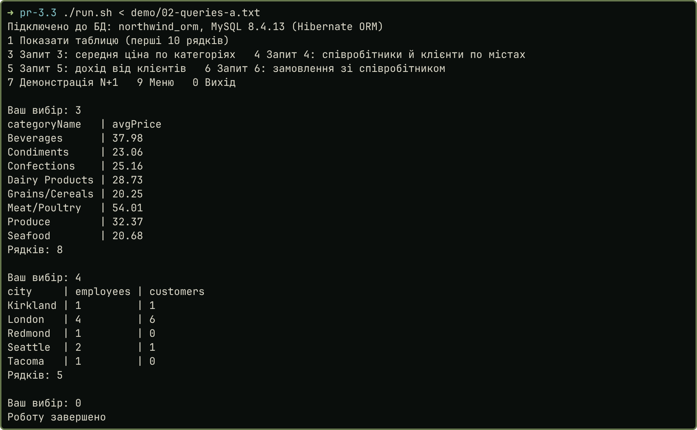

## Мета і завдання

Мета: навчитися працювати з БД через ORM. Завдання: підключити базу Northwind із другої роботи, згенерувати сутності з готової БД (Database First), створити дві міграції зі зміною моделі та реалізувати запити 3-6 з ПР 1.2 мовою ORM. Вивід у консоль.

## Хід виконання

**Технологія.** Я взяв Hibernate ORM 6.6.58 на Java 21, без Spring. EF Core в умові дано як приклад, тому відповідники такі:

| EF Core (.NET) | Hibernate (Java) |
|:---------------------|:----------------------------------------|
| `DbContext` | `Session` (її створює `SessionFactory`) |
| `DbSet<T>`, клас сутності | клас з `@Entity`, колекції `Set<T>` |
| `Scaffold-DbContext` | `hbm2java` (плагін `hibernate-tools-maven`) |
| `Add-Migration`, `Update-Database` | Flyway: файли `V1__…sql`, команда `migrate` |
| LINQ | JPQL |

Копію бази я зробив окремо (`northwind_orm`), бо міграції змінюють схему. Підключення беруться зі змінних середовища.

**Database First.** Генератор `hbm2java` читає схему MySQL і створює класи. У `hibernate.reveng.xml` я залишив 8 таблиць, потрібних запитам: `categories`, `products`, `suppliers`, `customers`, `employees`, `orders`, `order details`, `shippers`. Стовпці стали полями, зовнішні ключі стали зв'язками `@ManyToOne` та `@OneToMany`, складений ключ `order details` став `@EmbeddedId` (рис. 2). Назва `order details` має пробіл, тому в налаштуваннях увімкнено `globally_quoted_identifiers`. Режим `hbm2ddl.auto=validate`: Hibernate лише перевіряє, що схема збігається з сутностями. Вручну виправлено одне місце: `CustomerID` у БД `CHAR(5)`, генератор вказав `VARCHAR`, тому додано `@JdbcTypeCode(SqlTypes.CHAR)`.

```{.java .small}
@Entity
@Table(name="products", catalog="northwind_orm")
public class Products implements java.io.Serializable {
    @Id @GeneratedValue(strategy=IDENTITY)
    @Column(name="ProductID", unique=true, nullable=false)
    public Integer getProductId() { return this.productId; }

    @ManyToOne(fetch=FetchType.LAZY)
    @JoinColumn(name="CategoryID")
    public Categories getCategories() { return this.categories; }

    @Column(name="UnitPrice", precision=19, scale=4)
    public BigDecimal getUnitPrice() { return this.unitPrice; }
    // ... решта полів і set-методи
}
```

**Міграції.** Hibernate не створює міграції з різниці моделей, на відміну від `Add-Migration`, тому я взяв Flyway 11.20 у docker. `V1__northwind_schema.sql` це схема 8 таблиць, знята `mysqldump --no-data`: на існуючій базі вона стає базовою версією (`baseline`). Зміна моделі: клієнт отримує поле `email`. Спершу сутність `Customers` без `email`, потім із ним: Hibernate при запуску не знаходить стовпець `Email` і зупиняється, `validate` це доводить (рис. 3, ліворуч). Друга міграція `V2__add_customer_email.sql` виконується командою `migrate`, після неї додаток запускається (рис. 3, праворуч).

```{.sql .small}
-- V2__add_customer_email.sql
ALTER TABLE customers ADD COLUMN Email VARCHAR(100) NULL;
```

**Запити 3-6** з ПР 1.2 (меню 3-6, рис. 4) записані в JPQL над сутностями, а не над таблицями:

```{.java .small}
// 3. Середня ціна продуктів по категоріях
"select c.categoryName, round(avg(p.unitPrice), 2) from Products p join p.categories c group by c.categoryId, c.categoryName order by c.categoryName"
// 4. Співробітники й клієнти по містах (з'єднання сутностей за містом)
"select e.city, count(distinct e.employeeId), count(distinct c.customerId) from Employees e left join Customers c on c.city = e.city group by e.city order by e.city"
// 5. Дохід від кожного клієнта зі знижкою
"select c.customerId, c.companyName, round(sum(od.unitPrice * od.quantity * (1 - od.discount)), 2) as revenue from OrderDetails od join od.orders o join o.customers c group by c.customerId, c.companyName order by revenue desc"
// 6. Замовлення й співробітник підзапитом у select
"select o.orderId, o.orderDate, o.customers.customerId, (select concat(e.firstName, ' ', e.lastName) from Employees e where e.employeeId = o.employees.employeeId) from Orders o order by o.orderId"
```

## Результати

Сценарії лежать у `demo/`. Запити дали ті самі дані, що SQL у ПР 1.2: 8 категорій із середніми цінами від 20.25 до 54.01, 5 міст у запиті 4, у запиті 5 перші клієнти QUICK, ERNSH, SAVEA і 89 рядків усього, у запиті 6 перші замовлення від 10248 і 830 рядків усього.

| Рисунок 1 — Підключення, перегляд таблиці | Рисунок 2 — Генерація сутностей |
|:-----------|:-----------|
|  |  |

| Рисунок 3 — Міграції: до `migrate` і після | |
|:-----------|:-----------|
|  |  |

| Рисунок 4 — Запити 3 і 4 | Рисунок 4 (продовження) — Запити 5 і 6 |
|:-----------|:-----------|
|  |  |

Код: <https://github.com/brizzinck/krinzhrepoduta/tree/main/db/pr-3.3>.

## Висновки

Я створив консольний додаток на Hibernate ORM для бази Northwind. Сутності згенеровано з готової БД інструментом `hbm2java`, одне поле довелося виправити вручну. Зв'язки між таблицями стали полями класів, тому запити 3-6 записані в JPQL без `ON` для більшості з'єднань. Результати збігаються з SQL із ПР 1.2: 8, 5, 89 і 830 рядків. Міграції я зробив у Flyway: базова версія V1 і V2 з новим стовпцем `Email`, а `validate` показав, що без міграції модель і схема розходяться. Я опанував `SessionFactory`, `Session`, анотації `@Entity`, `@ManyToOne`, `@EmbeddedId`, мову JPQL і різницю між Hibernate та EF Core. Hibernate генерує SQL сам, тому контроль над запитом менший, ніж у JDBC і Jdbi.
