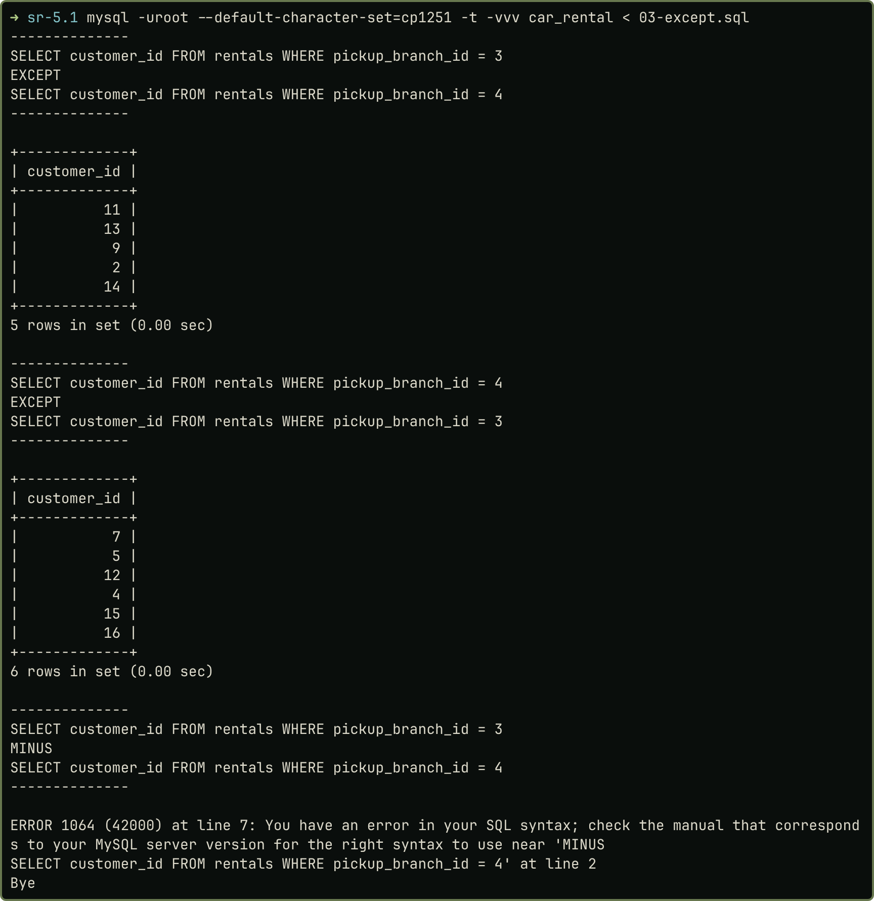
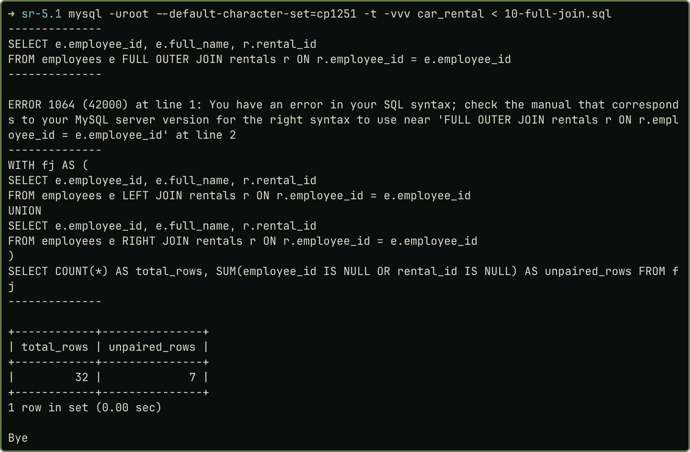

## Завдання

Ознайомитися з основними операціями реляційної алгебри, дати їх позначення й визначення та проаналізувати відповідність SQL-конструкціям на прикладах бази `car_rental` (ПР 1.1) у MySQL 8.4.

## Операції реляційної алгебри та їх відповідники в SQL

Реляційна алгебра оперує відношеннями (множинами кортежів), результат кожної операції теж є відношенням. Сигнатура Кодда містить вісім операцій; для ∪, ∩, − відношення мають бути сумісними (однакова кількість атрибутів і домени).

| Операція | Позначення, визначення | SQL у MySQL 8.4 |
|:-------------|:----------------------------------|:----------------------------|
| Об'єднання | R₁ ∪ R₂ = {t ∣ t ∈ R₁ ∨ t ∈ R₂} (без повторів) | `UNION`; `UNION ALL` лишає повтори |
| Перетин | R₁ ∩ R₂ = {t ∣ t ∈ R₁ ∧ t ∈ R₂}; також R₁ − (R₁ − R₂) | `INTERSECT` (з 8.0.31) |
| Різниця | R₁ − R₂ = {t ∣ t ∈ R₁ ∧ t ∉ R₂} | `EXCEPT`; `MINUS` немає |
| Декартів добуток | R × S: усі пари, \|R\|·\|S\| кортежів | `FROM A, B`; `CROSS JOIN` |
| Проєкція | π<sub>A₁…Aₖ</sub>(R): вибрані атрибути без повторів | список у `SELECT` + `DISTINCT` |
| Вибірка | σ<sub>F</sub>(R) = {t ∈ R ∣ F(t)}: кортежі, що задовольняють умову F | `WHERE` |
| З'єднання | R ⋈<sub>M θ N</sub> S = σ<sub>M θ N</sub>(R × S); еквіз'єднання (θ дорівнює «=»), природне R * S, напівз'єднання R ⋉ S | `INNER JOIN … ON`; `NATURAL JOIN`; `WHERE EXISTS` |
| Ділення | R(M, N) ÷ S(N): такі m, що для всіх n ∈ S є (m, n) ∈ R | `NOT EXISTS (… NOT EXISTS …)` або `NOT EXISTS (… EXCEPT …)` |

Крім того: перейменування ρ (`AS`), зовнішні з'єднання (`LEFT/RIGHT JOIN`; `FULL OUTER JOIN` у MySQL немає, його емулюють `LEFT JOIN … UNION … RIGHT JOIN`) і агрегування γ (`GROUP BY`). У лекції 2 (слайд 61) сказано, що `MINUS` є в MySQL; перевірка показала, що це не так: працює `EXCEPT`, а `MINUS` дає помилку 1064.

## Приклади на базі «Прокат автомобілів»

Усі результати отримано справжнім виконанням запитів (`examples.sql`). Для ∪, ∩, − використано R₁ = π<sub>customer_id</sub>(σ<sub>pickup_branch_id=3</sub>(rentals)) і R₂ те саме для філіалу 4.

| Операція | Запит (скорочено) | Результат |
|:----------|:---------------------------------|:-------------------------------|
| ∪ | `R₁ UNION R₂` | 13 клієнтів; `UNION ALL` дає 20 рядків |
| ∩ | `R₁ INTERSECT R₂`, також `R₁ EXCEPT (R₁ EXCEPT R₂)` | клієнти 1 і 8 (обидва способи) |
| − | `R₁ EXCEPT R₂`, `R₂ EXCEPT R₁` | {2, 9, 11, 13, 14} і {4, 5, 7, 12, 15, 16}: не комутативна |
| π | `SELECT [DISTINCT] brand, fuel_type FROM car_models` | 12 рядків, з `DISTINCT` 10 |
| σ | `WHERE status='available' AND daily_price>1500` | 8 автомобілів |
| × | `branches b, extras e` і `CROSS JOIN` | 4 × 5 = 20 рядків обома записами |
| θ-з'єднання | `rentals r JOIN cars c ON r.car_id=c.car_id AND r.daily_price < c.daily_price` | 10 договорів, укладених за нижчим тарифом, ніж поточний |
| екві-/природне | `car_classes ⋈ car_models` за `class_id` | по 12 рядків; у природному `class_id` один, в еквіз'єднанні два |
| напівз'єднання | `customers WHERE EXISTS (… rentals …)` | 18 клієнтів (`JOIN` дав би 30); без оренд 2 (антиз'єднання) |
| повне зовнішнє | `FULL OUTER JOIN` | помилка 1064; емуляція дає 32 рядки, з них 7 без пари (рис. 2) |
| ÷ | клієнти, що орендували авто класів «Економ» і «Преміум» | клієнти 1 і 11; ділення на всі класи дає порожній результат |

Ключові запити: емуляція повного з'єднання (усі пари, плюс непарні рядки обох боків) та ділення (подвійне заперечення).

```sql
-- повне з'єднання: LEFT JOIN UNION RIGHT JOIN, 32 рядки
SELECT e.employee_id, e.full_name, r.rental_id FROM employees e
LEFT JOIN rentals r ON r.employee_id = e.employee_id
UNION
SELECT e.employee_id, e.full_name, r.rental_id FROM employees e
RIGHT JOIN rentals r ON r.employee_id = e.employee_id;

-- ділення: клієнти, що орендували авто ВСІХ класів із набору S
SELECT c.customer_id, c.last_name FROM customers c
WHERE NOT EXISTS (
  SELECT 1 FROM car_classes k WHERE k.name IN ('Економ', 'Преміум')
    AND NOT EXISTS (
      SELECT 1 FROM rentals r JOIN cars a ON a.car_id = r.car_id
      JOIN car_models m ON m.model_id = a.model_id
      WHERE r.customer_id = c.customer_id AND m.class_id = k.class_id
        AND r.status <> 'cancelled'));
```

Додатково показано відсутність `MINUS` і `FULL OUTER JOIN` (помилка 1064 на обох знімках). Емуляція дає 32 рядки: 25 пар «працівник, оренда», 2 працівники без оренд і 5 оренд без працівника.

| Рисунок 1 — Різниця: `EXCEPT` працює, `MINUS` — помилка | Рисунок 2 — `FULL OUTER JOIN`: помилка й емуляція (32 рядки, 7 без пари) |
|:-----------|:-----------|
| {width=100%} | {width=100%} |

## Відмінності SQL від алгебри

1. *Мультимножини.* Таблиці й результати `SELECT` можуть мати однакові рядки: проєкція без `DISTINCT` дає 12 рядків замість 10, `UNION ALL` 20 замість 13.
2. *`NULL`.* `employee_id = NULL` повертає 0 рядків, `IS NULL` дає 5 оренд; `NOT IN` із `NULL` у підзапиті повертає 0 рядків, а `NOT EXISTS` дає 2 працівників без оренд.
3. *Порядок.* Відношення неупорядковане: `ORDER BY` і `LIMIT` є надбудовами SQL, а без `ORDER BY` порядок рядків не гарантовано.
4. *Імена стовпців.* `INNER JOIN` може повернути два стовпці `class_id`, в алгебрі атрибути унікальні (потрібні `AS` або `NATURAL JOIN`).

Усі запити, виводи й знімки: <https://github.com/brizzinck/krinzhrepoduta/tree/main/db/sr-5.1>.

## Висновки

Розглянуто вісім операцій реляційної алгебри (об'єднання, перетин, різниця, декартів добуток, проєкція, вибірка, з'єднання, ділення) та їх розширення (напівз'єднання, зовнішні з'єднання). Для кожної наведено позначення, визначення, SQL-аналог і справжній результат на базі `car_rental` у MySQL 8.4. З'ясовано, що в MySQL 8.4 є `UNION`, `INTERSECT`, `EXCEPT`, `CROSS` і `NATURAL JOIN`, але немає `MINUS` і `FULL OUTER JOIN` (емулюється), а ділення записується через подвійне заперечення. Головні розбіжності SQL з алгеброю: дублікати (мультимножини), `NULL` із тризначною логікою та небезпечним `NOT IN`, неупорядкованість результату.

## Список джерел

1. Лекція 1. Вступ до реляційних баз даних (слайди 64–86: реляційна алгебра та SQL-реалізація).
2. Лекція 2. Запити SQL (`UNION`, `INTERSECT`, `EXCEPT`, `JOIN`).
3. Звіт до ПР № 1.1: схема й дані бази `car_rental`.
