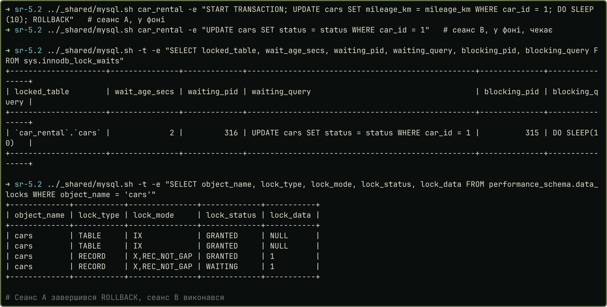
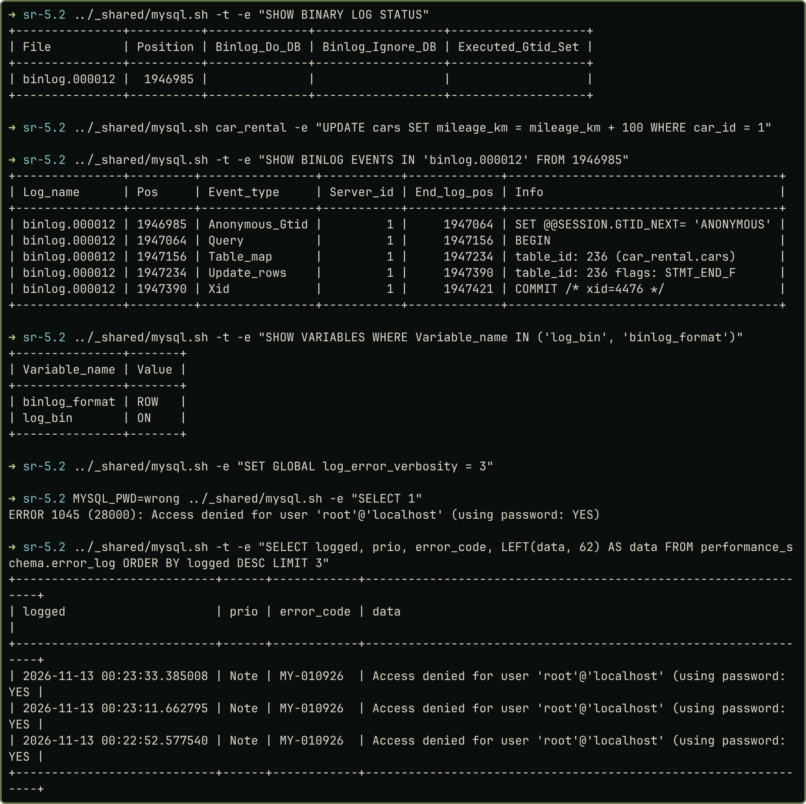

## Завдання

Ознайомитися з призначенням логування й моніторингу в реляційних СУБД, розглянути вбудовані інструменти (Extended Events, журнали транзакцій, системні журнали), проаналізувати, яку інформацію вони дають (помилки, продуктивність, блокування, виконання запитів), і оцінити їх роль у супроводі та оптимізації. Курс проходить на MySQL 8.4, тому інструменти MS SQL Server описано коротко, кожному знайдено відповідник у MySQL і показано на базі `car_rental` (ПР 1.1).

## Призначення логування й моніторингу

Логування записує, що сталося: запити, помилки, зміни даних. Моніторинг показує поточний стан: які запити працюють, що чекає, скільки ресурсів зайнято. За лекцією, інструменти моніторингу допомагають знаходити повільні запити, аналізувати блокування, помилки й використання ресурсів. Без них про проблему дізнаються від користувачів, а з ними видно, який запит повільний і хто кого блокує.

## Інструменти MS SQL і їх відповідники в MySQL

| MS SQL Server | Що робить | MySQL 8.4 |
|:--------------------|:-------------------------|:----------------------------|
| Profiler (слайд 10 лекції) | трасування запитів, подій, блокувань у реальному часі | повільний журнал `slow_query_log`, `mysql.slow_log` |
| Extended Events (слайд 11) | легка система збору подій, замінила Profiler | Performance Schema, схема `sys` |
| DMV, `sys.dm_exec_query_stats`, `sys.dm_tran_locks` (слайд 12) | поточний стан, статистика запитів, блокування | `events_statements_summary_by_digest`, `sys.innodb_lock_waits`, `performance_schema.data_locks` |
| Журнал транзакцій | записи про зміни для відновлення | журнал повторення InnoDB (redo log) і двійковий журнал (binary log) |
| Error log SQL Server | запуск, зупинка, помилки | журнал помилок MySQL, `performance_schema.error_log` |

Performance Schema, за документацією, стежить за виконанням сервера на низькому рівні й зберігає події в таблицях, які читаються звичайним `SELECT`. Схема `sys` дає зручний доступ до цих даних. Redo log потрібен для відновлення після аварії: незавершені зміни повторюються при запуску. Двійковий журнал призначений для реплікації та відновлення на момент часу і не містить `SELECT`.

## Яку інформацію дають

| Що потрібно | Інструмент MySQL | Приклад даних |
|:------------|:----------------------|:------------------------------------------|
| Помилки | журнал помилок | запуск сервера, попередження, відмова в доступі (рис. 3) |
| Продуктивність | повільний журнал, таблиця підсумків за digest | час запиту, `Rows_examined`, кількість і середній час (рис. 1) |
| Блокування | `sys.innodb_lock_waits`, `data_locks` | хто чекає, хто блокує, скільки секунд (рис. 2) |
| Виконання запитів | двійковий журнал, Performance Schema | подія `Update_rows` для таблиці `cars` (рис. 3) |

## Демонстрація на MySQL

Скрипт `demo.sh` працює на контейнері `duikt-mysql`, змінює лише змінні сервера через `SET GLOBAL` і наприкінці повертає їх: після запуску `slow_query_log` знову `OFF`, `long_query_time` 10, `log_output` `FILE`. Тестові оновлення в `car_rental` скасовуються.

**Повільний журнал і підсумки запитів.** Поріг `long_query_time` я поставив у 0, а `log_output` у `TABLE`, тому кожен запит потрапив у `mysql.slow_log`. Тричі виконано запит активних оренд із п'ятьма `JOIN`. Журнал показав час близько 0,5-0,7 мс і 49 переглянутих рядків для кожного. У `events_statements_summary_by_digest` ті самі виклики зведені в один рядок: 3 виконання, середній час 0,488 мс, 147 переглянутих рядків (рис. 1).

**Блокування.** Сеанс A почав транзакцію й оновив рядок автомобіля 1, сеанс B оновив той самий рядок і чекає. Представлення `sys.innodb_lock_waits` показало очікування 2 секунди, `waiting_query`, `blocking_pid` і `blocking_query`. У `data_locks` видно блокування запису `X,REC_NOT_GAP`: одне `GRANTED`, друге `WAITING` (рис. 2).

**Двійковий журнал і журнал помилок.** Після оновлення `cars` команда `SHOW BINLOG EVENTS` показала транзакцію: `Table_map`, `Update_rows`, `Xid` (формат `ROW`, `log_bin` `ON`). Утиліти `mysqlbinlog` в образі `mysql:8.4` немає, тому я використав цю команду. Невдалий вхід записався в `performance_schema.error_log` як `MY-010926` лише коли я підняв `log_error_verbosity` до 3; при типовому значенні 2 запису немає (рис. 3).

| Рисунок 1 — Повільний журнал і digest | Рисунок 2 — Очікування блокування |
|:-----------|:-----------|
|  |  |

| Рисунок 3 — Двійковий журнал і журнал помилок |
|:----------------------------------|
| {width=60%} |

## Роль у супроводі й оптимізації

Супровід: журнал помилок і `error_log` показують запуски, попередження й спроби входу; двійковий журнал дає відновлення на момент часу. Оптимізація: повільний журнал і digest знаходять запити з великою кількістю переглянутих рядків, після чого їх перевіряють планом і індексами. Стабільність: представлення блокувань пояснюють зависання, бо видно, який сеанс тримає рядок. Постійне логування має ціну: з порогом 0 кожен запит пишеться в таблицю, тому такий режим вмикають на час діагностики.

## Висновки

Я порівняв інструменти MS SQL Server із MySQL: Profiler відповідає повільному журналу, Extended Events і DMV відповідають Performance Schema та схемі `sys`, журнал транзакцій відповідає redo log і двійковому журналу. На базі `car_rental` я показав, що повільний журнал фіксує час і кількість переглянутих рядків, digest зводить однакові запити в один рядок, а `sys.innodb_lock_waits` називає сеанс, який блокує оновлення. Двійковий журнал записав зміну таблиці `cars` як подію `Update_rows`. Журнал помилок за замовчуванням не бачить невдалих входів, їх видно лише при `log_error_verbosity` 3. Всі налаштування сервера я повернув у початковий стан.

## Список джерел

1. Лекція «Моніторинг продуктивності та оптимізація запитів у реляційних базах даних», слайди 10-12.
2. MySQL 8.4 Reference Manual (сторінки відкрито 13.11.2026), розділи за адресою <https://dev.mysql.com/doc/refman/8.4/en/>: `slow-query-log.html`, `performance-schema-statement-summary-tables.html`, `sys-innodb-lock-waits.html`, `binary-log.html`, `error-log.html`, `innodb-redo-log.html`, `performance-schema.html`.
