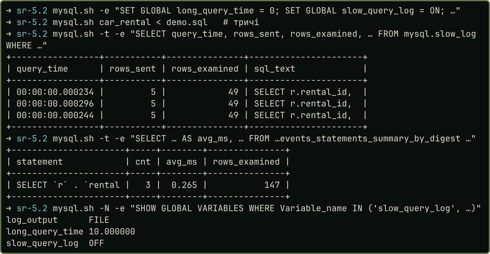
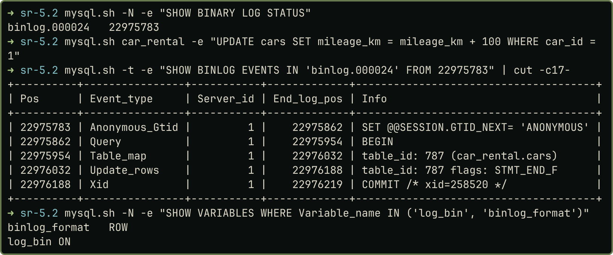

## Завдання

Ознайомитися з призначенням логування й моніторингу в реляційних СУБД, розглянути вбудовані інструменти (Extended Events, журнали транзакцій, системні журнали), проаналізувати, яку інформацію вони дають, і оцінити їх роль у супроводі та оптимізації. Мої роботи з курсу виконано на MySQL 8.4, тому інструменти MS SQL Server описано коротко, кожному знайдено відповідник у MySQL і показано на базі `car_rental` (ПР 1.1).

## Призначення логування й моніторингу

Логування записує, що сталося: запити, помилки, зміни даних. Моніторинг показує поточний стан: які запити працюють, що чекає, скільки ресурсів зайнято. За лекцією, інструменти моніторингу допомагають знаходити повільні запити, аналізувати блокування, помилки й використання ресурсів.

## Інструменти MS SQL і їх відповідники в MySQL

Таблиця 1 — Інструменти MS SQL Server і їх відповідники в MySQL 8.4

| MS SQL Server | Що робить | MySQL 8.4 |
|:----------------------|:----------------------------|:--------------------------------------|
| Profiler (слайд 10 лекції) | трасування запитів, подій, блокувань у реальному часі | загальний журнал `general_log` (усі запити), повільний журнал `slow_query_log`, `mysql.slow_log` |
| Extended Events (слайд 11) | легка система збору подій за власними правилами (сесіями), замінила SQL Trace і Profiler, менше навантажує сервер | Performance Schema, схема `sys` |
| DMV, `sys.dm_exec_query_stats`, `sys.dm_tran_locks` (слайд 12) | поточний стан, статистика запитів, блокування | `events_statements_summary_by_digest`, `sys.innodb_lock_waits`, `performance_schema.data_locks` |
| Журнал транзакцій | записи про зміни для відновлення | журнал повторення InnoDB (redo log) і двійковий журнал (binary log) |
| Error log SQL Server | запуск, зупинка, помилки | журнал помилок MySQL, `performance_schema.error_log` |

Performance Schema, за документацією, стежить за виконанням сервера на низькому рівні й зберігає події в таблицях, які читаються звичайним `SELECT`; схема `sys` спрощує доступ до них. Після аварії InnoDB повторює з redo log зміни, які не встигли потрапити у файли даних, а незавершені транзакції відкочує через undo log. Двійковий журнал призначений для реплікації та відновлення на момент часу і не містить `SELECT`.

## Яку інформацію дають

::: {style="break-inside: avoid"}
Таблиця 2 — Яку інформацію дає кожен інструмент

| Що дивимось | Інструмент MySQL | Приклад даних |
|:---------------|:----------------------------------------|:------------------------------------------------|
| Помилки | журнал помилок | запуск сервера, попередження, відмова в доступі (рис. 4) |
| Швидкодія | повільний журнал, таблиця підсумків за digest | час запиту, `Rows_examined`, кількість і середній час (рис. 1) |
| Блокування | `sys.innodb_lock_waits`, `data_locks` | хто чекає, хто блокує, скільки секунд (рис. 2) |
| Виконання запитів | `general_log` (текст), повільний журнал із порогом 0 і `events_statements_history` (час, рядки) | кожен запит із часом і кількістю рядків (рис. 1) |
| Зміни даних | двійковий журнал | подія `Update_rows` для таблиці `cars` (рис. 3) |

:::

## Extended Events у SQL Server

Сесія Extended Events складається з чотирьох частин (джерела 2 і 3). Подія (event) означає момент, який відстежує сервер, наприклад завершення оператора T-SQL, `sql_statement_completed`. Дія (action) додає до події поле, наприклад `sql_text`. Предикат відсіює події, щоб у ціль потрапили лише потрібні. Ціль (target) приймає дані: `event_file` пише їх у файл `.xel`, `ring_buffer` тримає останні події в пам'яті, `histogram` зводить їх у підсумок. Сесію створює `CREATE EVENT SESSION`, а запускає `ALTER EVENT SESSION ... STATE = START`. Сесія `system_health` постачається з SQL Server, стартує разом із ним і збирає, зокрема, графи взаємоблокувань. Приклад сесії для запитів довше за секунду (`duration` у мікросекундах):

```{.sql .small}
CREATE EVENT SESSION long_queries ON SERVER
ADD EVENT sqlserver.sql_statement_completed
    (ACTION (sqlserver.sql_text) WHERE duration >= 1000000)
ADD TARGET package0.event_file (SET filename = N'C:\temp\long_queries.xel');

ALTER EVENT SESSION long_queries ON SERVER STATE = START;
```

Приклад складено за документацією Microsoft, на SQL Server я його не запускав. Подія дає час виконання, дія додає текст запиту, предикат лишає повільні запити, ціль пише їх у файл. Це відповідає повільному журналу MySQL.

## Демонстрація на MySQL

Скрипт `demo.sh` працює на контейнері `duikt-mysql` (`mysql.sh` на рисунках запускає клієнт `mysql` усередині нього), змінює лише змінні сервера через `SET GLOBAL` і повертає їх: `slow_query_log` знову `OFF`, `long_query_time` 10, `log_output` `FILE`. Тестові оновлення в `car_rental` скасовуються або повертаються зворотним оновленням.

**Повільний журнал і підсумки запитів.** Поріг `long_query_time` я поставив у 0, а `log_output` у `TABLE`, тому кожен запит потрапив у `mysql.slow_log`. Тричі виконано запит активних оренд із п'ятьма `JOIN`. Кожен виклик тривав менше 1 мс і переглянув 49 рядків. У `events_statements_summary_by_digest` ті самі виклики зведені в один рядок: 3 виконання, середній час теж менше 1 мс, 147 переглянутих рядків (рис. 1). Час щоразу трохи інший, кількість рядків ні.

**Блокування.** Сеанс A почав транзакцію й оновив рядок автомобіля 1, сеанс B оновив той самий рядок і чекає. Представлення `sys.innodb_lock_waits` показало очікування 2 секунди, `waiting_query`, `blocking_pid` і `blocking_query`. У `data_locks` видно блокування запису `X,REC_NOT_GAP`: одне `GRANTED`, друге `WAITING` (рис. 2).

**Двійковий журнал і журнал помилок.** Після оновлення `cars` команда `SHOW BINLOG EVENTS` показала транзакцію: `Table_map`, `Update_rows`, `Xid` (формат `ROW`, `log_bin` `ON`). Утиліти `mysqlbinlog` в образі `mysql:8.4` немає, тому я використав цю команду. У виводі прибрано перший стовпець `Log_name` (`cut -c17-`), бо ім'я файла видно в команді. Невдалий вхід записався в `performance_schema.error_log` як `MY-010926` лише коли я підняв `log_error_verbosity` до 3. Спочатку я зробив невдалий вхід при типовому значенні 2: нових записів 0. Після підняття до 3 і такого самого входу з'явився один запис (рис. 4).

{width=100%}

{width=100%}

{width=100%}

{width=100%}

## Роль у супроводі й оптимізації

Супровід: журнал помилок і `error_log` показують запуски, попередження й спроби входу; двійковий журнал дає відновлення на момент часу. Оптимізація: повільний журнал і digest знаходять запити з великою кількістю переглянутих рядків, після чого їх перевіряють планом (`EXPLAIN`) і індексами. Стабільність: представлення блокувань пояснюють зависання, бо видно, який сеанс тримає рядок. Постійне логування має ціну, тому поріг 0 вмикають лише на час діагностики.

## Висновки

Я зіставив інструменти MS SQL Server із MySQL: Profiler відповідає журналам запитів, Extended Events і DMV відповідають Performance Schema та схемі `sys`, журнал транзакцій відповідає redo log і двійковому журналу. На базі `car_rental` я показав, що повільний журнал фіксує час і кількість переглянутих рядків, digest зводить однакові запити в один рядок, а `sys.innodb_lock_waits` називає сеанс, який блокує оновлення. Двійковий журнал записав зміну таблиці `cars` як подію `Update_rows`. Для Extended Events я описав сесію, подію, дію, предикат і ціль та склав за документацією приклад сесії для повільних запитів. Журнал помилок за замовчуванням не бачить невдалих входів, їх видно лише при `log_error_verbosity` 3.

Скрипти: <https://github.com/brizzinck/krinzhrepoduta/tree/main/db/sr-5.2>.

## Список джерел

1. Лекція «Моніторинг продуктивності та оптимізація запитів у реляційних базах даних», слайди 10-12.
2. Microsoft Learn, Quickstart: Extended Events (відкрито 19.11.2026), <https://learn.microsoft.com/en-us/sql/relational-databases/extended-events/quick-start-extended-events-in-sql-server>.
3. Microsoft Learn, CREATE EVENT SESSION (Transact-SQL) (відкрито 19.11.2026), <https://learn.microsoft.com/en-us/sql/t-sql/statements/create-event-session-transact-sql>; Use the system_health session, <https://learn.microsoft.com/en-us/sql/relational-databases/extended-events/use-the-system-health-session>.
4. MySQL 8.4 Reference Manual (відкрито 13.11.2026), <https://dev.mysql.com/doc/refman/8.4/en/>: розділи про slow query log, statement summary tables, `sys.innodb_lock_waits`, binary log, error log, InnoDB redo log і Performance Schema.
