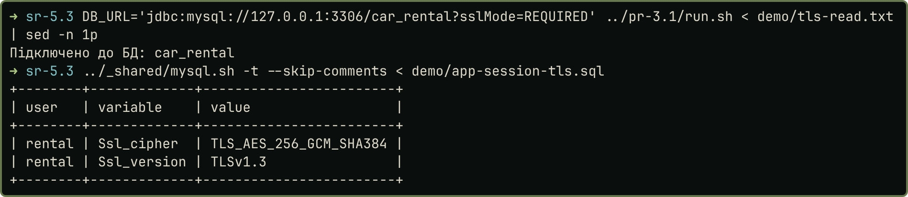
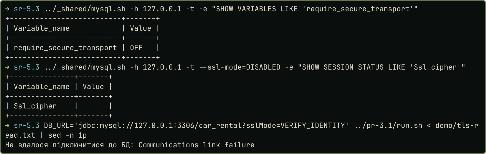

## Завдання

Ознайомитися з поняттям Database as a Service, проаналізувати документацію Azure Database for MySQL (Flexible Server), описати підключення застосунку з ПР 3.1 до віддаленої БД і порівняти його з локальним розгортанням.

Хмарний сервер я не створював (потрібна підписка Azure): кроки описано за документацією Microsoft Learn від 13.11.2026. Клієнтську частину, TLS-з'єднання, я перевірив на локальному MySQL 8.4.

## Поняття DBaaS

Database as a Service це керована хмарна база даних: провайдер ставить СУБД й оновлення та робить копії, а власник платить за використання й працює зі схемою та даними (джерело 1). Підключатися можна звичайним драйвером. Розподіл відповідальності:

| Модель | Що надає провайдер | Що робить замовник |
|:-----------|:------------------------------|:------------------------------------|
| Локально | Нічого | Усе: обладнання, ОС, СУБД, оновлення, копії |
| IaaS | Обчислення, мережу, сховище | Ставить і адмініструє ОС та СУБД, планує оновлення, захист, відновлення |
| DBaaS | Керовану БД: ОС, СУБД, оновлення, копії | Схема, запити, дані, права, дозволені параметри, перевірка політики копій |

## Аналіз документації Azure Database for MySQL

Flexible Server працює на MySQL Community Edition (5.7, 8.0, 8.4). Що описує документація:

| Область | Зміст |
|:--------------------|:--------------------------------------------------------------------------|
| Варіанти | Рівні Burstable (розробка, не для робочих навантажень), General Purpose, Memory-Optimized; сховище від 20 ГіБ до 16 ТіБ (до 32 ТіБ у Memory-Optimized) |
| Мережа | Public access: лише IP із правил брандмауера (спершу немає жодного, до 500 правил, лише IPv4, до 5 хв на застосування). Private access: сервер у VNet, у делегованій підмережі, без публічної адреси. Адреса `<імʼя>.mysql.database.azure.com` |
| Безпека | TLS примусовий за замовчуванням: 1.2 типово, 1.3 рекомендовано, 1.0 і 1.1 відхиляються. Дані й копії шифруються AES-256 |
| Копії | Знімок раз на добу, журнали кожні 5 хв, зберігання 1-35 днів (типово 7). Відновлення на момент часу (PITR) створює новий сервер; копії зберігаються локально, між зонами або в парному регіоні |
| Висока доступність | Резервний сервер у тій самій або іншій зоні, перемикання 60-120 с; платні обидва сервери, Burstable не підтримує |
| Масштабування | Обчислення: перезапуск 60-120 с; сховище росте онлайн і не зменшується; до 10 реплік для читання (асинхронно, без автоматичного переходу) |
| Обмеження | Заборонені `SUPER`, `FILE`, `CREATE TABLESPACE`, `SHUTDOWN` і роль DBA, натомість є адміністратор із створення сервера. `DEFINER` потребує `SUPER`, тож його прибирають з дампів. БД `mysql` лише для читання |

## Підключення застосунку до віддаленої БД

Кроки для застосунку з ПР 3.1, команди зібрано нижче.

1. Створити сервер (портал або Azure CLI, для навчання підходить Burstable) і базу `car_rental`; її також створить наш `schema.sql`.
2. Відкрити доступ: правило брандмауера з адресою клієнта (public access) або сервер у VNet із застосунком у тій самій мережі чи через VPN або ExpressRoute (private access).
3. Під адміністратором створити користувача застосунку з правами лише на `car_rental`.
4. Завантажити `schema.sql` і `seed.sql` клієнтом mysql. У них немає `DEFINER` і `ENGINE`, тож обмеження сервісу не заважають.
5. Взяти CA-сертифікати DigiCert Global Root G2 і Microsoft RSA Root Certificate Authority 2017, об'єднані разом. Для Java їх імпортують у сховище довіри (`keytool -import`) і задають `javax.net.ssl.trustStore` та `trustStorePassword`; документація робить це через `System.setProperty`, але властивості можна передати й ключами `-D` при запуску JVM.
6. Задати `DB_URL`, `DB_USER`, `DB_PASSWORD`, запустити `run.sh` і перевірити шифрування командою `status` у клієнті (рядок `SSL: Cipher in use is`). Код застосунку не змінюється, бо ці значення беруться зі змінних середовища; у `run.sh` лише зникає `--network container:duikt-mysql`, а сховище довіри з п. 5 передається в JVM. Приклад Java в документації бере `sslMode=REQUIRED`; для `VERIFY_IDENTITY` у рядку має стояти саме адреса `<сервер>.mysql.database.azure.com`.

```{.small}
# 1. сервер і база
az mysql flexible-server create --resource-group <група> --name <сервер> --location <регіон> --admin-user <адмін> --admin-password <пароль>
az mysql flexible-server db create --resource-group <група> --server-name <сервер> --database-name car_rental
# 2. брандмауер (public access)
az mysql flexible-server firewall-rule create --resource-group <група> --name <сервер> --rule-name allowiprange --start-ip-address <IP> --end-ip-address <IP>
# 3. користувач застосунку (під адміністратором)
CREATE USER 'rental'@'%' IDENTIFIED BY '<пароль>'; GRANT ALL PRIVILEGES ON car_rental.* TO 'rental'@'%'; FLUSH PRIVILEGES;
# 4. схема і дані
mysql -h <сервер>.mysql.database.azure.com -u <адмін> -p --ssl-mode=REQUIRED --ssl-ca=<об'єднаний файл CA з кроку 5> < schema.sql
# 6. запуск застосунку
DB_URL='jdbc:mysql://<сервер>.mysql.database.azure.com:3306/car_rental?sslMode=VERIFY_IDENTITY' DB_USER=rental DB_PASSWORD=<пароль> ./run.sh
```

## Перевірка TLS на локальному сервері

Клієнтська частина кроків вище зводиться до `sslMode` в рядку підключення. Я перевірив її на локальному MySQL 8.4 (сертифікат створює сам контейнер): `run.sh` запущено без змін, лише з `?sslMode=REQUIRED` у `DB_URL` (рис. 1). Поки застосунок тримав з'єднання (запуск у фоні, `&`), сервер показав, що воно йде по TLS 1.3 із шифром `TLS_AES_256_GCM_SHA384`.

{width=74%}

На рис. 2 видно різницю з Azure. Локально `require_secure_transport` дорівнює `OFF`, тож клієнт із `--ssl-mode=DISABLED` працює без шифрування (`Ssl_cipher` порожній), а Azure вимагає TLS за замовчуванням. З `sslMode=VERIFY_IDENTITY` застосунок не підключився: від успішного запуску це відрізняється лише режимом, отже причина в перевірці сертифіката, для якої JVM потрібен довірений CA-сертифікат сервера (для Azure це сертифікати з кроку 5).

{width=74%}

## Відмінності від локального розгортання

| Аспект | Локально (MySQL 8.4) | Azure Database for MySQL |
|:----------------|:--------------------------|:-------------------------------------|
| ОС і СУБД | Адмініструю сам | Обслуговує сервіс |
| Оновлення | Міняю образ вручну | Щомісячні, у вікно обслуговування |
| Копії | Сам (`mysqldump`) | Автоматично, PITR 1-35 днів |
| Масштабування | Межі мого комп'ютера | Портал чи CLI, до 10 реплік |
| HA | Немає | Резервний сервер, 60-120 с |
| Привілеї | `root`, включно з `SUPER` | Без `SUPER`, `FILE`, `SHUTDOWN` |
| Мережа й TLS | TLS не вимагається | Брандмауер або VNet, TLS примусовий |
| Вартість | Без оплати | За обчислення, сховище, копії; HA удвічі |
| Затримка | Той самий комп'ютер | Мережею; регіон ближче до користувача |
| Дані | На моєму комп'ютері | У вибраному регіоні Azure |

## Висновки

Я розібрав поняття DBaaS і порівняв його з IaaS: у DBaaS провайдер бере на себе ОС, СУБД, оновлення й копії, а замовнику лишаються схема, дані та права. Azure Database for MySQL Flexible Server працює на MySQL Community Edition, тому застосунок підключається до нього тим самим драйвером. Підключення зводиться до сервера, брандмауера або приватної мережі, користувача з правами на `car_rental`, завантаження `schema.sql` із `seed.sql` та CA-сертифікатів, а код не змінюється. Локально `sslMode=REQUIRED` дав шифроване з'єднання (TLS 1.3), а `VERIFY_IDENTITY` без довіреного сертифіката було відхилено. Найбільше мене здивувало, що адміністратор Azure не має `SUPER`, тож дампи з `DEFINER` довелося б чистити.

## Список джерел

1. Лекції Л 3.1-3.3 (підключення до БД, DBaaS); звіти ПР № 1.1 і 3.1; скрипти <https://github.com/brizzinck/krinzhrepoduta/tree/main/db/sr-5.3>.
2. Microsoft Learn, дата доступу 13.11.2026. Початок адреси `https://learn.microsoft.com/en-us/azure/mysql/`, далі: `flexible-server/overview`, `flexible-server/connect-java`, `security/security-tls-how-to-connect` і `flexible-server/concepts-` з одним із закінчень `networking`, `networking-public`, `networking-vnet`, `backup-restore`, `high-availability`, `read-replicas`, `limitations`, `service-tiers-storage`.
