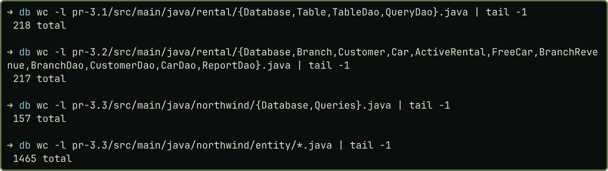
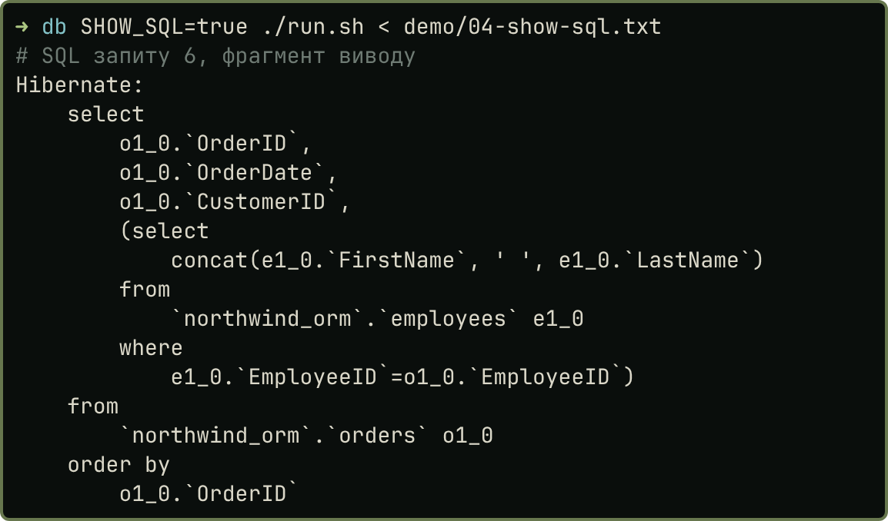

## Завдання

Розглянути прямий доступ до БД через API, підхід Micro-ORM і ORM та порівняти їх за зручністю, контролем запитів і сферою застосування. Порівняння спирається на мої три роботи: ПР 3.1 (JDBC), ПР 3.2 (Jdbi) і ПР 3.3 (Hibernate). Усі три написані на Java 21 для MySQL 8.4. Бази різні: у ПР 3.1 і 3.2 це `car_rental`, у ПР 3.3 це Northwind.

## Прямий доступ через API

Драйвер бази — це бібліотека для обміну командами й результатами з СКБД, а JDBC задає API доступу (лекція, слайд 12). У ПР 3.1 я пишу SQL, готую `PreparedStatement`, прив'язую параметри за номером і читаю `ResultSet`. Захист від ін'єкцій дає параметризація (слайд 13). Нижче запит із двома параметрами з `QueryDao`:

```{.java .small}
public int freeCars(String city, BigDecimal maxPrice) throws SQLException {
    try (PreparedStatement ps = connection.prepareStatement(FREE_CARS)) {
        ps.setString(1, city);
        ps.setBigDecimal(2, maxPrice);
        try (ResultSet rs = ps.executeQuery()) {
            return Printer.print(rs);
        }
    }
}
```

Контроль над SQL повний, але рядок перетворюється на дані вручну: `Printer` читає кожен стовпець через `getString`. Щоб не писати 10 однакових DAO, у `TableDao` довелося збирати SQL із рядків за описом таблиці (`Table`).

## Micro-ORM

Micro-ORM автоматизує вузьку частину відображення: розробник пише SQL, а бібліотека прив'язує параметри й перетворює рядки на об'єкти (слайд 18). У ПР 3.2 це Jdbi. Той самий запит у `ReportDao` виглядає так:

```{.java .small}
@RegisterConstructorMapper(FreeCar.class)
@SqlQuery("""
    SELECT a.car_id, ... WHERE a.status = 'available'
      AND b.city = :city AND a.daily_price <= :maxPrice ORDER BY a.daily_price""")
List<FreeCar> freeCars(@Bind("city") String city, @Bind("maxPrice") BigDecimal maxPrice);
```

SQL лишається моїм, але цикл по `ResultSet` і `try-with-resources` зникли: результат — це `List<FreeCar>`, де `FreeCar` — запис з одного рядка. Параметри іменовані. У звичайних операціях над таблицею (`insert`, `update`) шаблонного коду теж менше: у `CarDao` кожна займає анотацію й рядок з сигнатурою, ключ нового рядка повертає `@GetGeneratedKeys`. Зв'язків між об'єктами, відстеження змін і міграцій у бібліотеці немає.

## ORM

ORM додає відображення об'єктів у реляційні структури (слайд 12). У ПР 3.3 Hibernate створив класи з бази (Database First): зовнішні ключі стали полями-посиланнями, складений ключ став `@EmbeddedId`. Запит пишеться мовою JPQL над сутностями:

```{.java .small}
session.createQuery("""
    select c.categoryName, round(avg(p.unitPrice), 2)
    from Products p join p.categories c
    group by c.categoryId, c.categoryName order by c.categoryName""", Object[].class)
    .getResultList();
```

Умову з'єднання `ON` я не писав: Hibernate бере її зі зв'язку `p.categories`. SQL генерує бібліотека (рис. 2). Схему також можна версіонувати: у ПР 3.3 це зробив Flyway, а `validate` перевіряє збіг моделі та БД. Ціна цього: зв'язки читаються за стратегією завантаження, і ліниве завантаження дає проблему N+1 (слайди 19, 20).

## Порівняння

Кількість рядків не можна порівнювати прямо: ПР 3.1 має CRUD для 10 таблиць через один спільний `TableDao` і 3 запити, ПР 3.2 CRUD для 3 таблиць (власний DAO на кожну) і 3 запити, ПР 3.3 лише читання й 4 запити. Тому в таблиці лише те, що видно в коді (рис. 1).

::: {style="break-inside: avoid"}
Таблиця 1 — Порівняння ПР 3.1, 3.2 і 3.3

| Критерій | JDBC (ПР 3.1) | Jdbi (ПР 3.2) | Hibernate (ПР 3.3) |
|:----------------|:----------------------|:----------------------|:----------------------|
| Рядків доступу до даних, написано вручну (без спільного `Printer`) | 218 | 217 | 181 |
| Рядків згенеровано | немає | немає | 1761 (11 сутностей і складений ключ, ручні правки в пʼяти класах) |
| Зручність, шаблонний код | `PreparedStatement`, цикл по `ResultSet`, ручні типи | запис і анотація на запит | сутності від генератора, запит на JPQL |
| Контроль над SQL | повний, SQL мій | повний, SQL мій | SQL будує Hibernate (рис. 2) |
| Результат | рядок, `getString` | `record` | сутність або `Object[]` |
| Зв'язки між таблицями | вручну в `JOIN` | вручну в `JOIN` | поля класів, `join` за зв'язком |
| Міграції схеми | немає | немає | генерація сутностей і `validate`; версії дав Flyway |
| Ризик N+1 | не виникає непомітно: кожен запит пишу сам, цикл із запитом на рядок дав би його теж | те саме | виникає непомітно через ліниве завантаження (рис. 3) |
| Де доречно | прості утиліти, пакетні операції й місця, де потрібен повний контроль над SQL | звіти й запити, де потрібен свій SQL і зручний результат | багата доменна модель із зв'язками й CRUD |

:::

Те, що в Hibernate менше контролю, видно з двох дослідів. На рис. 2 JPQL запиту 6 став SQL із підзапитом у `select`, з псевдонімами `o1_0` і `e1_0` та повними іменами `northwind_orm`.`orders`: структуру я задав, але текст пише бібліотека. На рис. 3 цикл по 10 замовленнях із зверненням до співробітника дав 6 SQL-запитів (1 і 5 різних співробітників), а `join fetch` один. Тобто різницю в запитах треба перевіряти вручну, як радить лекція (слайд 19).

{width=72%}

{width=72%}

{width=72%}

## Висновки

Я порівняв три підходи на своїх роботах. JDBC дає повний контроль, але вимагає найбільше ручної роботи з параметрами й рядками результату. Jdbi лишає SQL моїм, а параметри й перетворення рядків на `record` бере на себе, тому на кожен запит менше шаблонного коду (немає циклу по `ResultSet` і ручного читання стовпців), а контролю не менше. Hibernate генерує сутності з бази й будує з'єднання за зв'язками, проте SQL пише сам, а ліниве завантаження дало 6 запитів замість одного. Для звітів і складних запитів я б узяв Jdbi або JDBC, а для моделі з багатьма зв'язками й CRUD Hibernate. Змішаний варіант теж можливий: ORM для звичайних операцій і власний SQL для звітів. Як перша оцінка складності вивчення: JDBC найпростіший, Hibernate найскладніший через анотації, стратегії завантаження й генерований SQL. Це моя оцінка за досвідом цих трьох робіт, а не виміряна величина.

## Список джерел

1. Лекція «Л 3.1 та 3.2 (6-7). Технології підключення до БД та архітектура додатків», слайди 12-20.
2. Власний код: `db/pr-3.1`, `db/pr-3.2`, `db/pr-3.3` у <https://github.com/brizzinck/krinzhrepoduta>.
