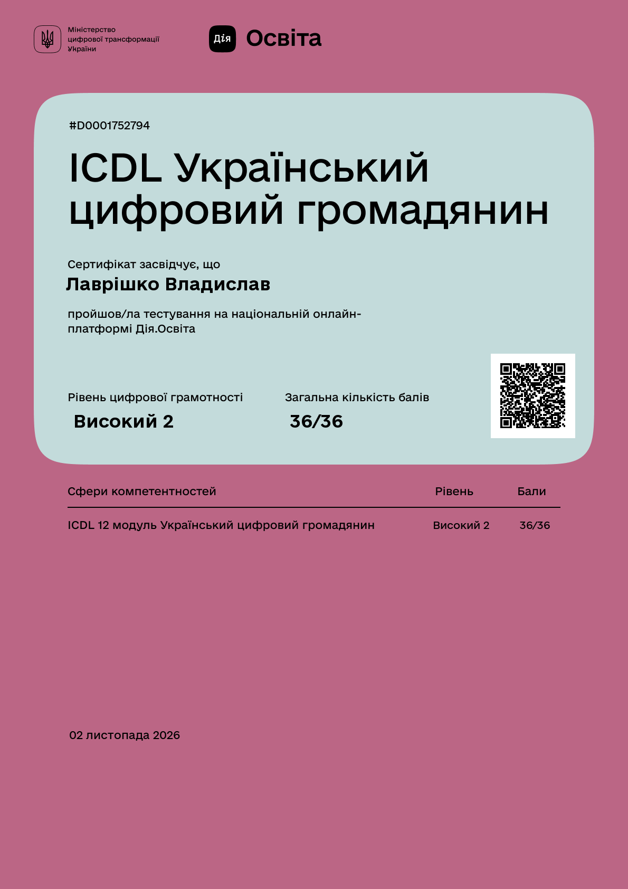
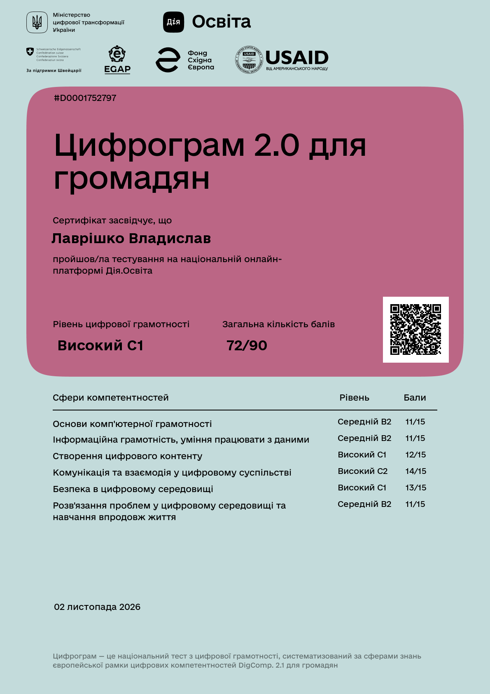

# Практичне заняття 1

**Тема:** «Діагностика власного рівня цифрової компетентності»

**Мета роботи:** Визначити початковий рівень цифрової компетентності студента за допомогою стандартизованих діагностичних інструментів і сформувати вихідні дані для подальшого професійного аналізу.

**Завдання:** Пройти тести «ICDL Український цифровий громадянин» і «Цифрограм 2.0 для громадян», зберегти результати, порівняти їх за сферами, визначити три сильні компетентності, три для розвитку й одну найважливішу для інженера ПЗ.

# Хід виконання роботи

## 1. Результати тестів

Я пройшов обидва тести на порталі Дія.Освіта 2 листопада 2026 року. ICDL дав 36 балів із 36 (рівень Високий 2). Цифрограм 2.0 дав 72 бали з 90 (рівень Високий C1).

{width=42%}

{width=42%}

Бали за модулями ICDL і компетентностями Цифрограму я взяв зі сторінок результатів на порталі.

## 2. Порівняльна таблиця

Модулі ICDL я розподілив за сферами DigCompUA самостійно, бо портал такого розподілу не показує. У рядках модулів портал показує 3/4, 3/3 і 3/2 і не пояснює другу цифру. Перші цифри в сумі дають 36 із 36, тому кожен модуль я рахую як 3 бали з 3. Оскільки ICDL дає 100 % усюди, збігом я вважаю рівень C1 або C2 у Цифрограмі.

| Сфера | Цифрограм 2.0 | ICDL (модулі) | Порівняння |
|-----------|--------|---------------|-------------|
| Основи комп'ютерної грамотності | 11/15, B2 | 12/12 (апаратне забезпечення, ОС, файлова система, основи) | найбільша відмінність |
| Інформаційна грамотність і дані | 11/15, B2 | 3/3 (інтернет, веббраузери) | найбільша відмінність: ICDL має лише один такий модуль |
| Створення цифрового контенту | 12/15, C1 | 6/6 (текстовий редактор, електронні таблиці) | збіг: високий рівень, але ICDL не перевіряє програмування |
| Комунікація та взаємодія | 14/15, C2 | 12/12 (онлайн-сервіси, пошта, спілкування, е-сервіси) | збіг: найвищий результат |
| Безпека | 13/15, C1 | 3/3 (мережева безпека) | збіг: високий рівень |
| Розв'язання проблем і навчання | 11/15, B2 | окремого модуля немає | оцінює лише Цифрограм |

: Таблиця 1 — Порівняння результатів за сферами

Обидва тести зачіпають п'ять сфер із шести. Результати збігаються в комунікації, безпеці й контенті. Найбільші відмінності в основах комп'ютерної грамотності й інформаційній грамотності: 100 % в ICDL проти 73 % у Цифрограмі. Я пояснюю це тим, що ICDL перевіряє знання понять і 36 балів не показують прогалин, а Цифрограм розрізняє рівні самостійності.

**Відповідність власній оцінці.** Загальний високий рівень відповідає моїй оцінці: я щодня працюю в Linux, користуюся Git і Docker та сам налаштовую робоче середовище. Сильним я вважаю і технічний бік безпеки. На мою думку, занижені результати: «Основи комп'ютерної грамотності» (11/15) і «Первинні навички програмування» (2/3), бо ці навички я застосовую щодня. Бал 1/3 за навчання впродовж життя вважаю справедливим.

## 3. Сильні сторони й компетентності для розвитку

Сильними я взяв компетентності з найвищим балом, які підтверджує щоденна робота, а для розвитку ті, де бал найнижчий.

| Група | Компетентність | Бал | Підтвердження або конкретна прогалина |
|-------|---------------|----|----------------------|
| Сильна | Співпраця за допомогою цифрових технологій | 3/3 | Git і GitHub, заняття в Meet і Classroom |
| Сильна | Захист пристроїв і безпечне підключення до мережі | 3/3 | Сам налаштовую систему й оновлення, ізолюю інструменти в контейнерах |
| Сильна | Визначення потреб і їх технологічне вирішення | 3/3 | Обираю інструмент під задачу й пишу власні скрипти для рутини |
| Розвиток | Управління даними, інформацією й контентом | 1/3 | Немає єдиної схеми зберігання файлів і регулярної перевірки резервних копій |
| Розвиток | Навчання протягом життя та професійний розвиток | 1/3 | Немає регулярного плану навчання, тому частину робіт я виконав із запізненням |
| Розвиток | Критичне оцінювання даних і перевірка джерел | 2/3 | Не завжди звіряю пораду з форуму з офіційною документацією |

: Таблиця 2 — Профіль компетентностей

Найважливіша компетентність для майбутнього інженера ПЗ: **навчання протягом життя та професійний розвиток**. Технології змінюються швидше за навчальні програми, тому інженер мусить сам закривати прогалини. У мене вона має один із двох найнижчих балів (1/3).

# Відповіді на контрольні запитання

**1. Що таке цифрова компетентність?** Це здатність упевнено, критично, відповідально й безпечно використовувати цифрові технології для навчання, роботи, комунікації, створення контенту й розв'язання практичних завдань.

**2. Чим вона відрізняється від уміння користуватися комп'ютером?** Уміння користуватися комп'ютером стосується лише техніки й програм. Компетентність додає пошук і критичне оцінювання інформації, створення контенту, командну взаємодію, захист даних, розв'язання проблем і самостійне опанування нових інструментів.

**3. Які сфери вона охоплює?** Шість сфер: основи комп'ютерної грамотності; інформаційна грамотність і дані; створення цифрового контенту; комунікація та взаємодія; безпека; розв'язання проблем і навчання впродовж життя.

**4. Для чого використовують рамки цифрових компетентностей?** Щоб систематизувати цифрові знання, уміння й ставлення. Рамка дає спільні сфери й рівні, за якими можна описати, виміряти й спланувати розвиток навичок.

**5. Що таке DigCompUA і яке її призначення?** Це Рамка цифрової компетентності громадян України, створена з урахуванням європейського підходу DigComp. Вона описує сфери цифрової компетентності й рівні їх сформованості, щоб їх можна було оцінювати й розвивати.

**6. Чим самооцінювання відрізняється від стандартизованого тестування?** Самооцінювання спирається на власне уявлення людини про свої знання й уміння. У стандартизованому тесті всі учасники виконують однакові завдання, тому результат об'єктивніший.

**7. Чому їхні результати можуть відрізнятися?** Людина може переоцінити або недооцінити себе, а тест охоплює лише частину навичок. У мене так вийшло з основами комп'ютерної грамотності: Цифрограм дав 11/15, а я вважаю цей бал заниженим.

**8. Що перевіряє тест ICDL «Український цифровий громадянин»?** Базові знання й практичні навички роботи з комп'ютером і цифровими технологіями. Його модулі стосуються апаратного забезпечення, ОС, файлової системи, основ, інтернету й веббраузерів, текстового редактора й таблиць, онлайн-сервісів, пошти, спілкування, е-сервісів і мережевої безпеки.

**9. Для чого призначений тест «Цифрограм 2.0 для громадян»?** Це національний тест цифрової грамотності, побудований на сферах цифрової компетентності. Він показує рівень за сферами й окремими компетентностями, тому за ним видно, що саме варто розвивати.

**10. Чому для діагностики варто брати два різні тести?** Вони перевіряють різне, тому другий показує те, чого не видно в першому. У мене ICDL дав 36/36 і не показав прогалин, а Цифрограм (72/90) виявив слабші компетентності.

**11. Що таке індивідуальний профіль цифрової компетентності?** Це узагальнене представлення сильних сторін і компетентностей, які потребують розвитку.

**12. Як визначити сильні сторони й прогалини?** Дивитися бали за окремими компетентностями, а не лише загальний результат. Найвищі бали, підтверджені щоденною роботою, дають сильні сторони, найнижчі вказують на прогалини, і кожну прогалину треба назвати конкретно.

**13. Чому висока загальна грамотність ще не гарантує професійної готовності?** Тести для громадян перевіряють загальні навички: у Цифрограмі з програмування є лише первинні навички, а ICDL його не перевіряє. Інженеру ще потрібні контроль версій, командна розробка, тестування, захист даних і автоматизація, тому загальна грамотність лише основа для їх розвитку.

**14. Які компетентності найважливіші для майбутнього інженера ПЗ?** Програмування, контроль версій і командна розробка, тестування, захист даних. Найважливішим я вважаю навчання протягом життя, бо технології змінюються швидше за навчальні програми й інженер мусить сам закривати прогалини.

**15. Як використати діагностику для планування розвитку?** Узяти компетентності з найнижчими балами, поставити конкретні дії й терміни, а згодом повторити тест і порівняти результат. У мене це зберігання даних і резервні копії, регулярний план навчання й перевірка порад за первинними джерелами.

# Висновки
**Мій поточний профіль цифрової компетентності та його відповідність професії інженера програмного забезпечення.** Профіль загалом високий: ICDL 36/36, Цифрограм 2.0 72/90. Найсильнішими виявилися сфери комунікації (14/15) і безпеки (13/15), найслабшими основи, дані й розв'язання проблем (по 11/15). Як загальна база для інженера ПЗ цього достатньо. Проте високий результат тестів для громадян ще не підтверджує професійної готовності. За результатами роботи було визначено наступні кроки: налагодити зберігання даних і резервні копії, скласти регулярний план навчання, перевіряти поради за первинними джерелами.
