# Практична робота 2.1

**Тема:** «Команди керування файловою системою ОС UNIX»

**Мета роботи:** Дослідити засоби керування файлами і структурою файлової системи в командному середовищі ОС UNIX та отримати навички керування файлами і каталогами.

## Завдання

1. Увійти у систему під заданим іменем користувача.
2. Командами `cd` і `ls` дослідити структуру файлової системи.
3. Створити нову директорію в домашньому каталозі.
4. Скопіювати файли з `/usr` у створену директорію.
5. Переглянути вміст текстового файлу.
6. Видалити файли за іменем із метасимволами.
7. Перейменувати файл/папку.
8. Перемістити файл/папку в задану директорію.
9. Видалити всі файли з директорії.
10. Видалити директорію.
11. За `pstree` знайти батьківські процеси й занести параметри трьох із них.

## Хід виконання роботи

Ubuntu 24.04 (bash 5.2.21, контейнер Docker, лише термінал), користувач `lavrishko`, тема вправ «Прокат автомобілів» (каталог `prokat`). Сеанс і знімки лежать у [репозиторії](https://github.com/brizzinck/krinzhrepoduta/tree/main/digital_tech/pr-2.1).

Завдання 1–2. `grep lavrishko /etc/passwd` показав останнє поле `/bin/bash`, тобто інтерпретатор bash (рис. 1). Структуру переглянуто командами `ls -a`, `-p`, `-l` (рис. 2). Командою `cd` перевірено абсолютні й відносні шляхи, `cd /1` дала `No such file or directory` (рис. 3).

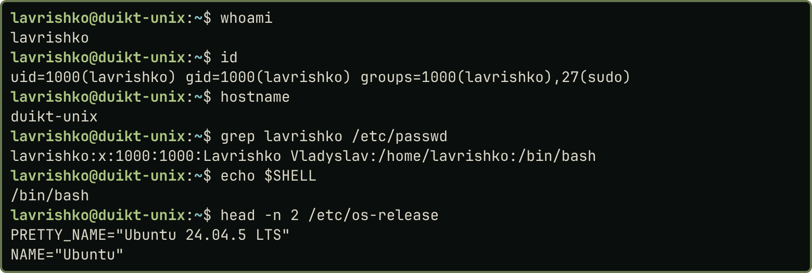{width=60%}

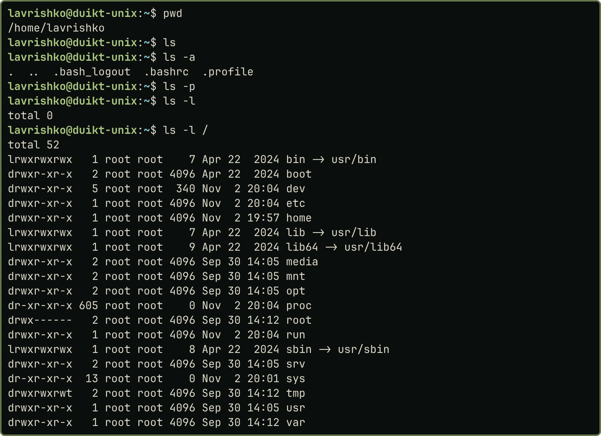{width=60%}

Завдання 3–5. Командою `mkdir` створено `prokat` з підкаталогами `sedan`, `suv`, `hatchback` (рис. 4). З `/usr/share/common-licenses` виконано `cp` одного файла, двох за маскою `GPL-[12]`, з перейменуванням (`cp GPL-3 sedan/license`) і в той самий каталог з іншим іменем (рис. 5); результат показує `tree` (рис. 6). Вміст переглянуто `head`, `tail`, `wc -l`, `more` (рис. 7). Для вправ з `mv` командою `touch` створено порожні файли `1_camry`…`golf3`.

::: {.pair}
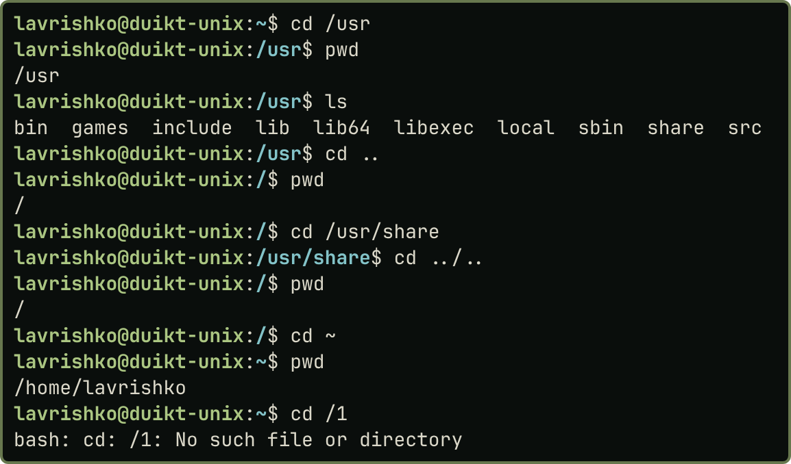{width=47%} 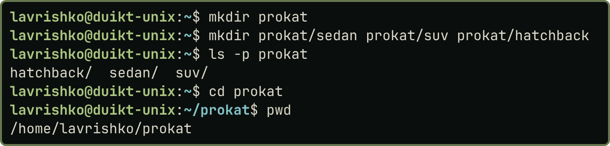{width=50%}

Рис. 3 (зліва). Переміщення `cd`. Рис. 4 (справа). Створення каталогів `mkdir`
:::

{width=60%}

::: {.pair}
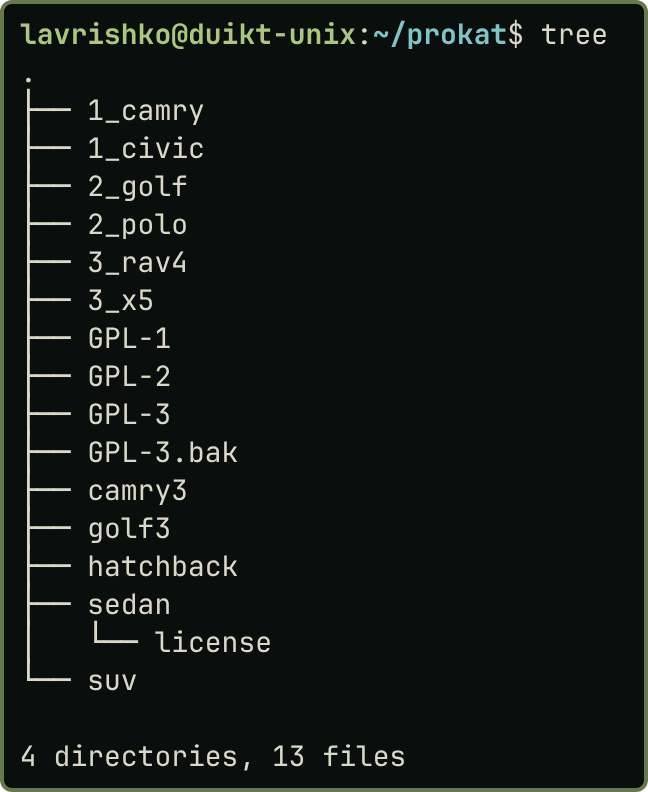{width=32%} 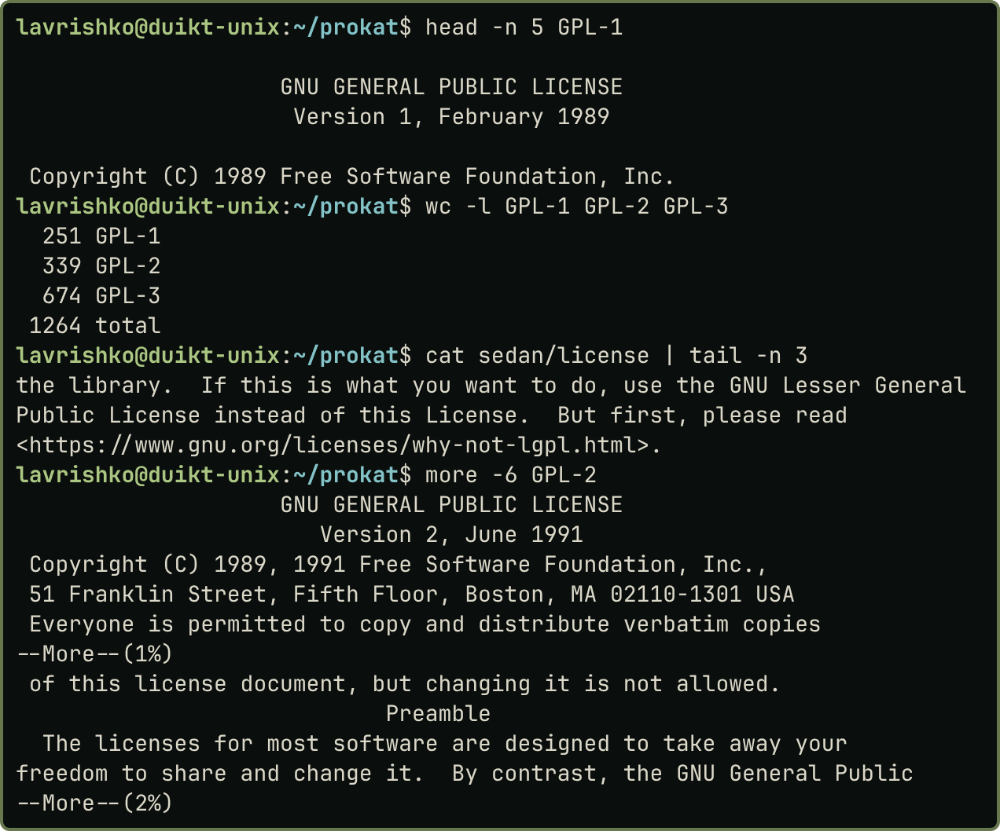{width=65%}

Рис. 6 (зліва). Дерево `tree` після копіювання. Рис. 7 (справа). Перегляд файлів
:::

Завдання 6. У `trash` створено файли `file1`–`file4`, `fileA`, `fileB`, `filec`, `file10`, `acx`, `rock`, `cat`, `my file`. Маска `file[!1-3]` вибрала `file4`, `fileA`, `fileB`, `filec`, тобто всі `file?`, крім `file1`–`file3`; `file10` вона не вибрала, бо `[!1-3]` замінює рівно один символ. Видалено `rm *c?` (передостання літера `c`), `rm file[1-3]`, `rm my\ file`, `rm -i fileA`, `rm file*`; лишився `cat` (рис. 8).

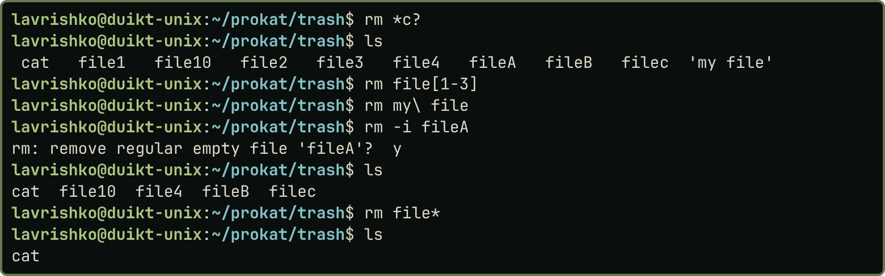{width=60%}

Завдання 7–9. `mv` перейменував файл і каталог (`GPL-3.bak` у `license_old`, `suv` у `crossover`; рис. 9) та перемістив файли за масками `1_*`, `*3` і за іменами (рис. 10). У `temp` команда `rmdir` дала `Directory not empty`, `rm *` видалила файли (рис. 11).

::: {.pair}
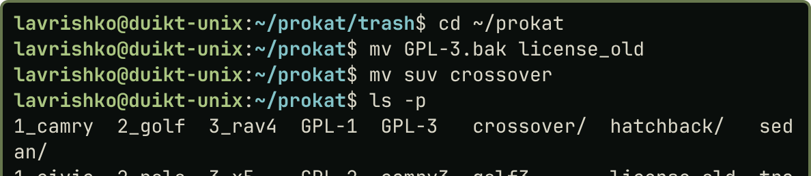{width=45%} 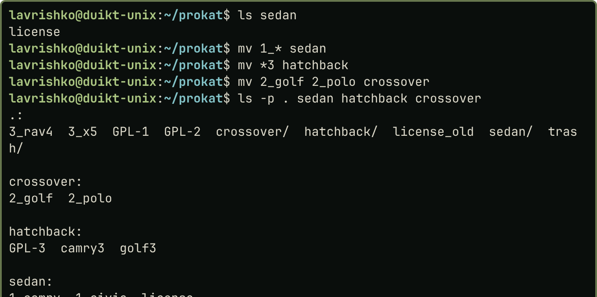{width=52%}

Рис. 9 (зліва). Перейменування. Рис. 10 (справа). Переміщення
:::

Завдання 10. Порожній `temp` видалено `rmdir`, каталог із вмістом (`full`) командою `rm -R full` (без кошика й скасування). У Ubuntu можна видалити поточний каталог (`rmdir ../ghost`), у класичному UNIX ні (рис. 12).

::: {.pair}
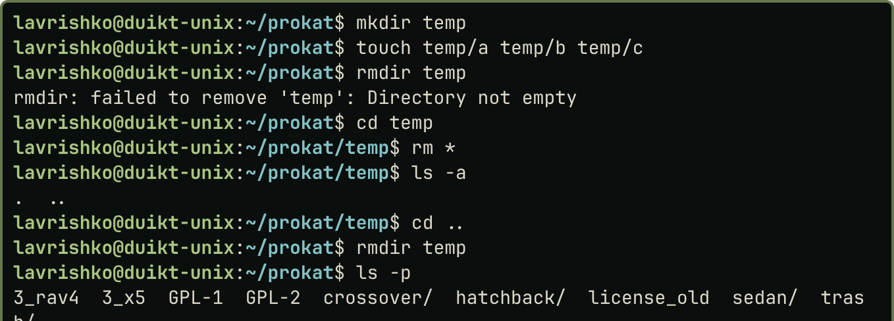{width=48%} 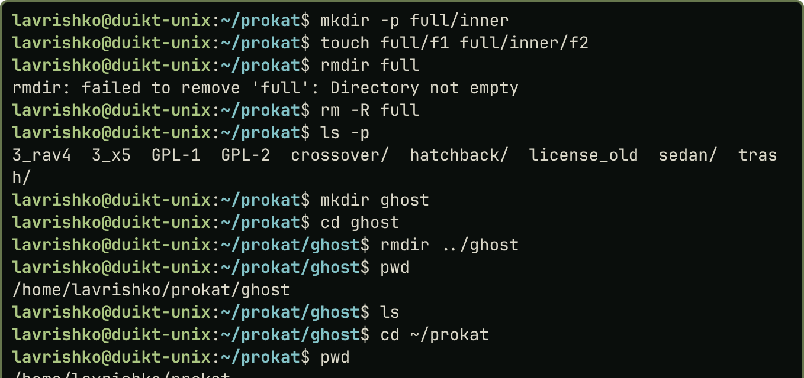{width=48%}

Рис. 11 (зліва). Видалення всіх файлів. Рис. 12 (справа). Видалення каталогів
:::

Завдання 11. `pstree -p` показав ланцюжок: `docker-init(1)` запускає `script(24)`, той `sh(38)`, а той `bash(39)`; параметри отримано `ps -o pid,ppid,user:12,stat,etime,cmd -p 1,$PPID,$$` (рис. 13, таблиця 1). `script` — це утиліта запису терміналу, яка запускає оболонку, а `docker-init` — це процес 1 контейнера.

Таблиця 1. Параметри трьох батьківських процесів

| Параметр | docker-init | sh | bash |
|---|---|---|---|
| PID | 1 | 38 | 39 |
| PPID | 0 | 24 (`script`) | 38 (`sh`) |
| Користувач | lavrishko | lavrishko | lavrishko |
| Стан | Ss | Ss | S |
| Час роботи | 00:15 | 00:14 | 00:14 |
| Команда | `/sbin/docker-init -- sleep infinity` | `sh -c bash --norc --noediting -i` | `bash --norc --noediting -i` |

::: {.pair}
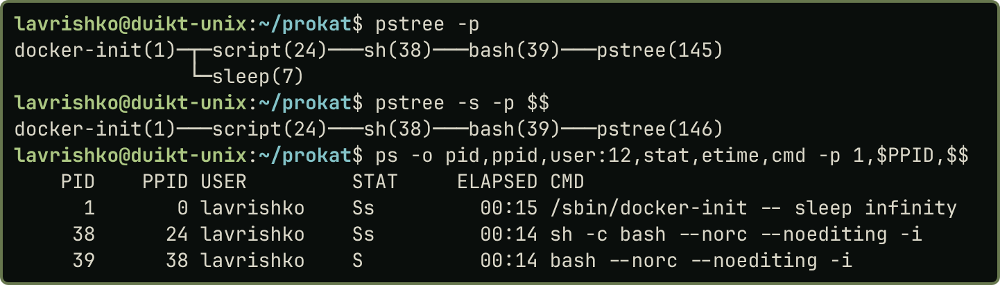{width=67%} 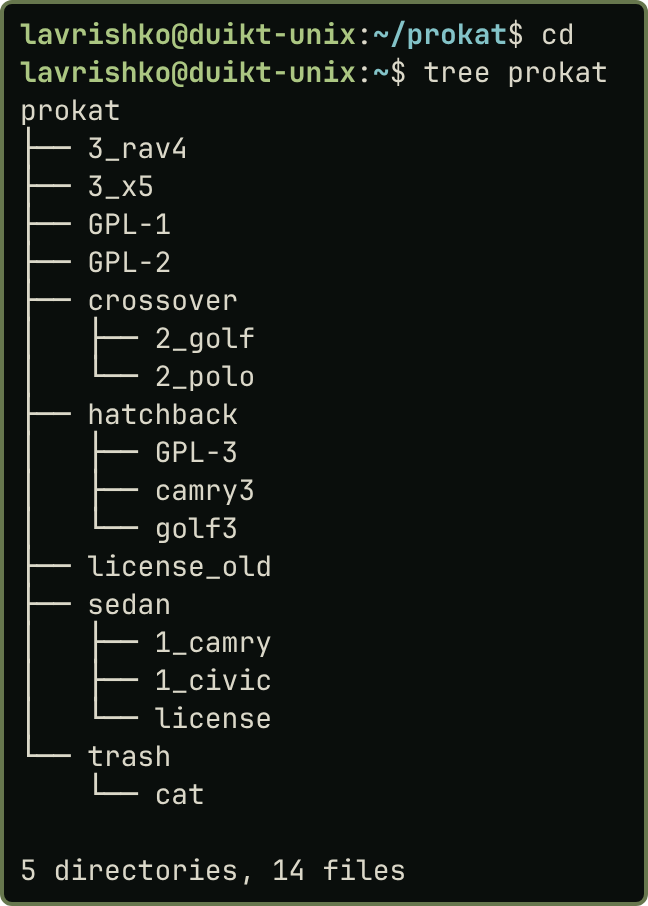{width=30%}

Рис. 13 (зліва). `pstree` і `ps`. Рис. 14 (справа). Підсумкове дерево `tree` після змін
:::

## Висновки

У роботі опрацьовано засоби керування файловою системою ОС UNIX у середовищі bash. За `/etc/passwd` визначено інтерпретатор, структуру файлової системи вивчено командами `pwd`, `ls`, `cd`. Створено структуру `prokat`, скопійовано файли з `/usr` (зокрема з перейменуванням однією командою) і переглянуто їх вміст. Метасимволи `?`, `*`, `[ ]`, `!` застосовано для вибору й видалення файлів, а командою `mv` перейменовано файл і каталог та переміщено файли. З’ясовано, що `rmdir` видаляє лише порожні каталоги, а `rm -R` не можна скасувати. За `pstree` знайдено батьківські процеси й зафіксовано параметри трьох із них.
