# Практична робота 2.2

**Тема:** «Використання перенаправлення введення-виведення та конвеєрів у середовищі ОС»

**Мета роботи:** Отримати навички роботи з перенаправленням введення-виведення та конвеєрами у середовищі ОС.

## Завдання

1. Об’єднати три файли, відсортувати й записати в четвертий.
2. Об’єднати файли за маскою; результат, кількість рядків і слів записати в новий файл.
3. Знайти задане слово в трьох файлах, результат записати в текстовий файл.
4. Об’єднати три файли, відсортувати у зворотному порядку, записати в четвертий і дописати поточну дату.
5. Об’єднати три файли, знайти слово, результат записати в четвертий файл і дописати кількість рядків.
6. Дописати до попереднього файлу впорядковані переліки процесів і активних користувачів.
7. Об’єднати три файли, знайти задані символи, результат записати в четвертий файл і дописати зміст директорії.
8. Дописати до файлу зміст заданого файлу зі зміною регістра.
9. Видати посторінково файли, що починаються із заданої літери.
10. Дописати до відсортованого файлу поточну дату і записати результат у файл.
11. Підрахувати файли в поточному каталозі й записати кількість разом з упорядкованим списком у файл.

## Хід виконання роботи

Ubuntu 24.04 (bash 5.2.21, контейнер Docker), користувач `lavrishko`, тема «Прокат автомобілів», робочий каталог `~/prokat/park`. Вхідні файли `cars_a.txt`, `cars_b.txt`, `cars_c.txt` (по 4 рядки «марка модель рік кузов ціна», останній рядок `cars_c.txt` тестовий, для пошуку символів `abcd`); задані: слово `Toyota`, символи `abcd`, літера `c`. Сеанс і знімки подано в [репозиторії](https://github.com/brizzinck/krinzhrepoduta/tree/main/digital_tech/pr-2.2).

Завдання 1–2. `cat cars_a.txt cars_b.txt cars_c.txt | sort > sorted.txt` об’єднує файли, конвеєр передає їх `sort`, `>` записує результат (12 рядків). Маска `cars_*.txt` дала `cat cars_*.txt > merged.txt`, а `wc -l -w merged.txt > count.txt` (12 рядків, 60 слів) і `cat merged.txt count.txt > result2.txt` зібрали результат (рис. 1–3).

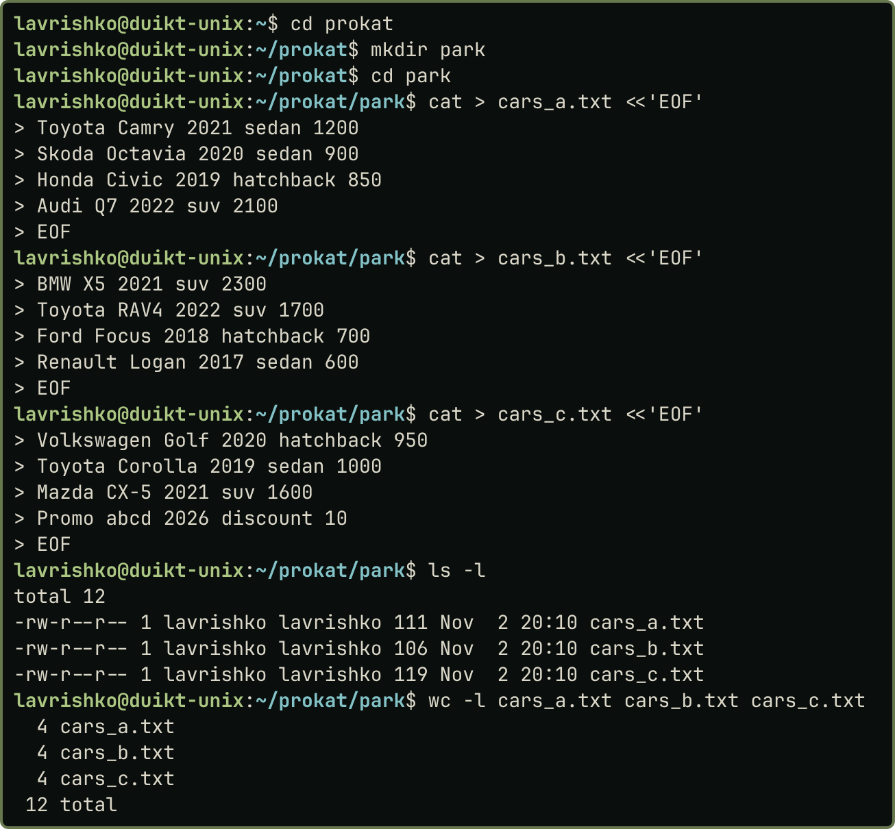{width=42%}

::: {.pair}
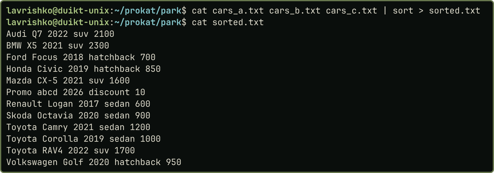{width=54%} 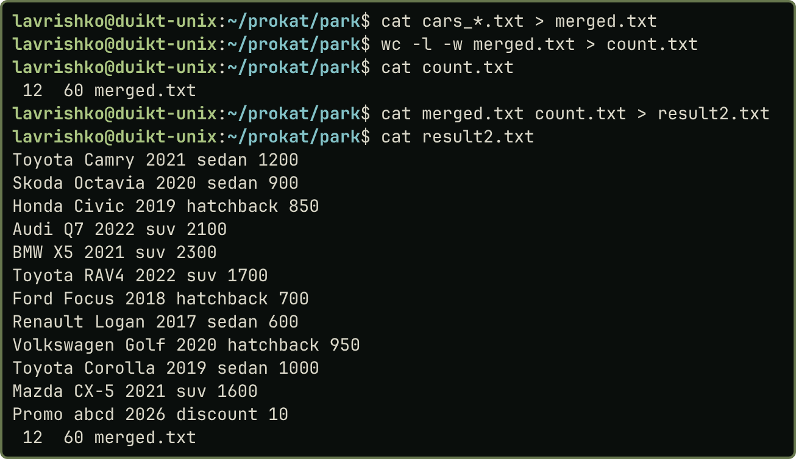{width=43%}

Рис. 2 (зліва). Завдання 1. Рис. 3 (справа). Завдання 2
:::

Завдання 3–4. `grep -n Toyota cars_a.txt cars_b.txt cars_c.txt > found.txt` знайшла три входження (по одному в кожному файлі). `cat cars_*.txt | sort -r > out4.txt` записала рядки у зворотному порядку, `date >> out4.txt` дописала дату (`>>` не стирає вміст) (рис. 4–5).

::: {.pair}
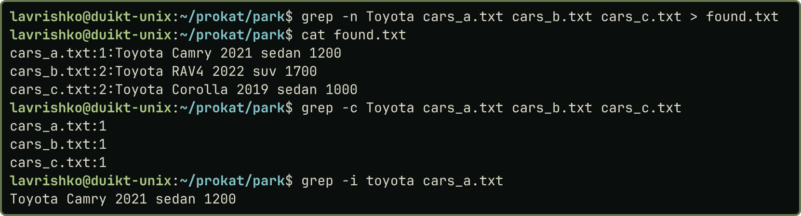{width=55%} 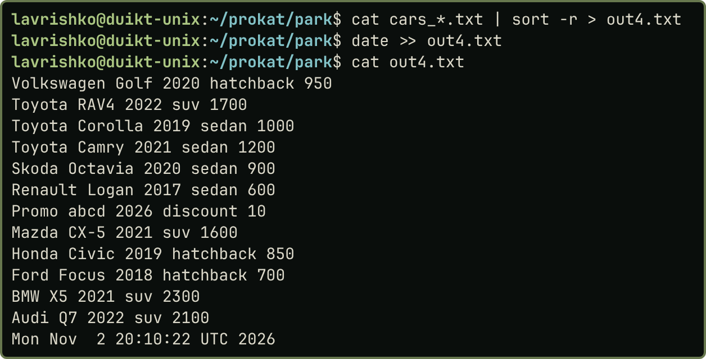{width=42%}

Рис. 4 (зліва). Завдання 3. Рис. 5 (справа). Завдання 4
:::

Завдання 5–6. `cat cars_*.txt | grep Toyota > out5.txt` і `wc -l out5.txt >> out5.txt` залишили 3 рядки та їх кількість. Далі дописано впорядкований за алфавітом перелік процесів `ps -eo comm= | sort` і користувачів `ps -eo user= | sort -u`; `who` і `w` у контейнері порожні (немає записів utmp), тому активним визначено власника процесів `lavrishko` (рис. 6–7).

::: {.pair}
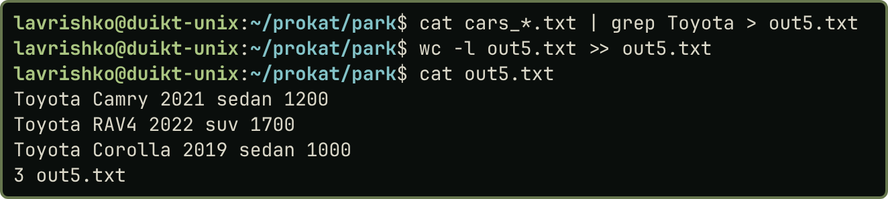{width=50%} 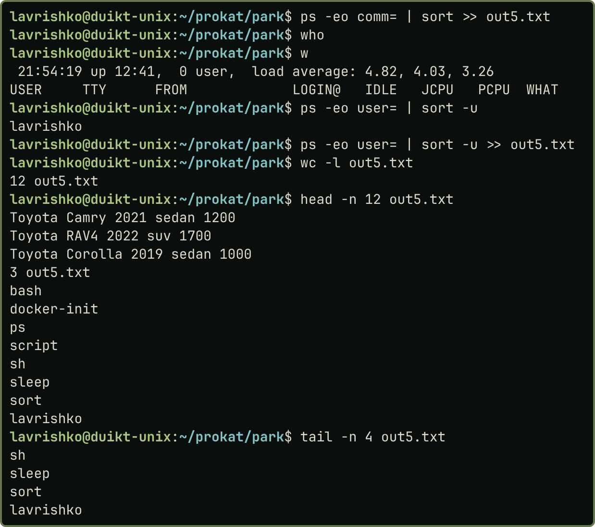{width=47%}

Рис. 6 (зліва). Завдання 5. Рис. 7 (справа). Завдання 6
:::

Завдання 7–8. `cat cars_*.txt | grep abcd > out7.txt` знайшла рядок `Promo abcd 2026 discount 10`, `ls >> out7.txt` дописала зміст каталогу. `tr 'a-z' 'A-Z' < cars_a.txt >> out8.txt` дописала вміст з великими літерами (діапазон пишеться без пробілів, на відміну від запису в методичці) (рис. 8–9).

::: {.pair}
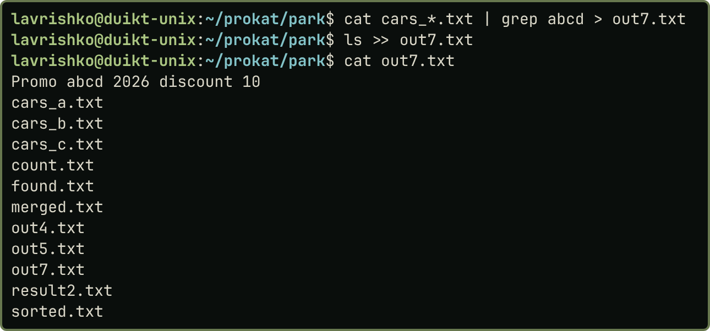{width=48%} 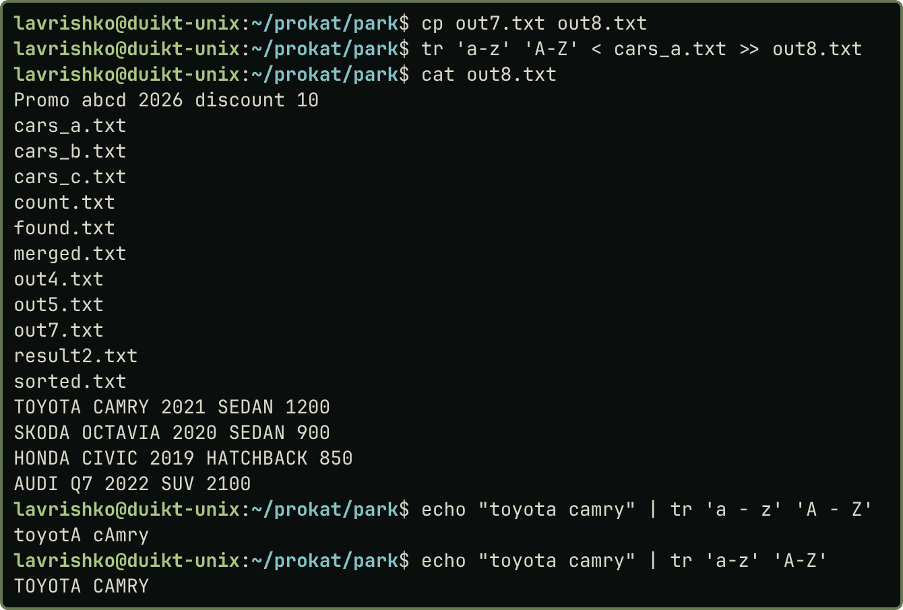{width=49%}

Рис. 8 (зліва). Завдання 7. Рис. 9 (справа). Завдання 8
:::

Завдання 9–10. Маска `c*` вибирає файли на `c`; `more -6 c*` виводить їх по 6 рядків із запрошенням `--More--`. `cat sorted.txt > out10.txt` і `date >> out10.txt` дописали дату до відсортованого файлу (рис. 10–11).

::: {.pair}
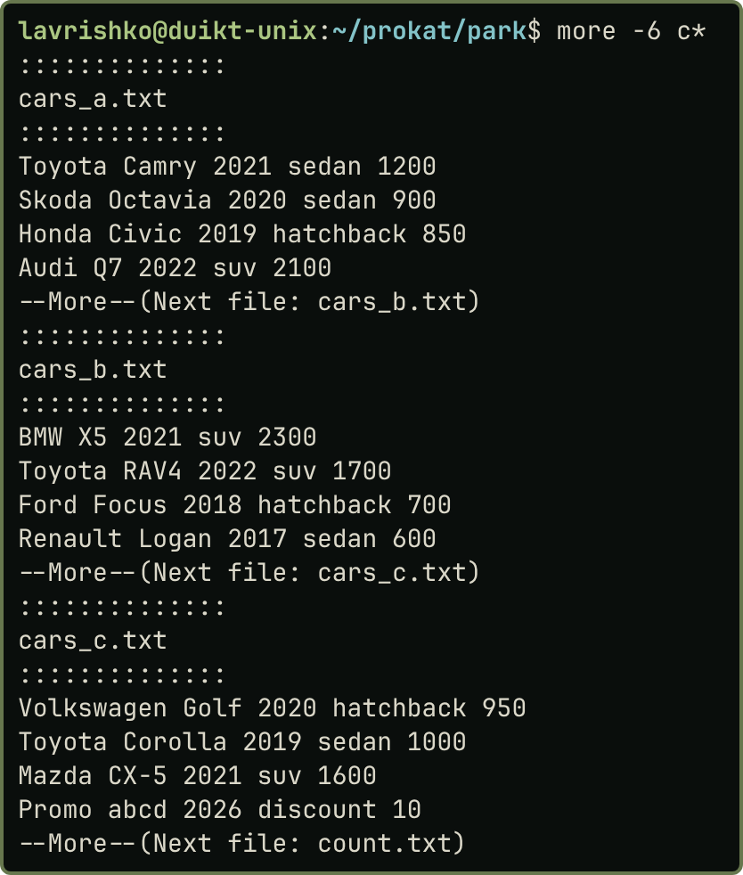{width=36%} 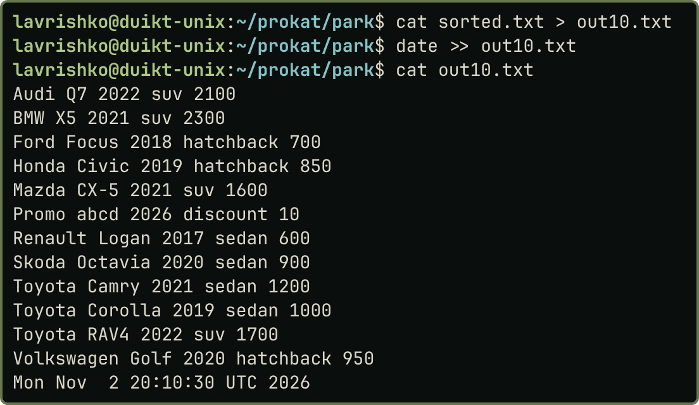{width=49%}

Рис. 10 (зліва). Завдання 9. Рис. 11 (справа). Завдання 10
:::

Завдання 11. `{ ls | wc -l; ls | sort; } > ../list_park.txt` групує два конвеєри й записує кількість файлів (14) і впорядкований список в один файл у батьківському каталозі, щоб він не потрапив у власний список (рис. 12).

::: {.pair}
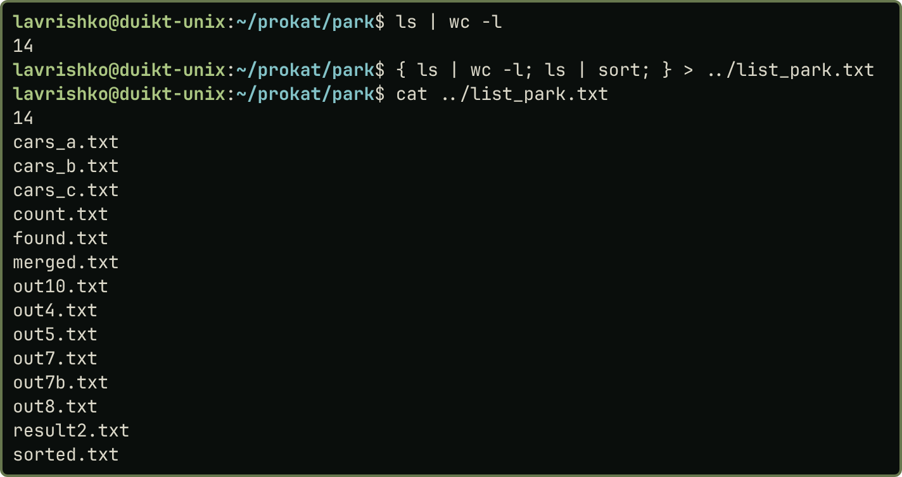{width=58%} 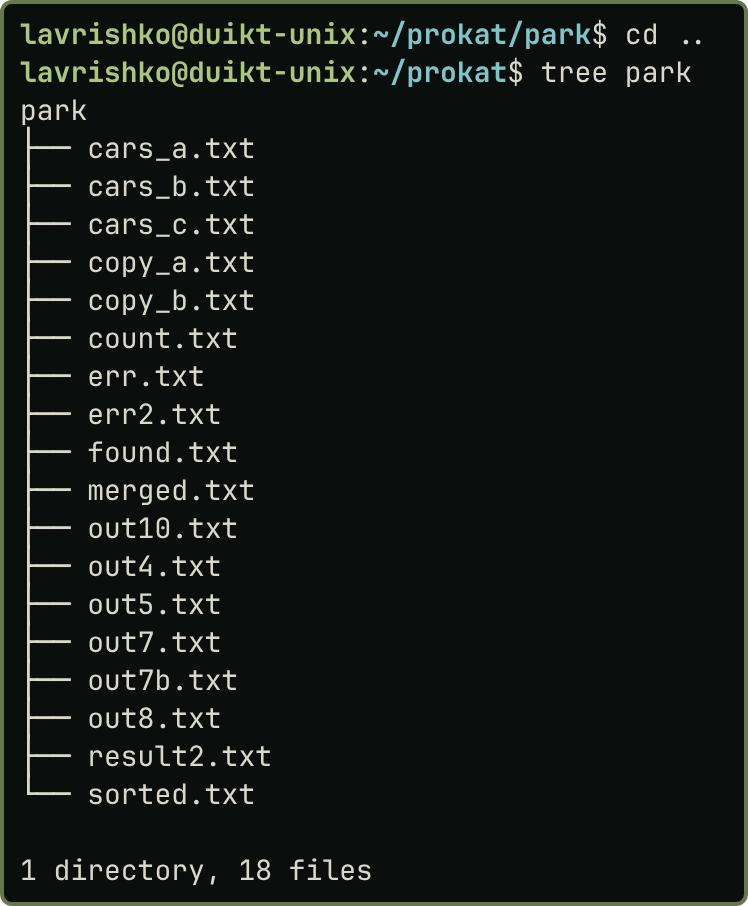{width=30%}

Рис. 12 (зліва). Завдання 11. Рис. 13 (справа). Дерево каталогів `park` (утиліта `tree`)
:::

## Висновки

У bash ОС Ubuntu опрацьовано перенаправлення введення-виведення операторами `<`, `>`, `>>` і конвеєри `|`. Виконано об’єднання файлів із прямим і зворотним сортуванням, об’єднання за маскою з підрахунком `wc`, пошук слова й символів командою `grep`, дописування дати, кількості рядків, переліків процесів і змісту каталогу. Регістр змінено командою `tr`, посторінковий вивід виконано командою `more`, файли підраховано із записом упорядкованого списку. З’ясовано, що `>>` дописує, а `>` перезаписує файл, і що запис `tr 'a - z'` із пробілами працює некоректно.
