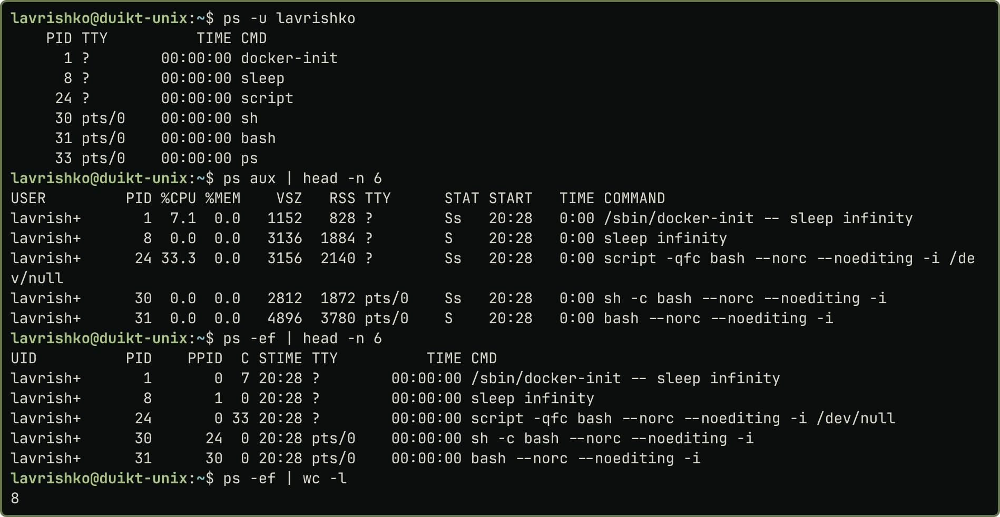
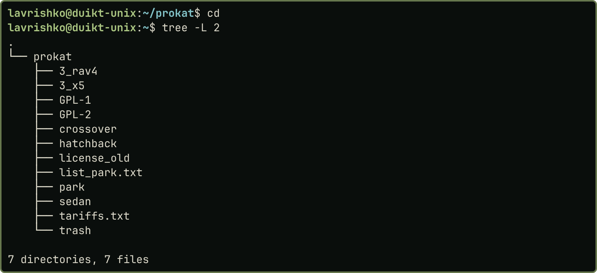

# Практична робота 2.3

**Тема:** «Адміністрування ОС UNIX»

**Мета роботи:** Дослідити основні можливості та отримати початкові навички з адміністрування ОС UNIX.

## Завдання

1. Отримати список активних процесів користувачів і список усіх процесів.
2. Запустити одночасно два процеси з командного рядка.
3. Задати запуск команди на визначений час, перевірити виконання.
4. Запустити утиліту перевірки файлової системи.
5. Занести нового користувача до `/etc/passwd`.
6. Занести нову групу до `/etc/group`.
7. Встановити права доступу до заданого файлу для нового користувача.
8. Перевірити роботу системи контролю доступу.

## Хід виконання роботи

Ubuntu 24.04 (bash, контейнер Docker), користувач `lavrishko`, права `root` через `sudo`. Для вправ: користувач `tester` (UID 2001), другий користувач `guest`, група `rental` (GID 2001), файл `~/prokat/tariffs.txt`. У контейнері немає `systemd`, тому `atd` запущено вручну, а `fsck` виконано на файлі-образі. Сеанс і знімки доступні в [репозиторії](https://github.com/brizzinck/krinzhrepoduta/tree/main/digital_tech/pr-2.3).

Завдання 1–2. `ps -u lavrishko` показав процеси користувача, `ps aux` і `ps -ef` показали всі процеси (7 процесів і заголовок; у контейнері всі вони належать `lavrishko`, тому списки збігаються). `sleep 300 & sleep 400 &` запустив два фонові процеси; `jobs` показав обидва Running, батьківським для них є оболонка (PPID 31). Додатково перевірено `nice -n 10` і `nohup`.

{width=60%}

{width=60%}

Завдання 3–4. `sudo -b atd` запустив демон, `echo 'date > ~/at_result.txt' | at now + 1 minute` поставила завдання, `atq` показала чергу, після паузи файл містить дату запланованого моменту. `fsck` не запускають на змонтованій системі, тому створено образ (`dd`, `mkfs.ext4`), а `e2fsck -fn ~/disk.img` виконала перевірку в режимі читання; підсумок `11/4096 files, 1291/4096 blocks` означає, що помилок немає.

{width=60%}

{width=60%}

Завдання 5–6. Запис у системні файли потребує прав `root`: `sudo whoami` повертає `root`, а `/etc/shadow` має права `-rw-r-----` і недоступний звичайному користувачеві. Рядок `tester:x:2001:2001:Test User:/home/tester:/bin/bash` дописано командою `sudo tee -a /etc/passwd`; `pwck -r` повідомила `no group 2001`. Рядок `rental:x:2001:lavrishko,tester` додано до `/etc/group`, після чого `id tester` показує `gid=2001(rental)`; створено домашній каталог, виконано `pwconv`, `grpconv`, повторні `pwck -r` і `grpck -r` помилок не дали. Користувача `guest` додано командою `useradd -m`.

{width=60%}

{width=60%}

Завдання 7–8. `sudo chown lavrishko:rental tariffs.txt` змінила групу, а `chmod 640 tariffs.txt` (те саме, що `chmod u=rw,g=r,o=`) дала `-rw-r-----`; каталогам `~` і `~/prokat` додано `o+x`. Перевірка від імені `tester` (група `rental`) і `guest` (стороннього): `tester` читає файл, але не пише (`Permission denied`); `guest` не читає; після `chmod g+w` `tester` пише, `guest` як і раніше ні.

{width=60%}

{width=60%}

Після перевірки `guest`, `tester` і групу `rental` видалено (`userdel -r`, `groupdel`). Структуру каталогу виведено утилітою `tree`.

{width=60%}

## Висновки

Було досліджено основні можливості адміністрування ОС UNIX. Списки процесів отримано командою `ps`, фонові процеси запущено оператором `&`, відкладене виконання команди налаштовано планувальником `at`. Файлову систему перевірено утилітою `fsck` на образі-файлі. У `/etc/passwd` і `/etc/group` внесено користувача `tester` і групу `rental`, а `guest` додано командою `useradd`. Для файлу `tariffs.txt` встановлено групу й права командами `chown` і `chmod` числовим та символічним способами. Перевірка від імені двох користувачів показала, що доступ надається або забороняється відповідно до бітів прав. Також з’ясовано, чим контейнер відрізняється від віртуальної машини: у ньому немає `systemd`, а `fsck` можливий лише на образі.
