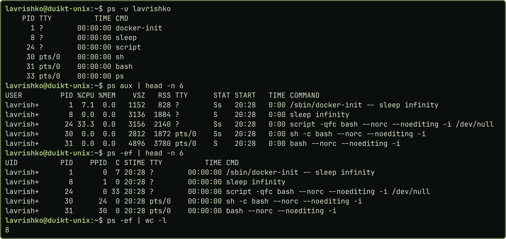
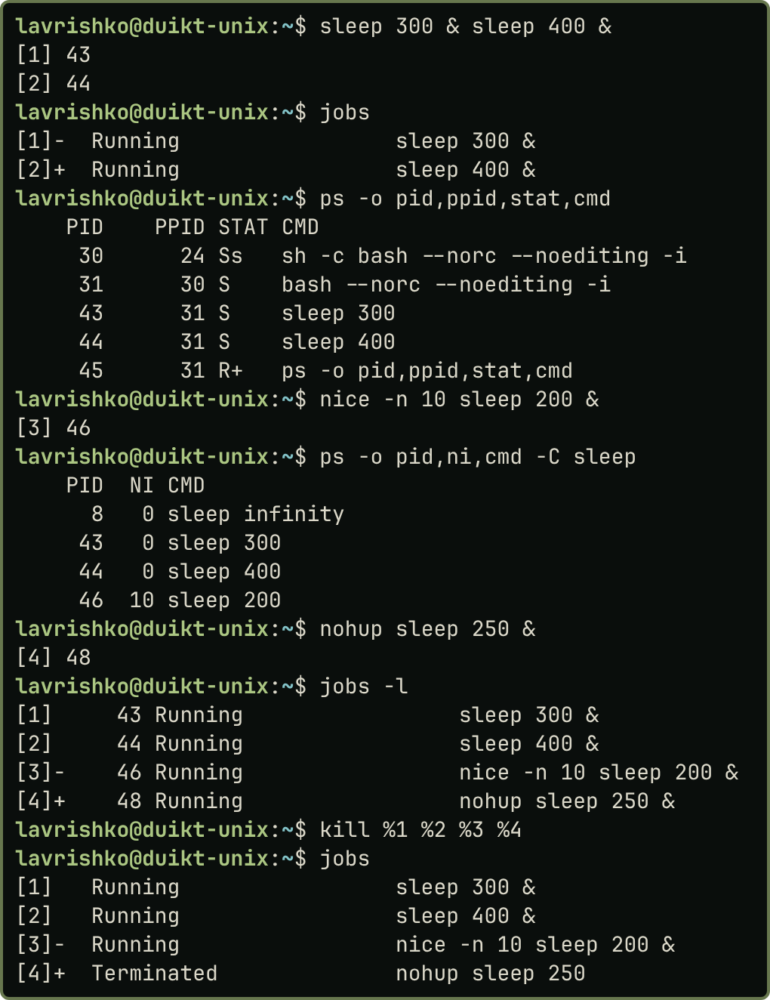
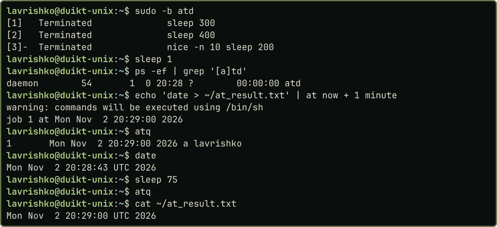
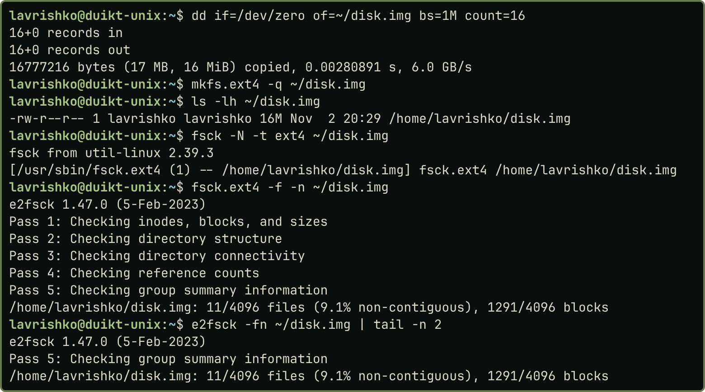
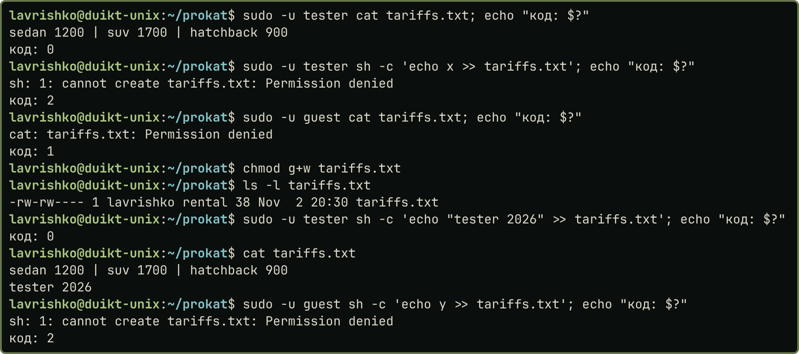
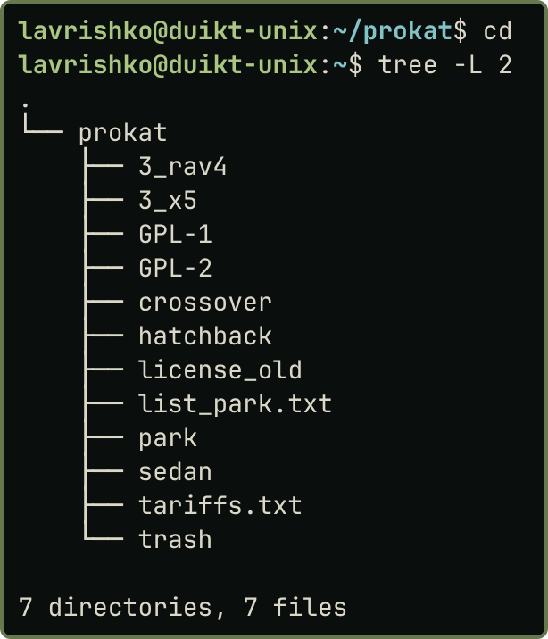

# Практична робота 2.3

**Тема:** «Адміністрування ОС UNIX»

**Мета роботи:** Дослідити основні можливості та отримати початкові навички з адміністрування ОС UNIX.

## Завдання

1. Отримати список активних процесів користувачів і список усіх процесів.
2. Запустити одночасно два процеси з командного рядка.
3. Задати запуск команди на визначений час, перевірити виконання.
4. Запустити утиліту перевірки файлової системи.
5. Занести нового користувача до `/etc/passwd`.
6. Занести нову групу до `/etc/group`.
7. Встановити права доступу до заданого файлу для нового користувача.
8. Перевірити роботу системи контролю доступу.

## Хід виконання роботи

Ubuntu 24.04 (bash, контейнер Docker), користувач `lavrishko`, права `root` через `sudo`. Для вправ: користувач `tester` (UID 2001), другий користувач `guest`, група `rental` (GID 2001), файл `~/prokat/tariffs.txt`. У контейнері немає `systemd`, тому демон `atd` запущено окремою командою, а `fsck` виконано на файлі-образі. Сеанс і знімки доступні в [репозиторії](https://github.com/brizzinck/krinzhrepoduta/tree/main/digital_tech/pr-2.3).

Завдання 1–2. `ps -u lavrishko` показав процеси користувача, `ps aux` і `ps -ef` показали всі процеси (7 процесів і заголовок; у контейнері всі вони належать `lavrishko`, тому списки збігаються). `sleep 300 & sleep 400 &` запустив два фонові процеси; `jobs` показав обидва Running, батьківським для них є оболонка (PPID 31). Додатково перевірено `nice -n 10` і `nohup`.

::: {.pair}
{width=65%} {width=32%}

Рис. 1 (зліва). Списки процесів. Рис. 2 (справа). Фонові процеси `&`
:::

Завдання 3–4. `sudo -b atd` запустив демон, `echo 'date > ~/at_result.txt' | at now + 1 minute` поставила завдання, `atq` показала чергу, після паузи файл містить дату запланованого моменту. `fsck` не запускають на змонтованій системі, тому створено образ (`dd`, `mkfs.ext4`), а `e2fsck -fn ~/disk.img` виконала перевірку в режимі читання; усі п’ять проходів завершились без повідомлень про помилки, а підсумок `11/4096 files, 1291/4096 blocks` показує зайняті inode і блоки.

::: {.pair}
{width=44%} {width=53%}

Рис. 3 (зліва). Команда `at`. Рис. 4 (справа). Перевірка `fsck`
:::

Завдання 5–6. Запис у системні файли потребує прав `root`: `sudo whoami` повертає `root`, а `/etc/shadow` має права `-rw-r-----` і недоступний звичайному користувачеві. Рядок `tester:x:2001:2001:Test User:/home/tester:/bin/bash` дописано командою `sudo tee -a /etc/passwd`; `pwck -r` повідомила `no group 2001`.

Рядок `rental:x:2001:lavrishko,tester` додано до `/etc/group`, після чого `id tester` показує `gid=2001(rental)`. Далі створено домашній каталог і виконано `pwconv`, `grpconv`; повторні `pwck -r` і `grpck -r` помилок не дали. Користувача `guest` додано командою `useradd -m`.

{width=60%}

{width=60%}

Завдання 7–8. `sudo chown lavrishko:rental tariffs.txt` змінила групу, а `chmod 640 tariffs.txt` (те саме, що `chmod u=rw,g=r,o=`) дала `-rw-r-----`; каталогам `~` і `~/prokat` додано `o+x`. Перевірка від імені `tester` (група `rental`) і `guest` (стороннього): `tester` читає файл, але не пише (`Permission denied`); `guest` не читає; після `chmod g+w` `tester` пише, `guest` як і раніше ні.

{width=60%}

Після перевірки `guest`, `tester` і групу `rental` видалено (`userdel -r`, `groupdel`).

::: {.pair}
{width=73%} {width=24%}

Рис. 8 (зліва). Перевірка доступу від `tester` і `guest`. Рис. 9 (справа). Дерево каталогів (`tree`)
:::

## Відповіді на контрольні запитання

**1. Як додати нового користувача?** Дописати в `/etc/passwd` рядок `ім’я:пароль:UID:GID:коментар:домашній_каталог:оболонка`, створити домашній каталог, виконати `pwconv` і задати пароль (`chpasswd`); так я додав `tester`. Простіше скористатися `adduser` або `useradd -m`, як для `guest`: команда сама створює запис і домашній каталог, а пароль задають окремо.

**2. Як додати нову групу й наявних користувачів до неї?** Дописати в `/etc/group` рядок `ім’я:пароль:GID:користувачі` з унікальним GID або виконати `groupadd`. Наявних користувачів додати можна: дописати їхні імена через кому в четверте поле або виконати `usermod -aG група користувач` (чи `gpasswd -a користувач група`). У роботі я додав `lavrishko` і `tester` записом у файлі, а `guest` командою `usermod -aG`.

**3. Що таке маска для доступу до файлу?** Це набір бітів прав, записаний числом або літерами. Для власника, групи й решти біти читання (4), запису (2) і виконання (1) дають по цифрі, тому `640` означає `rw-r-----`. Окремо є `umask`: її біти знімаються з прав нового файлу, і типове значення `022` дає файлам `644`.

**4. Якими командами керуються права доступу?** `chmod` змінює права (числовий і символічний способи), `chown` власника й групу, `chgrp` групу, `umask` права за замовчуванням. Переглянути права можна через `ls -l` і `stat`.

**5. Що таке володіння файлом?** Кожен файл має користувача-власника й групу-власника, записаних у його метаданих. Власник може змінювати права файлу, а змінити власника може лише суперкористувач командою `chown`.

**6. Що таке група безпеки файлу?** Це група-власник файлу: її права (середня трійка бітів у `ls -l`) діють на членів групи, які не є власником файлу. Так можна відкрити файл кільком користувачам, не даючи прав усім: у роботі `tester` із групи `rental` читав `tariffs.txt`, а сторонній `guest` ні.

**7. Що таке блок керування процесом?** Це структура даних ядра з усією інформацією про процес: PID і PPID, стан, власник (UID, GID), пріоритет, лічильник команд і регістри, пам’ять, відкриті файли. У Linux це `task_struct`. Частину полів видно у `/proc/<PID>/status`: для моєї оболонки там були `State: S (sleeping)`, `Pid: 31`, `PPid: 30`.

## Висновки
Основні засоби адміністрування ОС UNIX перевірено на практиці. Списки процесів отримано командою `ps`, фонові процеси запущено оператором `&`, відкладене виконання команди налаштовано планувальником `at`. Файлову систему перевірено утилітою `fsck` на образі-файлі. У `/etc/passwd` і `/etc/group` внесено користувача `tester` і групу `rental`, а `guest` додано командою `useradd`. Для файлу `tariffs.txt` встановлено групу й права командами `chown` і `chmod` числовим та символічним способами. Перевірка від імені двох користувачів показала, що доступ надається або забороняється відповідно до бітів прав.
