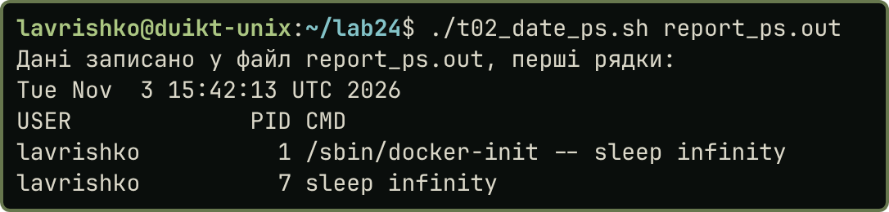
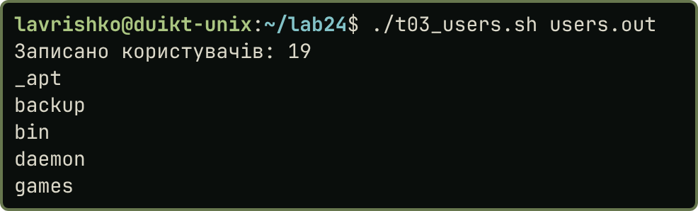
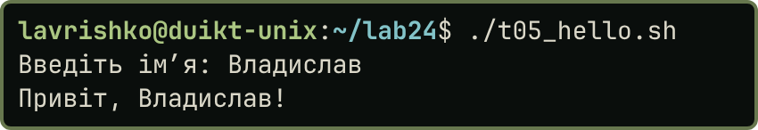
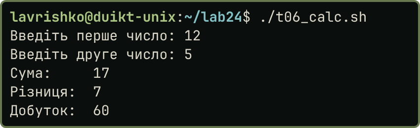
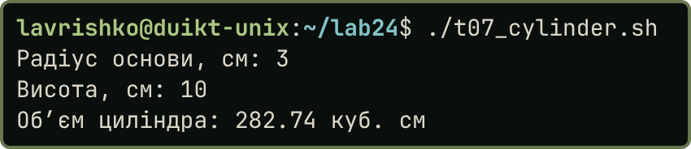
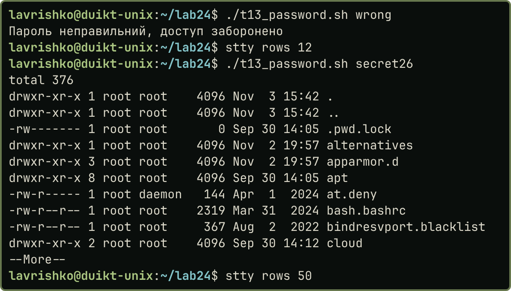
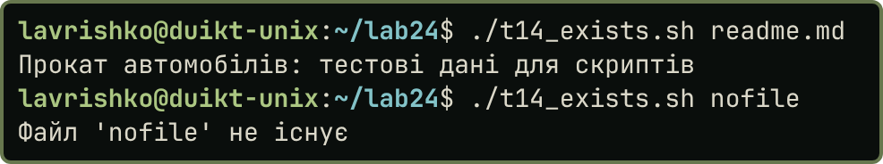
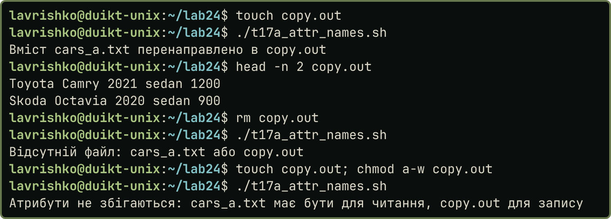
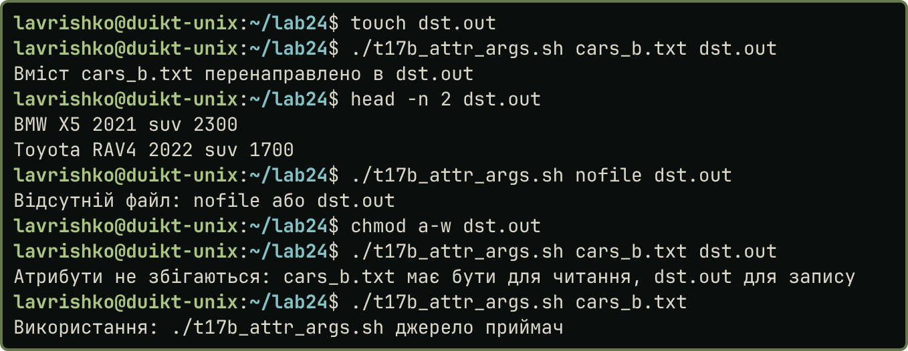

# Практична робота 2.4

**Тема:** «Командні файли та керуючі конструкції мови SHELL»

**Мета роботи:** Дослідити основні можливості командного середовища ОС UNIX та отримати навички зі створення і використання командних файлів в цьому середовищі та отримати навички з використання керуючих конструкцій мови SHELL.

## Завдання

Написати й запустити 18 командних файлів за методичкою. Умова кожного завдання наведена перед його скриптом.

## Хід виконання роботи

Ubuntu 24.04 (bash 5.2, Docker), користувач `lavrishko`, скрипти `t01`–`t18` у каталозі `lab24`. Кожен скрипт починається з `#!/bin/bash` (у лістингах пропущено разом із коментарем-описом), синтаксис перевірено `bash -n`, запуск `./файл` після `chmod +x` і `sh файл`, усі гілки умов перевірено окремими запусками. Дані: `cars_*.txt` з ПР 2.2, `readme.md`, порожній `empty.txt`. Скрипти й знімки лежать у [репозиторії](https://github.com/brizzinck/krinzhrepoduta/tree/main/digital_tech/pr-2.4).

Завдання 1. Створити в поточному каталозі каталог із вказаним іменем і скопіювати до нього файли із заданим розширенням.

```{.bash .small}
if [ $# -ne 2 ]; then
    echo "Використання: $0 каталог розширення"
    exit 1
fi
mkdir -p "$1"
cp *."$2" "$1"
echo "У каталозі $1 є файли:"
ls "$1"
```

{width=60%}

Завдання 2. Зберегти у вказаному файлі поточну дату та список активних процесів.

```{.bash .small}
if [ $# -ne 1 ]; then
    echo "Використання: $0 файл"
    exit 1
fi
date > "$1"
ps -eo user:12,pid,cmd >> "$1"
echo "Дані записано у файл $1, перші рядки:"
head -n 4 "$1"
```

Завдання 3. Записати у файл відсортований список зареєстрованих користувачів.

```{.bash .small}
if [ $# -ne 1 ]; then
    echo "Використання: $0 файл"
    exit 1
fi
cut -d: -f1 /etc/passwd | sort > "$1"
echo "Записано користувачів: $(wc -l < "$1")"
head -n 5 "$1"
```

::: {.pair}
{width=51%} {width=46%}

Рис. 2 (зліва). Запуск `t02`. Рис. 3 (справа). Запуск `t03`
:::

Завдання 4. Знайти визначеного користувача у списку користувачів і груп.

```{.bash .small}
if [ $# -ne 1 ]; then
    echo "Використання: $0 імя_користувача"
    exit 1
fi
echo "Пошук у /etc/passwd:"
grep "^$1:" /etc/passwd || echo "користувача $1 не знайдено"
echo "Пошук у /etc/group (група з таким іменем або членство):"
grep -E "^$1:|[:,]$1(,|$)" /etc/group || echo "у групах $1 не знайдено"
```

{width=60%}

Завдання 5. Запитати ім’я користувача й привітатися з ним.

```{.bash .small}
echo -n "Введіть імʼя: "
read name
echo "Привіт, $name!"
```

Завдання 6. Запитати значення двох змінних, обчислити суму, різницю, добуток.

```{.bash .small}
echo -n "Введіть перше число: "
read a
echo -n "Введіть друге число: "
read b
echo "Сума:     $(expr $a + $b)"
echo "Різниця:  $(expr $a - $b)"
echo "Добуток:  $(expr $a \* $b)"
```

Завдання 7. Обчислити об’єм циліндра (дані запитуються).

```{.bash .small}
# expr працює лише з цілими числами, тому дробові обчислення виконує bc (a(1) = arctg(1) = pi/4)
echo -n "Радіус основи, см: "
read r
echo -n "Висота, см: "
read h
v=$(echo "scale=20; 4*a(1)*$r*$r*$h" | bc -l)
printf "Обʼєм циліндра: %.2f куб. см\n" "$v"
```

::: {.pair}
{width=31%} {width=31%} {width=31%}

Рис. 5–7. Запуск `t05`, `t06` і `t07` (зліва направо)
:::

Завдання 8. Об’єднати три файли, відсортувати, дописати кількість рядків, зберегти у вказаному файлі.

```{.bash .small}
if [ $# -ne 4 ]; then
    echo "Використання: $0 файл1 файл2 файл3 результат"
    exit 1
fi
cat "$1" "$2" "$3" | sort > "$4"
n=$(wc -l < "$4")
echo "Кількість рядків: $n" >> "$4"
cat "$4"
```

{width=60%}

Завдання 9. Об’єднати три файли, знайти задане слово, відсортований результат зберегти у файлі.

```{.bash .small}
if [ $# -ne 5 ]; then
    echo "Використання: $0 файл1 файл2 файл3 слово результат"
    exit 1
fi
cat "$1" "$2" "$3" | grep "$4" | sort > "$5"
cat "$5"
```

{width=60%}

Завдання 10. Показати файл за позиційним параметром; після паузи очистити екран.

```{.bash .small}
if [ $# -ne 1 ]; then
    echo "Використання: $0 файл"
    exit 1
fi
cat "$1"
echo "Пауза 3 секунди, далі екран буде очищено..."
sleep 3
clear
```

Екран очищає `clear`: у виводі `od -c` наприкінці видно його керівні послідовності (`ESC[H`, `ESC[2J`, `ESC[3J`), які знімок терміналу не виконує.

{width=60%}

Завдання 11. Вивести у файл вміст усіх файлів за шаблоном із заголовком для кожного. Шаблон передається першим параметром; перевірка `-f` пропускає шаблон без збігів.

```{.bash .small}
if [ $# -ne 2 ]; then
    echo "Використання: $0 'шаблон' файл_результату"
    exit 1
fi
for f in $1; do
    [ -f "$f" ] || continue
    echo "Файл $f:"
    cat "$f"
done > "$2"
cat "$2"
```

{width=60%}

Завдання 12. Показати вміст файлу, якщо він є в поточному каталозі, інакше список файлів.

```{.bash .small}
if [ -f "$1" ]; then
    cat "$1"
else
    echo "Файлу '$1' немає, список файлів поточного каталогу:"
    ls
fi
```

{width=60%}

Завдання 13. Пароль передається аргументом; якщо він правильний, посторінково показати `/etc` у довгому форматі з прихованими файлами.

```{.bash .small}
PASSWORD="secret26"
if [ "$1" = "$PASSWORD" ]; then
    ls -la /etc | more
else
    echo "Пароль неправильний, доступ заборонено"
fi
```

Завдання 14. Перевірити існування файлу: якщо він є, вивести вміст, якщо ні, вивести повідомлення.

```{.bash .small}
if [ -e "$1" ]; then
    cat "$1"
else
    echo "Файл '$1' не існує"
fi
```

::: {.pair}
{width=53%} {width=44%}

Рис. 13 (зліва). Запуск `t13` з неправильним і правильним паролем, перший екран `more`. Рис. 14 (справа). Запуск `t14`
:::

Завдання 15. Якщо каталог читається, показати його вміст; якщо каталогу немає, створити його; якщо це не каталог, показати вміст файлу.

```{.bash .small}
if [ -d "$1" ]; then
    if [ -r "$1" ]; then
        ls -l "$1"
    else
        echo "Каталог '$1' існує, але його не можна читати"
    fi
elif [ -e "$1" ]; then
    cat "$1"
else
    mkdir "$1"
    echo "Каталогу '$1' не було, його створено"
fi
```

{width=60%}

Завдання 16. Файли за маскою: записати назви й вміст у файл, інакше вивести повідомлення й вміст каталогу.

```{.bash .small}
# маску слід передавати в лапках, щоб її розкрив не інтерпретатор у командному рядку, а цикл нижче
mask="$1"
out="$2"
found=0
: > "$out"
for f in $mask; do
    if [ -f "$f" ]; then
        echo "Файл $f:" >> "$out"
        cat "$f" >> "$out"
        found=1
    fi
done
if [ $found -eq 0 ]; then
    echo "Файлів за маскою '$mask' немає" >> "$out"
    ls >> "$out"
fi
cat "$out"
```

{width=60%}

Завдання 17. Проаналізувати атрибути двох файлів: якщо перший існує й читається, а другий існує й доступний для запису, вміст першого перенаправити в другий, інакше вивести повідомлення. Варіант а) імена файлів у скрипті; б) позиційні параметри.

```{.bash .small}
src=cars_a.txt
dst=copy.out
if [ ! -e "$src" ] || [ ! -e "$dst" ]; then
    echo "Відсутній файл: $src або $dst"
elif [ -r "$src" ] && [ -w "$dst" ]; then
    cat "$src" > "$dst"
    echo "Вміст $src перенаправлено в $dst"
else
    echo "Атрибути не збігаються: $src має бути для читання, $dst для запису"
fi
```

```{.bash .small}
if [ $# -ne 2 ]; then
    echo "Використання: $0 джерело приймач"
    exit 1
fi
if [ ! -e "$1" ] || [ ! -e "$2" ]; then
    echo "Відсутній файл: $1 або $2"
elif [ -r "$1" ] && [ -w "$2" ]; then
    cat "$1" > "$2"
    echo "Вміст $1 перенаправлено в $2"
else
    echo "Атрибути не збігаються: $1 має бути для читання, $2 для запису"
fi
```

::: {.pair}
{width=48%} {width=48%}

Рис. 17 (зліва). Запуск `t17а`. Рис. 18 (справа). Запуск `t17б`
:::

Завдання 18. Файл передається позиційним параметром; якщо розмір більший за нуль, відсортувати вміст у зворотному порядку, зберегти в інший файл і показати.

```{.bash .small}
if [ $# -ne 2 ]; then
    echo "Використання: $0 файл результат"
    exit 1
fi
if [ -s "$1" ]; then
    sort -r "$1" > "$2"
    echo "Результат у файлі $2:"
    cat "$2"
else
    echo "Файл '$1' порожній або відсутній"
fi
```

{width=60%}

{width=50%}

## Висновки

Під час роботи створено 19 командних файлів (завдання 1–18, завдання 17 у двох варіантах) з позиційними параметрами, запитом даних командою `read`, змінними, перенаправленням і конвеєрами. Цілі числа обчислено через `expr`, а дробові через `bc`, бо `expr` дробів не підтримує. Розгалуження побудовано на операторі `if` з умовами `-e`, `-f`, `-d`, `-r`, `-w`, `-s` і вкладеними перевірками, а перебір файлів за шаблоном виконує цикл `for`. Перевірено два способи запуску (`./файл` після `chmod +x` і `sh файл`), синтаксис командою `bash -n` і кожну гілку розгалужень окремим запуском. Отримано навички створення командних файлів і використання керуючих конструкцій мови SHELL.
