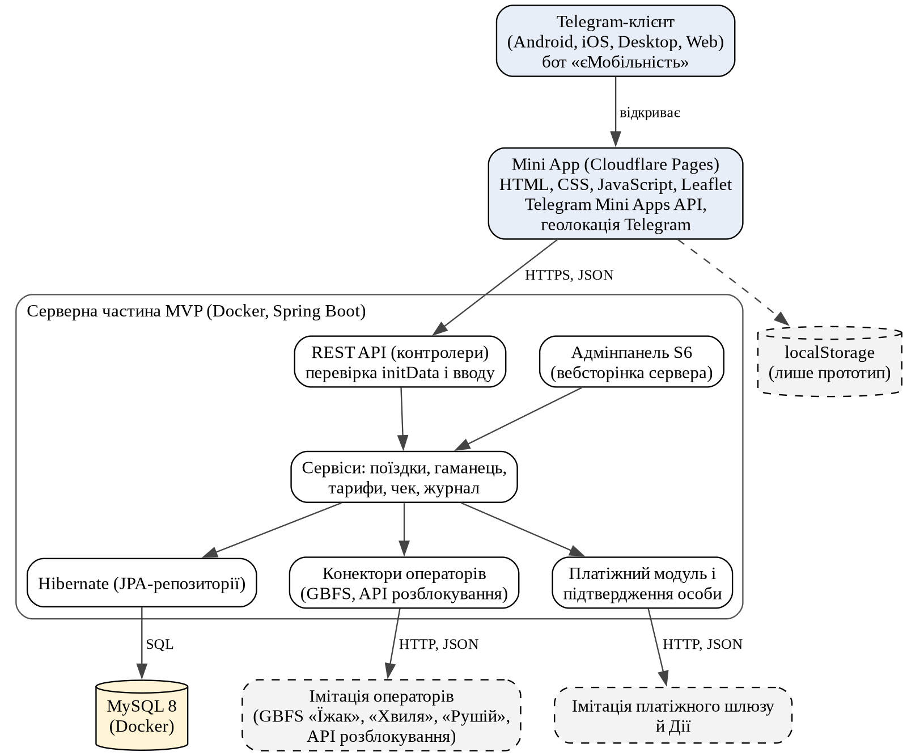
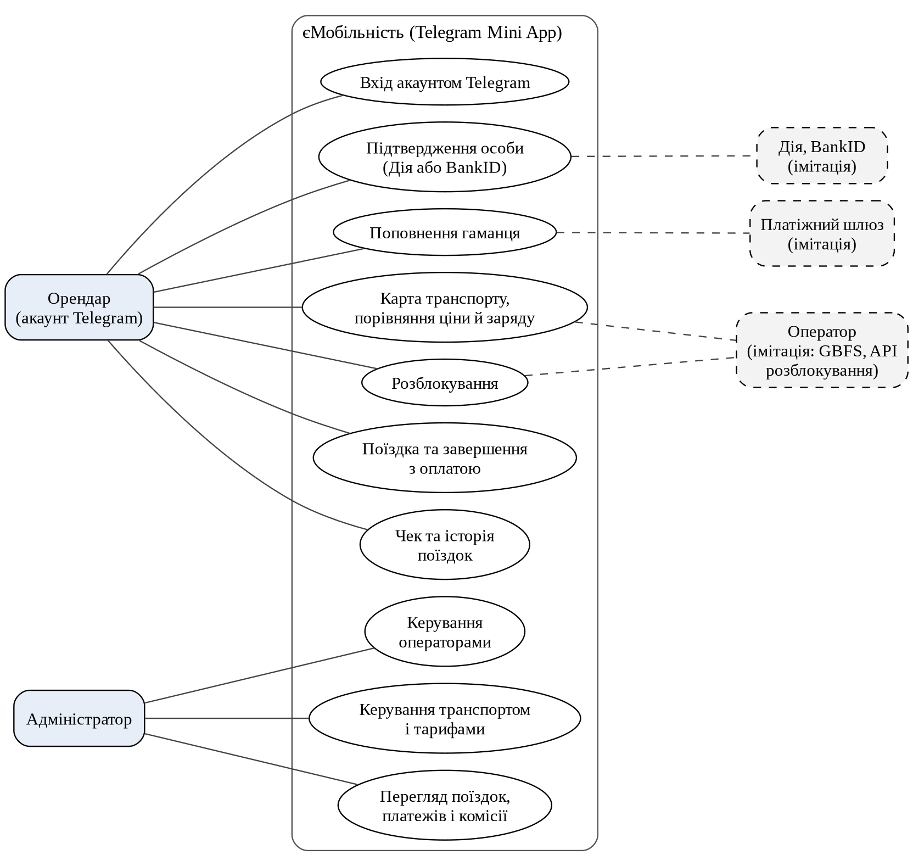
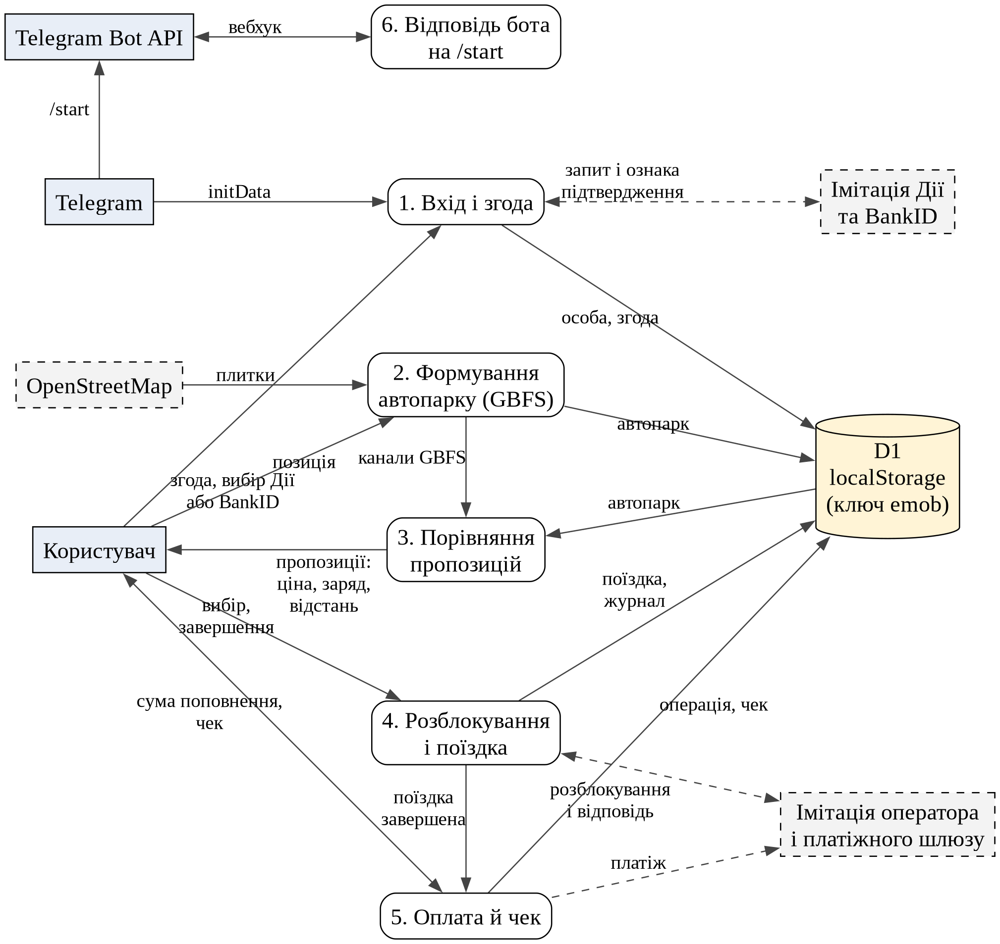
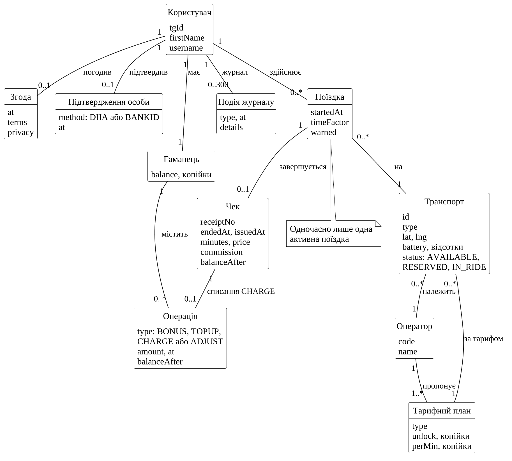
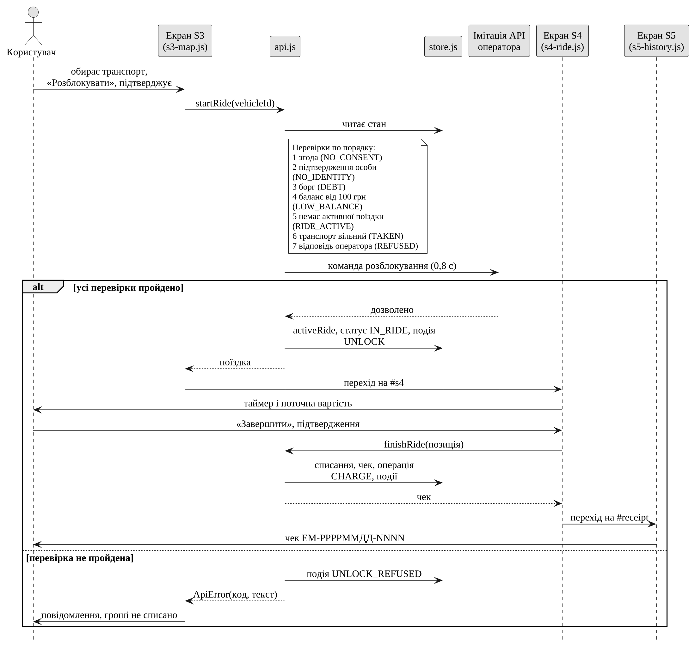
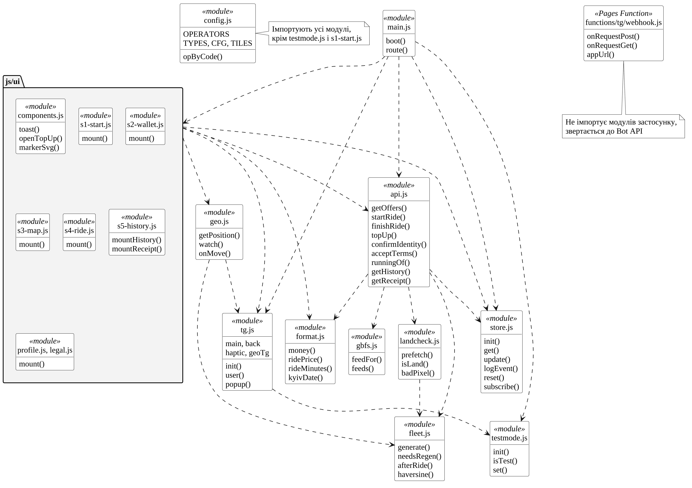
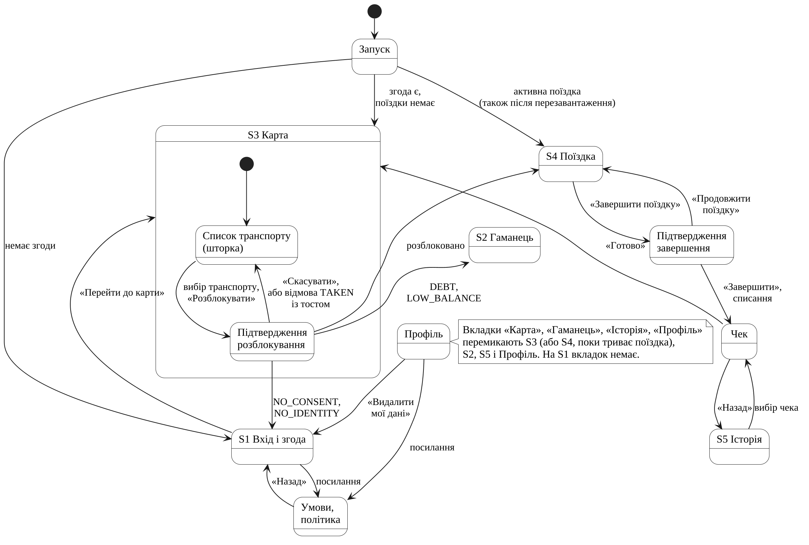
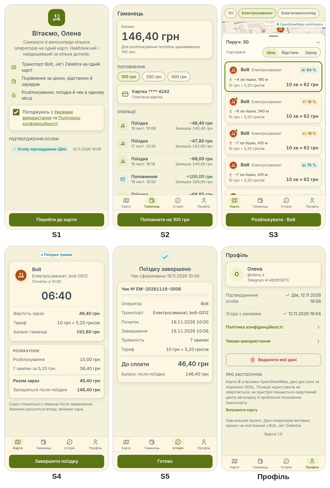

# ВСТУП {-}

Користувач, який орендує електросамокат чи електровелосипед у Києві, тримає окремий застосунок кожного оператора. У кожному він реєструється, прив'язує картку й вручну порівнює тарифи та заряд. Єдиної історії поїздок немає.

Мета розробки, визначена технічним завданням: скоротити для користувача кількість реєстрацій і кроків до початку поїздки та зробити вибір транспорту порівнянним за ціною й зарядом. Розроблено MVP «єМобільність»: Telegram Mini App з даними на пристрої користувача й бот з вебхуком на Cloudflare Pages. Сервер, адмінпанель і справжні інтеграції з операторами належать до наступного етапу.

Записка описує постановку задачі, проєктування, програмну реалізацію, тестування й оцінку результатів. Матеріали для користувача, програміста, системного програміста й адміністратора винесено в додатки А-Г, програму та методику тестування в додаток Д, перелік вихідних файлів у додаток Е.

Підставою є технічне завдання ДУІКТ.ТЦР-0008.045440.01.91, яке подано окремим документом. Склад документації наведено в таблиці 1. Графічна частина подана рисунками 1-8 у розділі 2. Проєкт виконує команда № 8: Чертілін П. О., Сукач В. Ю., Лаврішко В. С.

| Документ | Позначення |
|---|---|
| Технічне завдання (окремий документ) | ДУІКТ.ТЦР-0008.045440.01.91 |
| Пояснювальна записка (цей документ) | ДУІКТ.ТЦР-0008.045440.01.81 |
| Додаток А. Керівництво користувача | ДУІКТ.ТЦР-0008.045440.01.34 |
| Додаток Б. Керівництво програміста | ДУІКТ.ТЦР-0008.045440.01.33 |
| Додаток В. Керівництво системного програміста | ДУІКТ.ТЦР-0008.045440.01.32 |
| Додаток Г. Керівництво адміністратора | ДУІКТ.ТЦР-0008.045440.01.92 |
| Додаток Д. Програма та методика тестування | ДУІКТ.ТЦР-0008.045440.01.51 |
| Додаток Е. Текст програми | ДУІКТ.ТЦР-0008.045440.01.12 |

: Таблиця 1 — Склад програмної документації

# АНАЛІЗ ПРЕДМЕТНОЇ ОБЛАСТІ ТА ПОСТАНОВКА ЗАДАЧІ

## Проблема й користувачі

Ринок оренди мікромобільності в Києві розділений між кількома операторами. За оглядом тарифів [1] розблокування в Києві коштує близько 10 грн, а хвилина від 5 до 5,35 грн (Bolt 5,20, Jet близько 5,25, Zelektra 5,35). Абонементи, штрафи й умови в кожного свої, тому найдешевший самокат поруч користувач шукає, відкриваючи застосунки по черзі.

Основні користувачі: студенти Києва віком 18-25 років, міські працівники й туристи. Оператори отримують у «єМобільності» канал залучення клієнтів. Користувач платить рівно тариф оператора, а комісію 10 % із поїздки сплачує оператор.

Без сервісу той, хто хоче порівняти три оператори, проходить три реєстрації, прив'язує три картки й тримає три гаманці, а історія його поїздок розкидана по трьох застосунках. Кількість кроків і застосунків зростає разом із кількістю операторів. Саме цю проблему розв'язує розробка.

Навчальний проєкт. Дані операторів імітовані, проєкт не пов'язаний з Bolt, Jet і Zelektra.

## Аналоги

ТЗ (розділ 3) розрізняє два класи аналогів. Застосунки операторів (Bolt та інші) працюють лише зі своїм парком. Картографічні сервіси, наприклад Google Maps, будують маршрут і показують транспорт, але не орендують його й не приймають оплату: користувача передають у застосунок оператора.

Дані про транспорт оператори публікують у відкритому форматі GBFS [2]. Він описує транспорт і тарифні плани, а розблокування не охоплює: його виконує API оператора. На цьому розподілі побудовано MVP: транспорт і тарифи читаються з каналів у форматі GBFS, а розблокування виконує імітований API оператора. Вхід без реєстрації дає Telegram Mini App [3]: ім'я й ідентифікатор користувача надходять від Telegram. MVP не повторює жодного з аналогів повністю: він поєднує карту кількох операторів із розблокуванням і оплатою в одному місці, але лише на імітованих даних.

## Завдання й критерії якості

Завдання розробки: зібрати в одному Mini App вхід акаунтом Telegram, згоду й підтвердження особи, гаманець, карту з порівнянням транспорту трьох операторів, розблокування, поїздку з оплатою, чек та історію, а також бот.

Мета перевіряється шістьма метриками таблиці 1 ТЗ: кількість підключених операторів (не менше 3), реєстрації, кількість дотиків до розблокування (не більше 4), час від відкриття карти до розблокування (не більше 30 с), час відкриття карти (не більше 3 с на мобільному Інтернеті 4G) і оцінка доступності Lighthouse (не нижче 90 зі 100, рівень WCAG 2.1 AA [4]). Значення в ТЗ є цілями, а не результатами. Для кожної метрики в розділі 5 вказано, чим і як її виміряно, а значення, які не вдалося виміряти методом ТЗ, позначено окремо. Результати наведено в розділі 5.

# ПРОЄКТУВАННЯ

## Архітектура й компоненти

Система складається з двох частин (рисунок 1). Перша частина: Mini App, статичний вебзастосунок на HTML, CSS і JavaScript без збірки, розміщений на Cloudflare Pages. Telegram-клієнт відкриває його всередині чату з ботом. Застосунок має п'ять екранів S1-S5 і шар застосунку, який рахує гаманець, поїздку, борг, чек і журнал подій. Шар застосунку читає автопарк із каналів у форматі GBFS, а дані зберігає в `localStorage`.

Імітації API розблокування, платіжного шлюзу, Дії й BankID позначено на схемі пунктиром: вони повертають відповіді у форматах справжніх сервісів і замінюються в наступному етапі. Карту малює Leaflet на плитках OpenStreetMap [5], підпис «© OpenStreetMap contributors» завжди видно.

Мережа потрібна застосунку лише для завантаження сторінки, скрипта Telegram і плиток карти.

Друга частина: бот. На команду `/start` Telegram надсилає запит на вебхук, функцію Cloudflare Pages `/tg/webhook`, а вона відповідає повідомленням із кнопкою «Відкрити». Власного сервера немає.

{width=78%}

## Варіанти використання

Єдиний актор системи в MVP: орендар (рисунок 2). Він відкриває застосунок із бота, входить акаунтом Telegram, погоджується з умовами й політикою, підтверджує особу через Дію або BankID [6] (імітація), поповнює гаманець, переглядає карту й порівнює транспорт, розблоковує його, їде й завершує поїздку з оплатою, дивиться чек та історію, видаляє свої дані в профілі.

Із зовнішніх систем у варіантах використання задіяно оператора (канали GBFS і розблокування), платіжний шлюз і сервіс підтвердження особи. Усі три імітовані. Сценарій користувача починається з команди `/start`: бот відповідає кнопкою «Відкрити», яка відкриває застосунок. Далі користувач проходить екрани S1-S5, а повторні запуски одразу ведуть на карту або на активну поїздку. Адміністратор у MVP окремих варіантів не має: його роль виконує розробник через файл `config.js` (п. 4.1.3 ТЗ).

{width=46%}

## Потоки даних

Схема потоків даних (рисунок 3) містить шість процесів, одне сховище D1 і чотири зовнішні сутності. Сховище D1 це запис `emob` у `localStorage`. Процес 1 бере від Telegram `initData` (ідентифікатор і ім'я), від користувача згоду й вибір Дії або BankID, і записує в D1 особу та згоду.

Процес 2 за позицією користувача формує автопарк. Для перевірки, що транспорт не потрапляє на воду й будівлі, він читає плитки OpenStreetMap. Автопарк записується в D1 і віддається процесу 3 у вигляді каналів GBFS. Процес 3 повертає користувачу пропозиції з ціною, зарядом і відстанню. Позиція використовується лише для розрахунку й не зберігається.

Процес 4 приймає вибір і завершення поїздки, звертається до імітації оператора й записує поїздку та події журналу. Процес 5 бере завершену поїздку й баланс із D1, приймає поповнення, повертає чек і записує операцію. Процес 6 обробляє `/start` від Bot API й відповідає кнопкою.

{width=78%}

## Концептуальна модель

Концептуальна модель (рисунок 4) описує одинадцять сутностей. Користувач має не більше однієї згоди й одного підтвердження особи, один гаманець і не більше 300 подій журналу. Гаманець містить операції чотирьох типів: стартовий бонус, поповнення, списання за поїздку й коригування (його створює лише прихований режим тестування).

Тарифний план один на тип транспорту в оператора: Bolt має плани для самоката й велосипеда, Jet лише для самоката, Zelektra для обох типів. Поїздка належить користувачу й стосується одиниці транспорту. Транспорт належить оператору й має тарифний план свого типу. Одночасно активна не більше ніж одна поїздка. Завершена поїздка має чек, а чек пов'язаний з операцією списання.

Усі суми зберігаються цілими числами в копійках, час у UTC. У програмі чек зберігається разом із завершеною поїздкою, а на схемі це окремі сутності для зрозумілості. Основні атрибути взято зі структури стану в `store.js`.

{width=76%}

## Взаємодія об'єктів

Схема взаємодії (рисунок 5) показує розблокування й завершення поїздки. Користувач вибирає транспорт на екрані S3 і підтверджує розблокування. Екран викликає `api.startRide`, а та читає стан із `store.js` і по черзі виконує сім перевірок: згода, підтвердження особи, відсутність боргу, баланс не менший за 100 грн, відсутність активної поїздки, доступність транспорту й відповідь оператора. Кожна відмова має власний код і повідомлення.

Якщо перевірки пройдено, імітація оператора відповідає за 0,8 с, стан записується, а екран S4 показує таймер і поточну вартість. Завершення викликає `api.finishRide`, яка списує суму, формує чек і записує операцію та події. Екран S5 показує чек. Гілка відмови не списує гроші й записує подію `UNLOCK_REFUSED`.

{width=86%}

## Модулі програми

Програму складають модулі ES (рисунок 6). Екрани з теки `ui/` змінюють дані лише через `api.js`, а стан для показу читають зі `store.js`; `api.js` працює зі `store.js`, `fleet.js`, `gbfs.js` і `landcheck.js`. Файл `config.js` містить оператори, типи, тарифи й константи, його імпортують усі модулі, крім `testmode.js` і `ui/s1-start.js`. Модуль `tg.js` обгортає Telegram Mini Apps API: поза Telegram він малює головну кнопку, кнопку «Назад» і спливне вікно в HTML.

Залежності односпрямовані: нижні модулі не знають про верхні. У наступному етапі тіла функцій `api.js` замінюються на запити до сервера, екрани не змінюються. Функція вебхука `functions/tg/webhook.js` стоїть окремо й не імпортує модулів застосунку.

{width=100%}

## Стани інтерфейсу й екранні форми

Схема станів (рисунок 7) відповідає маршрутизації в `main.js`. Запуск без згоди веде на S1, із згодою на S3, а за активної поїздки на S4, зокрема після перезавантаження. На S3 вибір транспорту відкриває підтвердження розблокування. Успіх веде на S4, борг або мало коштів на S2, відсутність згоди чи підтвердження особи на S1, а відмова оператора лишає на S3 з повідомленням. З S4 завершення проходить через підтвердження до чека, чек веде на S3 або назад до історії S5.

Нижні вкладки перемикають S3 (або S4, поки триває поїздка), S2, S5 і профіль. Частину повідомлень застосунок показує тостами й спливними вікнами, а не окремими екранами, тому їх на схемі станів немає. Екранні форми S1-S5 показано на рисунку 8, їх подано знімками застосунку в світлій і темній темі.

{width=78%}

{width=58%}

# ПРОГРАМНА РЕАЛІЗАЦІЯ

## Засоби розробки

Застосунок написано на HTML, CSS і JavaScript (модулі ES) без фреймворків і збірки, тому теку `app` можна відкрити будь-яким статичним сервером. Додаткові бібліотеки й збирачі не потрібні. Версії й призначення засобів наведено в таблиці 2. Telegram Mini Apps API [3] дає вхід, головну кнопку, геолокацію й тему, а Pages Functions [7] виконують вебхук бота в тому самому проєкті Cloudflare Pages.

| Засіб | Версія | Призначення |
|---|---|---|
| HTML, CSS, JavaScript (модулі ES) | без збірки | Mini App і вебхук |
| Leaflet | 1.9.4 | карта |
| Tabler Icons | 3.34.0 | 38 значків у `sprite.svg`, ліцензія MIT |
| Telegram Mini Apps API | `telegram-web-app.js` | вхід, кнопки, геолокація, тема |
| Cloudflare Pages і Pages Function | wrangler 4.158.0 | розміщення й вебхук |
| Playwright, Chromium | 1.64.1, 156.0.8078.4 | автоматичні перевірки |
| Lighthouse | у Chrome DevTools | оцінка доступності |

: Таблиця 2 — Засоби розробки

## Дані й гроші

Стан застосунку зберігається одним записом `localStorage` із ключем `emob`: користувач, гаманець, автопарк, активна поїздка, завершені поїздки, журнал подій і налаштування. Журнал подій записує згоду, підтвердження особи, поповнення, розблокування й відмови, завершення поїздки та списання; зберігаються останні 300 подій. Запис має номер версії, а для переходу між версіями передбачено ланцюжок міграцій. Пошкоджений або чужий запис копіюється в ключ `emob.bak` і замінюється початковим станом. Копія лише записується й для відновлення не читається, а наступне пошкодження її перезаписує.

Гроші лічаться в копійках цілими числами. Ціна поїздки дорівнює ціні розблокування плюс хвилини за тарифом, хвилини округлюються вгору, мінімум одна. Приклад: 33 хвилини на Bolt за тарифом 10 грн і 5,20 грн за хвилину дають 1000 + 33 x 520 = 18160 копійок, тобто 181,60 грн.

```
/** Ціна поїздки в копійках: розблокування плюс хвилини за тарифом. */
export const ridePrice = (unlock, perMin, minutes) => unlock + minutes * perMin;

/** Хвилини до оплати: щонайменше одна, округлення вгору. */
export function rideMinutes(elapsedMs, factor = 1) {
  return Math.max(1, Math.ceil((elapsedMs * factor) / 60000));
}
```

Баланс може бути від'ємним лише як борг за одну поточну поїздку. Наступне поповнення спершу гасить борг, а нова поїздка заблокована, доки борг є.

## Автопарк і перевірка суші

Автопарк формує `fleet.js`. Зерно псевдовипадкового генератора складається з ідентифікатора Telegram, дати за Києвом і комірки центру, тому той самий користувач у тому самому районі за день бачить ті самі позиції. Створюється 38 одиниць: Bolt 10 самокатів і 4 велосипеди, Jet 12 самокатів, Zelektra 9 самокатів і 3 велосипеди. Три з них зарезервовані й на карті не малюються. Щонайменше чотири одиниці лежать у межах 250 м, усі в межах 800 м. Автопарк переформовується за нової дати або коли користувач далі ніж за 600 м від центру.

Щоб транспорт не стояв на воді, у будівлях і парках, `landcheck.js` завантажує плитки OpenStreetMap масштабу 17 і перевіряє колір пікселя в точці та в чотирьох сусідніх точках. До 64 плиток завантажуються по 8 одночасно з бюджетом 12 с, на одну точку до 24 спроб. Якщо плитки недоступні, перевірки немає, а застосунок працює далі.

## Розблокування й поїздка

Розблокування виконує `api.startRide`. Перевірки йдуть у фіксованому порядку, кожна з власним кодом і повідомленням, а в журнал потрапляє подія `UNLOCK_REFUSED`:

```
if (!s.user.consentAt) fail('NO_CONSENT', 'Спершу погодьтеся з Умовами ...');
if (!s.user.identity) fail('NO_IDENTITY', 'Спершу підтвердіть особу через Дію або BankID');
if (s.wallet.balance < 0) fail('DEBT', `Погасіть борг ${money(-s.wallet.balance)}`);
if (s.wallet.balance < CFG.MIN_BALANCE) fail('LOW_BALANCE', ...);
if (s.activeRide) fail('RIDE_ACTIVE', 'У вас уже є активна поїздка');
const v = s.fleet && s.fleet.vehicles.find((x) => x.id === vehicleId);
if (!v || v.status !== 'AVAILABLE') fail('TAKEN', 'Цей транспорт уже недоступний ...');
await sleep(CFG.UNLOCK_MS); // відповідь імітованого оператора
```

Фрагмент скорочено: повні тексти повідомлень наведено в додатку А. Прапорець `unlocking` не дає двом розблокуванням іти одночасно, а після відповіді оператора стан перевіряється ще раз. Оператор відмовляє (`REFUSED`), якщо заряд нижчий за 10 %.

Завершення виконує `api.finishRide`: рахує суму, списує її з гаманця, створює чек з номером `EM-РРРРММДД-NNNN` і записує операцію. Комісія 10 % рахується для майбутньої адмінпанелі й користувачу не показується. Транспорт стає на місце завершення зі зсувом 15-30 м.

## Telegram і бот

Модуль `tg.js` ховає від екранів усі виклики Telegram. Користувача він бере з `initDataUnsafe`, а поза Telegram дає нейтральний профіль. Кожен виклик, потрібний лише в клієнті, має запасний варіант у браузері, тому застосунок можна перевіряти без Telegram. Кожен виклик іде через перевірку версії клієнта й захищений від винятків, тому застарілий клієнт не ламає застосунок. Позиція береться через Telegram LocationManager, далі з геолокації браузера, далі це точка біля ДУІКТ. Telegram дописує в адресу параметри запуску, тому `main.js` прибирає їх із hash і читає `start_param`, за яким `/start s2` відкриває потрібний екран.

Вебхук приймає запит лише з правильним секретним заголовком [8]. Токен бота й секрет задаються в налаштуваннях проєкту Pages, у коді їх немає:

```
export async function onRequestPost({ request, env, waitUntil }) {
  if (!env.WEBHOOK_SECRET ||
      request.headers.get('X-Telegram-Bot-Api-Secret-Token') !== env.WEBHOOK_SECRET) {
    return new Response('unauthorized', { status: 401 });
  }
  // ... відповідь кнопкою «Відкрити» надсилається у фоні (waitUntil)
  return new Response('ok', { status: 200 });
}
```

## Захист даних

На пристрої зберігаються ідентифікатор Telegram, ім'я, необов'язковий username, ознака й час підтвердження особи, факт і час згоди, поїздки, платежі та журнал подій. Серверної копії немає. Дані картки не збираються, оплата імітована. Користувач бачить свої дані в профілі й видаляє їх кнопкою «Видалити мої дані»; обробка відповідає Закону України «Про захист персональних даних» [9], бо ґрунтується на згоді, яку користувач дає перед першою поїздкою.

Позиція користувача потрібна для карти й відстані й не зберігається. Центр автопарку округлюється до трьох знаків, а транспорт після поїздки ставиться зі зсувом 15-30 м і округленням до чотирьох знаків. Підпис `initData` не перевіряється, бо перевірити його можна лише на сервері, що знає токен бота. Тому ім'я й ідентифікатор у MVP потрібні для привітання й ключа стану, а не для автентифікації. Перевірка підпису входить до наступного етапу.

# ТЕСТУВАННЯ

## Види, засоби й порядок

Види тестування задає таблиця 4 ТЗ: функціональне й негативне, зручності, доступності, безпеки вебхука. Кожному виду відповідають випадки з додатка Д. Автоматичні сценарії F01-F32 виконує `checks.py` у Chromium (Playwright) на локальній копії застосунку, мережа дозволена лише для сторінки, скрипта Telegram і плиток карти, будь-який інший запит дає помилку. Вебхук і HTTPS (W1-W5) перевіряються командою `curl` до живого адреса. Доступність (A1, A2) оцінює Lighthouse, час і дотики (U1-U3) вимірює окремий сценарій Playwright. Ручні випадки A4, A5, M3, M4 і M5 виконано вручну в браузері з емуляцією телефона: Chrome 157, в'юпорт 412 на 915, мережа Fast 4G, процесор сповільнено в 4 рази. Це не смартфон і не Telegram. Випадки A3 (TalkBack), M1 (Telegram Desktop) і M2 (Telegram на Android) не виконувалися.

Зручність оцінюють за кількістю дотиків і часом, доступність за Lighthouse (світла й темна теми) і клавіатурним проходом, безпеку вебхука за кодами відповіді й пошуком токена. Результат кожного випадку фіксується в протоколі як PASS, виміряне значення або «не виконувалось».

Автоматичні сценарії не залежать від стану інтернету: плитки беруться з кешу, а відсутні замінює синтетична плитка, тому результат повторюється від запуску до запуску.

Порядок: автоматичні сценарії, вебхук, пошук токена, Lighthouse, вимірювання часу, ручні випадки. Негативні сценарії входять до F01-F09 і F14-F15: відмова від згоди, баланс 99 і 100 грн, зайнятий транспорт, друга поїздка, борг, відмова оператора, заборонена геолокація, недоступні плитки й сховище. Сирі результати лежать у теці `protocol` репозиторію.

## Протокол тестування

Протокол подано в таблиці 3. Результат PASS означає, що випадок виконано й очікуваний результат отримано. Дата виконання 17.11.2026, якщо не вказано інше.

<!-- widths: 8,52,26,14 -->
<!-- size: 20 -->

| ID | Перевірка | Результат | Дата |
|---|---|---|---|
| F01 | Без згоди розблокування відхилено | PASS | 17.11.2026 |
| F02 | Без підтвердження особи відхилено | PASS | 17.11.2026 |
| F03 | Баланс 99 і 100 грн, три дотики | PASS | 17.11.2026 |
| F04 | Транспорт зайнято, відмова | PASS | 17.11.2026 |
| F05 | Друга поїздка; перезавантаження в поїздці | PASS | 17.11.2026 |
| F06 | Борг блокує поїздку, поповнення гасить | PASS | 17.11.2026 |
| F07 | Відмова оператора, без списання | PASS | 17.11.2026 |
| F08 | Попередження про 20 грн один раз | PASS | 17.11.2026 |
| F09 | Геолокацію заборонено, точка ДУІКТ | PASS | 17.11.2026 |
| F10 | Склад автопарку: 38, 3 резерв | PASS | 17.11.2026 |
| F11 | Той самий seed, ті самі позиції | PASS | 17.11.2026 |
| F12 | Зсув 300 і 700 м | PASS | 17.11.2026 |
| F13 | Вода, будівлі, парки без транспорту | PASS | 17.11.2026 |
| F14 | Плитки недоступні, застосунок працює | PASS | 17.11.2026 |
| F15 | Сховище кидає виняток | PASS | 17.11.2026 |
| F16 | Стан переживає перезавантаження | PASS | 17.11.2026 |
| F17 | 33 хв Bolt дорівнюють 181,60 грн | PASS | 17.11.2026 |
| F18 | Канали GBFS мають потрібні поля | PASS | 17.11.2026 |
| F19 | Режим Telegram, імітований WebApp | PASS | 17.11.2026 |
| F20 | Справжній SDK, параметри в hash | PASS | 17.11.2026 |
| F21 | Адреса з ?startapp у браузері | PASS | 17.11.2026 |
| F22 | «Назад» із чека без хибного тосту | PASS | 17.11.2026 |
| F23 | Банер малого балансу стабільний | PASS | 17.11.2026 |
| F24 | Два одночасні розблокування, одна поїздка | PASS | 17.11.2026 |
| F25 | Позиція завершення не зберігається точно | PASS | 17.11.2026 |
| F26 | Низький заряд у кінці списку | PASS | 17.11.2026 |
| F27 | Звичайний режим без службових слів | PASS | 17.11.2026 |
| F28 | Прихований режим тестування | PASS | 17.11.2026 |
| F29 | Стиль коду: кольори лише в tokens.css | PASS | 17.11.2026 |
| F30 | Розмір app, секрети, зайві згадки | PASS | 17.11.2026 |
| F31 | Діалог малого балансу блокує головну кнопку | PASS | 17.11.2026 |
| F32 | Текст 200 %: суми не виходять за край на S2, S4, S5 | PASS | 17.11.2026 |
| W1 | POST без секретного заголовка | 401, PASS | 17.11.2026 |
| W2 | POST із хибним секретом | 401, PASS | 17.11.2026 |
| W3 | GET на вебхук | 405, PASS | 17.11.2026 |
| W4 | Токен у репозиторії й у файлах Pages | збігів немає, PASS | 17.11.2026 |
| W5 | HTTP перенаправляє на HTTPS, версія TLS | 301, TLS 1.3, PASS | 17.11.2026 |
| A1 | Lighthouse Accessibility, світла тема | 100, PASS | 17.11.2026 |
| A2 | Lighthouse Accessibility, темна тема | 100, PASS | 17.11.2026 |
| A3 | Прохід екранним читачем TalkBack | не виконувалось | - |
| A4 | Клавіатура й дерево доступності, S1-S5 | PASS із зауваженнями, вручну | 17.11.2026 |
| A5 | Збільшений шрифт 200 %, S1-S5, вручну | виявлено помилку A5-1; після виправлення F32 PASS | 17.11.2026 |
| U1 | Дотики від карти до розблокування | 3, PASS | 17.11.2026 |
| U2 | Час від карти до поїздки | 1,37 с автоматично; 2,85 с вручну | 17.11.2026 |
| U3 | Час відкриття карти, повторний запуск | 1,08 с автоматично; 0,86 с вручну | 17.11.2026 |
| M1 | Повний прохід S1-S5 у Telegram Desktop | не виконувалось | - |
| M2 | Повний прохід S1-S5 у Telegram на Android | не виконувалось | - |
| M3 | Прохід S1-S5 і негативні N1-N4, вручну | виявлено помилку D1; після виправлення F31 PASS | 17.11.2026 |
| M4 | Видалення даних у Профілі, вручну | PASS | 17.11.2026 |
| M5 | Пошкоджений стан, копія в `emob.bak`, вручну | PASS | 17.11.2026 |

: Таблиця 3 — Протокол тестування

У протоколі 50 випадків. Усі 32 автоматичні сценарії F01-F32, п'ять перевірок вебхука й HTTPS (W1-W5) і дві оцінки доступності (A1, A2) завершилися результатом PASS. Вимірювання U1-U3 мають автоматичні й ручні значення, їх зіставлено в розділі 5. Випадки A3, M1 і M2 не виконувалися: вони потребують смартфона з Telegram і TalkBack. Ручний прохід M3 виявив одну помилку: діалог «Мало коштів на балансі» не блокував кнопку завершення поїздки (таблиця 4). Її виправлено й перевірено сценарієм F31, інших функціональних помилок A4 і M3 не виявили. Проходи M4 і M5 помилок не виявили. Прохід A5 у режимі тексту 200 % виявив обрізання грошових сум на екранах S2, S4 і S5; помилку виправлено й перевірено сценарієм F32. Є чотири зауваження, які не блокують роботу: у діалогах немає пастки фокусу, після зміни екрана фокус переходить на тіло сторінки, на карті 35 маркерів стоять у порядку Tab перед фільтрами й списком, а на тексті 200 % ряд фільтрів ховає «Електровелосипед» за краєм без видимого натяку на прокрутку. Вони лишаються відкритими.

## Виявлені помилки й виправлення

Помилки виявлено переглядом коду, проходом сценаріїв зі справжнім скриптом Telegram і ручним проходом у браузері з емуляцією телефона. Таблиця 4 містить усі помилки, які вплинули на роботу, і одну перевірку самих тестів. Виправлення перевірено повторним запуском вказаних випадків. Для помилок логіки й інтерфейсу додано автоматичні сценарії (F20-F25, F31, F32), тому їх повернення виявить наступний запуск `checks.py`; контраст і склад теки перевіряються повторно Lighthouse і пошуком у файлах Pages.

<!-- widths: 28,22,32,18 -->

| Що виявлено | Як виявлено | Що виправлено | Повторна перевірка |
|---|---|---|---|
| У Telegram після першого запуску відкривався екран S1, параметр `startapp` ігнорувався, у консолі було 4 помилки | огляд коду, прохід зі справжнім SDK | `main.js` прибирає параметри `tgWebApp` з hash, невідомий маршрут веде на S3 або S1; виправлено дрібні виклики кнопок Telegram | F20, F21 |
| Після завершення поїздки «Назад» із чека показувало хибний тост «Активної поїздки немає»; банер малого балансу на S4 перемальовувався щосекунди, кнопка «Поповнити» зникала під пальцем | огляд коду | перехід на чек замінює запис історії; банер малюється лише при зміні стану | F22, F23 |
| Два одночасні розблокування створювали дві поїздки | огляд коду | прапорець `unlocking` і повторна перевірка після відповіді оператора | F24 |
| Точне місце завершення поїздки писалося в `localStorage`, що суперечило політиці конфіденційності | огляд коду | зсув 15-30 м і 4 знаки | F25 |
| Контраст позначки «Поїздка триває» у світлій темі 4,30:1, нижче 4,5:1 | розрахунок контрастів токенів | змінено колір тла позначки | A1 |
| У теці прототипу лежав `.wrangler` з ідентифікатором облікового запису Cloudflare | огляд теки перед публікацією | теку видалено, додано `.gitignore` | W4, перевірка файлів Pages |
| Діалог «Мало коштів на балансі» не блокував кнопку «Завершити поїздку»; два діалоги мали однаковий `id`, а застарілий діалог лишався поверх чека | ручний прохід у браузері з емуляцією телефона | унікальні `id` діалогів, одночасно лише один діалог, застосунок неактивний, поки діалог відкрито, діалоги закриваються при зміні маршруту | F31: на старому коді FAIL, на виправленому PASS |
| При збільшенні тексту до 200 % грошові суми на S2, S4 і S5 виходили за правий край екрана й обрізалися | ручний прохід A5 у браузері з емуляцією телефона | рядки з підписом і значенням переносяться, значення вирівнюється праворуч, довгі значення переносяться за словами | F32: на старому CSS FAIL, на виправленому PASS |
| Невідомо, чи перевірка суші справді працює | мутаційна перевірка | вимкнено `isLand`: сценарій F13 дав FAIL (131 проба в забороненій зоні), перевірку повернуто | F13 |

: Таблиця 4 — Виявлені помилки й виправлення

Мутаційна перевірка потрібна, щоб переконатися, що сценарій не проходить даремно. Вимкнення перевірки суші в `api.js` одразу дало FAIL сценарію F13 зі 131 пробою в забороненій зоні, тобто тест реагує на зміну коду. Після перевірки код повернуто.

# ОЦІНКА РЕЗУЛЬТАТІВ

Результати за метриками таблиці 1 ТЗ подано в таблиці 5. Кожне число має метод вимірювання. Автоматичні значення виміряно на ноутбуці в Chromium 156.0.8078.4, п'ять прогонів у новому контексті без кешу, 17.11.2026 приблизно о 18:10 на живому адресі https://emobility.pages.dev, без обмеження швидкості мережі й процесора, в'юпорт 390 на 844. Дотики скриптові, тобто час на роздуми людини не входить. Метод ТЗ для двох часових метрик інший: секундомір, п'ять запусків у Telegram на смартфоні, мобільний Інтернет 4G. Його не виконано. Замість нього 17.11.2026 з 18:48 до 19:10 виконано вручну в браузері з емуляцією телефона (Chrome 157, в'юпорт 412 на 915, DPR 2,6, мережа Fast 4G, процесор сповільнено в 4 рази, живий адрес): кожну дію зроблено окремо, час записано зчитуванням `performance.now()` й спостерігачем за DOM, а не секундоміром. Геолокацію в цьому прогоні не надано, тому карта показувала район ДУІКТ.

<!-- widths: 17,19,27,37 -->
<!-- size: 20 -->

| Метрика | Цільове значення | Отримано | Чим і як виміряно |
|---|---|---|---|
| Кількість операторів | не менше 3 | 3 (Bolt, Jet, Zelektra) | записи `OPERATORS` у `config.js`, канали GBFS у сценаріях F10 і F18 |
| Кількість реєстрацій | 0 окремих реєстрацій | 0 окремих; без сервісу 3 реєстрації й 3 прив'язки картки | порівняння сценаріїв, без вимірювання на користувачах |
| Кроки до розблокування | не більше 4 дотиків | 3 (картка, «Розблокувати», підтвердження), автоматично й вручну в 5 прогонах із 5 | підрахунок у 5 скриптових прогонах (`measure.json`, F03) і в 5 ручних прогонах |
| Час від карти до розблокування | не більше 30 с | автоматично: медіана 1,37 с, середнє 1,37 с (1,36-1,38 с); вручну в емуляції: медіана 2,85 с, середнє 5,43 с, найбільше 12,5 с | скриптові дотики в Chromium; у ручному ряді в прогонах 1 і 2 між дотиками переглядалося дерево доступності, після останнього дотику поїздка починалась за 0,85 с (медіана); обидва ряди включають імітовану відповідь оператора 0,8 с |
| Час відкриття карти | не більше 3 с | автоматично: повторний запуск, медіана 1,08 с, середнє 1,19 с (1,07-1,61 с), перший запуск дня, медіана 2,10 с, середнє 2,29 с (2,07-2,60 с); вручну в емуляції: повторний запуск, медіана 0,86 с, середнє 0,88 с (кеш теплий) і медіана 1,03 с, середнє 1,12 с (кеш порожній), перший запуск дня 3,01 с (3 прогони) | від початку навігації до першого маркера транспорту; ручний ряд із мережею Fast 4G і сповільненням процесора, 5 прогонів повторного запуску й 3 прогони першого запуску дня |
| Доступність | не нижче 90 зі 100 | 100 у світлій (навігація) і 100 у темній темі (режим знімка) | Lighthouse Accessibility у Chrome DevTools, мобільний режим 390 на 844, живий адрес, 17.11.2026 |

: Таблиця 5 — Результати за метриками таблиці 1 ТЗ

Порівняння із застосунком реального оператора (база в ТЗ) не виконувалось, тому порівняльних значень немає. Ціль 3 с ТЗ стосується повторного запуску: ручне значення 0,86-1,03 с її не перевищує, а перший запуск дня на емульованій мережі дав 3,01 с, трохи більше за 3 с, але ціль ТЗ задана для повторного запуску. Результати не доводять виконання цілей ТЗ у Telegram на смартфоні: для цього потрібне вимірювання методом ТЗ, яке лишається невиконаним. Метрика реєстрацій оцінена лише за сценарієм: без сервісу користувач проходить по одній реєстрації й одній прив'язці картки в кожного з трьох операторів, із сервісом один вхід Telegram і одне підтвердження особи.

# НАСТУПНИЙ ЕТАП РОЗВИТКУ {nb}

За ТЗ після захисту MVP виконується наступний етап (розділ 6, етап 10). Він охоплює:

- сервер на Java 21 зі СУБД MySQL: зовнішні ключі, завершення поїздки й списання в одній транзакції, щоденна резервна копія;
- адмінпанель S6: оператори, тарифи, транспорт, поїздки й комісія 10 %;
- справжні інтеграції з операторами: канали GBFS і партнерський API розблокування, справжня ідентифікація через Дію й BankID з перевіркою віку;
- перевірку підпису `initData` і свіжості `auth_date` на сервері, обмеження частоти запитів, JSON-експорт даних;
- зберігання даних поїздок і платежів 3 роки, журнал з правом лише додавання на 1 рік, доступність 99 % на місяць;
- модульне, навантажувальне й security-тестування сервера (JUnit, Postman, JMeter, OWASP ZAP).

Цей перелік узято з ТЗ без змін, нових зобов'язань записка не додає.

# ВИСНОВКИ {-}{nb}

Було розроблено MVP «єМобільність»: Telegram Mini App з п'ятьма екранами S1-S5 і бота з вебхуком на Cloudflare Pages, без власного сервера. Застосунок читає транспорт трьох операторів із каналів у форматі GBFS, веде один гаманець, розблоковує транспорт через імітований API оператора й формує чек та історію поїздок. Розблокування потребує 3 дотики проти допустимих 4, а карта на повторному запуску відкривається за 1,08 с в автоматичному прогоні та за 0,86-1,03 с у ручному прогоні з емуляцією телефона й мережі Fast 4G проти цілі 3 с. Оцінка Lighthouse Accessibility склала 100 зі 100 у світлій і темній темах. Тестування охопило 32 автоматичні сценарії, перевірку вебхука (відповіді 401 і 405, токена в коді немає), ручні проходи й мутаційну перевірку шару суші; знайдені помилки виправлено й перевірено повторно. Не виконано метод ТЗ для часових метрик (секундомір у Telegram на смартфоні), прохід з TalkBack, перевірку в Telegram Desktop і на Android та порівняння із застосунком реального оператора. Дані користувача лишаються на пристрої, підпис `initData` не перевіряється, а сервер, адмінпанель і справжні інтеграції належать до наступного етапу.

# ПЕРЕЛІК ДЖЕРЕЛ ПОСИЛАННЯ {-}

1. Пономарьов С. Тарифи, абонементи та приховані штрафи: скільки насправді коштує оренда самоката в Києві у 2026 році. Київ Life. 2026. 20 черв. URL: https://life.kyiv.ua/news/taryfy-abonementy-ta-prykhovani-shtrafy-skilky-naspravdi-koshtuie-orenda-samokat (дата звернення: 17.11.2026).
2. General Bikeshare Feed Specification (GBFS). Version 3.0 / MobilityData. URL: https://github.com/MobilityData/gbfs/blob/v3.0/gbfs.md (дата звернення: 17.11.2026).
3. Telegram Mini Apps. Telegram Bot Platform : документація. URL: https://core.telegram.org/bots/webapps (дата звернення: 17.11.2026).
4. Web Content Accessibility Guidelines (WCAG) 2.1 : W3C Recommendation, 06 May 2025 / W3C. URL: https://www.w3.org/TR/WCAG21/ (дата звернення: 17.11.2026).
5. Copyright and License. OpenStreetMap. URL: https://www.openstreetmap.org/copyright (дата звернення: 17.11.2026).
6. Про електронну ідентифікацію та електронні довірчі послуги : Закон України від 05.10.2017 № 2155-VIII. URL: https://zakon.rada.gov.ua/laws/show/2155-19 (дата звернення: 17.11.2026).
7. Functions. Cloudflare Pages : документація / Cloudflare. URL: https://developers.cloudflare.com/pages/functions/ (дата звернення: 17.11.2026).
8. Telegram Bot API. Telegram Bot Platform : документація (метод setWebhook, параметр secret_token). URL: https://core.telegram.org/bots/api#setwebhook (дата звернення: 17.11.2026).
9. Про захист персональних даних : Закон України від 01.06.2010 № 2297-VI. URL: https://zakon.rada.gov.ua/laws/show/2297-17 (дата звернення: 17.11.2026).
