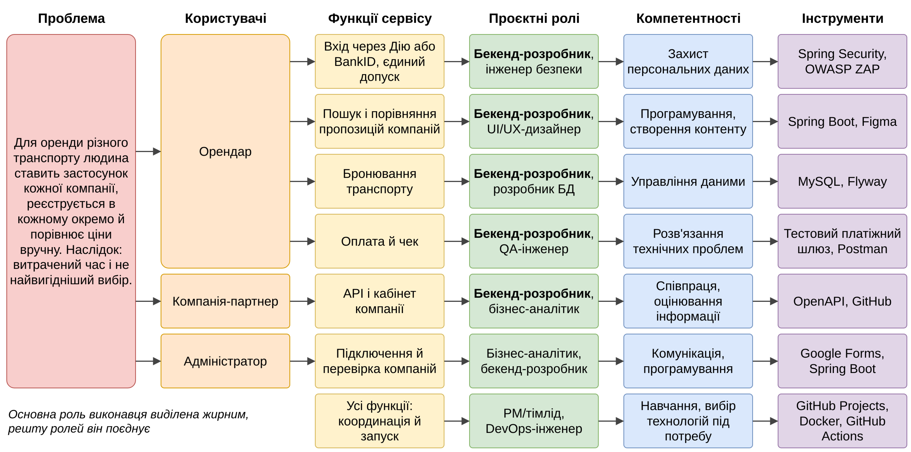

# Практична робота 3

**Тема:** «Проєктування карти компетентностей команди для розроблення електронного сервісу»

**Мета роботи:** Навчитися визначати проблему, користувачів і функції е-сервісу та склад проєктної команди; побудувати карту компетентностей і сформувати попередній задум семестрового проєкту.

**Завдання:** Описати проблему, ідею, зацікавлені сторони, функції, ролі, карту компетентностей, прогалини, здійсненність, тему й схему. Роботу виконано індивідуально за темою групи № 8 з таблиці е-проєкту, основна роль: бекенд-розробник.

# Хід виконання роботи

## Завдання 1. Проблемна сфера

Сфера: транспорт і логістика. Людині в місті чи в поїздці потрібно швидко взяти в оренду авто, самокат або велосипед. Кожна компанія має власний застосунок, окрему реєстрацію й перевірку документів, а ціни доводиться порівнювати вручну. Людина ставить кілька застосунків, щоразу вводить ті самі дані й часто бере перший варіант, а не вигідніший. Опитування я ще не проводив, тож це припущення.

## Завдання 2. Попередня ідея

Для людей, які орендують різний транспорт і мають проблему з окремими застосунками, реєстраціями й ручним порівнянням цін, пропонується розробити електронний сервіс «єМобільність». На відміну від застосунків окремих компаній, сервіс дасть змогу один раз підтвердити особу й орендувати транспорт будь-якої підключеної компанії в одному застосунку.

| Складова | Зміст |
|------|-------------------------------|
| Назва | єМобільність |
| Цільова група | Мешканці й гості міст, які час від часу орендують транспорт |
| Мета | Зібрати оренду транспорту різних компаній в одному застосунку |
| Цінність | Менше часу на оренду. Вимірюватиму кількістю реєстрацій для N компаній (N без сервісу, 1 із сервісом) і кроками до бронювання, які порахую на прототипі |
| Основні функції | Вхід, пошук і порівняння, бронювання, оплата |
| Тип рішення | Вебзастосунок, адаптований під телефон, і API-сервіс для компаній |

: Таблиця 1 — Складові ідеї

Унікальна риса: **єдиний допуск**. Особу й посвідчення водія людина підтверджує один раз, і підключені компанії приймають це без окремої реєстрації. Власних паролів немає, вхід через Дію або BankID.

## Завдання 3. Користувачі й зацікавлені сторони

| Зацікавлена сторона | Потреба або проблема | Як взаємодіє із сервісом | Очікуваний результат |
|--------|---------------|-----------------|----------|
| Орендар | Орендувати транспорт без нових реєстрацій | Входить, порівнює, бронює, платить | Оренда в одному застосунку |
| Компанія-партнер | Знаходити клієнтів поза власним застосунком | Передає транспорт і тарифи через API, приймає бронювання | Нові бронювання |
| Адміністратор | Стежити за компаніями й даними у списку пропозицій | Перевіряє компанії, керує доступом | Лише перевірені компанії |
| Власник сервісу | Розуміти, чи потрібен сервіс людям | Аналізує показники | Дані для рішень |

: Таблиця 2 — Зацікавлені сторони

## Завдання 4. Функції

| Функція | Користувач | Очікуваний результат |
|-----------------|------|----------------|
| Вхід через Дію або BankID, єдиний допуск | Орендар | Підтверджена особа без окремого пароля |
| Пошук і порівняння пропозицій | Орендар | Пропозиції компаній в одному списку |
| Бронювання транспорту | Орендар | Бронювання передано компанії |
| Оплата й чек | Орендар | Оплачена оренда і чек |
| API і кабінет компанії | Компанія | Актуальні транспорт і тарифи |
| Підключення й перевірка компаній | Адміністратор | У видачі лише перевірені компанії |

: Таблиця 3 — Обов'язкові функції

Додаткові: статус бронювання й сповіщення, історія поїздок, статистика для компанії. Перспективні: один маршрут із кількох видів транспорту, спільний абонемент на кілька компаній, страхування поїздки.

## Завдання 5. Проєктна команда

Усі вісім ролей поєднує один виконавець, основний обсяг припадає на бекенд і базу даних.

| Роль | Завдання | Зона відповідальності | Компетентності | Інструменти | Результат |
|-------|------|-------|-------|------|------|
| Бекенд-розробник (основна) | Логіка, API, інтеграції | Працездатність сервера | Програмування, розв'язання проблем | Java, Spring Boot | Робочий API |
| Розробник БД | Схема, міграції, копії | Цілісність даних | Управління даними | MySQL, Flyway | Схема БД |
| PM/тімлід | План, спринти | Строки й обсяг | Співпраця, комунікація | GitHub Projects | План і версії |
| Бізнес-аналітик | Проблема, вимоги | Відповідність потребам | Оцінювання інформації | Google Forms, Sheets | Вимоги |
| UI/UX-дизайнер, фронтенд | Екрани, клієнт | Зручність | Створення контенту | Figma, HTML, JavaScript | Прототип, клієнт |
| QA-інженер | Перевірка сценаріїв | Якість | Розв'язання проблем | Postman, JUnit | Звіт про тести |
| DevOps-інженер | Збирання, запуск | Відтворюваний запуск | Вибір технологій | Docker, GitHub Actions | Запуск однією командою |
| Інженер безпеки | Перевірка входу й даних | Захист даних | Захист персональних даних | OWASP ZAP, Spring Security | Перелік ризиків і заходів |

: Таблиця 4 — Ролі команди

## Завдання 6. Карта компетентностей

| Компонент | Завдання | Роль | Компетентність | Інструменти | Результат |
|-----|--------|-------|-------|------|------|
| Вимоги | Перевірити проблему опитуванням | Бізнес-аналітик | Оцінювання інформації | Google Forms, Sheets | Перелік вимог |
| Інтерфейс | Спроєктувати пошук і бронювання | UI/UX-дизайнер | Створення контенту | Figma | Прототип екранів |
| Вхід | Вхід і єдиний допуск | Бекенд-розробник | Захист персональних даних | Spring Security | Вхід без власних паролів |
| Каталог | Зібрати пропозиції компаній | Бекенд-розробник | Програмування | Spring Boot, OpenAPI | Спільний список пропозицій |
| Бронювання, оплата | Бронювання й тестова оплата | Бекенд-розробник | Розв'язання проблем | Spring Boot, тестовий шлюз | Оплачене бронювання |
| Дані | Схема, резервні копії | Розробник БД | Управління даними | MySQL, Flyway | Схема і копії |
| Якість | Перевірити сценарії | QA-інженер | Розв'язання проблем | Postman, JUnit | Звіт про тести |
| Безпека | Знайти вразливості | Інженер безпеки | Захист персональних даних | OWASP ZAP | Ризики й заходи |
| Запуск | Зібрати й запустити | DevOps-інженер | Вибір технологій | Docker, GitHub Actions | Запуск однією командою |

: Таблиця 5 — Карта компетентностей

## Завдання 7. Прогалини

| Питання | Відповідь |
|-----|-------------------------------|
| Що вже сформовано | Співпраця 3/3 (Git, GitHub), захист пристроїв і мережі 3/3, визначення потреб і вибір технологій 3/3. Це покриває спільну роботу, робоче середовище й вибір інструментів |
| Чого бракує | Управління даними 1/3 (немає єдиної схеми зберігання й перевірки копій), навчання протягом життя 1/3 (немає регулярного плану), критичне оцінювання 2/3 (не завжди звіряю пораду з документацією). Програмування Цифрограм оцінив на 2/3, я вважаю це заниженим, а ICDL його не перевіряє, тому бекенд-навичок ця діагностика не підтверджує |
| Нові інструменти | З робочих інструментів звіт ПЗ 1 згадує Linux, Git, GitHub, Docker і власні скрипти. Решту з таблиці 5 він не підтверджує, тому закладаю час на кожен: Spring Boot, Spring Security, MySQL, Flyway, JUnit, OpenAPI, GitHub Actions, Postman, Figma, OWASP ZAP, Google Forms, вхід через зовнішній сервіс ідентифікації й тестовий платіжний шлюз |
| Найбільший ризик | Управління даними, бо сервіс зберігає персональні дані й бронювання. Другий ризик: навчання, бо нових інструментів багато, а частину робіт семестру я вже виконав із запізненням |
| Як усунути за семестр | До ТЗ (5 листопада): описати, де й скільки зберігаються дані, скласти план навчання за тижнями. До прототипу (19 листопада): опанувати нові інструменти за офіційною документацією, перевірити відновлення БД із копії. До попереднього представлення (26 листопада): перевірити через OWASP ZAP і виправити знайдене. Наприкінці семестру: повторити Цифрограм 2.0 і порівняти бали |

: Таблиця 6 — Аналіз прогалин за звітом практичного заняття 1 (ICDL 36/36, Цифрограм 2.0 72/90)

## Завдання 8. Здійсненність

| Критерій | Оцінка | Обґрунтування |
|---------------|----|-------------------------------|
| Актуальність проблеми | 4 | Проблема зрозуміла, але опитуванням ще не підтверджена |
| Корисність для користувачів | 4 | Менше реєстрацій і застосунків, ціни в одному списку |
| Реалістичність за семестр | 3 | Реальні компанії й платежі недоступні, потрібні заглушки |
| Відповідність компетентностям | 3 | Бекенд обрано основною роллю, але є прогалини із завдання 7 |
| Можливість продемонструвати | 5 | Сценарій від входу до оплати можна показати наживо на тестових даних |
| Подальший розвиток | 4 | Нова компанія або вид транспорту підключаються через той самий API |

: Таблиця 7 — Оцінка здійсненності (оцінки власні, вимірювань ще не було)

Висновок: **звузити функціональність**. У прототипі лишаю два види транспорту (авто й самокат), кілька тестових компаній з імітованим API, вхід через заглушку замість Дії й BankID і тестову оплату. Умов реального підключення Дії, BankID і передавання даних посвідчення водія я не перевіряв, це питання для ТЗ.

## Попередня тема проєкту

«Електронний сервіс для оренди різного транспорту від різних компаній в одному застосунку» (робоча назва «єМобільність»).

## Візуальна схема

Кожен рядок показує роль, компетентність та інструменти для конкретної функції. Файл draw.io (`scheme.drawio`) лежить у [репозиторії](https://github.com/brizzinck/krinzhrepoduta/tree/main/digital_tech/pr-3).

{width=100%}

# Висновки

Було обрано сферу транспорту й описано проблему окремих застосунків і реєстрацій кожної компанії. Сформульовано ідею «єМобільність» з єдиним допуском через Дію або BankID, визначено зацікавлені сторони й функції. Описано вісім проєктних ролей, які поєднує один виконавець з основною роллю бекенд-розробника. Побудовано карту компетентностей із дев'яти завдань і схему, що пов'язує функції з компетентностями та інструментами. Аналіз результатів практичного заняття 1 показав найбільші ризики в управлінні даними й навчанні протягом життя, для них складено план на семестр. За оцінкою здійсненності ідею збережено зі звуженою функціональністю.
