# Прототип е-сервісу «єМобільність»

Прототип е-сервісу «єМобільність» (агрегатор оренди мікромобільного транспорту), команда № 8, дисципліна «Цифрові технології». Склад екранів визначено в розділі 4.1.1 [технічного завдання](../tz/report.md) (таблиця 2).

Це Telegram Mini App: вебзастосунок на чистих HTML, CSS і JavaScript без фреймворків і збірки, який відкривається в Telegram з бота й у звичайному браузері. Усі дані зберігаються на пристрої (localStorage), сервера немає. Зовнішні ресурси лише два: плитки карти OpenStreetMap і позиція користувача.

- Застосунок: https://emobility.pages.dev
- Бот: https://t.me/emobility_ua_bot (кнопка «Відкрити»), перехід одразу на екран: `https://t.me/emobility_ua_bot?startapp=s3`
- Навчальний проєкт. Дані операторів імітовані, проєкт не пов'язаний з Bolt, Jet і Zelektra.

Що вміє: карта Києва з реальною позицією користувача й імітованим транспортом трьох операторів поруч, порівняння за ціною, відстанню й зарядом, гаманець з імітованим поповненням, розблокування за три дотики, поїздка з таймером і вартістю, чек та історія поїздок. Усі екрани є у світлій і темній темі.

<a id="s1"></a>

## S1. Вхід, згода й профіль

| Світла тема | Темна тема |
|---|---|
| 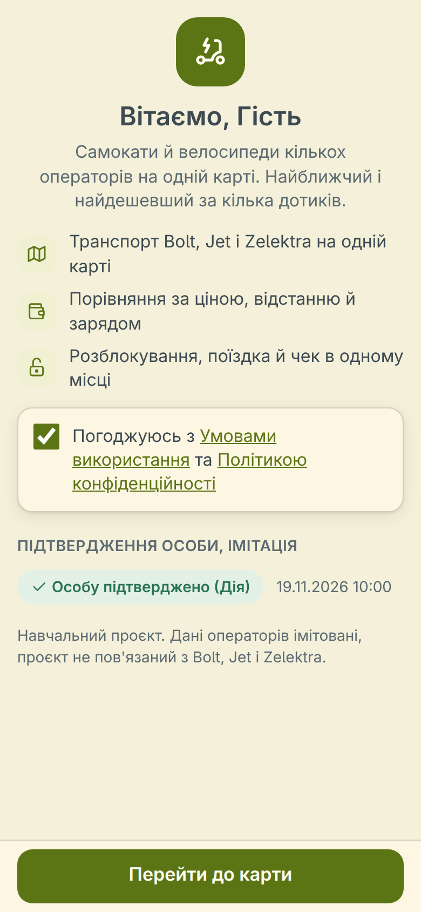 | 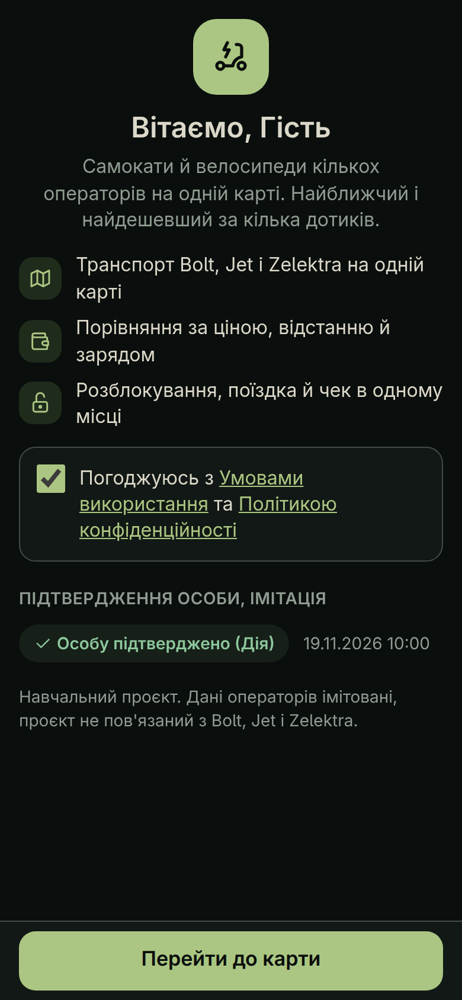 |
| 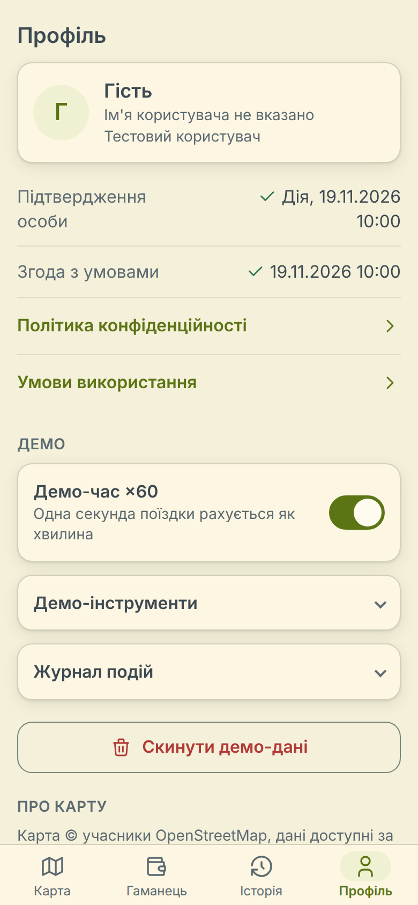 | 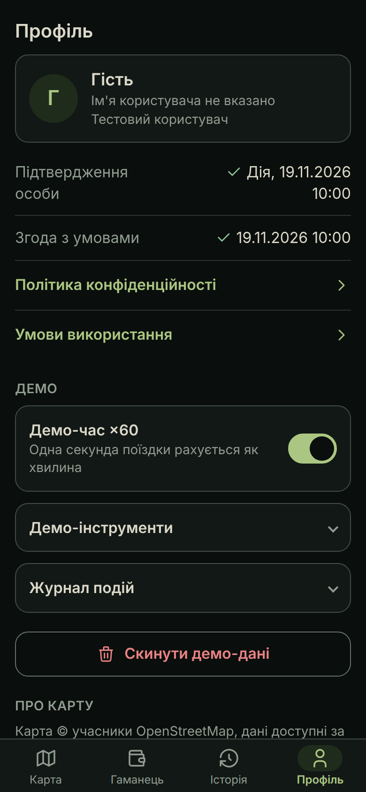 |

- Вхід автоматичний за акаунтом Telegram: привітання за іменем, окремої реєстрації, e-mail і пароля немає. У браузері користувач тестовий («Гість»).
- Перед першою поїздкою потрібна згода з Умовами використання й Політикою конфіденційності (обидві сторінки відкриваються в застосунку); без згоди головна кнопка неактивна.
- Підтвердження особи імітується: кнопки «Підтвердити особу через Дію» і «Підтвердити через BankID», спінер 1,5 с, далі позначка «Особу підтверджено».
- Профіль (нижче на знімках): дані користувача, статус згоди й підтвердження, політика й умови, перемикач «Демо-час ×60», демо-інструменти, журнал подій, «Скинути демо-дані», «Про карту».

<a id="s2"></a>

## S2. Гаманець

| Світла тема | Темна тема |
|---|---|
| 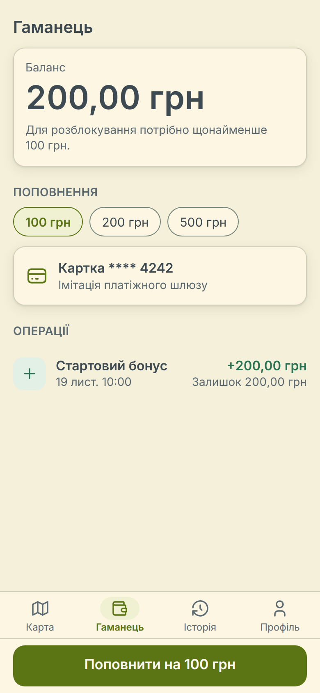 | 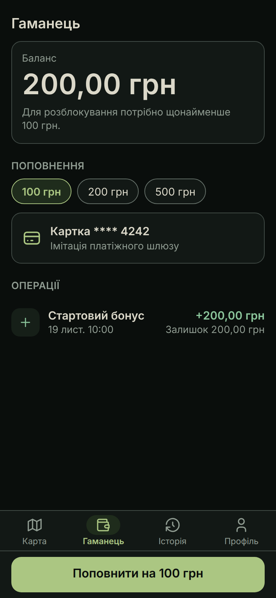 |
| 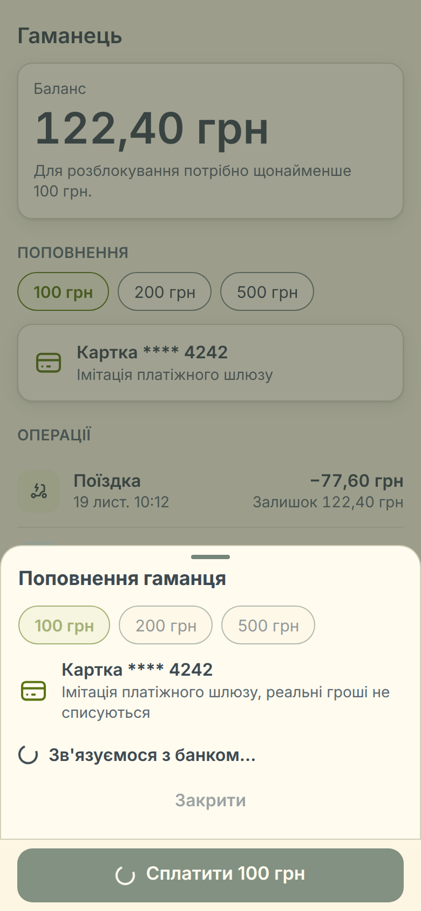 | 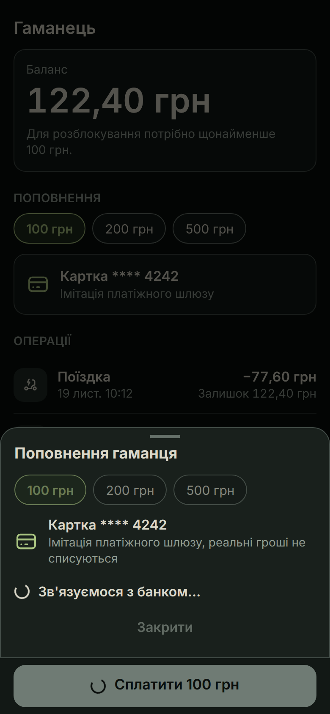 |

- Баланс у гривнях, стартовий бонус 200 грн. Якщо поїздка пішла в мінус, баланс показується як борг червоним кольором.
- Поповнення сумами 100, 200 або 500 грн картою `**** 4242` через імітований платіжний шлюз (1,2 с, потім «Оплату підтверджено»).
- Список операцій: стартовий бонус, поповнення, поїздки зі знаком суми й залишком.
- Поповнення спершу гасить борг, нова поїздка заблокована, доки борг є.

<a id="s3"></a>

## S3. Карта й порівняння транспорту

| Світла тема | Темна тема |
|---|---|
| 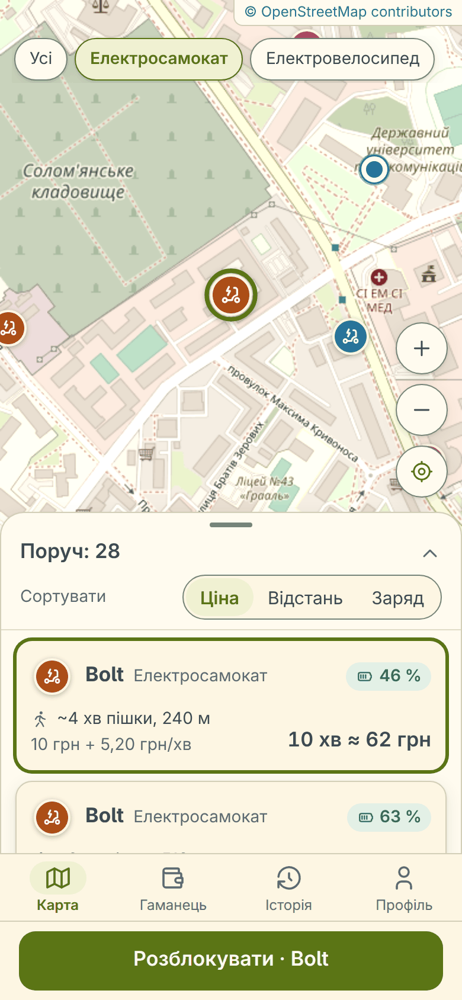 | 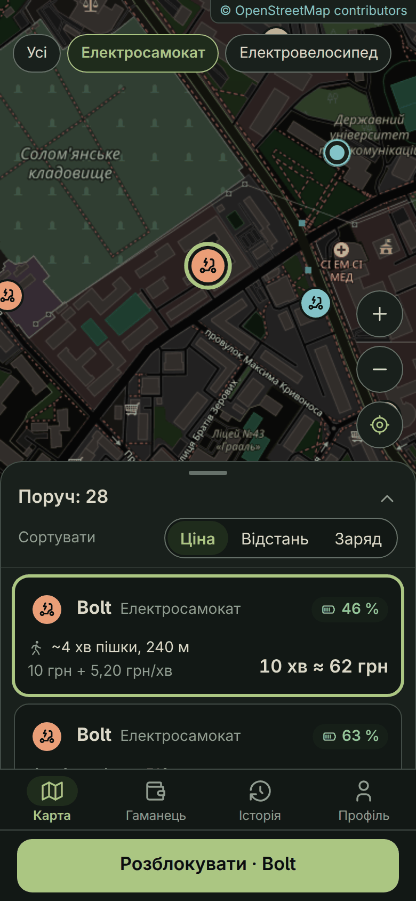 |
| 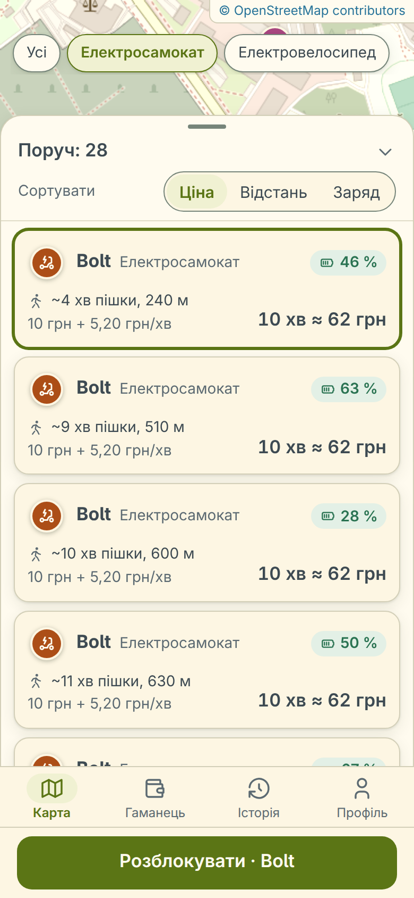 | 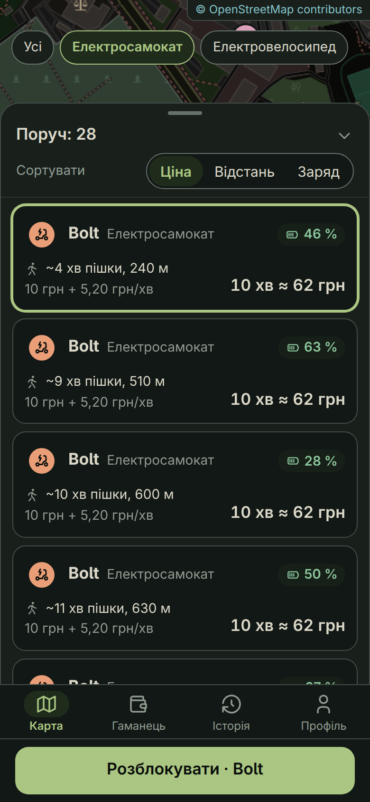 |

- Карта Leaflet з плитками OpenStreetMap, позиція користувача з колом точності, кнопки наближення й повернення до своєї позиції. Позиція береться з Telegram (LocationManager), далі з браузера; якщо доступу немає, показується район ДУІКТ.
- Транспорт: колір маркера означає оператора (Bolt, Jet, Zelektra), форма й значок означають тип (коло для електросамоката, квадрат для електровелосипеда), крапка попереджає про заряд нижче 20 %.
- Фільтр за типом (Усі, Електросамокат, Електровелосипед) і сортування списку за ціною, відстанню або зарядом. Картка: оператор, тип, заряд, час пішки й відстань, тариф, орієнтовна вартість 10 хвилин.
- Вибір маркера або картки показує головну кнопку «Розблокувати · оператор»; далі підтвердження з тарифом. Від карти до поїздки три дотики.

<a id="s4"></a>

## S4. Поїздка

| Світла тема | Темна тема |
|---|---|
| 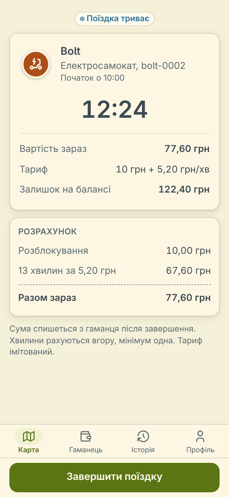 | 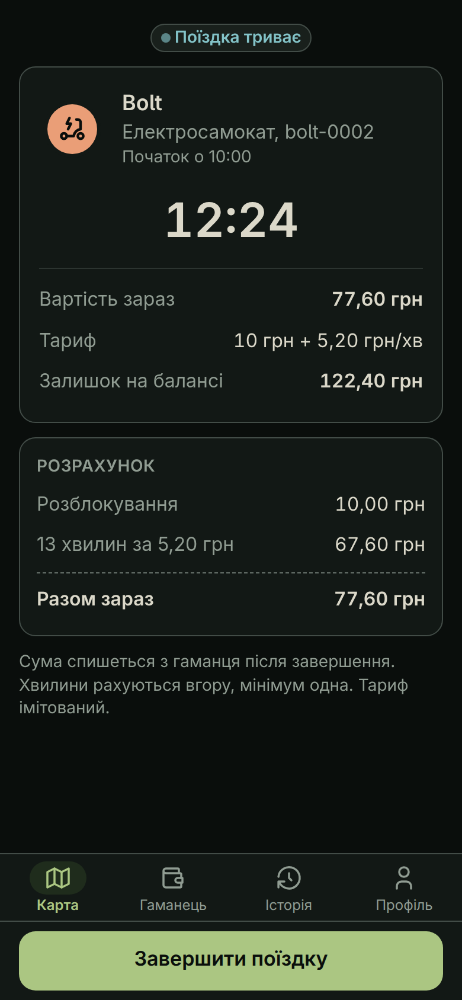 |

- Розблокування проходить перевірки по черзі: згода, особа, борг, баланс від 100 грн, відсутність іншої поїздки, транспорт вільний, відповідь оператора (імітація 0,8 с, відмова при заряді нижче 10 %). Кожна відмова має власне повідомлення й не списує гроші.
- Екран показує оператора, тип, номер транспорту, таймер, поточну вартість, залишок балансу й розрахунок. Поїздка переживає перезавантаження.
- Коли на балансі лишається 20 грн або менше, з'являється попередження з кнопкою «Поповнити»; поїздка триває, недостача стає боргом.
- Завершення головною кнопкою з підтвердженням. Для демонстрації є «Демо-час ×60».

<a id="s5"></a>

## S5. Чек та історія поїздок

| Світла тема | Темна тема |
|---|---|
| 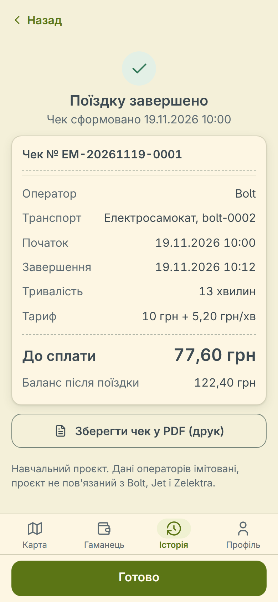 | 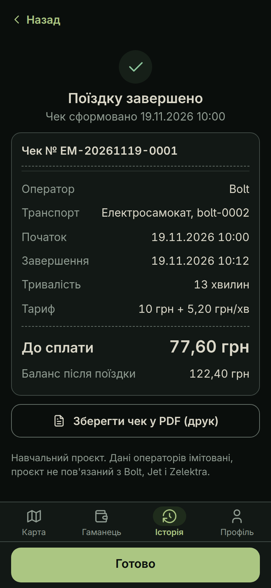 |
| 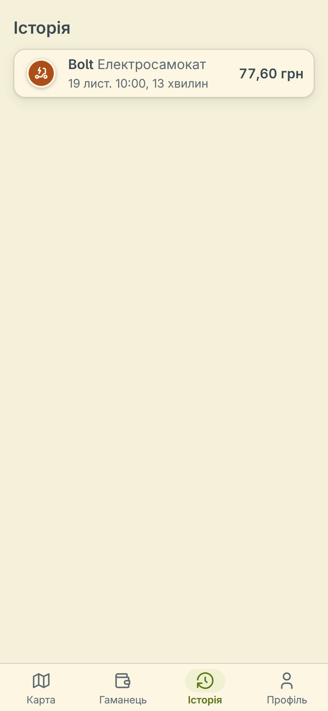 | 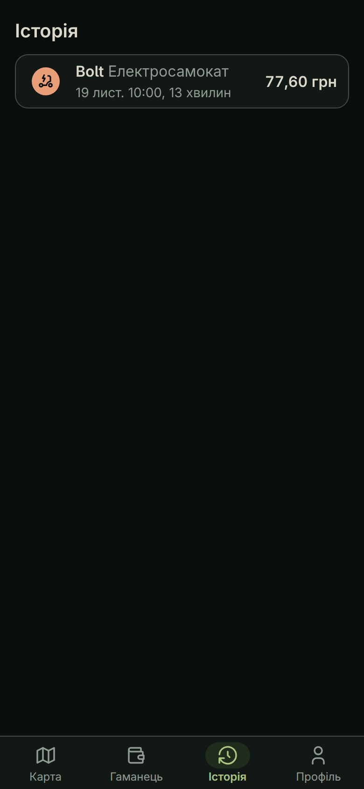 |

- Чек: номер `EM-РРРРММДД-NNNN`, оператор, транспорт, початок і завершення за київським часом, тривалість, тариф, «До сплати» (рівно тариф оператора) і баланс після поїздки. Чек не змінюється; його можна зберегти як PDF через друк браузера.
- Вкладка «Історія» показує поїздки всіх операторів, кожну можна відкрити як чек.
- Комісію сервісу сплачує оператор, користувач її не бачить.

<a id="s6"></a>

## S6. Адмінпанель

Адмінпанель (оператори, транспорт, тарифи, поїздки, платежі й комісія) є вебсторінкою серверної частини й реалізується разом із серверною частиною MVP, 10.12. У прототипі її немає.

## Дані й імітації

- Оператори й тарифи задані в `app/js/config.js`: Bolt, Jet і Zelektra, електросамокати й електровелосипеди, розблокування 10 грн, за хвилину 4,00-5,35 грн. Дані імітовані, логотипів і фірмових кольорів немає.
- Транспорт з'являється випадково в крузі радіусом приблизно 800 м навколо користувача (38 одиниць, щонайменше 4 у межах 250 м) і зберігається на пристрої. Той самий користувач, день і район дають той самий автопарк. Перед розміщенням застосунок читає колір плитки OpenStreetMap у цій точці й відхиляє воду, будівлі та парки; якщо плитки недоступні, перевірки немає. Позиції лишаються випадковими, тож у рідкісних випадках маркер може опинитися на подвір'ї чи в зоні, яку карта не розрізняє. У MVP позиції надходять з каналів операторів.
- Автопарк віддається у формі каналів GBFS v3 (`vehicle_status`, `system_pricing_plans`); інтерфейс читає лише їх.
- Імітуються Дія й BankID, платіжний шлюз, відповідь оператора на розблокування. Позиція користувача не зберігається; на пристрої лишаються округлений центр автопарку й положення транспорту (після поїздки поблизу місця завершення зі зсувом 15-30 м і округленням).
- Дані лежать у localStorage під ключем `emob`; «Скинути демо-дані» у Профілі видаляє їх.

## Запуск локально

```
cd app
python3 -m http.server 8099
```

Відкрити `http://localhost:8099`. Потрібен інтернет для плиток карти. Збірки немає, залежності (Leaflet 1.9.4 і значки Tabler, обидва MIT) лежать у `app/vendor` разом з ліцензіями.

## Розгортання

Теку `app` розміщено на Cloudflare Pages (проєкт `emobility`, гілка `main`). Заголовки задає `app/_headers`. Відповідь на `/start` бота реалізована функцією `functions/tg/webhook.js`; розгортати треба з теки прототипу.
