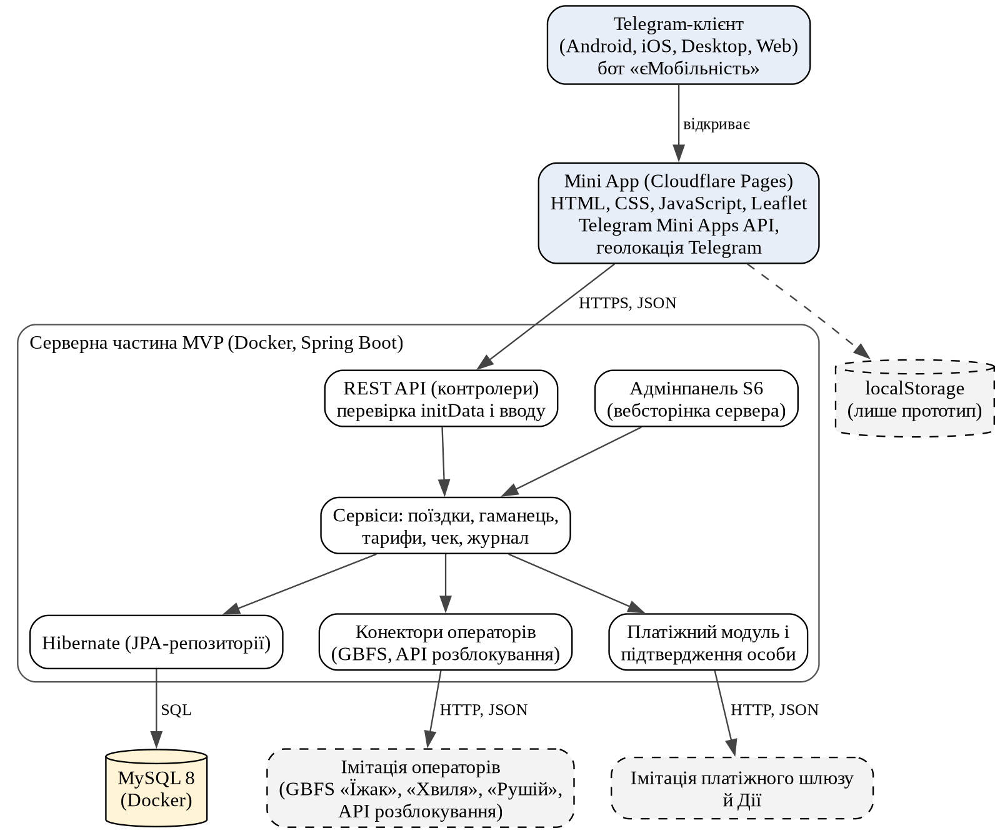

# 1 НАЙМЕНУВАННЯ ТА ГАЛУЗЬ ЗАСТОСУВАННЯ

Назва розробки: «єМобільність — агрегатор оренди мікромобільного транспорту».

Галузь застосування: міська мобільність, оренда мікромобільного транспорту (електросамокатів, електровелосипедів, скутерів і мопедів).

Наведене технічне завдання поширюється на розробку програмного забезпечення «єМобільність», яке використовується для оренди транспорту кількох операторів в одному застосунку: з одним акаунтом, одним гаманцем, зведеною картою, порівнянням тарифів і заряду, розблокуванням через API оператора, єдиним чеком та історією поїздок. Воно призначене для таких користувачів:

- орендарі (B2C): студенти великих міст віком 18–25 років, міські працівники віком 25–45 років, туристи та епізодичні користувачі;
- оператори мікромобільності (B2B): малі локальні оператори, для яких агрегатор стає каналом залучення клієнтів, і великі оператори;
- міська влада, університети та коворкінги як партнери й замовники зручної мобільності.

Розробка охоплює лише мікромобільний транспорт. Автомобілі й каршеринг у розробці не розглядаються; інтеграцію з розкладом міського транспорту відкладено на наступні версії (п. 4.1.2).

Проєкт виконує команда № 8 з дисципліни «Цифрові технології»: Чертілін П. О. (ТЦР-31), Сукач В. Ю. (ТЦР-31), Лаврішко В. С. (ТЦР-32). Технічне завдання складено одне на всю команду.

# 2 ПІДСТАВА ДЛЯ РОЗРОБКИ

Підставою для розробки «єМобільність» є завдання на домашню роботу з дисципліни «Цифрові технології», затверджене кафедрою технологій цифрового розвитку Державного університету інформаційно-комунікаційних технологій.

# 3 ПРИЗНАЧЕННЯ РОЗРОБКИ

Розробка призначена для зняття фрагментації ринку мікромобільності. Зараз користувач тримає окремий застосунок кожного оператора, реєструється й прив'язує картку в кожному, вчить різні правила й порівнює тарифи та заряд вручну. Єдиної історії поїздок немає, а оператори втрачають клієнтів. «єМобільність» дає один акаунт і гаманець, єдину карту транспорту, порівняння тарифів і заряду, розблокування через API оператора, єдиний чек і історію поїздок.

Мета розробки: скоротити для користувача кількість реєстрацій і кроків до початку поїздки, зробити вибір транспорту порівнянним за ціною та зарядом і дати операторам доступ до нових клієнтів. Експлуатація: орендарі користуються застосунком на смартфоні в місті, адміністратор працює в адмінпанелі. Досягнення цілі перевіряється метриками з таблиці 1 (взято з impact canvas проєкту). Числові значення є цілями навчального прототипу, а не результатами вимірювань.

| Метрика | Цільове значення | Спосіб вимірювання |
|--------------|----------------|----------------------------|
| Кількість підключених операторів | не менше 3 (імітовані: самокати, велосипеди, скутери) | Кількість записів operator зі статусом «активний» у БД |
| Кроки до розблокування | не більше 4 кліків від карти до розблокування (вхід і платіж уже виконано) | Підрахунок кліків за сценарієм на прототипі; база для порівняння вимірюється так само в застосунках одного-двох реальних операторів і записується в пояснювальній записці |
| Час від відкриття до розблокування | не більше 30 с | Часові мітки подій «відкрито карту» і «розблоковано», середнє з 5 прогонів |
| Реєстрацій на N операторів | 1 реєстрація й 1 платіжний метод замість N | Порівняння сценаріїв без сервісу (N реєстрацій) і з сервісом (1) |
| Конверсія з пошуку в бронювання | орієнтир не менше 30 % сесій | Сесії з бронюванням, поділені на всі сесії з переглядом карти (події застосунку) |
| Поїздок на користувача на тиждень, MAU, DAU, ARPU | довідкові значення, строгих цілей немає | Події застосунку й таблиця ride; ARPU: комісія за період на одного активного користувача |
| Retention 7/30/90 днів | орієнтир: Retention 7 днів не менше 30 % | Частка користувачів з першою поїздкою, які повернулися через 7, 30, 90 днів (таблиці booking і ride) |
| NPS | орієнтир не менше 30 | Опитування після поїздки: частка тих, хто радить (9–10), мінус частка критиків (0–6) |
| Частка поїздок через агрегатор | зростає в кожному періоді вимірювання | Поїздки через сервіс, поділені на всі поїздки оператора (для імітованих операторів дані генерує сценарій) |
| Продуктивність API карти | 95 % запитів до 2 с при 100 користувачах, помилок менше 1 % | Навантажувальний тест JMeter на запиті списку транспорту |

: Таблиця 1 — Критерії якості та метрики

# 4 ВИМОГИ ДО ПРОГРАМНОГО ЗАБЕЗПЕЧЕННЯ

## 4.1 Вимоги до функціональних характеристик

Програмне забезпечення повинне виконувати такі основні функції: реєстрація й вхід; гаманець і платіжний метод; карта транспорту з геолокацією; порівняння тарифів і заряду; бронювання; розблокування; поїздка й завершення з оплатою; чек та історія поїздок; адміністрування операторів, транспорту й тарифів. Повний перелік наведено в підрозділах 4.1.1–4.1.4.

### 4.1.1 Користувацького інтерфейсу

Інтерфейс складається з екранів S1–S10 вебзастосунку-прототипу. Прототип розробляється на етапі 5 за цим технічним завданням і розміщується в публічному репозиторії команди. Коди екранів S1–S10 у таблиці 2 відповідають екранам прототипу.

Для кожного екрана в README прототипу є окремий розділ, посилання на нього наведено в таблиці 2.

Прототип: [https://github.com/brizzinck/krinzhrepoduta/blob/main/digital_tech/prototype/README.md](https://github.com/brizzinck/krinzhrepoduta/blob/main/digital_tech/prototype/README.md)

| Екран | Функція | Хто користується | Посилання на прототип |
|-----|----------------------------------|-----------|-----------|
| S1 | Реєстрація й вхід (єдиний акаунт, Дія ID або BankID) | Орендар | [README.md#s1](https://github.com/brizzinck/krinzhrepoduta/blob/main/digital_tech/prototype/README.md#s1) |
| S2 | Профіль, гаманець і прив'язка платіжного методу | Орендар | [README.md#s2](https://github.com/brizzinck/krinzhrepoduta/blob/main/digital_tech/prototype/README.md#s2) |
| S3 | Карта й список транспорту (Leaflet, геолокація користувача, сортування) | Орендар | [README.md#s3](https://github.com/brizzinck/krinzhrepoduta/blob/main/digital_tech/prototype/README.md#s3) |
| S4 | Порівняння тарифів і заряду | Орендар | [README.md#s4](https://github.com/brizzinck/krinzhrepoduta/blob/main/digital_tech/prototype/README.md#s4) |
| S5 | Картка транспорту й бронювання | Орендар | [README.md#s5](https://github.com/brizzinck/krinzhrepoduta/blob/main/digital_tech/prototype/README.md#s5) |
| S6 | Розблокування (QR-код або кнопка, імітований API оператора) | Орендар | [README.md#s6](https://github.com/brizzinck/krinzhrepoduta/blob/main/digital_tech/prototype/README.md#s6) |
| S7 | Активна поїздка | Орендар | [README.md#s7](https://github.com/brizzinck/krinzhrepoduta/blob/main/digital_tech/prototype/README.md#s7) |
| S8 | Завершення поїздки, оплата, чек | Орендар | [README.md#s8](https://github.com/brizzinck/krinzhrepoduta/blob/main/digital_tech/prototype/README.md#s8) |
| S9 | Історія поїздок і чеки | Орендар | [README.md#s9](https://github.com/brizzinck/krinzhrepoduta/blob/main/digital_tech/prototype/README.md#s9) |
| S10 | Адмінпанель: оператори, транспорт, тарифи, поїздки, платежі, журнал дій | Адміністратор | [README.md#s10](https://github.com/brizzinck/krinzhrepoduta/blob/main/digital_tech/prototype/README.md#s10) |

: Таблиця 2 — Екрани прототипу

### 4.1.2 Для користувача

- реєстрація, вхід і вихід з єдиним акаунтом для всіх операторів: через Дія ID або BankID (у прототипі імітація) або за e-mail і паролем (S1);
- прив'язка платіжного методу й керування внутрішнім гаманцем: перегляд балансу, поповнення (S2);
- профіль: перегляд і зміна даних користувача, експорт його даних і видалення акаунта за запитом (S2);
- перегляд на карті транспорту всіх підключених операторів з позицією користувача, фільтр за типом транспорту (самокат, електровелосипед, скутер) і за оператором, сортування списку найближчого транспорту за відстанню, ціною та зарядом (S3);
- динамічне порівняння тарифів (ціна розблокування, ціна за хвилину, ціна за кілометр) і рівня заряду акумулятора (S4);
- бронювання вибраного транспорту на обмежений час (за замовчуванням 10 хвилин) зі скасуванням (S5);
- розблокування транспорту через API оператора (S6);
- активна поїздка: час, відстань, поточна вартість (S7);
- завершення поїздки в дозволеній зоні паркування оператора (перевірка через API оператора), автоматичне списання коштів з гаманця й формування чека (S8);
- історія поїздок незалежно від оператора, перегляд кожного чека (S9).

Відкладено на наступні версії, тому в цій версії не реалізуються: бронювання на заданий час наперед, універсальна страховка на час оренди, мультипас і преміум-підписки, інтеграція з розкладом міського транспорту, white-label рішення для нових операторів. Відгуки про поїздки теж відкладено на наступні версії.

### 4.1.3 Для адміністратора системи

- підключення, відключення й модерація операторів (S10);
- керування транспортом оператора: додавання, зміна статусу (вільний, заброньований, у поїздці, не працює), перегляд заряду й позиції (S10);
- керування тарифами операторів (S10);
- перегляд поїздок і платежів з пошуком за користувачем, оператором і датою (S10);
- перегляд журналу дій користувачів та адміністраторів (S10).

### 4.1.4 Додаткові вимоги

- логування дій користувача: вхід, бронювання, розблокування, завершення поїздки, платіж фіксуються в журналі із записом, хто, коли й що зробив; журнал підтверджує дії в разі спору;
- сповіщення користувача про закінчення броні, початок і завершення поїздки, списання коштів (повідомлення в застосунку, S7 і S8);
- експорт чека: перегляд чека як HTML-сторінки й збереження в PDF через друк браузера (S8, S9);
- доступність (accessibility): достатній контраст тексту й елементів керування, керування з клавіатури, текстові підписи кнопок і полів для програм зчитування з екрана, масштабування шрифту без втрати функцій; відповідність перевіряється інструментом Lighthouse (розділ 7).

## 4.2 Вимоги до надійності

Контроль введення. Усі вхідні дані перевіряються на сервері за правилами типу, довжини й діапазону, значення з обмеженого набору (тип транспорту, статус) приймаються лише зі списку допустимих. Перевірка на клієнті не замінює серверну. Спроби дій з недопустимим станом (розблокування чужої броні, поїздка з недостатнім балансом, подвійне бронювання одного транспорту) відхиляються із зрозумілим повідомленням.

Цілісність БД. Зв'язані дані зберігаються із зовнішніми ключами (транспорт до оператора й тарифу, бронювання до користувача й транспорту, платіж до гаманця й поїздки). Операції, що змінюють кілька таблиць (списання за поїздку, завершення поїздки, звільнення транспорту), виконуються в одній транзакції: або виконуються всі зміни, або жодна. Баланс гаманця не може стати від'ємним.

Відновлення після збоїв. Резервна копія MySQL створюється щодоби й перед оновленням версії. Час відновлення з копії не більше 30 хвилин. Поїздка, перервана збоєм сервера, відновлюється за станом у БД: час початку поїздки зберігається, вартість розраховується під час завершення. Запуск і відновлення середовища виконуються командою `docker compose`. Цільова доступність сервісу для прототипу: не нижче 99 % на місяць, режим 24/7. Резервне копіювання виконується без зупинки сервісу. Оновлення версій виконуються в нічне вікно обслуговування (02:00–04:00) не частіше одного разу на тиждень, плановий простій не перевищує 30 хвилин і не враховується в цільовій доступності; про вікно користувачів попереджають у застосунку.

Персональні дані. Збираються лише ім'я, e-mail, хеш пароля, згода на обробку даних, дані поїздок і платежів (токен платіжного шлюзу й останні чотири цифри картки). Геолокація користувача використовується для показу на карті й не зберігається, координати записуються лише для початку й кінця поїздки. Пробіг для оплати за кілометр надає API оператора (телеметрія транспорту; у прототипі імітується), тому треку користувача сервіс не зберігає. Передбачено політику конфіденційності, згоду користувача при реєстрації, журнал доступів до персональних даних, експорт і видалення даних користувача за його запитом, псевдонімізацію користувача в аналітичних звітах. Повні дані картки не зберігаються. Обробка ведеться відповідно до Закону України «Про захист персональних даних». Дані поїздок і платежів зберігаються 3 роки, після чого автоматично видаляються або знеособлюються.

Кібербезпека. Обмін клієнта із сервером виконується через HTTPS (TLS 1.2 і вище, у навчальному середовищі допускається самопідписаний сертифікат). Паролі зберігаються як хеші BCrypt. Том з даними MySQL і резервні копії шифруються. Складається модель загроз із заходами захисту; її переглядають після кожного етапу розробки. Сканування вразливостей виконується інструментом OWASP ZAP (розділ 7).

Електронні документи. Журнал подій (хто, коли, що) тільки доповнюється: застосунок не змінює й не видаляє наявні записи. Стан чека й бронювання змінюється новими записами історії статусів, а не перезаписом, тому будь-який стан можна відтворити.

## 4.3 Умови експлуатації

Умови експлуатації згідно СанПін 2.2.2.542 – 96.

### 4.3.1 Вид обслуговування

Потрібне поточне обслуговування сервісу: оновлення версій і залежностей, щоденне резервне копіювання, моніторинг доступності й помилок, оновлення довідника тарифів і підключених операторів, модерація операторів.

### 4.3.2 Обслуговуючий персонал

Для реальної експлуатації потрібні такі штатні одиниці: адміністратор сервісу (модерація операторів, тарифів і транспорту, робота з адмінпанеллю, 1 особа), підтримка користувачів (звернення щодо платежів і поїздок, 1 особа), DevOps-інженер (Docker, MySQL, резервні копії, оновлення, 1 особа). У навчальному проєкті ці ролі виконують учасники команди.

## 4.4 Вимоги до складу і параметрів технічних засобів

Серверна частина працює в Docker, клієнтська частина працює в браузері. Програмне забезпечення повинне функціонувати на IBM-сумісних персональних комп'ютерах, клієнт додатково на смартфонах із геолокацією.

Мінімальна конфігурація технічних засобів:

- тип процесору: Intel Core i5;
- об'єм ОЗП: 4 Гб;
- вільне місце на диску: 10 Гб (образи Docker і дані MySQL);
- підключення до мережі Інтернет зі швидкістю від 20 мегабіт;
- клієнт: сучасний браузер (Chrome, Firefox, Edge або Safari поточних версій), для смартфона ще й дозвіл на геолокацію.

Рекомендована конфігурація технічних засобів (та, на якій виконується розробка):

- тип процесору: Intel Core i7;
- об'єм ОЗП: 8 Гб;
- вільне місце на диску: 20 Гб;
- підключення до мережі Інтернет зі швидкістю від 100 мегабіт;
- хост з Docker і Docker Compose, MySQL 8 у контейнері.

## 4.5 Вимоги до інформаційної та програмної сумісності

Серверна частина працює в контейнерах Docker і не залежить від ОС хоста: Linux, Windows 10/11 або macOS з Docker. Клієнт працює під будь-якою ОС із сучасним браузером.

### 4.5.1 Вимоги до вхідних даних

Вхідні дані повинні бути представлені в такому форматі:

- API операторів: JSON з полями транспорту (ідентифікатор, тип, координати lat і lng у градусах WGS 84, рівень заряду 0–100 %, статус) і тарифу (ціна розблокування, ціна за хвилину, ціна за кілометр у гривнях з двома знаками);
- дані користувача: ім'я, e-mail, пароль не коротше 8 символів (якщо вхід виконується не через Дія ID або BankID), згода на обробку персональних даних;
- дані платежу: токен платіжного методу від платіжного шлюзу, сума поповнення в гривнях;
- дата й час в ISO 8601, у UTC.

У навчальному проєкті API операторів, платіжний шлюз, Дія ID і BankID замінено імітацією (mock) із тими самими форматами. Інтеграція з реальними операторами не виконується.

### 4.5.2 Вимоги до вихідних даних

Результати повинні бути представлені в такому форматі:

- відповіді API клієнту: JSON;
- екрани вебзастосунку: HTML;
- бронювання, чек і історія поїздок: JSON для API, HTML-сторінка для користувача, чек додатково зберігається в PDF через друк браузера;
- команди до API операторів (розблокування, блокування): JSON.

### 4.5.3 Вимоги до мови розробки

Серверну частину виконати мовою програмування Java. Клієнтську частину виконати мовами HTML, CSS і JavaScript.

### 4.5.4 Вимоги до середовища розробки

Розробку виконати на платформі Spring Boot з Hibernate (JPA) і СУБД MySQL 8, середовище запуску Docker та Docker Compose. Карта в клієнті будується бібліотекою Leaflet. Тести: JUnit, Postman, OWASP ZAP, JMeter.

### 4.5.5 Вимоги до представленню вихідних кодів

Вихідний код програми має бути представлений у вигляді проєкту в Git-репозиторії зі збірною конфігурацією Maven, файлом `docker-compose.yml` і описом запуску в `README`. Код коментується українською мовою.

## 4.6 Вимоги до маркування та пакування

Вимоги до маркування та пакування не висуваються.

## 4.7 Вимоги до транспортування та зберігання

Вимоги до транспортування та зберігання не висуваються.

## 4.8 Спеціальні вимоги

Згенерувати інсталяційну версію програмного забезпечення: запуск усієї системи (сервер, MySQL, імітовані оператори, платіжний шлюз, веб-клієнт) однією командою `docker compose up` з початковими тестовими даними.

# 5 ВИМОГИ ДО ПРОГРАМНОЇ ДОКУМЕНТАЦІЇ

## 5.1 Попередній склад програмної документації

У склад супроводжувальної документації повинні входити такі документи на аркушах формату А4:

- пояснювальна записка;
- технічне завдання;
- керівництво користувача;
- керівництво програміста;
- керівництво системного програміста;
- керівництво адміністратора;
- програма та методика тестування;
- текст програми.

Графічна частина повинна бути виконана на аркушах формату А4 та містити такі документи (обрані схеми):

- схема структурна програмного забезпечення;
- схема структура потоків даних програмного забезпечення або його частини;
- схема структурна варіантів використання;
- схема структурна концептуальної моделі предметного середовища;
- схеми взаємодії об'єктів, об'єктна декомпозиція;
- схема структурна компонент;
- схема структурна класів програмного забезпечення;
- схема структурна станів інтерфейсу;
- креслення вигляду екранних форм.

У цьому технічному завданні наведено дві схеми: структурну варіантів використання (рисунок 1) і структурну програмного забезпечення з компонентами (рисунок 2). Решту схем буде подано в пояснювальній записці. Креслення екранних форм відповідають екранам S1–S10 прототипу (посилання в 4.1.1).

{width=60%}

{width=90%}

## 5.2 Спеціальні вимоги до програмної документації

Програмні модулі, котрі розробляються, повинні бути задокументовані, тобто тексти програм повинні містити всі необхідні коментарі. Кожен клас і публічний метод сервісного шару має короткий коментар українською мовою: призначення, вхідні дані, результат. Для REST API складається опис у форматі OpenAPI.

# 6 СТАДІЇ І ЕТАПИ РОЗРОБКИ

| № | Назва етапу | Строк (в рамках навчального проєкту) | Строк (орієнтовно, в рамках реального проєкту) | Звітність |
|--|----------------------|----------|----------|----------------------|
| 1. | Вивчення літератури за тематикою роботи | 01.10 | 2 тижні | Огляд аналогів і літератури |
| 2. | Аналіз вимог та уточнення специфікацій | 15.10 | 3 тижні | Специфікації програмного забезпечення |
| 3. | Розробка технічного завдання | 05.11 | 2 тижні | Технічне завдання |
| 4. | Проектування структури програмного забезпечення, проектування компонентів | 12.11 | 4 тижні | Схема структурна програмного забезпечення та специфікація компонентів (діаграма класів, схема алгоритму) |
| | Підготовка тез доповіді на конференцію | 12.11 | 1 тиждень | Тези доповіді |
| 5. | Програмна реалізація програмного забезпечення | 19.11 | 8 тижнів | Тексти програмного забезпечення. Прототип |
| 6. | Тестування програмного забезпечення | 19.11 | 4 тижні | Тести, результати тестування |
| 7. | Розробка матеріалів текстової частини роботи. Підготовка презентації | 26.11 | 3 тижні | Пояснювальна записка. Презентація |
| 8. | Підготовка презентації | 26.11 | 2 тижні | Графічний матеріал проекту |
| 9. | Представлення презентації на конференції | 03.12 | 1 день | Презентація |

: Таблиця 3 — Стадії й етапи розробки (2026 рік)

# 7 ПОРЯДОК КОНТРОЛЮ ТА ПРИЙМАННЯ

Тестування розробленого програмного продукту виконується відповідно до програми та методики тестування, яка входить до складу документації (розділ 5). Заплановано такі види тестування.

| Вид | Як проводиться | Що перевіряється | Що фіксується |
|--------------|------------------------|--------------------------|----------------------|
| Модульне | JUnit: тести сервісів (розрахунок вартості, правила бронювання, баланс гаманця) | Правильність окремих класів і методів | Кількість тестів, пройдені й провалені тести |
| Інтеграційне, тестування API | Postman, колекція запитів до REST API з імітованими операторами й MySQL в Docker | Взаємодія контролерів, сервісів, БД, конекторів операторів; коди відповідей і формат JSON | Результати колекції (пройдені й провалені запити) |
| Функціональне за сценаріями | Сценарій від реєстрації до чека за екранами S1–S10 і окремо негативні сценарії | Усі функції з 4.1.2 і 4.1.3 | Таблиця «сценарій, очікуваний результат, фактичний результат» |
| Негативні сценарії | Ручні й автоматичні перевірки | Недостатній баланс; розблокування зайнятого, заброньованого іншим або розрядженого транспорту; подвійне бронювання; некоректні дані форм; недоступність API оператора (імітована затримка й помилка); перерване з'єднання під час поїздки | Реакція системи й повідомлення користувачу, відсутність пошкоджених даних у БД |
| Безпеки | OWASP ZAP на запущеному застосунку, перевірка автентифікації й прав доступу | Вразливості введення, керування сесією й доступом, відкриті службові ендпоінти | Перелік знахідок за ризиком і виправлень |
| Навантажувальне (масовість) | JMeter: 100 одночасних користувачів, запит списку транспорту й бронювання | Час відповіді, частка помилок, поведінка при пікових запитах | 95-й перцентиль часу відповіді й частка помилок; ціль з таблиці 1 |
| Зручності (usability) | Проходження сценарію розблокування на прототипі з кількома тестовими користувачами | Кількість кроків і час до розблокування, зрозумілість екранів | Кліки й час за сценарієм, оцінка NPS з таблиці 1 |
| Доступність (accessibility) | Lighthouse (Accessibility) і ручна перевірка з клавіатури на екранах S1–S10 | Контраст, підписи елементів для програм зчитування з екрана, керування з клавіатури, масштабування шрифту | Оцінка Lighthouse, перелік знайдених проблем і виправлень |

: Таблиця 4 — Види тестування

Приймання виконується на демонстрації. Програмне забезпечення вважається прийнятим, якщо виконано такі умови:

- система запускається з чистого клону репозиторію командою `docker compose up`;
- повний сценарій від реєстрації до чека й історії поїздок проходить без помилок, а функції адміністратора працюють;
- негативні сценарії завершуються відмовою з повідомленням і не псують дані;
- метрики з таблиці 1, які можна виміряти на прототипі, виміряно й результати наведено в пояснювальній записці;
- вихідні коди, документація й схеми передано в складі, визначеному розділом 5.
