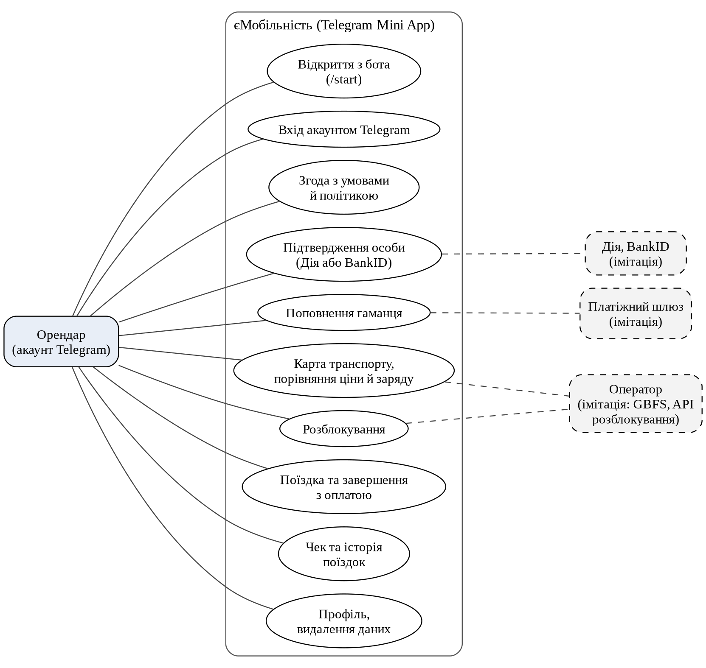
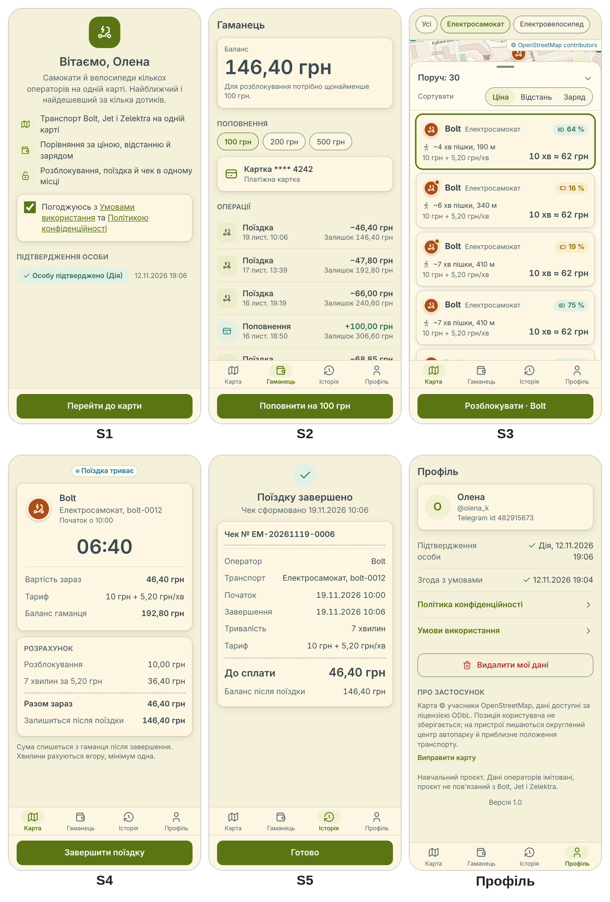

# 1 НАЙМЕНУВАННЯ ТА ГАЛУЗЬ ЗАСТОСУВАННЯ

Назва розробки: «єМобільність — агрегатор оренди мікромобільного транспорту».

Галузь застосування: міська мобільність, оренда мікромобільного транспорту в Києві (електросамокатів і електровелосипедів).

Наведене технічне завдання поширюється на розробку програмного забезпечення «єМобільність» (MVP). Це Telegram Mini App, тобто вебзастосунок усередині Telegram, який відкривається з бота «єМобільність» (@emobility_ua_bot). Він використовується для оренди транспорту кількох операторів в одному застосунку: вхід за акаунтом Telegram, один гаманець, зведена карта, порівняння тарифів і заряду, розблокування (через імітований API оператора), єдиний чек та історія поїздок. Застосунок призначений для таких користувачів:

- орендарі: насамперед студенти Києва віком 18–25 років, також міські працівники й туристи;
- оператори мікромобільності, для яких сервіс стає каналом залучення клієнтів;
- адміністратор сервісу (у MVP налаштовує застосунок розробник, п. 4.1.3).

Розробка охоплює лише мікромобільний транспорт у Києві. Автомобілі не розглядаються; інтеграцію з громадським транспортом відкладено на наступні версії (п. 4.1.2).

Проєкт виконує команда № 8 з дисципліни «Цифрові технології»: Чертілін П. О. (ТЦР-31), Сукач В. Ю. (ТЦР-31), Лаврішко В. С. (ТЦР-32). Технічне завдання одне для всієї команди.

# 2 ПІДСТАВА ДЛЯ РОЗРОБКИ

Підставою для розробки «єМобільність» є завдання на домашню роботу з дисципліни «Цифрові технології», затверджене кафедрою технологій цифрового розвитку Державного університету інформаційно-комунікаційних технологій.

# 3 ПРИЗНАЧЕННЯ РОЗРОБКИ

Розробка призначена для подолання фрагментації ринку мікромобільності. Зараз користувач тримає окремий застосунок кожного оператора, реєструється й прив'язує картку в кожному та вручну порівнює тарифи й заряд. Єдиної історії поїздок немає, а оператори втрачають клієнтів. Аналоги розв'язують задачу частково: застосунки операторів (Bolt, Kiwi) працюють лише зі своїм парком, а картографічні сервіси (Google Maps) будують маршрут, але не орендують транспорт і не приймають оплату. «єМобільність» дає одну карту транспорту, один гаманець, порівняння ціни й заряду, розблокування, єдиний чек та історію поїздок. Користувач платить рівно тариф оператора; сервіс заробляє комісію 10 %, яку сплачує оператор із кожної поїздки, приведеної сервісом.

Мета розробки: скоротити для користувача кількість реєстрацій і кроків до початку поїздки та зробити вибір транспорту порівнянним за ціною й зарядом.

Досягнення мети перевіряється метриками з таблиці 1. Значення є цілями, а не результатами вимірювань: їх вимірюють на MVP (чинний застосунок, п. 4.1) на етапі 6 (19.11).

| Метрика | Цільове значення | Чим вимірюється |
|--------------|----------------|----------------------------|
| Кількість підключених операторів | не менше 3 (оператори Bolt, Jet, Zelektra, дані імітовані) | Кількість каналів операторів у форматі GBFS, які читає застосунок (у конфігурації) |
| Кількість реєстрацій для N операторів | 0 окремих реєстрацій: вхід акаунтом Telegram, одне підтвердження особи через Дію або BankID й один гаманець замість N | Порівняння сценаріїв: без сервісу N реєстрацій і N платіжних методів, із сервісом один вхід |
| Кроки до розблокування | не більше 4 дотиків від відкритої карти (вхід і підтвердження особи вже виконано) | Підрахунок дотиків за сценарієм у MVP; база для порівняння: той самий сценарій у застосунку одного реального оператора |
| Час від відкриття карти до розблокування | не більше 30 с | Секундомір, середнє з 5 прогонів команди в Telegram; база для порівняння: час, щоб знайти найдешевший транспорт поруч, відкриваючи застосунки трьох операторів по черзі |
| Час відкриття карти | карта з позицією користувача й транспортом з'являється не пізніше ніж за 3 с після відкриття Mini App (повторний запуск, мобільний Інтернет 4G) | Секундомір, середнє з 5 запусків у Telegram на смартфоні; база для порівняння: час запуску застосунку одного оператора з нуля |
| Доступність інтерфейсу | оцінка Lighthouse Accessibility не нижче 90 зі 100 | Lighthouse у Chrome на публічній адресі MVP (Cloudflare Pages) |

: Таблиця 1 — Критерії якості та метрики

# 4 ВИМОГИ ДО ПРОГРАМНОГО ЗАБЕЗПЕЧЕННЯ

## 4.1 Вимоги до функціональних характеристик

Програмне забезпечення повинне виконувати такі основні функції: вхід акаунтом Telegram і підтвердження особи; гаманець; карта й порівняння транспорту; розблокування, поїздка й оплата; чек та історія поїздок; бот із кнопкою відкриття застосунку. Адміністрування операторів, транспорту й тарифів у MVP задається конфігурацією (п. 4.1.3), а повна адмінпанель входить у наступний етап (наступний абзац). Повний перелік наведено в підрозділах 4.1.1–4.1.4.

MVP — це чинний застосунок: Telegram Mini App із даними в `localStorage` і бот (відповідь на `/start`, вебхук на функції Cloudflare Pages) за адресою https://emobility.pages.dev і в боті @emobility_ua_bot. Усі функції, вимоги, тести й приймання цього ТЗ стосуються MVP. Наступний етап після MVP: сервер зі СУБД (Spring Boot, MySQL), адмінпанель (оператори, тарифи, транспорт, поїздки, комісія), справжні інтеграції з операторами (канали GBFS, партнерський API розблокування), перевірка підпису initData на сервері, навантажувальне й security-тестування. Він виконується після захисту MVP і в цьому ТЗ не приймається (розділ 6, етап 10).

### 4.1.1 Користувацького інтерфейсу

Інтерфейс MVP складається з п'яти екранів S1–S5. Mini App відкривається в Telegram з бота, має власну палітру, перемикається між світлою й темною темою слідом за налаштуванням Telegram і керується нижніми вкладками «Карта», «Гаманець», «Історія», «Профіль», головною кнопкою та кнопкою «Назад» Telegram. Екран S6 (адмінпанель) належить до наступного етапу й у MVP не реалізується.

MVP розроблено на етапі 5 за цим технічним завданням. Він зберігається в репозиторії проєкту, розміщений на Cloudflare Pages і відкривається з бота. Для кожного екрана в README є окремий розділ зі знімками, посилання на нього наведено в таблиці 2. Знімки екранів зібрано на рисунку 3.

Застосунок: [https://emobility.pages.dev](https://emobility.pages.dev)

Бот: [https://t.me/emobility_ua_bot?startapp](https://t.me/emobility_ua_bot?startapp)

Опис і знімки екранів: [README прототипу](https://github.com/brizzinck/krinzhrepoduta/blob/main/digital_tech/prototype/README.md)

| Екран | Функція | Хто користується | Посилання на знімки |
|-----|----------------------------------|-----------|-----------|
| S1 | Вхід акаунтом Telegram, згода з умовами й підтвердження особи (кнопки «Підтвердити особу через Дію» і «Підтвердити через BankID», імітація); профіль: дані користувача, політика конфіденційності, умови використання, видалення даних, розділ «Про застосунок» | Орендар | [README.md#s1](https://github.com/brizzinck/krinzhrepoduta/blob/main/digital_tech/prototype/README.md#s1) |
| S2 | Гаманець: баланс, стартовий бонус, поповнення (імітований платіжний шлюз), список операцій | Орендар | [README.md#s2](https://github.com/brizzinck/krinzhrepoduta/blob/main/digital_tech/prototype/README.md#s2) |
| S3 | Карта Києва (Leaflet, OpenStreetMap) з позицією користувача, транспорт Bolt, Jet і Zelektra і список транспорту: фільтр за типом, сортування за ціною, відстанню й зарядом | Орендар | [README.md#s3](https://github.com/brizzinck/krinzhrepoduta/blob/main/digital_tech/prototype/README.md#s3) |
| S4 | Поїздка: розблокування (імітований API оператора), таймер, поточна вартість, завершення; активна поїздка зберігається після перезавантаження Mini App | Орендар | [README.md#s4](https://github.com/brizzinck/krinzhrepoduta/blob/main/digital_tech/prototype/README.md#s4) |
| S5 | Чек поїздки (ціна для користувача) та історія поїздок усіх операторів | Орендар | [README.md#s5](https://github.com/brizzinck/krinzhrepoduta/blob/main/digital_tech/prototype/README.md#s5) |

: Таблиця 2 — Екрани MVP

### 4.1.2 Для користувача

- вхід автоматично за акаунтом Telegram; перед першою поїздкою користувач позначає згоду з умовами використання й політикою конфіденційності (факт і час згоди записуються в журнал) і одноразово підтверджує особу кнопкою «Підтвердити особу через Дію» або «Підтвердити через BankID» (обидві імітація); окремої реєстрації, e-mail і пароля немає (S1);
- внутрішній гаманець: перегляд балансу, поповнення (імітований платіжний шлюз) і список операцій; кожен новий користувач отримує стартовий бонус 200 грн, щоб почати без поповнення (S2);
- карта (Leaflet, плитки OpenStreetMap) з реальною позицією користувача й транспортом усіх підключених операторів (Bolt, Jet, Zelektra) із фільтром за типом: електросамокат, електровелосипед (S3);
- порівняння найближчого транспорту: ціна старту, ціна за хвилину, рівень заряду й відстань від користувача (транспорт імітується випадково в колі близько 800 м навколо користувача, щонайменше 4 одиниці в межах 250 м і віддається застосунку у формі каналів GBFS; колір плитки OpenStreetMap у точці перевіряється, щоб транспорт не потрапляв на воду, будівлі й парки; якщо доступ до геолокації заборонено, береться точка біля ДУІКТ), сортування за ціною, відстанню або зарядом (S3);
- розблокування вибраного транспорту через API оператора (імітація); воно можливе, якщо особу підтверджено, а баланс не менший за 100 грн (S4);
- поїздка: час і поточна вартість; завершення кнопкою; з гаманця списується рівно тариф оператора (S4);
- попередження, коли за вирахуванням поточної вартості поїздки на балансі лишається 20 грн або менше, із кнопкою «Поповнити»; якщо не поповнити, поїздка триває, а після завершення недостача стає боргом: його списують під час наступного поповнення, і нова поїздка блокується, доки борг є (S4);
- профіль: перегляд своїх даних, сторінки «Політика конфіденційності» й «Умови використання», кнопка «Видалити мої дані», яка стирає дані користувача, гаманець, поїздки й журнал на пристрої (S1);
- чек поїздки (оператор, транспорт, час, тариф, сума до сплати; комісії сервісу в чеку немає) та історія поїздок незалежно від оператора (S5).

Відкладено на наступні версії, тому в цій версії не реалізуються: бронювання, універсальна страховка, мультипас і підписки, тарифікація за кілометр, перевірка зон паркування, інтеграція з громадським транспортом, white-label рішення для операторів.

Підтвердження особи через Дію й BankID в MVP імітується. У реальному сервісі (наступний етап) це електронна ідентифікація через Дія ID або BankID НБУ (OpenID Connect) відповідно до Закону України «Про електронну ідентифікацію та електронні довірчі послуги»: сервіс отримує лише ознаку підтвердження особи й вік (Дія бере їх із державного реєстру, BankID з даних банку), без копій документів, і фіксує, які дані, звідки й коли отримано. Перевірка віку (припущення команди: від 16 років для електросамокатів) з'явиться разом із реальною ідентифікацією; в MVP її немає.

### 4.1.3 Для адміністратора системи

Адміністративні функції (підключення операторів, керування транспортом і тарифами, перегляд поїздок, платежів і комісії 10 % за операторами й періодом, вхід адміністратора за логіном і паролем) належать до наступного етапу як серверна адмінпанель S6 і в MVP не реалізуються.

У MVP адміністрування виконує розробник у конфігурації застосунку (`config.js`): перелік операторів (Bolt, Jet, Zelektra), типи транспорту, тарифи (ціна розблокування й хвилини), стартовий бонус, мінімальний баланс і ліміти. Зміна набуває чинності після нового розгортання на Cloudflare Pages. Токен бота й секрет вебхука задаються в налаштуваннях проєкту Pages.

### 4.1.4 Додаткові вимоги

- журнал подій на пристрої: записуються згода, підтвердження особи, поповнення, розблокування й відмови в ньому, завершення поїздки й списання з часом, типом і подробицями події; зберігаються останні 300 подій, вони видаляються разом з даними користувача кнопкою «Видалити мої дані». Журнал лише додається; в наступному етапі він переходить на сервер з правом INSERT для облікового запису застосунку й строком зберігання 1 рік;
- чек поїздки є електронним документом: після завершення поїздки він не змінюється, час зберігається в UTC, а номер чека пов'язаний із записами журналу про завершення й списання;
- інтерфейс має світлу й темну тему, що перемикаються слідом за Telegram, кнопки й поля мають текстові підписи, збільшений шрифт не ламає екрани;
- доступність на рівні WCAG 2.1 AA: контраст тексту не менше 4,5:1, підписи для кнопок і полів, озвучення кнопок екранним читачем; перевіряється інструментом Lighthouse і читачем TalkBack (розділ 7).

## 4.2 Вимоги до надійності

Вимоги стосуються MVP: усі дані користувача зберігаються на його пристрої, власного сервера даних немає.

Контроль введення. Вхідні дані перевіряє застосунок: суму поповнення вибирають лише кнопками 100, 200 і 500 грн, тип транспорту й сортування теж беруться лише зі списку. Недопустимі дії (розблокування зайнятого транспорту, друга одночасна поїздка, розблокування без згоди, без підтвердження особи, з балансом, меншим за 100 грн, або за наявності боргу) відхиляються зі зрозумілим повідомленням, гроші не списуються.

Цілісність даних. Дані зберігаються в `localStorage` застосунку на пристрої користувача (ключ `emob`), гроші лічаться в копійках цілими числами. Збереження не гарантоване: його стирає очищення сховища Telegram або браузера, а кнопка «Видалити мої дані» в «Профілі» видаляє їх навмисно. Пошкоджені дані замінюються початковим станом, а копія пошкодженого запису лишається в резервному ключі. Баланс може стати від'ємним лише як борг за одну поточну поїздку: наступне поповнення спершу гасить борг, а нову поїздку заблоковано, доки борг є.

Відновлення після збоїв. Резервного копіювання немає, дані не відновлюються. Активна поїздка зберігається на пристрої, тому закриття чи перезавантаження Mini App її не перериває: час початку записано, вартість розраховується за поточним часом. Доступність застосунку визначає хостинг Cloudflare Pages; власних гарантій доступності MVP не дає.

Захист даних. Зберігаються лише Telegram id, ім'я, username (необов'язковий у Telegram), ознака й час підтвердження особи (Дія або BankID), факт і час згоди, поїздки, платежі й журнал подій. Усе це лишається на пристрої користувача. Позиція користувача потрібна для карти й відстані й не зберігається: на пристрої лишаються лише округлений центр автопарку й положення транспорту (після поїздки поблизу місця завершення зі зсувом 15–30 м і округленням). Дані користувача Telegram беруться з Mini App без перевірки підпису initData, бо сервера, який міг би її виконати, у MVP немає. Дані картки не збираються: оплата імітована. Telegram Stars призначені лише для цифрових товарів, а поїздка є фізичною послугою, тому реальна оплата йшла б через платіжного провайдера, а гаманець його імітує. Mini App відкривається лише за адресою HTTPS (TLS 1.2 і вище). Вебхук бота приймає запити лише із секретним заголовком `X-Telegram-Bot-Api-Secret-Token` (інакше відповідь 401), токен бота й секрет вебхука зберігаються лише в секретах проєкту Cloudflare Pages і не потрапляють у репозиторій. Обробка відповідає Закону України «Про захист персональних даних»: дані обробляються лише за згодою користувача, яку він дає перед першою поїздкою. Користувач бачить свої дані в «Профілі» й видаляє їх кнопкою «Видалити мої дані». Умови Telegram для розробників вимагають доступної політики конфіденційності: це сторінка «Політика конфіденційності» в «Профілі» (поруч сторінка «Умови використання»).

Що додає наступний етап: сервер із MySQL (зовнішні ключі, завершення поїздки й списання в одній транзакції, щоденна резервна копія), перевірку підпису initData і свіжості `auth_date`, обмеження частоти запитів, JSON-експорт даних, зберігання даних поїздок і платежів 3 роки за Податковим кодексом, журнал з правом INSERT на 1 рік, доступність 99 % на місяць.

## 4.3 Умови експлуатації

Умови експлуатації згідно СанПін 2.2.2.542 – 96.

### 4.3.1 Вид обслуговування

Потрібне поточне обслуговування: оновлення версій і залежностей (Leaflet), супровід проєкту на Cloudflare Pages, зберігання токена бота й секрету вебхука, оновлення тарифів і списку операторів у конфігурації.

### 4.3.2 Обслуговуючий персонал

Для реальної експлуатації потрібні дві ролі. Адміністратор сервісу (1 особа): конфігурація операторів і тарифів, розгортання на Cloudflare Pages, токен бота; кваліфікація: веброзробка (JavaScript), робота з Cloudflare Pages і Telegram Bot API. Підтримка користувачів (1 особа): питання боргів і поїздок через чат бота; кваліфікація: знання правил сервісу й порядку повернення коштів. У навчальному проєкті ці ролі виконують учасники команди.

## 4.4 Вимоги до складу і параметрів технічних засобів

MVP працює без власного сервера: це статичний сайт на Cloudflare Pages, а відповідь бота на `/start` виконує функція Cloudflare Pages (п. 4.8). Окремих технічних засобів для експлуатації не потрібно.

Мінімальна конфігурація пристрою користувача: смартфон з Android або iOS, на якому працює актуальна версія Telegram з підтримкою Mini App, модуль геолокації (GPS), мобільний Інтернет від 1 мегабіта; або комп'ютер з Telegram Desktop чи Telegram Web (без геолокації застосовується точка біля ДУІКТ).

Мінімальна конфігурація технічних засобів (робоче місце розробника):

- тип процесору: Intel Core i5;
- об'єм ОЗП: 4 Гб;
- вільне місце на диску: 5 Гб;
- підключення до мережі Інтернет зі швидкістю від 20 мегабіт;
- сучасний браузер і Node.js для розгортання командою `wrangler`.

Рекомендована конфігурація технічних засобів (та, на якій виконується розробка):

- тип процесору: Intel Core i7;
- об'єм ОЗП: 8 Гб;
- вільне місце на диску: 10 Гб;
- підключення до мережі Інтернет зі швидкістю від 100 мегабіт;
- тестовий смартфон з Telegram (Android) для перевірки в Mini App.

## 4.5 Вимоги до інформаційної та програмної сумісності

Застосунок працює в Telegram на будь-якій ОС, для якої є клієнт Telegram з підтримкою Mini App. Розгортання виконується з Linux, Windows 10/11 або macOS.

### 4.5.1 Вимоги до вхідних даних

Вхідні дані повинні бути представлені в такому форматі:

- канали операторів у підмножині відкритого стандарту GBFS v3 (JSON), у якому оператори публікують відкриті дані про транспорт (у MVP ці канали формує сам застосунок): `vehicle_status` (`vehicle_id`, координати `lat` і `lon` у градусах WGS 84, `vehicle_type_id`, `is_reserved`, `is_disabled`, необов'язкові `current_fuel_percent` (заряд від 0 до 1) і `pricing_plan_id`) і `system_pricing_plans` (ціна розблокування в `plans[].price`, ціна за хвилину в `per_min_pricing[].rate`, `currency` UAH);
- дані користувача: Telegram id, ім'я й необов'язковий username з initData Mini App; позиція користувача (широта й довгота) через Telegram LocationManager з дозволу користувача, запасний варіант: геолокація браузера;
- відповідь API оператора на команду розблокування (JSON; у MVP імітація) і сума поповнення в гривнях;
- дата й час у форматі RFC 3339 (ISO 8601), зберігаються в UTC.

У навчальному проєкті оператори Bolt, Jet і Zelektra (назви реальні, дані імітовані), API розблокування (відмова при заряді нижче 10 %), платіжний шлюз, Дію й BankID замінено імітацією (mock) із тими самими форматами. У «Профілі» («Про застосунок») і на юридичних сторінках є застереження: «Навчальний проєкт. Дані операторів імітовані, проєкт не пов'язаний з Bolt, Jet і Zelektra.»

### 4.5.2 Вимоги до вихідних даних

Результати повинні бути представлені в такому форматі:

- екрани S1–S5: HTML;
- чек (ціна для користувача) та історія поїздок: екран Mini App;
- повідомлення бота на `/start`: текст із кнопкою «Відкрити», який вебхук надсилає запитом `sendMessage` до Telegram Bot API (JSON).

### 4.5.3 Вимоги до мови розробки

Застосунок виконати мовами HTML, CSS і JavaScript без фреймворків і збірки; вебхук бота виконати мовою JavaScript як функцію Cloudflare Pages. Мова серверної частини наступного етапу: Java 21.

### 4.5.4 Вимоги до середовища розробки

Виконати як Telegram Mini App на Telegram Mini Apps API (скрипт `telegram-web-app.js`) з картою Leaflet на плитках OpenStreetMap (з видимим підписом «© OpenStreetMap contributors»), розмістити на Cloudflare Pages. Тестування MVP: сценарії вручну в Telegram, автоматичні сценарії в браузері (Playwright) і Lighthouse.

### 4.5.5 Вимоги до представленню вихідних кодів

Вихідний код має бути представлений у репозиторії проєкту: статична тека застосунку (Mini App), функція вебхука бота й README з описом запуску й розгортання. Код коментується українською мовою.

## 4.6 Вимоги до маркування та пакування

Вимоги до маркування та пакування не висуваються.

## 4.7 Вимоги до транспортування та зберігання

Вимоги до транспортування та зберігання не висуваються.

## 4.8 Спеціальні вимоги

Згенерувати інсталяційну версію програмного забезпечення: статична тека, що розгортається на Cloudflare Pages (`wrangler pages deploy`) і відкривається з бота «єМобільність». Бот відповідає на `/start` кнопкою «Відкрити»: це вебхук, функція Cloudflare Pages у тому самому проєкті, окремого сервера немає. Захист вебхука описано в п. 4.2. У @BotFather для Mini App вказується лише робоча адреса Pages.

# 5 ВИМОГИ ДО ПРОГРАМНОЇ ДОКУМЕНТАЦІЇ

## 5.1 Попередній склад програмної документації

У склад супроводжувальної документації повинні входити такі документи на аркушах формату А4:

- пояснювальна записка;
- технічне завдання;
- керівництво користувача;
- керівництво програміста;
- керівництво системного програміста;
- керівництво адміністратора;
- програма та методика тестування;
- текст програми.

Графічна частина повинна бути виконана на аркушах формату А4 та містити такі документи (обрані схеми):

- схема структурна програмного забезпечення;
- схема структура потоків даних програмного забезпечення або його частини;
- схема структурна варіантів використання;
- схема структурна концептуальної моделі предметного середовища;
- схеми взаємодії об'єктів, об'єктна декомпозиція;
- схема структурна компонент;
- схема структурна класів програмного забезпечення;
- схема структурна станів інтерфейсу;
- креслення вигляду екранних форм.

У цьому технічному завданні наведено дві схеми: структурну варіантів використання (рисунок 1) і структурну програмного забезпечення з компонентами (рисунок 2). Креслення вигляду екранних форм наведено знімками екранів MVP (рисунок 3, екрани S1–S5, посилання в п. 4.1.1). Решту схем буде подано в пояснювальній записці.

{width=60%}

{width=90%}

{width=74%}

## 5.2 Спеціальні вимоги до програмної документації

Програмні модулі, котрі розробляються, повинні бути задокументовані, тобто тексти програм повинні містити всі необхідні коментарі. Кожен модуль застосунку й функція вебхука мають короткий коментар українською мовою: призначення, вхідні дані, результат.

# 6 СТАДІЇ І ЕТАПИ РОЗРОБКИ

| № | Назва етапу | Строк (в рамках навчального проєкту) | Строк (орієнтовно, в рамках реального проєкту) | Звітність |
|----|--------------------|----------|----------|----------------------|
| 1. | Вивчення літератури за тематикою роботи | 01.10 | 2 тижні | Огляд аналогів і літератури |
| 2. | Аналіз вимог та уточнення специфікацій | 15.10 | 3 тижні | Специфікації програмного забезпечення |
| 3. | Розробка технічного завдання | 05.11 | 2 тижні | Технічне завдання |
| 4. | Проектування структури програмного забезпечення, проектування компонентів | 12.11 | 4 тижні | Схема структурна програмного забезпечення та специфікація компонентів (діаграма класів, схема алгоритму) |
| | Підготовка тез доповіді на конференцію | 12.11 | 1 тиждень | Тези доповіді |
| 5. | Програмна реалізація програмного забезпечення | 19.11 | 8 тижнів | Тексти програмного забезпечення. MVP: Mini App і бот |
| 6. | Тестування програмного забезпечення | 19.11 | 4 тижні | Тести, результати тестування |
| 7. | Розробка матеріалів текстової частини роботи. Підготовка презентації | 26.11 | 3 тижні | Пояснювальна записка. Презентація |
| 8. | Підготовка презентації | 26.11 | 2 тижні | Графічний матеріал проекту |
| 9. | Представлення презентації на конференції | 03.12 | 1 день | Презентація |
| 10. | Наступний етап: сервер з БД, адмінпанель, інтеграції | після захисту | 12 тижнів | Тексти й тести сервера |

: Таблиця 3 — Стадії й етапи розробки (2026 рік)

# 7 ПОРЯДОК КОНТРОЛЮ ТА ПРИЙМАННЯ

Тестування розробленого програмного продукту виконується відповідно до програми та методики тестування, яка входить до складу документації (розділ 5). Усі види тестування стосуються MVP.

| Вид тестування | Як проводиться | Що перевіряється | Що фіксується |
|--------------|------------------------|--------------------------|----------------------|
| Функціональне й негативне | Сценарій S1–S5 від входу до чека в Telegram Desktop і на Android; негативні: відмова від згоди, баланс 99 і 100 грн, зайнятий транспорт, друга поїздка, закриття Mini App під час поїздки, борг, немає підтвердження особи, відмова оператора (заряд нижче 10 %), заборонена геолокація; попередження на 20 грн | Усі функції з 4.1.2; відмова з повідомленням або запасний варіант без пошкодження даних; активна поїздка переживає перезавантаження; транспорт не стоїть на воді, у будівлях і парках | Таблиця «сценарій, очікуваний результат, фактичний результат» |
| Зручності | 5 прогонів сценарію розблокування командою, секундомір і підрахунок дотиків; 5 запусків карти | Кроки й час до розблокування, час відкриття карти | Значення з таблиці 1 |
| Доступності | Lighthouse (Accessibility) у Chrome на публічній адресі MVP; перегляд у світлій і темній темі Telegram, зі збільшеним шрифтом; проходження сценарію S1–S5 з TalkBack на Android | Контраст, підписи елементів, масштабування шрифту | Оцінка Lighthouse, перелік знайдених проблем і виправлень |
| Безпеки вебхука | Запити до `/tg/webhook`: POST без секретного заголовка й з хибним, GET; пошук токена бота в репозиторії й у файлах Pages | Відповідь 401 без правильного секрету, 405 на GET, токен лише в секретах проєкту | Коди відповідей, результат пошуку токена |

: Таблиця 4 — Види тестування

Що виявлено під час тестування (знайдені помилки, їх виправлення й повторна перевірка), фіксується в протоколі тестування за таблицею 4 і наводиться в пояснювальній записці після етапу 6 (19.11). Для негативних сценаріїв застосунок має прихований режим тестування (прискорений час, баланс, відмови оператора); це не функція продукту. Модульне, навантажувальне й security-тестування сервера (JUnit, Postman, JMeter, OWASP ZAP) входять у наступний етап і в приймання MVP не входять.

MVP приймається на демонстрації 19.11 і на конференції 03.12, якщо:

- бот «єМобільність» відкриває Mini App (адреса в п. 4.1.1), а повний сценарій S1–S5 від входу до чека й історії поїздок проходить без помилок;
- негативні сценарії завершуються відмовою з повідомленням або запасним варіантом (точка біля ДУІКТ, якщо геолокацію заборонено) і не псують дані;
- вебхук відхиляє запити без секретного заголовка, а токен бота не потрапив у репозиторій;
- метрики з таблиці 1 виміряно, а результати наведено в пояснювальній записці;
- вихідні коди, документація й схеми передано в складі, визначеному розділом 5.
