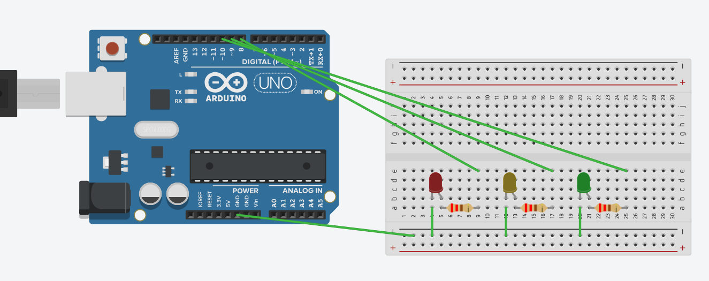
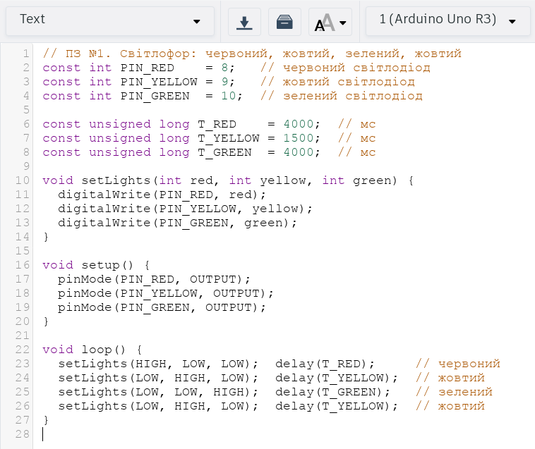
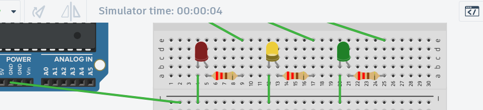
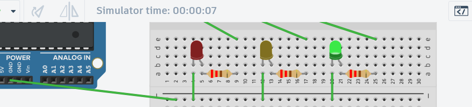

# Мета роботи

Опанувати підключення світлодіода до цифрового виходу плати Arduino UNO через струмообмежувальний резистор і керування ним зі скетча; зібрати та перевірити в симуляторі схему світлофора з трьох світлодіодів.

# Завдання

Зібрати схему світлофора на основі плати Arduino UNO з червоним, жовтим і зеленим світлодіодами. Кожен світлодіод підключається до окремого цифрового виходу, номери виходів у схемі збігаються з номерами в програмі. Послідовність вмикання: червоний, жовтий, зелений, жовтий, далі цикл повторюється. Тривалість станів задається через `delay`. Варіантів завдання немає.

Симулятор: Tinkercad Circuits (плата Arduino Uno R3, мала макетна плата).

# Теоретичні відомості

Цифровий вихід Arduino UNO (ATmega328P) видає рівень `HIGH` (близько 5 В) або `LOW` (0 В). Режим виводу задається викликом `pinMode(пін, OUTPUT)`, рівень викликом `digitalWrite(пін, рівень)`, пауза викликом `delay(мс)`.

Світлодіод пропускає струм лише від анода до катода й має малий власний опір, тому послідовно з ним ставлять резистор. Для червоного світлодіода падіння напруги близько 2 В, робочий струм 10–20 мА, тож $R = (5 - 2)/0{,}015 = 200$ Ом; обрано стандартний номінал **220 Ом**. На макетній платі п'ять отворів колонки (a–e або f–j) з'єднані між собою, а дві половини плати розділені проміжком, тому компоненти одного ланцюга ставлять в одну колонку.

# Хід виконання роботи

1. У новому колі Tinkercad Circuits додано Arduino Uno R3, Breadboard Small, три світлодіоди (Red, Yellow, Green) і три резистори по 220 Ω.
2. Компоненти розміщено на нижній половині макетки: світлодіод у двох сусідніх колонках (катод у колонці *N*, анод у *N*+1), резистор у рядку a від колонки анода на чотири колонки правіше.
3. Проведено дроти: від цифрового виходу до вільної ніжки резистора, від колонки катода до шини «−» і від GND Arduino до тієї самої шини.
4. У панелі Code вибрано режим Text і вставлено скетч `sketch.ino`; запущено симуляцію (Start Simulation) і записано відео.

Таблиця з'єднань:

| Світлодіод | Пін Arduino | Резистор | Анод (колонка) | Катод (колонка) |
|---|---|---|---|---|
| Червоний | D8 | R1 = 220 Ом, колонки 5–9 | 5 | 4, далі на шину «−» |
| Жовтий | D9 | R2 = 220 Ом, колонки 13–17 | 13 | 12, далі на шину «−» |
| Зелений | D10 | R3 = 220 Ом, колонки 21–25 | 21 | 20, далі на шину «−» |

Дріт від виходу (D8, D9, D10) закінчується в колонці вільного кінця резистора (9, 17, 25). Шина «−» макетки з'єднана дротом із GND плати.

{width=85%}

# Скетч

Піни 8, 9, 10 задано константами `PIN_RED`, `PIN_YELLOW`, `PIN_GREEN`, тривалості (4000, 1500, 4000 мс) константами `T_RED`, `T_YELLOW`, `T_GREEN`. Функція `setLights` задає стан усіх трьох виходів одним викликом, тому одночасно світиться лише один світлодіод. У `loop()` по черзі: червоний, жовтий, зелений, жовтий, кожен стан з `delay`. Повний текст у `sketch.ino`, нижче знімок редактора:

{width=70%}

# Результати симуляції

Відео роботи схеми: `simulation.mp4` (25 с, понад півтора цикли світлофора). Кадри з відео в чотирьох станах циклу (зверху на кадрі видно лічильник часу симулятора):

| Стан | Світить | Час симулятора | Тривалість за скетчем |
|---|---|---|---|
| 1 | червоний (D8) | 00:00:01 | 4 с |
| 2 | жовтий (D9) | 00:00:04 | 1,5 с |
| 3 | зелений (D10) | 00:00:07 | 4 с |
| 4 | жовтий (D9) | 00:00:10 | 1,5 с |

| | |
|:---:|:---:|
| {width=7cm} | {width=7cm} |
| Стан 1: світить червоний | Стан 2: світить жовтий |
| {width=7cm} | {width=7cm} |
| Стан 3: світить зелений | Стан 4: світить жовтий |

Покадровий аналіз відео (колір світлодіодів у кожному кадрі) показав послідовність червоний, жовтий, зелений, жовтий, червоний, жовтий, зелений; одночасно світиться один світлодіод, окрім коротких (до 0,5 с) кадрів переходу, коли яскравість одного діода спадає, а наступного зростає. Тривалість станів у відео трохи більша за задану в скетчі: симулятор працював повільніше за реальний час (за лічильником симулятора 9 с пройшло приблизно за 11 с відео), а відео записано зі швидкістю близько 11 кадрів/с. За лічильником симулятора переходи відбуваються на 4, 5,5, 9,5 і 11 с, що відповідає значенням 4000, 1500, 4000, 1500 мс у скетчі.

| Перевірка | Результат |
|---|---|
| Кожен світлодіод на окремому піні, номери в схемі й скетчі збігаються (8, 9, 10) | виконано |
| Послідовність червоний, жовтий, зелений, жовтий, повтор | виконано |
| Тривалості станів відповідають `delay` | виконано (за часом симулятора) |
| Резистори, дроти, GND присутні | виконано |

# Висновки

Зібрано й перевірено в симуляторі схему світлофора на Arduino UNO: три світлодіоди підключено до цифрових виходів D8, D9, D10 через резистори 220 Ом, катоди виведено на шину «−», яка з'єднана з GND. Опановано розрахунок струмообмежувального резистора, роботу з `pinMode`, `digitalWrite` і `delay` та правила з'єднання отворів макетної плати. Номери пінів у схемі й скетчі збігаються. Покадровий аналіз відео підтвердив послідовність червоний, жовтий, зелений, жовтий і тривалості станів за часом симулятора. Тривалості легко змінюються константами `T_RED`, `T_YELLOW`, `T_GREEN`.
