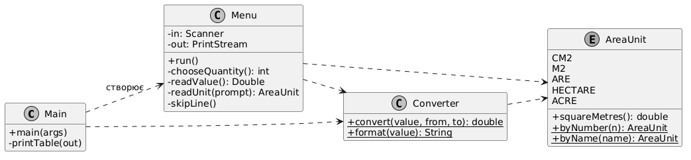
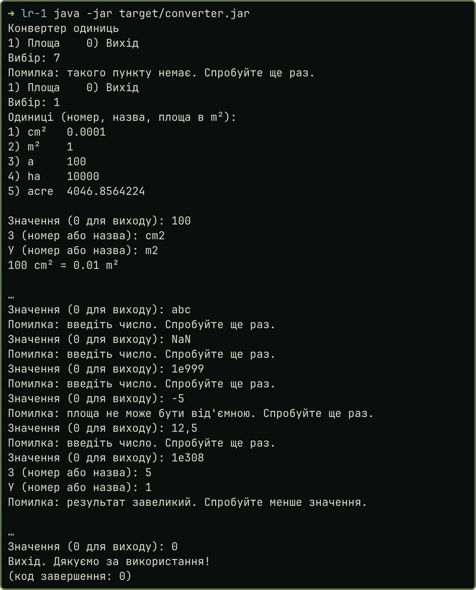

# 1. Мета й завдання за варіантом

Розробити консольний конвертер із валідацією введення без винятків і запакувати його у fat-jar, який запускається командою `java -jar` на машині без середовища розробки.

Номер у журналі 12, варіант (12 − 1) mod 6 + 1 = 6: площа, одиниці cm², m², a (ар), ha, acre. Потрібні меню з циклом до команди виходу, конвертація в усіх напрямках, кодування UTF-8 і журнал інцидентів. Проєкт зібрано Maven 3.9 на JDK 21 у docker-образі `maven:3.9-eclipse-temurin-21`, IntelliJ IDEA не використовувалась.

# 2. Ключові фрагменти коду

{width=100%}

Кожна одиниця знає свій коефіцієнт до m². Акр міжнародний: 43560 квадратних футів по 0,3048 м, що точно дорівнює 4046,8564224 m².

```java
public enum AreaUnit {
    CM2("cm²", "cm2", 0.0001),
    M2("m²", "m2", 1.0),
    ARE("a", "a", 100.0),
    HECTARE("ha", "ha", 10_000.0),
    ACRE("acre", "acre", 4046.8564224);
```

Конвертація йде через базову одиницю, тому на п'ять одиниць потрібно п'ять коефіцієнтів, а не двадцять окремих формул:

```java
public static double convert(double value, AreaUnit from, AreaUnit to) {
    return value * from.squareMetres() / to.squareMetres();
}
```

Читання значення. Спершу `hasNext` (чи не закінчилось введення), потім `hasNextDouble`. Метод `hasNextDouble` приймає `NaN`, `Infinity` і `1e999`, тому скінченність перевіряється окремо:

```java
private Double readValue() {
    while (true) {
        out.print("Значення (0 для виходу): ");
        if (!in.hasNext()) {
            return null;
        }
        if (!in.hasNextDouble()) {
            skipLine();
            out.println(NOT_A_NUMBER);
            continue;
        }
        double value = in.nextDouble();
        if (!Double.isFinite(value)) {
            out.println(NOT_A_NUMBER);
        } else if (value < 0) {
            out.println(
                "Помилка: площа не може бути від'ємною. Спробуйте ще раз.");
        } else {
            return value;
        }
    }
}
```

Кодування задано явно для обох напрямків, а `Locale.ROOT` робить роздільником дробової частини крапку незалежно від налаштувань системи:

```java
PrintStream out = new PrintStream(System.out, true, StandardCharsets.UTF_8);
Scanner in = new Scanner(System.in, StandardCharsets.UTF_8)
        .useLocale(Locale.ROOT);
```

# 3. Прийняті рішення

Меню. У варіанті одна величина, тому головне меню має пункти «1) Площа» і «0) Вихід». Далі програма в циклі просить значення й дві одиниці. Одиницю можна вказати номером або назвою (`cm2`, `cm²`, `ha`). Значення 0 завершує роботу, як у прикладі з методички.

Валідація без винятків. У коді немає `try` і `catch`, це перевірено пошуком. Кожне читання стоїть за перевіркою `hasNextInt`, `hasNextDouble` або `hasNext`. Хибне значення відкидається, програма друкує повідомлення й повторює запит. Результат теж перевіряється: `1e308 acre` у cm² виходить за межі `double`, і замість `Infinity` користувач бачить повідомлення. Рядок `12,5` відхиляється. Рядок `1,000` `Scanner` читає як 1000, бо в `Locale.ROOT` кома розділяє тисячі; я залишив цю поведінку стандартною.

Пакування. Плагін `maven-shade-plugin` 3.5.1 копіює класи залежностей у один JAR, а `ManifestResourceTransformer` записує `Main-Class`. Щоб fat-jar мав що вміщувати, додано справжню залежність `commons-lang3`: `StringUtils.rightPad` вирівнює таблиці.

# 4. Результати

Тести JUnit 5 перевіряють 20 напрямків за еталоном, порахованим окремо точними дробами (`verify/reference.py`), відомі значення, пошук одиниць і поведінку меню:

```text
> mvn test
[INFO] Tests run: 24, Failures: 0, Errors: 0, Skipped: 0
[INFO] BUILD SUCCESS
```

Усі напрямки: скільки одиниць стовпця в одній одиниці рядка (`E-8` означає множник 10 у степені −8).

```{.text .small}
> java -jar target/converter.jar --table
од.   cm²            m²             a              ha             acre
cm²   1              0.0001         0.000001       1E-8           2.47105381467E-8
m²    10000          1              0.01           0.0001         0.000247105381467
a     1000000        100            1              0.01           0.0247105381467
ha    100000000      10000          100            1              2.47105381467
acre  40468564.224   4046.8564224   40.468564224   0.40468564224  1
```

Сеанс роботи (пропуски позначено «…»). Некоректне введення не дає стектрейсу, кирилиця читабельна:

{width=68%}

Автономність. У fat-jar є 413 записів `commons-lang3` і `Main-Class`. Файл запущено в образі `eclipse-temurin:21-jre`, де є лише JRE і цей JAR, без Maven і його кешу:

```{.text .small}
> unzip -p target/converter.jar META-INF/MANIFEST.MF
Main-Class: ua.duikt.lavrishko.converter.Main
> unzip -l target/converter.jar | grep -c org/apache/commons/lang3/
413
> unzip -l target/original-converter.jar | grep -c org/apache/commons/lang3/
0
> docker run --rm -v target/converter.jar:/app/converter.jar:ro eclipse-temurin:21-jre java -jar /app/converter.jar --table   (лише JRE і один файл)
acre  40468564.224   4046.8564224   40.468564224   0.40468564224  1
(код завершення: 0)
```

# 5. Журнал інцидентів

Усі записи взято зі справжніх запусків, вивід лежить у `results/incidents.txt` і `results/incident_double_error.txt`.

| № | Проблема і вивід | Причина | Як усунуто |
|---|------------|---------|---------|
| 1 | `Error: Unable to access jarfile target/converter.jar` | у фрагменті `pom.xml` з методички немає `finalName`, артефакт отримав назву `converter-1.0.jar` | додано `<finalName>converter</finalName>` |
| 2 | `no main manifest attribute, in target/original-converter-1.0.jar` | це звичайний JAR до обробки плагіном, запису `Main-Class` у ньому немає | запускати треба результат shade: `target/converter.jar` |
| 3 | `NoClassDefFoundError: org/apache/commons/lang3/StringUtils` під час запуску `original-converter.jar` через `-cp` | у звичайному JAR немає класів залежності | fat-jar містить їх усередині |
| 4 | кирилиця як `?????. ??????? ?? ????????????!` у контрприкладі `verify/PlainOut.java` з `-Dstdout.encoding=US-ASCII` | `System.out` кодує текст кодуванням системи | `PrintStream` і `Scanner` з UTF-8; з тим самим параметром конвертер друкує `cm²` правильно |
| 5 | у контейнері програма одразу завершилась після меню, без помилки | `docker run` без `-i` не передає stdin, тож програма побачила кінець введення | запуск із `-i` (`-it` для сеансу); кінець введення програма обробляє без винятку |
| 6 | на одне `abc` два повідомлення про помилку | `nextLine` після `nextInt` прочитав лише кінець попереднього рядка, а `abc` лишився в буфері | спочатку `next`, потім `nextLine`; додано тест `MenuTest` |
| 7 | у корені проєкту з'явився `dependency-reduced-pom.xml` | так типово робить shade-плагін | `createDependencyReducedPom=false` |

Під час збірки shade попереджає про `META-INF/MANIFEST.MF`, який є в обох JAR. Це не помилка: у результат потрапляє один маніфест, і `Main-Class` у ньому є.

# 6. Висновки

Я створив конвертер площі для варіанта 6 на Maven і JDK 21 з меню, циклом до виходу та вибором одиниць за номером або назвою. Конвертація через m² дала правильний результат для всіх 20 напрямків, що підтвердили 24 тести з незалежним еталоном. Валідація працює на `hasNextInt` і `hasNextDouble` без `try-catch`, а `NaN`, `1e999`, від'ємні значення й переповнення результату дають повідомлення без стектрейсу. Плагін `maven-shade-plugin` зібрав автономний JAR, який запустився в образі лише з JRE. Явне UTF-8 для введення й виведення прибрало залежність від кодування системи. Журнал інцидентів показав різницю між звичайним JAR і fat-jar, а також роль запису `Main-Class`. Окремо я знайшов дефект із подвійним повідомленням і закрив його тестом.

# 7. Посилання на репозиторій

<https://github.com/brizzinck/krinzhrepoduta/tree/main/java/lr-1>
