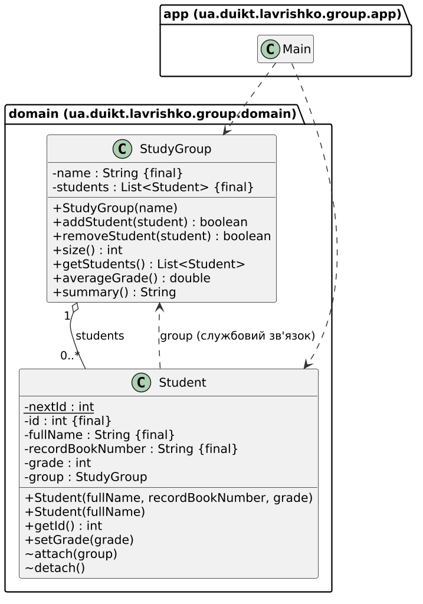

<style>
pre, pre code { overflow: visible !important; overflow-wrap: anywhere !important; }
</style>


# 1. Мета роботи

Спроєктувати класи предметної області так, щоб зовнішній код не міг привести їх у некоректний стан, і обґрунтувати вибір засобів мови (інкапсуляція, рівні доступу, конструктори, `final`, `static`).

# 2. Завдання за варіантом

Номер у списку групи 12, варіант 2: **навчальна група й студент**, підсумок **середній бал**. Класи домену в пакеті `ua.duikt.lavrishko.group.domain` (`Student`, `StudyGroup`), `Main` у `ua.duikt.lavrishko.group.app`. Вимоги: (1) середній бал завжди узгоджений із набором студентів; (2) унікальний номер, що не змінюється; (3) частина даних `final`, інша змінюється контрольовано; (4) некоректні дані не потрапляють у групу; (5) ззовні не можна змінити внутрішній набір і не можна користуватися службовими операціями узгодження; (6) студента можна створити повним і скороченим способом. Maven, Java 21, без залежностей.

# 3. Модель і основні фрагменти

Група володіє списком студентів, студент знає свою групу, але змінювати зв'язок може лише код пакета `domain`.

{width=70%}

**`Student`.** Незмінні дані (`id`, `fullName`, `recordBookNumber`) оголошено `private final` і задано лише в конструкторі; `grade` змінюється через `setGrade` із перевіркою. Лічильник `nextId` `static`, бо спільний для всіх студентів. Службові `attach`/`detach` без модифікатора доступу видимі лише в пакеті `domain`.

```java
    private static int nextId = 1;

    private final int id;
    private final String fullName;
    private final String recordBookNumber;
    private int grade;
    private StudyGroup group;

    /** Повний конструктор: усі дані задаються одразу, некоректні відхиляються. */
    public Student(String fullName, String recordBookNumber, int grade) {
        this.fullName = requireText(fullName, "ПІБ");
        this.recordBookNumber = requireText(recordBookNumber, "номер залікової книжки");
        this.grade = requireGrade(grade);
        // номер присвоюється останнім: відхилений студент не витрачає номер
        this.id = nextId++;
    }

    /** Скорочений конструктор: решта даних отримує типові значення. */
    public Student(String fullName) {
        this(fullName, DEFAULT_RECORD_BOOK, DEFAULT_GRADE);
    }

    public void setGrade(int grade) {
        this.grade = requireGrade(grade);
    }

    void attach(StudyGroup group) { /* перевірка, що студент ще не в групі, і this.group = group */ }
    void detach() { this.group = null; }
```

**`StudyGroup`.** Список `private final`, назовні віддається лише незмінна копія; середній бал не зберігається, а обчислюється щоразу:

```java
    private final List<Student> students = new ArrayList<>();

    public boolean addStudent(Student student) {
        Objects.requireNonNull(student, "student");
        if (student.isInGroup()) {
            return false;
        }
        students.add(student);
        student.attach(this);
        return true;
    }

    /** Незмінна копія списку: змінити склад групи через неї неможливо. */
    public List<Student> getStudents() {
        return List.copyOf(students);
    }

    public double averageGrade() {
        if (students.isEmpty()) {
            return 0.0;
        }
        int sum = 0;
        for (Student student : students) {
            sum += student.getGrade();
        }
        return (double) sum / students.size();
    }
```

Прийнято: шкала оцінок 0..100 (методичка її не задає), порожня група має середній бал 0.0, студент належить не більш як одній групі, скорочений конструктор дає оцінку 0 і книжку «не вказано».

# 4. Обґрунтування засобів мови

| Вимога | Засіб мови | Чому саме так |
|------------|----------------|--------------------|
| 1. Підсумок узгоджений із набором | `averageGrade()` рахує за елементами щоразу, окремого поля немає | немає другої копії даних, яка могла б розійтися з набором |
| 2. Унікальний номер | `private static int nextId`, `private final int id`, без сеттера | `static` дає спільний лічильник, `final` забороняє змінити номер, `private` закриває лічильник |
| 3. Незмінне й змінне | `private final` для ПІБ і книжки; `private int grade` із `setGrade` | незмінне гарантує компілятор; змінне доступне лише через метод із перевіркою |
| 4. Некоректні дані | перевірка в конструкторі й `setGrade`, `IllegalArgumentException`, `Objects.requireNonNull` | об'єкт із хибними даними не створюється, тож у групу не потрапить |
| 5а. Набір недоступний ззовні | `private final List`, `getStudents()` повертає `List.copyOf` | копія незмінна: зміна дає `UnsupportedOperationException` |
| 5б. Службові операції недоступні | `attach`/`detach` package-private | поза пакетом `domain` невидимі, `app` користується лише публічним API |
| 6. Два способи створення | конструктор із трьома параметрами й лише з ПІБ через `this(...)` | типові значення в одному місці, перевірка не дублюється |

# 5. Результати запуску

Вивід `Main` (скорочено, повний у `results/lr2_run.txt`): підсумок і перелік, спроби порушити стан через публічний API, контрольована зміна, видалення, номери.

```
> java -cp target/classes ua.duikt.lavrishko.group.app.Main
Група й студенти:
Група ТЦР-32, студентів: 4, середній бал: 62.50
 + #1 Іваненко Іван      зал. книжка KB-001       оцінка  85
 …
 + #4 Мельник Марія      зал. книжка не вказано   оцінка   0
Спроба змінити перелік студентів через getStudents():
add(...) дав UnsupportedOperationException, група не змінилась
clear() дав UnsupportedOperationException, група не змінилась
Спроба створити студента з некоректними даними:
оцінка 105 відхилено: оцінка 105 поза межами 0..100
порожнє ім'я відхилено: ПІБ не може бути порожнім
Спроба змінити оцінку на некоректну:
setGrade(105) відхилено: оцінка 105 поза межами 0..100
оцінка лишилась 70 (була 70); Група ТЦР-32, студентів: 4, середній бал: 62.50
Спроба додати студента, який уже в групі:
addStudent повернув false, студентів: 4
Контрольована зміна оцінки:
Мельник Марія: оцінка була 0, стала 80
Група ТЦР-32, студентів: 4, середній бал: 82.50
Видалення студента:
Група ТЦР-32, студентів: 3, середній бал: 86.67
Номери студентів:
Іваненко Іван: 1
…
Останній Студент: 7 (відхилені студенти номерів не витратили)
```

Середній бал (85 + 70 + 95 + 0) / 4 = 62.50 після зміни оцінки стає 82.50, після видалення студента 86.67: підсумок завжди відповідає набору. Номери 5 і 6 забрали допоміжні студенти зі спроб зміни переліку, а відхилені спроби номерів не витратили.

Спроби порушити стан напряму не компілюються (фрагменти в `compile-errors/E1..E4`, повний вивід у `results/E*.txt`):

```
> javac … compile-errors/E3_internal_list/*.java      // group.students.add(...)
TamperList.java:12: error: students has private access in StudyGroup
> javac … compile-errors/E2_service_op/*.java         // student.attach(group)
CallService.java:11: error: attach(StudyGroup) is not public in Student; cannot be accessed from outside package
> javac … compile-errors/E1_id_access/*.java          // student.id = 99
TamperId.java:9: error: id has private access in Student
> javac … compile-errors/E4_final_assign/*.java       // this.fullName = newName (у методі класу з final-полем)
FinalData.java:13: error: cannot assign a value to final variable fullName
```

Робочий код проєкту компілюється без помилок (`results/compile_ok.txt`).

# 6. Висновки

Модель побудовано так, що узгодженість тримається конструкцією класів, а не домовленістю про акуратне використання. Середній бал обчислюється за елементами, тому завжди відповідає набору. Унікальний номер створює статичний лічильник, зберігає приватне `final`-поле, а сеттера немає. Незмінні дані задаються лише в конструкторі, змінна оцінка проходить перевірку в `setGrade`, тож некоректний студент не створюється й не потрапляє в групу. Внутрішній список приватний, `getStudents()` віддає `List.copyOf`, а `attach` і `detach` package-private. Спроби обійти захист або дали `UnsupportedOperationException`, або не компілюються. Два конструктори (через `this(...)`) дають повний і скорочений спосіб створення без дублювання перевірок.

# 7. Посилання на репозиторій

<https://github.com/brizzinck/krinzhrepoduta/tree/main/java/lr-2>
