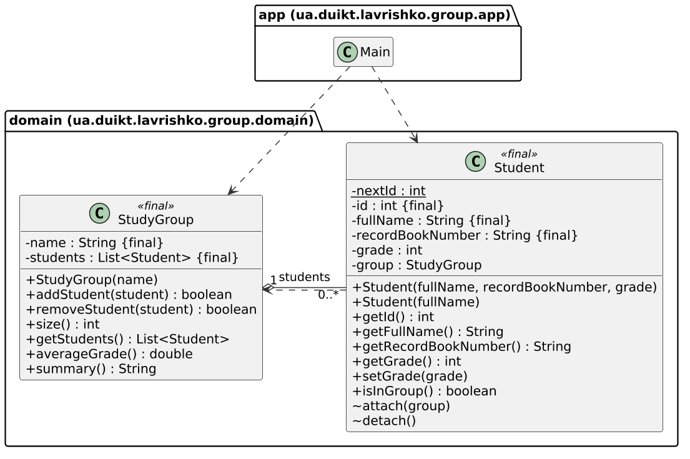

# 1. Мета роботи

Спроєктувати класи предметної області так, щоб зовнішній код не міг привести їх у некоректний стан, і обґрунтувати вибір засобів мови (інкапсуляція, рівні доступу, конструктори, `final`, `static`).

# 2. Завдання за варіантом

Номер у списку групи 12, варіант 2: **навчальна група й студент**, підсумок **середній бал**. Класи домену в пакеті `ua.duikt.lavrishko.group.domain` (`Student`, `StudyGroup`), `Main` у `ua.duikt.lavrishko.group.app`. Maven, Java 21, без залежностей. Вимоги 1-6 методички й засоби мови для кожної зведено в таблиці 1 (розд. 4).

# 3. Модель і основні фрагменти

Група володіє списком студентів, студент знає свою групу, але змінювати зв'язок може лише код пакета `domain`.

{width=80%}

**`Student`.** Незмінні дані (`id`, `fullName`, `recordBookNumber`) оголошено `private final` і задано лише в конструкторі; `grade` змінюється через `setGrade` із перевіркою. Лічильник `nextId` `static`, бо спільний для всіх студентів. Службові `attach`/`detach` без модифікатора доступу видимі лише в пакеті `domain`. Обидва класи оголошено `final`: інакше підклас із `app` міг би перевизначити `getGrade()` чи `isInGroup()` і обійти перевірки.

```java
private static int nextId = 1;

private final int id;
private final String fullName;
private final String recordBookNumber;
private int grade;
private StudyGroup group;

/** Повний конструктор: некоректні дані відхиляються. */
public Student(String fullName, String recordBookNumber, int grade) {
    this.fullName = requireText(fullName, "ПІБ");
    this.recordBookNumber = requireText(recordBookNumber, "книжка");
    this.grade = requireGrade(grade);
    // номер останнім: відхилений студент його не витрачає
    this.id = nextId++;
}

/** Скорочений конструктор: решта даних типова. */
public Student(String fullName) {
    this(fullName, DEFAULT_RECORD_BOOK, DEFAULT_GRADE);
}

public void setGrade(int grade) {
    this.grade = requireGrade(grade);
}

void attach(StudyGroup group) { /* перевірка й this.group = group */ }
void detach() { this.group = null; }
```

**`StudyGroup`.** Список `private final`, назовні віддається лише незмінна копія; середній бал не зберігається, а обчислюється щоразу:

```java
private final List<Student> students = new ArrayList<>();

public boolean addStudent(Student student) {
    Objects.requireNonNull(student, "student");
    if (student.isInGroup()) {
        return false;
    }
    student.attach(this);
    students.add(student);
    return true;
}

/** Незмінна копія списку: змінити склад групи через неї неможливо. */
public List<Student> getStudents() {
    return List.copyOf(students);
}

public double averageGrade() {
    if (students.isEmpty()) {
        return 0.0;
    }
    int sum = 0;
    for (Student student : students) {
        sum += student.getGrade();
    }
    return (double) sum / students.size();
}
```

Я прийняв такі правила: шкала оцінок 0..100 (методичка її не задає), порожня група має середній бал 0.0, студент належить не більш як одній групі (`attach` викликається до `students.add`, тож при помилці список не міняється), скорочений конструктор дає оцінку 0 і книжку «не вказано».

# 4. Обґрунтування засобів мови

: Таблиця 1 – Вимоги й засоби мови, якими їх досягнуто

| Вимога | Засіб мови | Чому саме так |
|------------|----------------|--------------------|
| 1. Підсумок узгоджений із набором | `averageGrade()` рахує за елементами щоразу, окремого поля немає | немає другої копії даних, яка могла б розійтися з набором |
| 2. Унікальний номер | `private static int nextId`, `private final int id`, без сеттера | `static` дає спільний лічильник, `final` забороняє змінити номер, `private` закриває лічильник |
| 3. Незмінне й змінне | `private final` для ПІБ і книжки; `private int grade` із `setGrade` | незмінне гарантує компілятор; змінне доступне лише через метод із перевіркою |
| 4. Некоректні дані | перевірка в конструкторі й `setGrade`, `IllegalArgumentException`; `addStudent` відкидає `null` (`Objects.requireNonNull`) і повтор (`false`); `final class Student` | об'єкт із хибними даними не створюється, а нащадок не може перевизначити `getGrade()` чи `isInGroup()` |
| 5а. Набір недоступний ззовні | `private final List`, `getStudents()` повертає `List.copyOf` | копія незмінна: зміна дає `UnsupportedOperationException` |
| 5б. Службові операції недоступні | `attach`/`detach` package-private | поза пакетом `domain` невидимі, `app` користується лише публічним API |
| 6. Два способи створення | конструктор із трьома параметрами й лише з ПІБ через `this(...)` | типові значення в одному місці, перевірка не дублюється |

# 5. Результати запуску

Вивід `Main` скорочено, пропуски позначено «…», повний лежить у `results/lr2_run.txt`.

```
> java -cp target/classes ua.duikt.lavrishko.group.app.Main
Група й студенти:
Група ТЦР-32, студентів: 4, середній бал: 62.50
 + #1 Іваненко Іван      зал. книжка KB-001       оцінка  85
 …
 + #4 Мельник Марія      зал. книжка не вказано   оцінка   0
…
Спроба змінити перелік студентів через getStudents():
add(...) дав UnsupportedOperationException, група не змінилась
clear() дав UnsupportedOperationException, група не змінилась
…
копія списку, взята раніше: 4 студентів; група тепер: 5
…
Спроба створити студента з некоректними даними:
оцінка 105 відхилено: оцінка 105 поза межами 0..100
порожнє ім'я відхилено: ПІБ не може бути порожнім
…
Спроба змінити оцінку на некоректну:
setGrade(105) відхилено: оцінка 105 поза межами 0..100
оцінка лишилась 70 (була 70); Група ТЦР-32, студентів: 4, середній бал: 62.50
Спроба додати студента, який уже в групі:
addStudent повернув false, студентів: 4
додати його до іншої групи: false
Контрольована зміна оцінки:
Мельник Марія: оцінка була 0, стала 80
Група ТЦР-32, студентів: 4, середній бал: 82.50
Видалення студента:
Група ТЦР-32, студентів: 3, середній бал: 86.67
…
Номери студентів:
Іваненко Іван: 1
…
Останній Студент: 7 (відхилені студенти номерів не витратили)
```

Середній бал (85 + 70 + 95 + 0) / 4 = 62.50 після зміни оцінки стає 82.50, після видалення студента 86.67: підсумок завжди відповідає набору. Номери 5 і 6 забрали допоміжні студенти зі спроб зміни переліку, а відхилені спроби номерів не витратили.

Спроби порушити стан напряму не компілюються. У `compile-errors/E1..E5` це `group.students.add(...)` (E3), `student.attach(group)` (E2), `student.id = 99` (E1), `this.fullName = newName` у методі класу з `final`-полем (E4) і `class Sneaky extends Student` (E5). Нижче рядок із помилкою, повні повідомлення в `results/E*.txt`:

```
> javac … compile-errors/E3_internal_list/*.java
TamperList.java:12: error: students has private access in StudyGroup
> javac … compile-errors/E2_service_op/*.java
CallService.java:11: error: attach(StudyGroup) is not public in Student; cannot be accessed from outside package
> javac … compile-errors/E1_id_access/*.java
TamperId.java:9: error: id has private access in Student
> javac … compile-errors/E4_final_assign/*.java
FinalData.java:13: error: cannot assign a value to final variable fullName
> javac … compile-errors/E5_subclass/*.java
Sneaky.java:6: error: cannot inherit from final Student
```

Робочий код проєкту компілюється без помилок (`results/compile_ok.txt`).

# 6. Відповіді на контрольні питання

**1. Чому підсумок краще обчислювати за елементами, а не зберігати окремим полем?** Окреме поле є другою копією тих самих даних, і його треба оновлювати при додаванні, видаленні та зміні оцінки. Достатньо забути один випадок, щоб підсумок розійшовся з набором, а обчислення за елементами таку розбіжність виключає. Платою є час на перерахунок, який для невеликих наборів непомітний.

**2. Як захистити внутрішній набір від зміни ззовні?** Поле треба зробити приватним і не віддавати посилання на змінний список. У мене `getStudents()` повертає незмінну копію `List.copyOf`. Склад групи змінюють лише методи `addStudent` і `removeStudent`.

**3. Коли доречно зробити член доступним лише в межах пакета?** Коли операція потрібна кільком класам домену для узгодження між собою, але не має входити в публічний API. У мене так зроблено `attach` і `detach`: група й студент узгоджують зв'язок між собою, а код із пакета `app` їх викликати не може.

**4. Які дані варто зробити final і чому?** Ті, що задаються під час створення й далі не повинні змінюватись: номер, ПІБ, номер залікової книжки, посилання на внутрішній список, а також сам клас `Student` (і `StudyGroup`), щоб нащадок не обійшов перевірки. Незмінність гарантує компілятор, і стан об'єкта простіше відстежувати.

**5. Навіщо класу кілька конструкторів і чим вони відрізняються?** Вони дають створити об'єкт за різних наборів відомих даних. Повний `Student(fullName, recordBookNumber, grade)` задає все, а скорочений `Student(fullName)` лише ім'я, решта береться з типових значень. Скорочений викликає повний через `this(...)`, тому перевірки й присвоєння написані в одному місці.

# 7. Висновки

Середній бал, який рахується щоразу за списком, не розійшовся з набором: 62.50, після зміни оцінки 82.50, після видалення 86.67. Номер студент отримує лише після всіх перевірок у конструкторі, тому відхилені спроби номерів не витратили. Я перевірив, що `List.copyOf` у `getStudents()` дає незмінну копію: `add` і `clear` через неї кидають `UnsupportedOperationException`, а копія, взята раніше, не бачить п'ятого студента. Перевірка `isInGroup()` в `addStudent` не дала додати студента до другої групи (`attach` додатково кидає `IllegalStateException`). Звернення до приватних полів і package-private `attach` з пакета `app` не компілюються, так само як і спроба успадкуватися від `final`-класу `Student`. Робота показала різницю між станом класу (`static`, лічильник номерів) і станом окремого студента, а також те, що `final` стосується і класу, якщо від нього не мають успадковуватись.

# 8. Посилання на репозиторій

<https://github.com/brizzinck/krinzhrepoduta/tree/main/java/lr-2>
