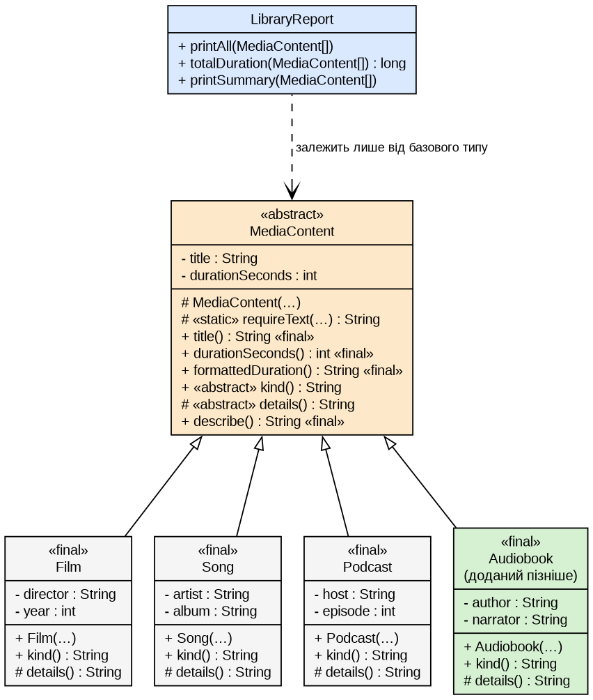

# 1. Мета роботи

Спроєктувати ієрархію класів з поліморфною обробкою об'єктів через базовий тип і застосувати принцип підстановки Лісков (LSP).

# 2. Завдання за варіантом

Мій номер у списку групи 12, тому я виконую варіант 2. Базовий тип **Медіаконтент** (`MediaContent`), різновиди Фільм, Пісня, Подкаст, спільна операція: тривалість і опис. Об'єкти зберігаються в масиві базового типу, обробляються поліморфно, а додавання різновиду не змінює код обробки.

# 3. Теоретичні відомості

LSP: об'єкти похідного класу можна використовувати там, де очікується базовий, без порушення правильності програми. Похідний клас не посилює передумов, не послаблює постумов, зберігає інваріанти й не кидає нових винятків. Ознака порушення: `instanceof` і приведення типів у клієнтському коді.

# 4. Хід виконання роботи

{width=55%}

## 4.1. Розподіл відповідальності

Базовий абстрактний `MediaContent` містить спільні дані (`title`, `durationSeconds`), перевірку інваріантів, `formattedDuration()` і фінальний `describe()`. Різновиди (`Film`, `Song`, `Podcast`) додають власні поля й перевизначають лише `kind()` та `details()`; базову частину ініціалізують через `super(...)`. Тобто змінна частина спільної операції `describe()` (вид і подробиці) перевизначається в кожному різновиді, а сам каркас `final`, щоб нащадок не порушив формат (див. розд. 4.3). Класи різновидів теж `final`: від них не можна успадкуватися й підмінити `kind()` чи `details()`. `LibraryReport` бачить тільки `MediaContent[]`, конкретні класи відомі лише в `Main`.

```java
public abstract class MediaContent {
    private final String title;
    private final int durationSeconds;

    protected MediaContent(String title, int durationSeconds) {
        this.title = requireText(title, "назва");
        if (durationSeconds <= 0) {
            throw new IllegalArgumentException("тривалість має бути більшою за 0, отримано " + durationSeconds);
        }
        this.durationSeconds = durationSeconds;
    }
    public abstract String kind();
    protected abstract String details();
    public final String describe() {                    // спільна операція
        return kind() + " «" + title + "», " + formattedDuration() + ". " + details();
    }
}

public final class Film extends MediaContent {
    public Film(String title, int durationSeconds, String director, int year) {
        super(title, durationSeconds);                  // базова частина
        this.director = requireText(director, "режисер");
        if (year < MIN_YEAR || year > MAX_YEAR) {       // 1888..2100
            throw new IllegalArgumentException("рік виходу " + year + " поза межами…");
        }
        this.year = year;
    }
    @Override public String kind() { return "Фільм"; }
    @Override protected String details() { return "Режисер: " + director + ", " + year + " р."; }
}
```

`Song`, `Podcast` і `Audiobook` побудовано так само; `Podcast` додатково відхиляє номер випуску, що не більший за 0. Обробка масиву не розрізняє різновиди:

```java
public void printAll(MediaContent[] library) {
    for (MediaContent item : library) { System.out.println(item.describe()); }
}
```

## 4.2. Поліморфна обробка та додавання різновиду

```text
> javac -d target/stage1 snapshots/stage1_three_kinds/…/*.java && java -cp target/stage1 ua.duikt.lavrishko.media.Main
…
Фільм «Довга дорога додому», 02:16:00. Режисер: Андрій Мельник, 2019 р.
Пісня «Тихий вечір», 00:03:34. Виконавець: Гурт «Береги», альбом: Світанок.
Подкаст «Код і кава», 00:45:45. Ведучий: Олена Ковальчук, випуск № 12.
Елементів: 3, загальна тривалість: 03:05:19
…
```

Вивід вище належить етапу 1 (три різновиди): я скомпілював код зі `snapshots/stage1_three_kinds` окремо від проєкту. Один виклик `describe()` дає різний результат залежно від різновиду. Потім я додав `Audiobook` і порівняв стан етапу 1 із поточним:

```text
> diff -rq snapshots/stage1_three_kinds src/main/java
Only in src/main/java/ua/duikt/lavrishko/media: Audiobook.java
Files snapshots/…/media/Main.java and src/main/java/…/media/Main.java differ

> sha256sum snapshots/…/LibraryReport.java src/main/java/…/LibraryReport.java
dd41e3a551f359efbe675e8f3aa7b405bf48bdb1d9002b3dad38338d9c293aad  snapshots/…/LibraryReport.java
dd41e3a551f359efbe675e8f3aa7b405bf48bdb1d9002b3dad38338d9c293aad  src/main/java/…/LibraryReport.java
```

Змінилися лише `Main` (9 доданих рядків, масив із чотирьох елементів) і з'явився `Audiobook.java`; `LibraryReport.java` і `MediaContent.java` ідентичні. Нижче вивід етапу 2 (додано `Audiobook`): той самий `LibraryReport` обробляє чотири різновиди.

```text
> java -cp target/classes ua.duikt.lavrishko.media.Main
…
Бібліотека з новим різновидом (Audiobook):
…
Аудіокнига «Вечори на хуторі», 05:43:00. Автор: Микола Гоголь, читає: Ігор Савчук.
Елементів: 4, загальна тривалість: 08:48:19
…
```

<div style="break-inside: avoid">

Пошук `instanceof` і приведень по коду етапу 2:

```text
> grep -rnE 'instanceof|getClass\(\)|\((Film|Song|Podcast|Audiobook)\) *[a-z]' src/main/java
(код завершення: 1)
```

</div>

`grep` по коду етапу 2 не знаходить ні `instanceof`, ні приведень до різновидів (код 1 означає «збігів немає»).

## 4.3. Захист угоди базового типу

Спроби порушити угоду базового типу не компілюються. У `compile-errors/E1_override_final` новий різновид `BadMedia` перевизначає `describe()`, у `E4_extends_final` клас `BadFilm` успадковується від `Film`:

```text
> javac -encoding UTF-8 -cp target/classes compile-errors/E1_override_final/*.java
BadMedia.java:20: error: describe() in BadMedia cannot override describe() in MediaContent
…
  overridden method is final

> javac -encoding UTF-8 -cp target/classes compile-errors/E4_extends_final/*.java
BadFilm.java:4: error: cannot inherit from final Film
```

`final` на `describe()` фіксує формат опису, а `final` на класах різновидів не дає підмінити їхні `kind()` і `details()`. Некоректні дані відхиляє конструктор до створення об'єкта (`IllegalArgumentException`): порожня назва, тривалість 0, рік виходу поза 1888..2100, номер випуску 0 (рядки «Відхилено: …» у `results/stage2_run.txt`).

# 5. Обґрунтування підстановки (LSP)

Контракт `MediaContent`: методи без параметрів (передумов до аргументів немає); `describe()` завжди повертає непорожній рядок із видом, назвою й тривалістю; інваріанти (назва не порожня, тривалість більша за 0) перевіряє конструктор, поля `private final`; винятків методи не кидають. Різновиди `final`, а `describe()`, `title()` і `durationSeconds()` у базовому класі `final`, тому підмінити можна лише `kind()` і `details()`. Умови LSP для кожного різновиду зведено в таблиці 1.

<div class="page-break"></div>

: Таблиця 1 – Перевірка умов LSP для кожного різновиду

| Різновид | Передумови не посилено | Постумови не послаблено | Інваріанти збережено | Нових винятків немає |
|---|---|---|---|---|
| Фільм | нових параметрів у методах немає | `kind()` дає «Фільм», `details()` режисера й рік | `director` непорожній, `year` 1888..2100 | `kind()` і `details()` лише складають рядок |
| Пісня | нових параметрів у методах немає | `kind()` дає «Пісня», `details()` виконавця й альбом | `artist` і `album` непорожні | `kind()` і `details()` лише складають рядок |
| Подкаст | нових параметрів у методах немає | `kind()` дає «Подкаст», `details()` ведучого й випуск | `host` непорожній, `episode` більший за 0 | `kind()` і `details()` лише складають рядок |
| Аудіокнига | нових параметрів у методах немає | `kind()` дає «Аудіокнига», `details()` автора й диктора | `author` і `narrator` непорожні | `kind()` і `details()` лише складають рядок |

Код, написаний для `MediaContent`, тому однаково працює з кожним різновидом і бачить різницю лише в тексті опису. У коді обробки немає `instanceof`, а всі чотири різновиди пройшли через один і той самий `LibraryReport`.

# 6. Відповіді на контрольні питання

**1. Що дає обробка через базовий тип замість перевірки конкретного типу?** Один код працює з усіма різновидами й не розгалужується за конкретним класом. У мене `LibraryReport` бачить лише `MediaContent[]` і викликає `describe()`, а `grep` не знаходить у коді ні `instanceof`, ні приведень до різновидів.

**2. Як побудувати ієрархію, щоб новий різновид не змінював клієнтський код?** Клієнтський код має залежати лише від базового типу, а відмінності ховатися у віртуальних методах різновидів. Коли я додав `Audiobook`, змінився тільки `Main`, де створюються об'єкти, а хеш `LibraryReport.java` лишився тим самим.

**3. Що означає принцип підстановки і як перевірити, що різновид його не порушує?** Об'єкт похідного класу можна використати замість базового, і програма лишається правильною. Я перевіряю контракт: передумови не посилено, постумови не послаблено, інваріанти збережено, нових винятків методи не кидають. Ще одна ознака: у клієнтському коді немає `instanceof`.

**4. Що винести в базовий клас, а що лишити в похідних, і чому?** У базовий клас виносять спільні дані й поведінку, щоб не дублювати їх: у `MediaContent` це `title`, `durationSeconds`, перевірка інваріантів, `formattedDuration()` і `describe()`. У похідних лишається те, що справді відрізняється: власні поля, `kind()` і `details()`.

# 7. Висновки

Спільні дані (назва, тривалість) і спільну поведінку (форматування, склад опису) винесено в абстрактний базовий клас, а різновиди додають власні поля й реалізують `kind()` та `details()`. Базова частина ініціалізується викликом `super`. Клієнтський код працює з `MediaContent[]` і не містить перевірок типів. Після того як я додав `Audiobook`, `diff -rq` показав лише змінений `Main` і новий файл, а хеш `LibraryReport.java` до і після збігся. Для кожного різновиду перевірено чотири умови LSP, а `final` на `describe()` і на класах різновидів захищає спільну угоду від зміни в нащадках (`E1`, `E4`).

# 8. Посилання на репозиторій

<https://github.com/brizzinck/krinzhrepoduta/tree/main/java/lr-3>
