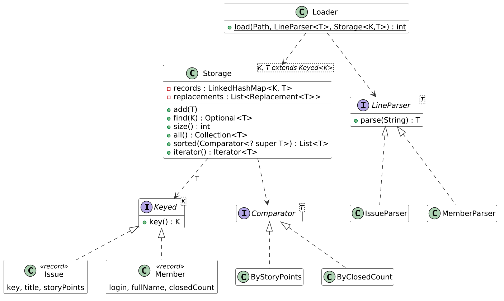

<style>
pre, pre code { overflow: visible !important; overflow-wrap: anywhere !important; }
</style>

# 1. Мета роботи

Спроєктувати узагальнене сховище записів, яке шукає за ключем без перебору, не дублює записи, видає їх відсортованими за різними критеріями і не дає змінити свій вміст ззовні.

# 2. Завдання за варіантом

Номер у списку групи 12, варіант 2 (12 mod 5): трекер задач. Файли `v2_issues.txt` (`ключ;назва;story_points`) і `v2_members.txt` (`логін;ПІБ;закрито_задач`), по 40 рядків даних. Ключі: ключ задачі та логін. Критерії сортування: story points і кількість закритих задач. Maven, Java 21, без залежностей, без лямбд і Stream API. Файли UTF-8, перший рядок заголовок, поля розділені крапкою з комою.

# 3. Структура сховища

Одне сховище `Storage<K, T extends Keyed<K>>` обслуговує обидва типи записів. Інтерфейс `Keyed<K>` має один метод `key()`, його реалізують записи `Issue` і `Member` (Java record). Рядки перетворюють `IssueParser` і `MemberParser` через спільний інтерфейс `LineParser<T>`, а `Loader.load` читає файл і кладе записи у сховище. Критерії сортування лежать в окремих класах `ByStoryPoints` і `ByClosedCount`.

{width=68%}

Клієнтський код (`Main`) не має приведень типу: `Storage<String, Issue>` повертає `Issue`, `Storage<String, Member>` повертає `Member` (`grep -rnE '\((Issue|Member)\)' src` порожній, `results/check.txt`).

# 4. Колекція всередині й повтор ключа

Записи лежать у `LinkedHashMap<K, T>`. `HashMap` шукає за ключем за O(1), без перебору, і не тримає двох записів з одним ключем. Саме `LinkedHashMap`, бо зберігає порядок файлу: обхід і повтори передбачувані. `TreeMap` дав би O(log n) без вигоди, а список із лінійним пошуком суперечить вимозі.

Повтор ключа: лишається пізніший рядок. `add` викликає `put`, який замінює старе значення, а заміну сховище запам'ятовує. Пізніший рядок трактуємо як новішу версію запису. Варіант «перший лишається» я відкинув, бо тоді нове значення мовчки втрачається, а користувач не побачить, що файл містить уточнення.

```java
    public void add(T record) {
        T previous = records.put(record.key(), record);
        if (previous != null) {
            replacements.add(new Replacement<>(previous, record));
        }
    }

    public Optional<T> find(K key) {
        return Optional.ofNullable(records.get(key));
    }
```

`find` повертає `Optional`, тож відсутній ключ не дає `null`. Позиція замінюваного запису в порядку сховища лишається тією, де ключ уперше зустрівся у файлі.

# 5. Сортування й рівні значення критерію

`sorted` робить нову копію значень мапи і сортує її через `List.sort(Comparator)`. Критерій передається зовні, тому клас запису не змінюється. Компаратор порівнює за основним полем, а за рівних значень за ключем, тож порядок визначений однозначно:

```java
public class ByStoryPoints implements Comparator<Issue> {
    @Override
    public int compare(Issue a, Issue b) {
        int byPoints = Integer.compare(a.storyPoints(), b.storyPoints());
        return byPoints != 0 ? byPoints : a.key().compareTo(b.key());
    }
}
```

Якби компаратор порівнював лише story points, то `TreeSet` чи `TreeMap` вважали б елементи з `compare == 0` однаковими й залишили б лише один. Тому результат збираю в список: `List.sort` стабільний і нічого не відкидає, а порівняння за ключем додає визначеності. записи з однаковим значенням лишаються в результаті (у задачах десять записів по 1 SP, шість по 5 SP, шість по 13 SP).

# 6. Захист внутрішнього стану

Сховище не віддає мапу. `iterator()` і `all()` повертають `Collections.unmodifiableCollection(records.values())`: це подання лише для читання, for-each працює, зміни кидають `UnsupportedOperationException`. Список повторів теж не змінюється ззовні (`unmodifiableList`). Відсортований результат окремий список, тому його очищення сховище не зачіпає.

# 7. Результати для обох файлів

Запуск: `java -cp target/classes ua.duikt.lavrishko.lr6.Main data/v2_issues.txt data/v2_members.txt`, повний вивід у `results/main.txt`. Нижче вивід скорочено (`…`).

```
Задачі: рядків у файлі 40, записів у сховищі 37
Повтори ключа (лишається пізніший запис): 3
  SHOP-106: значення різні; було: SHOP-106 Виправити дублікати в кошику, 13 SP; стало: … 8 SP
  SHOP-148: той самий запис; …
  SHOP-202: той самий запис; …
Пошук SHOP-136: SHOP-136 Push-сповіщення у мобільному застосунку, 5 SP
Пошук SHOP-106: SHOP-106 Виправити дублікати в кошику, 8 SP
Пошук SHOP-000: не знайдено
За story points (37 записів):
  SHOP-132 Збереження кошика між сесіями, 1 SP
  SHOP-134 Health check для бази даних, 1 SP
  …
  SHOP-202 Перейти на Java 21, 2 SP
  …
  SHOP-268 Оновити залежності з вразливостями, 13 SP
  SHOP-356 Сортування відгуків за датою, 13 SP
Перевірка: у списку 37, у сховищі 37, усі записи списку є в сховищі: так
```

```
Учасники: рядків у файлі 40, записів у сховищі 37
Повтори ключа (лишається пізніший запис): 3
  atlas80: той самий запис; …
  echo34: той самий запис; …
  falcon14: значення різні; було: … закрито 59; стало: … закрито 60
Пошук echo34: echo34 Федоренко Ігор, закрито 59
Пошук falcon14: falcon14 Гончаренко Олена, закрито 60
Пошук nobody00: не знайдено
За кількістю закритих задач (37 записів):
  lviv_it52 Поліщук Андрій, закрито 0
  kyivdev75 Поліщук Анна, закрито 4
  zen74 Коваленко Дарина, закрито 4
  …
  odesa_js24 Ткаченко Дмитро, закрито 60
  pixel66 Петренко Богдан, закрито 60
Перевірка: у списку 37, у сховищі 37, усі записи списку є в сховищі: так
```

Рядків 40, записів 37, бо три ключі в кожному файлі трапляються двічі. Дві пари повторів мають різні значення (`SHOP-106`: 13 і 8, `falcon14`: 59 і 60), у сховищі лишилися 8 і 60. Два записи з 4 закритими задачами (`kyivdev75`, `zen74`) обидва є в результаті. Незалежна перевірка консольними утилітами дала ті самі 40 рядків і 37 унікальних ключів у обох файлах (`results/check.txt`).

Захист стану:

```
Захист внутрішнього стану (записів у сховищі 37):
  iterator().remove(): java.lang.UnsupportedOperationException
  all().clear(): java.lang.UnsupportedOperationException
  очищення відсортованої копії: у копії 0, у сховищі 37
  подання all() бачить нові записи сховища: було 37, стало 38
  обхід for-each дав 38 записів
```

# 8. Відповіді на контрольні питання

**1. Чому для пошуку за ключем обрано саме таку колекцію і яка складність?** `LinkedHashMap` (хеш-таблиця зі зв'язаним списком порядку). Пошук за ключем O(1) у середньому, без перебору записів, плюс порядок вставки для передбачуваного виводу.

**2. Що станеться, якщо в класі запису не перевизначити `equals` і `hashCode`?** Мапа використовує `equals` і `hashCode` ключа (`String`), тому пошук і виявлення повторів працюють і без них у запису. Але два однакові за змістом записи вважалися б різними: у моїй перевірці `containsAll` і в порівнянні «той самий запис» ішлося б про посилання. Для записів Java record обидва методи генеруються автоматично. Якщо ключем зробити власний клас без цих методів, `find` не знайшов би нічого, як у ПР 6.

**3. Як перевірено, що відсортований результат містить усі записи сховища?** Розмір списку порівнюється з `size()` і перевіряється `storage.all().containsAll(sorted)`; результат друкується в рядку «Перевірка». Окремо число 37 підтверджено через `sort -u` (`results/check.txt`).

**4. Чим подання лише для читання відрізняється від копії колекції?** Подання (`all()`) не копіює дані й бачить усі подальші зміни сховища, але не дозволяє змінювати. Копія (`sorted`) незалежна: її можна змінювати, а нові записи сховища в ній не з'являться. У виводі: очищена копія не зачепила сховище, а подання після `add` стало на один запис довшим.

**5. Як додати новий критерій, не змінюючи клас запису і сховище?** Написати ще один клас `Comparator<Issue>` і передати його в `sorted`. Ні `Issue`, ні `Storage` змінювати не потрібно.

# 9. Висновки

Одне сховище `Storage<K, T extends Keyed<K>>` працює з задачами й учасниками, а клієнтський код без жодного приведення типу. Пошук за ключем іде через `LinkedHashMap` без перебору, і 40 рядків кожного файлу дали по 37 записів. З повторів ключа лишається пізніший запис: для `SHOP-106` це 8 SP, для `falcon14` 60 закритих задач, зміну сховище пам'ятає і друкує. Сортування працює на копії через `List.sort` з компаратором, який за рівних значень порівнює ключі, тому жоден із 37 записів не втрачається. Подання лише для читання кинуло `UnsupportedOperationException` на `remove` і `clear`, а очищення відсортованої копії не зачепило сховище. Критерій сортування додається окремим класом без змін у записах і сховищі.

# 10. Посилання на репозиторій

<https://github.com/brizzinck/krinzhrepoduta/tree/main/java/lr-6>
