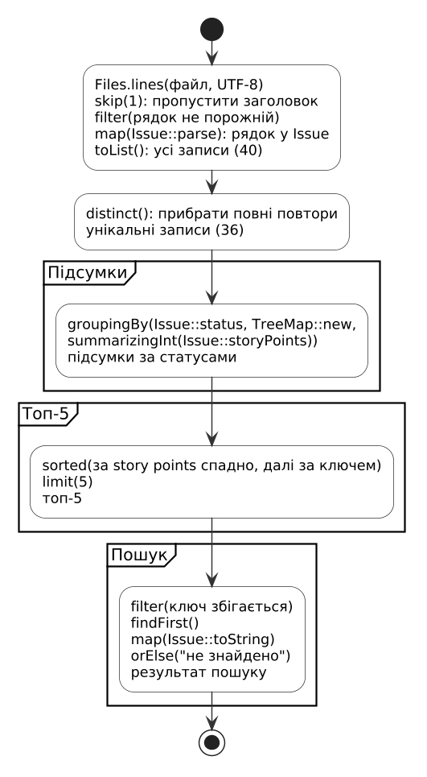

# 1. Мета роботи

Побудувати консольний звіт за файлом даних засобами Stream API: перетворити рядки на об'єкти, усунути повтори, згрупувати з підсумками, впорядкувати й знайти запис за ключем без винятків.

# 2. Завдання за варіантом

Номер у списку групи 12, варіант 2 (12 mod 5): трекер задач, файл `v2_issues.txt` з рядками `ключ;статус;виконавець;story_points` (UTF-8, перший рядок заголовок, 40 рядків даних). Категорія — це статус, підсумок у категорії — це сума story points, показник для топ-5 — це story points. Програма `java -jar report.jar <файл> <ключ>` друкує три частини: підсумки за статусами (за алфавітом), п'ять задач з найбільшими story points (за рівних оцінок за ключем), результат пошуку за ключем. Maven, Java 21, без залежностей, запуск у docker. Повні виводи в `results/`.

# 3. Рядки в об'єкти і усунення повторів

Кожен рядок стає записом `Issue(key, status, assignee, storyPoints)` через `Issue.parse`. Решта обробки працює з об'єктами. `Issue` — це Java record: `equals` і `hashCode` за всіма полями, тому повністю однакові рядки дають рівні об'єкти й `distinct()` лишає по одному.

::: {style="break-inside: avoid"}
```java
try (Stream<String> lines = Files.lines(Path.of(args[0]), StandardCharsets.UTF_8)) {
    all = lines.skip(1)
            .filter(line -> !line.isBlank())
            .map(Issue::parse)
            .toList();
}
List<Issue> issues = all.stream().distinct().toList();
```
:::

Заголовок пропускає `skip(1)`, потік закрито через `try-with-resources`. У файлі 40 рядків, унікальних записів 36: чотири рядки — це повні повтори (`SHOP-114`, `SHOP-237`, `SHOP-258`, `SHOP-364`). Усі наступні кроки йдуть від `issues`, тому повтори не потрапляють ні в підсумки, ні в топ.

Загальна схема конвеєра на рисунку 1: три частини звіту виконуються одна за одною над тим самим списком `issues`.

{width=60%}

# 4. Підсумки за статусами, топ-5 і пошук

```java
Map<String, IntSummaryStatistics> byStatus = issues.stream()
        .collect(Collectors.groupingBy(Issue::status, TreeMap::new,
                Collectors.summarizingInt(Issue::storyPoints)));
byStatus.forEach((status, stat) ->
        System.out.printf("  %-12s %3d %5d%n", status, stat.getCount(), stat.getSum()));
```

`groupingBy` з `TreeMap::new` дає категорії за алфавітом, `summarizingInt` одразу рахує кількість і суму. Зовнішні змінні в лямбдах не змінюються, лише друкується результат.

```java
issues.stream()
        .sorted(Comparator.comparingInt(Issue::storyPoints).reversed()
                .thenComparing(Issue::key))
        .limit(5)
        .forEach(issue -> System.out.printf("  %2d %s %s %s%n",
                issue.storyPoints(), issue.key(), issue.status(), issue.assignee()));
```

Спочатку компаратор порівнює story points за спаданням, а за рівних значень ключі за зростанням. Це важливо тут: задач із 13 SP шість, а в топ входить п'ять. У рядку топ-5 друкуються ще статус і виконавець.

```java
String found = issues.stream()
        .filter(issue -> issue.key().equals(searchKey))
        .findFirst()
        .map(Issue::toString)
        .orElse("не знайдено");
```

`findFirst` повертає `Optional`, а `orElse` підставляє текст, якщо запису немає. Тому `null` і винятку немає.

# 5. Результати двох запусків і перевірка

::: {style="break-inside: avoid"}
```
> java -jar target/report.jar data/v2_issues.txt SHOP-101
Рядків у файлі: 40, унікальних записів: 36
Статуси (кількість, сума story points):
  DONE          11    77
  IN_PROGRESS    9    36
  REVIEW         8    33
  TODO           8    35
Топ-5 за story points:
  13 SHOP-190 DONE nova8
  13 SHOP-286 DONE pixel5
  13 SHOP-357 TODO pixel5
  13 SHOP-366 REVIEW neo6
  13 SHOP-376 IN_PROGRESS echo1
Пошук SHOP-101: SHOP-101, DONE, виконавець byte8, 8 SP
(код завершення: 0)

> java -jar target/report.jar data/v2_issues.txt SHOP-000
…  (рядок з кількістю записів і перші дві частини ті самі)
Пошук SHOP-000: не знайдено
(код завершення: 0)
```
:::

Для відсутнього ключа програма завершується з кодом 0 і друкує «не знайдено». Без другого аргументу вона друкує підказку `Використання: java -jar report.jar <файл з даними> <ключ задачі>` і завершується з кодом 2 (`results/usage.txt`).

Підсумки я перевірив без Java: `tail -n +2 data/v2_issues.txt | tr -d '\r' | sort -u` лишає 36 рядків, `awk` рахує за статусами `DONE 11 77`, `IN_PROGRESS 9 36`, `REVIEW 8 33`, `TODO 8 35`, і це збігається з виводом програми. Із шести задач із 13 SP (`SHOP-190`, `-286`, `-357`, `-366`, `-376`, `-395`) у топ-5 потрапили перші п'ять за ключем, `SHOP-395` шоста (`results/check.txt`).

# 6. Відповіді на контрольні питання

**1. Як ви переконалися, що повтори не потрапили в підсумки?** Програма друкує 40 рядків і 36 унікальних записів. Окремо `sort -u` дає 36 рядків, а `awk` за унікальними рядками видає ті самі кількості й суми, що й програма (`results/check.txt`).

**2. Як забезпечено порядок категорій і записів з однаковим показником?** Категорії йдуть за алфавітом, бо `groupingBy` збирає в `TreeMap`. Записи з однаковим показником впорядковує `thenComparing(Issue::key)`: п'ять із шести задач із 13 SP потрапили в топ саме за ключем.

**3. Що повертає пошук за відсутнім ключем і чому це не `null`?** `findFirst` повертає порожній `Optional`, а `orElse("не знайдено")` підставляє текст. `Optional` змушує викликача врахувати відсутність результату, тож виняток чи `null` у виводі неможливі.

# 7. Висновки

Програма читає файл потоком, перетворює 40 рядків на об'єкти `Issue` і через `distinct()` лишає 36 унікальних записів, бо `record` порівнює всі поля. Підсумки за статусами (`DONE` 11 записів і 77 SP, `IN_PROGRESS` 9 і 36, `REVIEW` 8 і 33, `TODO` 8 і 35) збіглися з перевіркою через `sort -u` і `awk`. Категорії виведено за алфавітом завдяки `TreeMap`. У топ-5 потрапили п'ять із шести задач із 13 SP, бо компаратор за рівних оцінок порівнює ключі. Пошук наявного ключа `SHOP-101` дав запис, а відсутнього `SHOP-000` текст «не знайдено» з кодом 0. Лямбди нічого не змінюють ззовні, лише друкують результат.

# 8. Посилання на репозиторій

<https://github.com/brizzinck/krinzhrepoduta/tree/main/java/lr-7>
