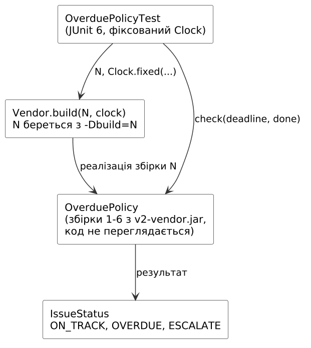

<style>
pre, pre code { overflow: visible !important; overflow-wrap: anywhere !important; }
table { font-size: 9.5pt; }
</style>

# 1. Мета роботи

Написати за специфікацією приймальні тести для чужого модуля без доступу до його коду, знайти єдину правильну збірку з шести, описати дефекти інших і перевірити, що тести не залежать від дати й часового поясу комп'ютера.

# 2. Завдання і специфікація варіанта 2

Номер у списку групи 12, варіант 2. Файл `v2-vendor.jar` містить шість збірок модуля. Специфікація `OverduePolicy.check(deadline, done)` для трекера задач:

- виконана задача і задача з дедлайном сьогодні або пізніше: `ON_TRACK`;
- інакше рахуються робочі дні (пн-пт) після дедлайну до сьогодні включно: менше 2 дає `OVERDUE`, 2 і більше дає `ESCALATE`;
- дедлайн відсутній: `IllegalArgumentException`;
- «сьогодні» і дати визначаються за київським часом, поточний час модуль бере з переданого `java.time.Clock`.

Правильній специфікації відповідає лише одна збірка. Проєкт Maven (Java 21, JUnit 6.1.3), залежність `ua.vendor:vendor:1.0` зі scope `test`; jar лежить поза репозиторієм і не комітиться. Повні логи в `results/`.

{width=40%}

# 3. Як отримано API без коду збірок

Методичка забороняє дивитись вихідний чи декомпільований код збірок. Тому я лише прочитав публічні сигнатури трьох класів через `javap -public` у контейнері без мережі, з jar, змонтованим для читання (`results/api.txt`). Байт-код (`javap -c`), класи `Base` і `Build1`-`Build6`, декомпілятори я не використовував.

```
> javap -public -cp v2-vendor.jar ua.vendor.issues.OverduePolicy ua.vendor.issues.IssueStatus ua.vendor.issues.Vendor
public interface ua.vendor.issues.OverduePolicy {
  public abstract ua.vendor.issues.IssueStatus check(java.time.LocalDate, boolean);
}
public final class ua.vendor.issues.IssueStatus extends java.lang.Enum<ua.vendor.issues.IssueStatus> {
  public static final ua.vendor.issues.IssueStatus ON_TRACK;
  public static final ua.vendor.issues.IssueStatus OVERDUE;
  public static final ua.vendor.issues.IssueStatus ESCALATE;
  …
}
public final class ua.vendor.issues.Vendor {
  public static ua.vendor.issues.OverduePolicy build(int, java.time.Clock);
}
```

Jar встановлюється в локальне сховище Maven однією командою (лише копіює файл, код із jar не виконується):

```
mvn install:install-file -Dfile=v2-vendor.jar -DgroupId=ua.vendor -DartifactId=vendor -Dversion=1.0 -Dpackaging=jar
```

Код підрядника виконується лише під час `mvn test`, у docker без мережі (`--network none`), в офлайн-режимі Maven і з репозиторієм лише для читання. Номер збірки передає `-Dbuild=N`.

# 4. Підхід до тестів

Тести написано за специфікацією, значення обрано за класами еквівалентності та межами. Годинник скрізь фіксований: `Clock.fixed(instant, Europe/Kyiv)`, жодного `LocalDate.now()`. Звичайні тести використовують київський полудень, щоб дата була однозначна. Дати тестів не збігаються з датами прогонів (листопад 2026), тому збірка, що ігнорує годинник, помилилась би. Кожен тест сам створює годинник і збірку, спільного стану між тестами немає, тому порядок запуску на результат не впливає (перевірено в розділі 6).

Таблиця 1 — Групи тестів, значення і призначення

| Група тестів | Значення | Навіщо |
|------------|------------------------------|--------------------|
| Виконана задача | дедлайн вчора, тиждень тому, кілька місяців тому | `done` сильніший за прострочення |
| Дедлайн сьогодні або пізніше | середа, субота, завтра, понеділок при неділі, місяць | межа «сьогодні» (включно) |
| Робочі дні: 0, 1, 2 | пт-сб, пт-нд, пт-пн, пт-вт, чт-сб, чт-нд, чт-пн, сб-пн, сб-вт, нд-пн, нд-вт | вихідні не рахуються, поріг 2 |
| Межі календаря | 31.12.2025-01.01 і 02.01.2026, 31.07-03.08 і 04.08 | перехід через рік і місяць |
| Давно прострочено | місяць, кілька місяців | `ESCALATE` не залежить від довжини |
| Дедлайн відсутній | `null` з `done=false` і `done=true` | `IllegalArgumentException` |
| Київ і зсув від UTC | див. таблицю нижче | «сьогодні» за київським часом |

Таблиця 2 — Київська дата проти UTC і перехід на зимовий час (25.10.2026)

| Київ | UTC | Дедлайн | Очікується |
|--------------------|-----------|--------|--------------------|
| 10.06.2026 00:30 (літо, UTC+3) | 09.06 21:30 | 09.06 | OVERDUE (у Києві вже середа) |
| 09.12.2026 23:30 (зима, UTC+2) | 09.12 21:30 | 09.12 | ON_TRACK (ще середа) |
| 25.10.2026 00:30 (ще UTC+3) | 24.10 21:30 | 24.10 | OVERDUE (дата вже 25.10) |
| 25.10.2026 23:30 (вже UTC+2) | 25.10 21:30 | 25.10 | ON_TRACK |

Окремо перевірено календарні припущення (`calendarAssumptions`: дні тижня 01.06, 05.06, 25.10 і зсуви UTC+3, UTC+2 на межі переходу).

# 5. Код тестів

Збірку для кожного тесту дає один метод; номер збірки береться з системної властивості. `policyOn` будує годинник на київський полудень заданої дати:

```{.java .small}
    private static OverduePolicy policy(Clock clock) {
        return Vendor.build(Integer.getInteger("build", 1), clock);
    }

    private static OverduePolicy policyOn(String today) {
        Instant noon = LocalDate.parse(today).atTime(12, 0).atZone(KYIV).toInstant();
        return policy(Clock.fixed(noon, KYIV));
    }
```

Робочі дні перевіряє параметризований тест (мітка рядка: день дедлайну і день «сьогодні»; усього 19 рядків):

```{.java .small}
    @ParameterizedTest(name = "[{index}] {0}")
    @CsvSource({
            "середа - четвер: 1 робочий день, 2026-06-03, 2026-06-04, OVERDUE",
            "пʼятниця - вівторок: 2 робочі дні, 2026-06-05, 2026-06-09, ESCALATE",
            "пʼятниця - неділя: 0 робочих днів, 2026-06-05, 2026-06-07, OVERDUE",
            "перехід через рік - 2 робочі дні, 2025-12-31, 2026-01-02, ESCALATE",
            …
    })
    void overdueByWorkingDays(String label, LocalDate deadline,
                              LocalDate today, IssueStatus expected) {
        assertEquals(expected, policyOn(today.toString()).check(deadline, false));
    }
```

Показано перевірки [1], [4], [9], [15] з 35. Тести `missingDeadlineThrowsEvenForDoneIssue` і `kyivDateEvenWhenClockIsInUtc` позначені `@Tag("interpretation")`: специфікація їх прямо не вирішує, див. розділ 8.

# 6. Результати шести збірок

`mvn test -Dbuild=N` для N = 1…6 (`results/build-N.txt`, зведення `results/summary.txt`). Номери в дужках це номери рядків параметризованих тестів.

Таблиця 3 — Результати шести збірок

| Збірка | Тестів | Впало | Тести, що впали |
|------|------|------|-------------------------------------|
| 1 | 35 | 6 | `overdueByWorkingDays` [3] [5] [6] [9] [10] [16] |
| 2 | 35 | 4 | `deadlineTodayOrLaterIsOnTrack` [1] [2], `kyivLateEveningWinter`, `dstDayLateEvening` |
| 3 | 35 | 3 | `doneIssueIsOnTrack` [1] [2] [3] |
| 4 | 35 | 7 | `overdueByWorkingDays` [2] [4] [7] [11] [13] [15] [17] |
| 5 | 35 | 3 | `kyivMidnightSummer`, `dstDayAfterMidnight`, `kyivDateEvenWhenClockIsInUtc` |
| 6 | 35 | 0 | немає |

```
> mvn test -Dbuild=6
[INFO] Tests run: 35, Failures: 0, Errors: 0, Skipped: 0
[INFO] BUILD SUCCESS
> mvn test -Dbuild=1
[ERROR] …OverduePolicyTest.overdueByWorkingDays(String, LocalDate, LocalDate, IssueStatus)[3] -- … <<< FAILURE!
org.opentest4j.AssertionFailedError: expected: <OVERDUE> but was: <ESCALATE>
…
[ERROR] Tests run: 35, Failures: 6, Errors: 0, Skipped: 0
```

Незалежність від поясу комп'ютера і порядку тестів: набір запущено ще з `-DargLine=-Duser.timezone=America/Los_Angeles` і `Pacific/Kiritimati` (у логах рядок «Часовий пояс комп'ютера: …» це підтверджує). Набори тестів, що впали, у всіх шести збірках збіглися з основним запуском у поясі контейнера Etc/UTC (`results/tz-*.txt`, `results/summary.txt`). Так само збіглися набори при випадковому порядку методів JUnit (`MethodOrderer$Random`, зерна 1-3, `results/order.txt`).

# 7. Звіти про дефекти

Усі дати з 2026 року. Опис причин це припущення за поведінкою: код збірок не переглядався.

Таблиця 4 — Звіти про дефекти

| № | Тест | Вхідні дані | Мало бути | Було | Порушене правило |
|---|------------------------|----------------|------------|------------|--------------------|
| 1 | `overdueByWorkingDays` [3] і ще 5 рядків | дедлайн пт 05.06, сьогодні пн 08.06, `done=false` | `OVERDUE` | `ESCALATE` | Рахуються лише пн-пт: після дедлайну 1 робочий день. Схоже, вихідні враховано як робочі |
| 2 | `deadlineTodayOrLaterIsOnTrack` [1] і ще 3 тести | дедлайн 03.06 і сьогодні 03.06 (середа), `done=false` | `ON_TRACK` | `OVERDUE` | Дедлайн сьогодні дає `ON_TRACK`. Дедлайн «завтра» збірка пропускає правильно |
| 3 | `doneIssueIsOnTrack` [1] і ще [2] [3] | `done=true`, дедлайн 02.06, сьогодні 03.06 | `ON_TRACK` | `OVERDUE` ([2] [3]: `ESCALATE`) | Виконана задача завжди `ON_TRACK`. Прапорець `done` ігнорується при простроченому дедлайні |
| 4 | `overdueByWorkingDays` [2] і ще 6 рядків | дедлайн пн 01.06, сьогодні ср 03.06, `done=false` | `ESCALATE` | `OVERDUE` | 2 робочі дні (вт, ср) це вже `ESCALATE`. Поріг зсунуто: потрібно 3 дні |
| 5 | `kyivMidnightSummer` і ще 2 тести | годинник Київ 10.06 00:30 (UTC 09.06 21:30), дедлайн 09.06, `done=false` | `OVERDUE` | `ON_TRACK` | «Сьогодні» за київським часом, тобто 10.06. Збірка, схоже, бере дату за UTC (09.06) |

# 8. Рішення про прийняття і неоднозначності

Рекомендую прийняти збірку 6: вона проходить усі 35 перевірок, а збірки 1-5 відхилити, кожна впала щонайменше на тесті, що напряму випливає зі специфікації.

Дві неоднозначності специфікації. Перша: для виконаної задачі з відсутнім дедлайном правило «виконана: `ON_TRACK`» суперечить правилу «дедлайн відсутній: некоректно». Я читаю буквально, що відсутній дедлайн некоректний завжди, і написав тест на `IllegalArgumentException` для `done=true`. Друга: «сьогодні за київським часом», коли `Clock` передано в іншій зоні (UTC): я очікую київську дату. Обидва тести позначені `interpretation`. Вони не вирішують вибір збірки: збірка 6 проходить обидва, а збірки 1-4 їх не чіпають; збірка 5 падає на `kyivMidnightSummer` і `dstDayAfterMidnight`, які від тлумачення не залежать.

# 9. Відповіді на контрольні питання

**1. Як ви обирали вхідні дані, не бачачи коду?** За специфікацією: кожному правилу відповідає клас значень, а помилки зазвичай ховаються на межах. Для робочих днів це 0, 1 і 2 дні після дедлайну, початок і кінець вихідних, перехід через місяць і рік. Для часу це моменти, коли київська дата відрізняється від UTC, і день переходу на зимовий час.

**2. Який дефект було найважче спіймати і чому?** Дефект збірки 5 (дата за UTC). Він проявляється лише близько київської півночі: у полудень дата у Києві й UTC збігається, і звичайні тести його не бачать. Знадобився годинник на 00:30 за Києвом (UTC уже попередній день).

**3. Навіщо модулю передають `Clock`, а не викликають `LocalDate.now()` усередині?** З `Clock.fixed` тест сам задає «сьогодні»: можна відтворити вихідні, київську північ і перехід на зимовий час, результат не залежить від дня запуску. `LocalDate.now()` бере справжній час, і такі випадки перевірити неможливо.

# 10. Висновки

За специфікацією варіанта 2 я написав 35 приймальних перевірок і запустив їх проти шести збірок. Збірка 6 пройшла всі, а кожна з п'яти інших упала щонайменше на трьох: збірка 1 рахує вихідні як робочі дні, збірка 2 не вважає дедлайн «сьогодні» вчасним, збірка 3 ігнорує `done`, збірка 4 вимагає 3 робочі дні замість 2 для `ESCALATE`, збірка 5 бере дату за UTC. Годинник у всіх тестах фіксований, а набір, запущений із поясами America/Los_Angeles і Pacific/Kiritimati, дав ті самі результати. На кожну відхилену збірку оформлено звіт про дефект. Найтоншим виявився тест на київську північ: без моменту 00:30 дефект збірки 5 не видно. API я отримав лише через `javap -public`, код збірок не відкривав, jar лишився поза репозиторієм.

# 11. Посилання на репозиторій

<https://github.com/brizzinck/krinzhrepoduta/tree/main/java/lr-8>
