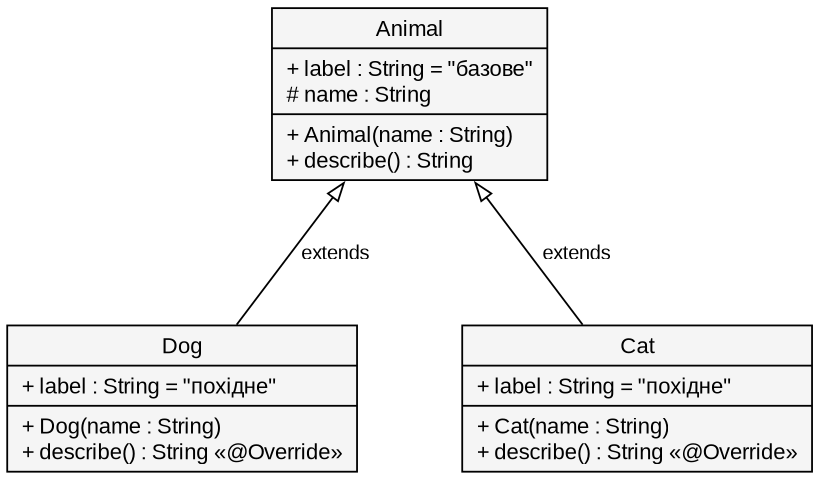
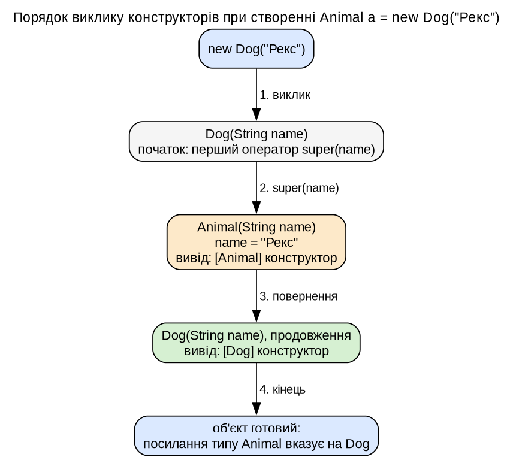

# Мета роботи

Дослідити `extends`, `@Override` і `super`, порядок виклику конструкторів та різницю між доступом до полів (за типом посилання) і методів (за фактичним типом).

# Завдання за варіантом

Номер у списку 12, остача від ділення на 5 дорівнює 2: базовий клас **Тварина** (`Animal`), похідні **Собака** (`Dog`) і **Кіт** (`Cat`). Три досліди: перевизначення з `super`; порядок конструкторів, вимога `super(...)` і `Derived d = new Base(...)`; поле й метод з однаковими іменами через посилання базового типу.

# Теоретичні відомості

`super.метод()` викликає версію базового класу, `super(...)` ініціалізує базову частину й має бути першим оператором конструктора; без нього компілятор вставляє `super()`. Методи зв'язуються за фактичним типом об'єкта під час виконання, поля за типом змінної під час компіляції. Запуск: JDK 21 (docker-образ `maven:3.9-eclipse-temurin-21`), повідомлення `javac` дослівно.

# Хід виконання роботи

```java
public class Animal {
    public String label = "базове";
    protected final String name;
    public Animal(String name) {          // конструктора без параметрів немає
        this.name = name;
        System.out.println("[Animal] конструктор, ім'я: " + name);
    }
    public String describe() { return "Тварина " + name; }
}

public class Dog extends Animal {
    public String label = "похідне";      // те саме ім'я поля
    public Dog(String name) {
        super(name);                      // перший оператор
        System.out.println("[Dog] конструктор");
    }
    @Override
    public String describe() { return super.describe() + ". Собака " + name + " гавкає"; }
}
```

`Cat` побудовано так само (текст «Кіт ... нявкає»).

{width=47%} {width=45%}

## Дослід 1. `@Override` і `super`

```text
> java -cp target/classes ua.duikt.lavrishko.pr3.Main 1
Animal.describe(): Тварина Звір
Dog.describe():    Тварина Рекс. Собака Рекс гавкає
Cat.describe():    Тварина Мурка. Кіт Мурка нявкає
```

Версія `Animal` повертає лише «Тварина Звір». Похідні версії починаються з тексту батьківської, бо першим рядком викликають `super.describe()`; `@Override` змушує компілятор перевірити, що метод справді перевизначає базовий.

## Дослід 2. Порядок конструкторів

```text
> java -cp target/classes ua.duikt.lavrishko.pr3.Main 2
Animal a = new Dog("Рекс");
[Animal] конструктор, ім'я: Рекс
[Dog] конструктор
Animal b = new Cat("Мурка");
[Animal] конструктор, ім'я: Мурка
[Cat] конструктор
```

Спершу виконується конструктор базового класу, потім решта похідного: похідна частина спирається на поля базової (`name`). Похідний клас без `super(...)` при єдиному конструкторі `Animal(String)` не компілюється:

```text
> javac -encoding UTF-8 -cp target/classes compile-errors/E1_no_super/*.java
BadDog.java:5: error: constructor Animal in class Animal cannot be applied to given types;
  required: String
  found:    no arguments
  reason: actual and formal argument lists differ in length
```

Компілятор вставив неявний `super()`, а такого конструктора в `Animal` немає. Той самий клас з явним `super(name)` компілюється (код 0). Присвоєння базового об'єкта похідному посиланню:

```text
> javac -encoding UTF-8 -cp target/classes compile-errors/E2_downcast/*.java
DerivedFromBase.java:6: error: incompatible types: Animal cannot be converted to Dog
        Dog d = new Animal("Невідомий");
```

`Base b = new Derived(...)` припустимо, бо `Dog` містить усе, що є в `Animal`. `Derived d = new Base(...)` ні: об'єкт `Animal` не має похідної частини, тож посилання `Dog` на нього було б обіцянкою, яку не виконати.

## Дослід 3. Поле за типом посилання, метод за фактичним типом

```java
Animal[] pets = {new Dog("Рекс"), new Cat("Мурка")};
for (Animal pet : pets) { System.out.println(pet.label); System.out.println(pet.describe()); }
```

```text
> java -cp target/classes ua.duikt.lavrishko.pr3.Main 3
Фактичний тип: Dog
pet.label (тип посилання Animal): базове
pet.describe() (метод за фактичним типом): Тварина Рекс. Собака Рекс гавкає
поле після приведення до похідного типу: похідне
Фактичний тип: Cat
pet.label (тип посилання Animal): базове
pet.describe() (метод за фактичним типом): Тварина Мурка. Кіт Мурка нявкає
поле після приведення до похідного типу: похідне
```

В об'єкта два окремі поля `label` (успадковане й приховуюче); вибір між ними робить компілятор за типом змінної, тому через `Animal` видно «базове». Методи не мають такого обмеження: виклик `describe()` іде за фактичним класом (динамічне зв'язування).

# Висновки

Перевизначення з `@Override` змінює поведінку методу в похідному класі й лишає доступ до батьківської версії через `super`. Об'єкт будується від базової частини до похідної, тому конструктор базового класу виконується першим, а за відсутності в ньому конструктора без параметрів похідний зобов'язаний явно викликати `super(...)`, інакше `javac` відхиляє клас. Присвоєння `Dog d = new Animal(...)` заборонене, бо базовий об'єкт не гарантує похідної частини, а `Animal a = new Dog(...)` безпечне. Поле береться за типом посилання, метод за фактичним типом об'єкта, тому на перевизначення методів можна спиратися в поліморфному коді, а приховування полів з однаковими іменами краще уникати.

# Посилання на репозиторій

<https://github.com/brizzinck/krinzhrepoduta/tree/main/java/pr-3>
