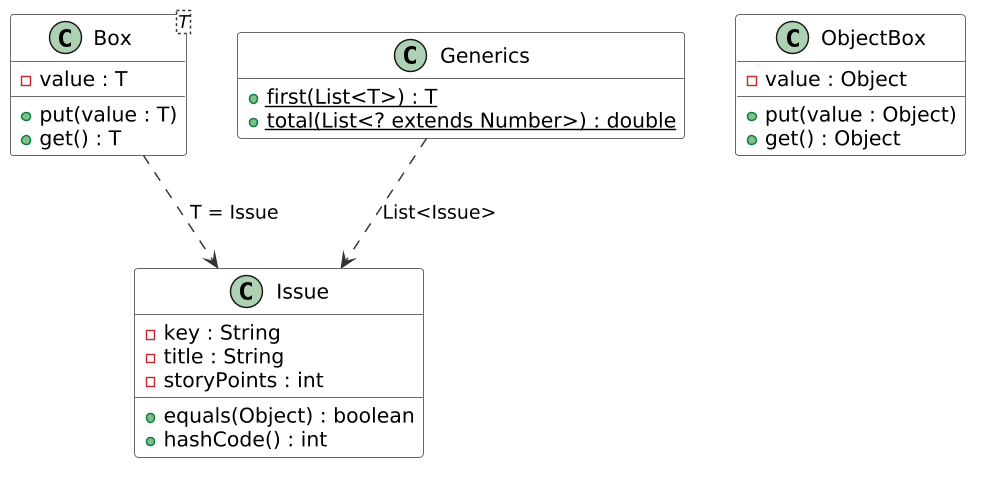

<style>
pre, pre code { overflow: visible !important; overflow-wrap: anywhere !important; }
</style>

# 1. Мета роботи

Спробувати узагальнені класи й методи, порівняти час роботи `ArrayList`, `LinkedList` і `HashSet`, перевірити, як контракт `equals` і `hashCode` впливає на `HashSet`.

# 2. Завдання за варіантом

Номер у списку групи 12, варіант 2 (12 mod 5): задача в трекері, поля ключ, назва, story points, ключ рівності: ключ. Три досліди в одному Maven-проєкті (Java 21, без залежностей, запуск у docker). Лямбд і Stream API немає. Повні виводи лежать у `results/`, хибні фрагменти в `compile-errors/`.

{width=62%}

# 3. Дослід 1. Узагальнений контейнер

`Box<T>` має методи `put(T)` і `get()`. `ObjectBox` робить те саме на `Object`. Метод `Generics.first(List<T>)` повертає перший елемент списку будь-якого типу без приведення.

Я поклав у `Box<Issue>` рядок. Код не компілюється:

```
> javac … compile-errors/E1_box_type/*.java
BoxTypeError.java:7: error: incompatible types: String cannot be converted to Issue
        box.put("abc");   // рядок замість Issue
```

Те саме з `ObjectBox` компілюється, а помилка з'являється під час читання з приведенням `(Issue) box.get()`:

```
> java … Exp1Cast
Значення покладено, компіляція пройшла.
Exception in thread "main" java.lang.ClassCastException: class java.lang.String cannot be cast to class ua.duikt.lavrishko.pr6.Issue (…)
	at ua.duikt.lavrishko.pr6.Exp1Cast.main(Exp1Cast.java:9)
(код завершення: 1)
```

Для `Box<T>` компілятор знає, що `T` це `Issue`, і відхиляє чужий тип одразу. Для `ObjectBox` усе є `Object`, тому перевірка переходить на момент приведення, коли програма вже працює.

Далі метод із параметром `List<Number>` і виклик зі `List<Integer>`:

```
> javac … compile-errors/E2_list_number/*.java
ListNumberError.java:15: error: incompatible types: List<Integer> cannot be converted to List<Number>
        System.out.println(total(ints));
```

Узагальнені типи інваріантні: `Integer` є підтипом `Number`, але `List<Integer>` не є підтипом `List<Number>`. Інакше через `List<Number>` у список цілих можна було б покласти `Double`. Виправлення: параметр `List<? extends Number>`, метод лише читає числа.

```java
    public static double total(List<? extends Number> numbers) {
        double sum = 0;
        for (Number n : numbers) {
            sum += n.doubleValue();
        }
        return sum;
    }
```

```
> java … Exp1Total
total(List<Integer>) = 26.0
total(List<Number>)  = 26.5
first(List<Issue>) = SHOP-1 (5 SP) Вхід через Google
```

# 4. Дослід 2. Час колекцій і видалення в циклі

У кожному з п'яти запусків колекції створюються заново і заповнюються 100 000 об'єктами `Issue`. Далі вимірюється `System.nanoTime` 1 000 вставок у середину списків (`add(size() / 2, …)`) і 1 000 викликів `contains` для ключів, розкиданих по всій колекції.

```
> java … Exp2Timing
Елементів: 100000, операцій: 1000, час у мс
Запуск   ArrayList ins  LinkedList ins ArrayList has  LinkedList has HashSet has
1        2              278            179            342            0
2        1              236            234            321            0
3        1              323            355            698            0
4        1              326            361            920            0
5        1              304            331            812            0
```

Вставка в середину `LinkedList` повільніша в сотні разів (236-326 мс проти 1-2 мс), хоча сама вставка вузла O(1). Але список зв'язаний, і щоб дійти до індексу 50 000, треба пройти до 50 000 вузлів по посиланнях. У `ArrayList` пошук позиції миттєвий, а зсув хвоста виконує `System.arraycopy` над неперервним масивом. Швидкість вставки в `LinkedList` була б високою лише з готовим ітератором на потрібній позиції. `contains` у списків лінійний (до 100 000 викликів `equals` на ключ), у `HashSet` це хеш і порівняння в одному кошику, тому 0 мс. Час `contains` для списків від запуску до запуску помітно коливається (179-920 мс), тому порівнювати варто порядок величин, а не окремі числа.

Видалення задач із менше ніж 3 story points із `ArrayList` в циклі for-each:

```
> java … Exp2Cme
До видалення: 8 задач
Exception in thread "main" java.util.ConcurrentModificationException
	at java.base/java.util.ArrayList$Itr.checkForComodification(ArrayList.java:1095)
	at java.base/java.util.ArrayList$Itr.next(ArrayList.java:1049)
	at ua.duikt.lavrishko.pr6.Exp2Cme.main(Exp2Cme.java:10)
```

Цикл for-each працює через прихований `Iterator`. Після `list.remove` лічильник змін списку не збігається з очікуваним ітератора, і наступний `next()` кидає виняток. З `Iterator.remove()` виняток зникає:

```java
        Iterator<Issue> it = issues.iterator();
        while (it.hasNext()) {
            if (it.next().getStoryPoints() < 3) {
                it.remove();   // ітератор оновлює і список, і свій лічильник
            }
        }
```

```
> java … Exp2Iterator
До видалення: 8 задач
Після видалення: 5 задач
```

# 5. Дослід 3. HashSet, equals і hashCode

У множину додано два різні об'єкти з однаковим ключем `SHOP-1`, потім перевірено `contains` для третього з тим самим ключем. Дослід повторено для трьох станів класу.

```
> java … Exp3Equality
без equals і hashCode:   size = 2, contains(третій рівний) = false
лише equals:             size = 2, contains(третій рівний) = false
equals і hashCode:       size = 1, contains(третій рівний) = true
```

`HashSet` спершу бере `hashCode`, щоб знайти кошик, і лише потім викликає `equals`. Без обох методів (стан 1) рівність і хеш за посиланням: усі об'єкти різні. Коли є лише `equals` (стан 2), хеш лишається ідентифікаційним, тому рівні за ключем об'єкти потрапляють у різні кошики, і `equals` до них навіть не доходить. Лише в стані 3 рівні об'єкти мають однаковий хеш і розпізнаються.

Далі я змінив ключ у об'єкта, що вже лежить у `HashSet<Issue>`:

```
Зміна ключа елемента, що вже лежить у HashSet<Issue>:
  до зміни:  contains(SHOP-1) = true
  після setKey(SHOP-2):
    contains(старий ключ SHOP-1) = false
    contains(новий ключ SHOP-2)  = false
    size = 1, у обході множини: SHOP-2 (5 SP) Вхід через Google
```

Об'єкт лежить у кошику за старим хешем. Пошук за старим ключем знаходить кошик, але `equals` вже не збігається, а за новим ключем шукається інший кошик. Елемент у множині є (`size = 1`, видно в обході), але через `contains` недосяжний. Поля, від яких залежить хеш, не можна змінювати, поки об'єкт у хеш-колекції.

# 6. Відповіді на контрольні питання

**1. Чому помилку типу видно під час компіляції для узагальненої колекції, а для `Object` лише під час виконання?** Для `Box<Issue>` компілятор знає тип елемента й перевіряє кожен виклик `put`. Для `ObjectBox` будь-яке значення є `Object`, і тип можна перевірити лише під час приведення, тобто коли програма вже працює.

**2. Чим `List<? extends Number>` відрізняється від `List<Number>`?** `List<Number>` приймає лише список саме з типом `Number` і дозволяє в нього писати. `List<? extends Number>` приймає список будь-якого підтипу (`Integer`, `Double`), але дозволяє тільки читати елементи як `Number`: невідомо, який підтип у списку, тож безпечно записати можна лише `null`.

**3. Чому вставка в середину `LinkedList` не обов'язково швидша, ніж в `ArrayList`?** Сама вставка вузла O(1), але до середини треба дійти по ланцюжку посилань (до 50 000 кроків). `ArrayList` знаходить індекс одразу, а зсув хвоста швидко виконує `arraycopy` над неперервною пам'яттю: у досліді 1-2 мс проти 236-326 мс.

**4. Чому `HashSet` не знаходить рівний об'єкт, якщо перевизначено лише `equals`?** Пошук починається з `hashCode`. Рівні за `equals` об'єкти мають різні ідентифікаційні хеші й потрапляють у різні кошики, тому `equals` не викликається. Контракт: рівні за `equals` об'єкти зобов'язані мати однаковий `hashCode`.

**5. Що буде з об'єктом у `HashSet`, якщо змінити поле, від якого залежить хеш?** Об'єкт лишається в кошику за старим хешем. `contains` не знаходить його ні за старим ключем (не збігається `equals`), ні за новим (інший кошик), хоча об'єкт є в множині. Його можна лише обійти ітератором.

# 7. Висновки

Узагальнений `Box<Issue>` не пропустив рядок у `put` на етапі компіляції, а `ObjectBox` дав `ClassCastException` лише в момент приведення. `List<Integer>` не передається як `List<Number>`, бо узагальнені типи інваріантні, а `List<? extends Number>` приймає обидва списки. У вимірах із 100 000 елементів `contains` у `HashSet` вклався в 0 мс проти сотень мілісекунд у списках, а вставка в середину `LinkedList` виявилась у сотні разів повільнішою за `ArrayList` через обхід вузлів. Видалення в циклі for-each дало `ConcurrentModificationException`, `Iterator.remove()` видалив три задачі без помилки. Два об'єкти з однаковим ключем дали `size = 1` і `contains = true` лише за перевизначених `equals` і `hashCode`; після зміни ключа елемент перестав знаходитись через `contains`, хоча лишився в множині.

# 8. Посилання на репозиторій

<https://github.com/brizzinck/krinzhrepoduta/tree/main/java/pr-6>
