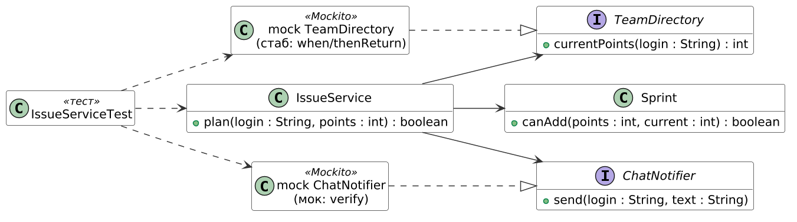

<style>
pre, pre code { overflow: visible !important; overflow-wrap: anywhere !important; }
</style>

# 1. Мета роботи

Написати модульні тести JUnit за схемою Given-When-Then, перевірити межі параметризованими тестами й ізолювати сервіс від залежностей за допомогою Mockito.

# 2. Завдання за варіантом

Номер у списку групи 12, варіант 2 (12 mod 5): `Sprint.canAdd(points, current)`: оцінка задачі від 1 до 13, разом у спринті не більше 40 SP. Межі: оцінки 0, 1, 13, 14, сума 40 і 41. Сервіс `IssueService`: виконавець береться з `TeamDirectory`, повідомлення йде в `ChatNotifier`. Maven, Java 21, JUnit 6.1.3 (через `junit-bom`), `mockito-junit-jupiter` 5.24.0, Surefire 3.6.1, запуск у docker. Повні логи кожного кроку в `results/`.

{width=90%}

# 3. Клас і правило

Некоректна оцінка (поза 1..13) дає `IllegalArgumentException`. Від'ємну поточну суму я теж вважаю некоректною й кидаю той самий виняток (методичка про неї не каже).

```java
    public boolean canAdd(int points, int current) {
        if (points < MIN_POINTS || points > MAX_POINTS) {
            throw new IllegalArgumentException("оцінка задачі " + points + " поза межами "
                    + MIN_POINTS + ".." + MAX_POINTS);
        }
        if (current < 0) {
            throw new IllegalArgumentException("поточна сума " + current + " не може бути від'ємною");
        }
        return current + points <= CAPACITY;   // CAPACITY = 40
    }
```

# 4. Дослід 1. Три тести Given-When-Then

`SprintTest`: звичайний випадок (30 SP у спринті, задача на 5 SP, разом 35, очікується `true`), оцінка 0 (`assertThrows`) і повний спринт (38 SP і задача на 5 SP, разом 43, очікується `false`).

```java
    @Test
    void addsTaskWhenItFits() {
        // Given: у спринті 30 SP, задача на 5 SP (разом 35 з 40)
        int points = 5;
        int current = 30;
        // When
        boolean result = sprint.canAdd(points, current);
        // Then
        assertTrue(result);
    }
```

```
> mvn test -Dtest=SprintTest                 (results/s1_green.txt)
[INFO] Tests run: 3, Failures: 0, Errors: 0, Skipped: 0
[INFO] BUILD SUCCESS
```

Потім я замінив у коді `CAPACITY = 40` на `30` і запустив тести ще раз:

```
> mvn test -Dtest=SprintTest                 (results/s1_red.txt)
[ERROR]   SprintTest.addsTaskWhenItFits:20 expected: <true> but was: <false>
[ERROR] Tests run: 3, Failures: 1, Errors: 0, Skipped: 0
```

Упав лише `addsTaskWhenItFits`: сума 35 з обмеженням 30 вже не вміщується. Інші два тести пройшли, бо оцінка 0 і сума 43 відхиляються і за 30, і за 40. Звичайні значення зміну обмеження помітили лише одним тестом, тому межі перевіряє окремий набір (розділ 5). Код повернуто.

# 5. Дослід 2. Параметризовані тести на межах

Допустимі значення перевіряє `@CsvSource` (оцінка, поточна сума, очікуваний результат), значення поза діапазоном `@ValueSource` з `assertThrows`:

```java
    @ParameterizedTest
    @CsvSource({
            "1,  0,  true",    // найменша допустима оцінка
            "13, 0,  true",    // найбільша допустима оцінка
            "13, 27, true",    // разом рівно 40
            "13, 28, false"    // разом 41
    })
    void boundariesInsideRange(int points, int current, boolean expected) {
        assertEquals(expected, sprint.canAdd(points, current));
    }

    @ParameterizedTest
    @ValueSource(ints = {0, 14})
    void pointsOutsideRangeThrow(int points) { /* assertThrows(IllegalArgumentException.class, ...) */ }
```

Значення вибрано на самій межі й по обидва боки від неї: 1 і 13 останні допустимі оцінки, 0 і 14 перші недопустимі, сума 40 остання допустима, 41 перша недопустима. Саме на межах перемикання `<=` на `<` дає помилку.

```
> mvn test -Dtest=SprintBoundaryTest         (results/s2_green.txt)
[INFO] Tests run: 7, Failures: 0, Errors: 0, Skipped: 0
```

Я змінив `current + points <= CAPACITY` на `<` і запустив ще раз:

```
> mvn test -Dtest=SprintBoundaryTest         (results/s2_red.txt)
[ERROR] …SprintBoundaryTest.boundariesInsideRange(int, int, boolean)[3] -- … <<< FAILURE!
[ERROR]   SprintBoundaryTest.boundariesInsideRange:23 expected: <true> but was: <false>
[ERROR] Tests run: 7, Failures: 1, Errors: 0, Skipped: 0
```

Упав рядок `[3]` набору, `"13, 27, true"`, тобто сума рівно 40. Інші три рядки набору пройшли. Код повернуто.

# 6. Дослід 3. Сервіс, стаб і мок

`IssueService.plan(login, points)` бере поточну суму з `TeamDirectory`, питає `Sprint.canAdd` і надсилає повідомлення через `ChatNotifier`. Обидва інтерфейси без реалізацій. У тесті (`@ExtendWith(MockitoExtension.class)`) довідник повертає задане число, а повідомлення перевіряє `verify`:

```java
    @Test
    void notifiesWhenTaskIsAdded() {
        when(directory.currentPoints("olena")).thenReturn(30);   // стаб
        boolean added = service.plan("olena", 5);
        assertTrue(added);
        verify(notifier).send("olena", "Задачу на 5 SP додано в спринт");   // мок
    }
```

Стаб `TeamDirectory` лише підставляє вхідні дані: що він повернув, не перевіряється, а результат видно по `assertTrue`. Мок `ChatNotifier` нічого не повертає, і єдиний спосіб побачити результат роботи сервісу це перевірити, що метод `send` викликали з потрібними аргументами. Потім у `plan` я закоментував рядок `notifier.send(login, text);`:

```
> mvn test -Dtest=IssueServiceTest           (results/s3_red.txt)
[ERROR]   IssueServiceTest.notifiesWhenTaskIsAdded:35
Wanted but not invoked:
notifier.send(
    "olena",
    "Задачу на 5 SP додано в спринт"
);
Actually, there were zero interactions with this mock.
[ERROR] Tests run: 2, Failures: 2, Errors: 0, Skipped: 0
```

Mockito каже, який виклик очікувався й що з моком не відбулося жодної взаємодії. Обидва тести впали, бо в обох є `verify`. Код повернуто.

Попередження про агента. У проєкті з `junit-jupiter` і `mockito-junit-jupiter`, але без `argLine` (`pom-without-agent.xml`), Mockito на Java 21 підключає агента динамічно, і JDK попереджає (`results/s3_noagent.txt`):

```
Mockito is currently self-attaching to enable the inline-mock-maker. This will no longer work in future releases of the JDK. …
WARNING: A Java agent has been loaded dynamically (…/byte-buddy-agent-1.17.7.jar)
WARNING: Dynamic loading of agents will be disallowed by default in a future release
```

У `pom.xml` я додав `maven-dependency-plugin` (ціль `properties`), порожню `<argLine/>` у властивостях і в Surefire `<argLine>@{argLine} -javaagent:${org.mockito:mockito-core:jar}</argLine>`. Тепер агент підключено явно, і ці попередження зникли (`results/s3_green.txt`, `results/final_green.txt`). У логу лишилося інше повідомлення JVM про спільні класи (`Sharing is only supported for boot loader classes…`), воно є і в запуску без `argLine` (`results/s3_noagent.txt`), тож до динамічного завантаження агента не стосується. Остаточний запуск на відновленому коді:

```
> mvn test                                   (results/final_green.txt)
[INFO] Tests run: 7, Failures: 0, Errors: 0, Skipped: 0 -- in …SprintBoundaryTest
[INFO] Tests run: 2, Failures: 0, Errors: 0, Skipped: 0 -- in …IssueServiceTest
[INFO] Tests run: 3, Failures: 0, Errors: 0, Skipped: 0 -- in …SprintTest
[INFO] Tests run: 12, Failures: 0, Errors: 0, Skipped: 0
[INFO] BUILD SUCCESS
```

# 7. Відповіді на контрольні питання

**1. Навіщо в `assertEquals` для дробових чисел передають похибку?** Дробові числа в `double` зберігаються наближено (0.1 + 0.2 не дорівнює 0.3 точно), тому порівняння на точну рівність може хибно падати. Похибка задає допустиму різницю. У моєму варіанті результати цілі й логічні, тож похибка не потрібна.

**2. Чому найважливіші тести на межових значеннях?** Помилки в умовах (`<` замість `<=`) проявляються лише на межі. Це показав дослід 2: тест на сумі 40 упав, а звичайні значення зміну не помітили (дослід 1).

**3. Чим параметризований тест кращий за цикл у одному тесті?** Кожен рядок набору це окремий запуск зі своїм номером і результатом: у досліді 2 видно, що впав саме `[3]`, а решта пройшли. Цикл зупинився б на першій помилці й не показав би, які ще значення неправильні.

**4. Що перевіряє стаб, а що мок? Коли достатньо `assertEquals`, а коли потрібен `verify`?** Стаб підставляє дані й сам нічого не перевіряє. Мок фіксує виклики, їх перевіряє `verify`. Якщо в методу є результат, що повертається (`plan` повертає `boolean`), достатньо `assertEquals` або `assertTrue`. Якщо метод лише передає дані зовнішній залежності (`send` нічого не повертає), потрібен `verify`.

# 8. Висновки

`Sprint.canAdd` покрито трьома тестами за схемою Given-When-Then, і при заміні обмеження 40 на 30 упав один тест (`addsTaskWhenItFits`). Параметризований набір із чотирьох рядків `@CsvSource` і значень 0 та 14 в `@ValueSource` на коректному коді пройшов, а після заміни `<=` на `<` упав рядок `[3]`, сума рівно 40. Сервіс `IssueService` перевірено зі стабом `TeamDirectory` і моком `ChatNotifier`, а прибраний виклик `send` дав `Wanted but not invoked`. Явний `-javaagent` у `argLine` прибрав попередження Mockito про динамічний агент, залишилось лише повідомлення JVM про спільні класи. Фінальний запуск `mvn test` дав 12 тестів без помилок.

# 9. Посилання на репозиторій

<https://github.com/brizzinck/krinzhrepoduta/tree/main/java/pr-8>
