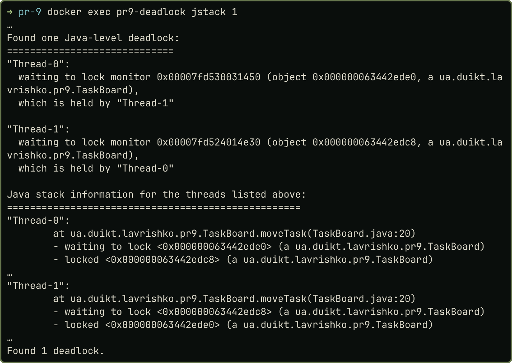

# 1. Мета роботи

Відтворити й усунути втрату оновлень спільних даних, а також знайти взаємне блокування потоків за дампом потоків.

# 2. Завдання за варіантом

Номер у списку групи 12, варіант 2 (12 mod 5): лічильник закритих задач спринту, 16 потоків по 25 000 викликів, очікується 400000. Ресурси: дві дошки задач по 10 задач, переноситься одна. Java 21 без бібліотек, `javac` і запуск у docker, без IDE. Повні виводи в `results/`.

# 3. Дослід 1. Втрата оновлень

`SprintCounter` має поле `int` і два методи, що відрізняються лише словом `synchronized`:

```{.java .small}
public class SprintCounter {
    private int closed;
    public void close() { closed++; }                    // без синхронізації
    public synchronized void closeSynced() { closed++; } // той самий код під монітором
    public int get() { return closed; }
}
```

`Exp1Race.main` створює один лічильник і 16 потоків, запускає всі, чекає їх через `join()` і друкує результат поруч із 400000. Аргумент `plain` чи `synced` вибирає метод:

```{.java .small}
Runnable step = synced ? counter::closeSynced : counter::close;
Thread[] threads = new Thread[THREADS];                       // THREADS = 16
for (int i = 0; i < THREADS; i++) {
    threads[i] = new Thread(() -> {
        for (int k = 0; k < PER_THREAD; k++) { step.run(); } // PER_THREAD = 25 000
    });
    threads[i].start();
}
for (Thread t : threads) { t.join(); }
int expected = THREADS * PER_THREAD;                          // 400000
System.out.println(mode + ": " + counter.get() + " / " + expected + …);
```

Кожен режим запущено тричі (`results/exp1_plain.txt`, `results/exp1_synced.txt`):

| Запуск | Без синхронізації | synchronized |
|---|---|---|
| 1 | 47346 / 400000 | 400000 / 400000 |
| 2 | 125858 / 400000 | 400000 / 400000 |
| 3 | 78100 / 400000 | 400000 / 400000 |

Без синхронізації щоразу менше за 400000 і щоразу інше число. `closed++` складається з трьох кроків: прочитати поле, додати 1, записати назад. Якщо два потоки прочитали одне значення, обидва запишуть його плюс 1, і одне додавання пропаде. 16 потоків на 16 ядрах одночасно змінюють те саме поле, тому пропадає більшість (від 274142 до 352654 додавань). З `synchronized` в методі одночасно лише один потік, тож усі три рази вийшло 400000.

# 4. Дослід 2. Взаємне блокування

Клас `TaskBoard` має поля `id` і `tasks`. Метод `moveTask` бере монітор джерела, чекає 50 мс і лише потім бере монітор приймача:

```{.java .small}
static void moveTask(TaskBoard from, TaskBoard to) throws InterruptedException {
    synchronized (from) {
        System.out.println(Thread.currentThread().getName() + " тримає дошку "
                + from.id + ", чекає дошку " + to.id);
        Thread.sleep(50);
        synchronized (to) {      // тут потік чекає монітор to (у дампі TaskBoard.java:20)
            from.tasks--;
            to.tasks++;
        }
    }
}
```

`Exp2Deadlock.main` створює дві дошки й два потоки, які переносять задачу в протилежних напрямках, і чекає їх через `join()`:

```{.java .small}
TaskBoard board1 = new TaskBoard(1, 10);
TaskBoard board2 = new TaskBoard(2, 10);
Thread t1 = new Thread(() -> run(move, board1, board2));   // Thread-0: з 1 на 2
Thread t2 = new Thread(() -> run(move, board2, board1));   // Thread-1: з 2 на 1
t1.start(); t2.start();
t1.join(); t2.join();
```

Програма надрукувала два рядки «тримає ... чекає» і зависла. Щоб зняти дамп, не зупиняючи її, я запустив її в окремому контейнері `pr9-deadlock`: `jps -l` показав PID 1, далі `docker exec pr9-deadlock jstack 1` (рисунок 1).

Дамп (рисунок 1) показує цикл очікування. `Thread-0` переносить з дошки 1, тож `locked ...edc8` це дошка 1 (те саме друкує програма). Він чекає дошку 2 (`waiting to lock ...ede0`, `held by "Thread-1"`). `Thread-1` тримає дошку 2 (`locked ...ede0`) і чекає дошку 1 (`held by "Thread-0"`). Обидва потоки у стані `BLOCKED (on object monitor)` (повний дамп у `results/exp2_deadlock.txt`), і жоден не відпустить свій монітор, поки не отримає чужий. Рядок 20 у дампі це перший рядок усередині `synchronized (to)`.

{width=80%}

# 5. Виправлення: порядок за id

`moveTaskOrdered` завжди бере спершу монітор дошки з меншим `id`, а перенесення робить у потрібний бік:

```{.java .small}
static void moveTaskOrdered(TaskBoard from, TaskBoard to) throws InterruptedException {
    TaskBoard first = from.id < to.id ? from : to;
    TaskBoard second = first == from ? to : from;
    synchronized (first) {
        Thread.sleep(50);
        synchronized (second) {
            from.tasks--;
            to.tasks++;
        }
    }
}
```

Запуск з аргументом `ordered` завершується:

```{.text .small}
> java -cp target/classes ua.duikt.lavrishko.pr9.Exp2Deadlock ordered
Дошка 1: 10 задач, дошка 2: 10 задач, разом 20. Програма завершилась.
```

Обидва потоки спершу беруть дошку 1, і той, хто її не отримав, чекає, нічого не тримаючи. Циклу немає, на кожній дошці знову по 10 задач.

# 6. Відповіді на контрольні питання

1. Чому `count++` не атомарна і чому програма інколи дає правильний результат? Це читання, додавання і запис, і між ними інший потік може змінити поле, тоді одне оновлення губиться. Правильне число виходить, коли потоки не перетинаються в часі (малі M, потік встиг закінчити до старту інших). У моїх запусках 16 потоків на 16 ядрах давали від 47 до 126 тисяч із 400000.
2. Що змінює `synchronized`? Потік бере монітор об'єкта на час виконання методу, а інші потоки, що викликають синхронізовані методи цього об'єкта, чекають у стані `BLOCKED`. Тому в методі одночасно один потік, і результат завжди 400000. Крім того, після виходу з методу зміна поля стає видимою потоку, який наступним бере той самий монітор.
3. Чому при взаємному блокуванні програма зависає без винятку? Потоки нічого не порушили: вони просто чекають монітор у стані `BLOCKED`, а `main` стоїть у `join()`. Виняток ніхто не кидає, цикл видно лише в дампі.
4. Чому єдиний порядок захоплення виключає блокування? Для блокування потрібен цикл: потік A тримає 1 і чекає 2, потік B тримає 2 і чекає 1. Якщо всі беруть монітори за зростанням `id`, потік чекає лише монітор з більшим `id`, ніж ті, що вже тримає. Тоді в ланцюжку очікування `id` тільки зростають і не можуть повернутися до початку, тож циклу немає (у моєму випадку потік, що чекає дошку 1, нічого не тримає).

# 7. Висновки

Я відтворив втрату оновлень на лічильнику закритих задач: 16 потоків по 25 000 викликів дали без синхронізації 47346, 125858 і 78100 замість 400000, бо `closed++` складається з читання, додавання і запису. З `synchronized` усі три запуски дали 400000. Перенесення задач між двома дошками з `synchronized (from)`, паузою 50 мс і `synchronized (to)` зависло, а `jstack 1` у контейнері показав `Found one Java-level deadlock`: `Thread-0` тримає дошку 1 і чекає дошку 2, `Thread-1` навпаки. Коли монітори стали братися за зростанням `id`, програма завершилась і на дошках знову по 10 задач.

# 8. Посилання на репозиторій

<https://github.com/brizzinck/krinzhrepoduta/tree/main/java/pr-9>
