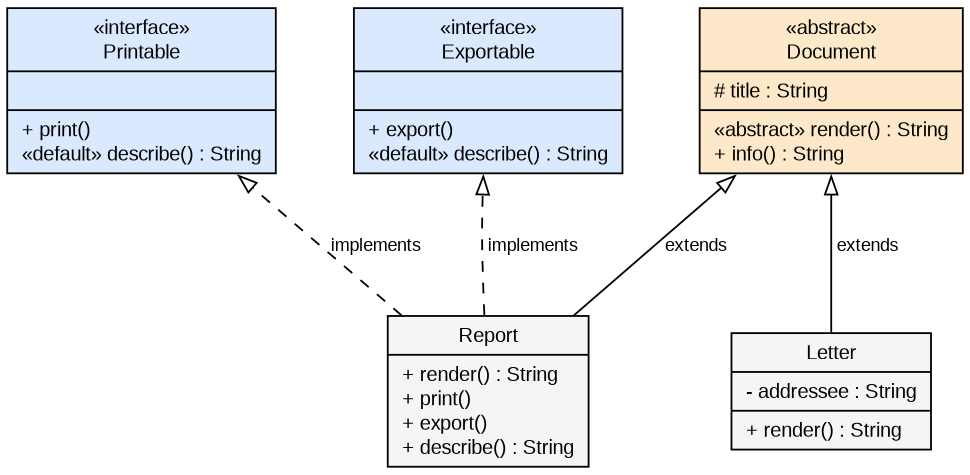
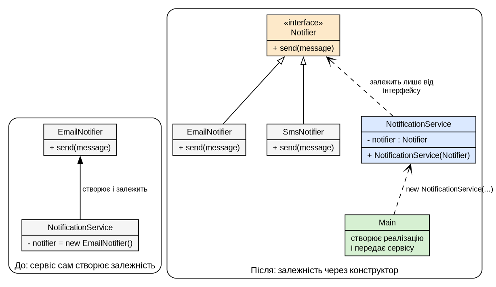

# Мета роботи

Дослідити абстрактні класи, інтерфейси та `default`-методи в Java і показати, як передача залежності через конструктор (DIP) дозволяє міняти реалізацію без зміни сервісу.

# Завдання за варіантом

Номер у списку 12, остача від ділення на 5 дорівнює 2: абстрактний клас **Документ** (похідні Звіт, Лист), інтерфейси `Printable` і `Exportable`, залежність сервісу: сповіщувач email або SMS. Три досліди: (1) абстрактний клас, (2) два інтерфейси та конфлікт `default`, (3) залежність через `new` і через конструктор.

# Теоретичні відомості

Абстрактний клас не можна інстанціювати; нащадок мусить реалізувати його абстрактні методи. Інтерфейс описує роль, клас реалізує кілька інтерфейсів; два `default`-методи з однаковою сигнатурою компілятор не може вибрати між собою. DIP: верхній рівень залежить від абстракцій, а не від класів. Запуск: Maven, JDK 21; повідомлення `javac` наведено дослівно.

# Хід виконання роботи

## Дослід 1. Абстрактний клас

```java
public abstract class Document {
    protected final String title;
    protected Document(String title) { this.title = title; }

    public abstract String render();          // абстрактний метод
    public String info() { return "Документ «" + title + "»"; }   // звичайний
}
```

`new Document("Назва")` і похідний клас `NoRender extends Document` без `render()` не компілюються:

```text
NewDocument.java:5: error: Document is abstract; cannot be instantiated
        Document d = new Document("Назва");
                     ^
NoRender.java:4: error: NoRender is not abstract and does not override abstract method render() in Document
```

Після реалізації `render()` клас компілюється (код 0). `Report` і `Letter` реалізують `render()` по-різному, `info()` успадковано:

```text
> java -cp target/classes ua.duikt.lavrishko.pr4.exp1.Main
Документ «Підсумки семестру»
ЗВІТ: Підсумки семестру (розділи, таблиці, висновки)
Документ «Запрошення на захист»
Шановний(а) Ніщеменко Д. О.! Тема листа: Запрошення на захист
```

## Дослід 2. Два інтерфейси і конфлікт default

{width=50%}

```java
public interface Printable  { void print();  default String describe() { return "Printable: документ можна надрукувати"; } }
public interface Exportable { void export(); default String describe() { return "Exportable: документ можна експортувати"; } }

public class Report extends Document implements Printable, Exportable {
    @Override public String describe() {        // розв'язання конфлікту
        return Printable.super.describe() + "; " + Exportable.super.describe();
    }
}
```

Через `Printable p = report;` доступні `print()` і `describe()`, через `Exportable e = report;` доступні `export()` і `describe()` (плюс методи `Object`). Виклик `p.export()` не компілюється (для `e.print()` аналогічно):

```text
ViaPrintable.java:8: error: cannot find symbol
        p.export();
         ^
  symbol:   method export()
  location: variable p of type Printable
```

Клас `ConflictReport implements Printable, Exportable` без перевизначення `describe()`:

```text
ConflictReport.java:5: error: types Printable and Exportable are incompatible;
  class ConflictReport inherits unrelated defaults for describe() from types Printable and Exportable
```

У `Report` конфлікт розв'язано явним перевизначенням з `Printable.super` і `Exportable.super`; запуск:

```text
> java -cp target/classes ua.duikt.lavrishko.pr4.exp2.Main
Друк: ЗВІТ: Підсумки семестру
Printable: документ можна надрукувати; Exportable: документ можна експортувати
Експорт у файл: Підсумки семестру.pdf
…
```

`describe()` через `p`, `e` і `report` повертає однаковий результат: версію обирає фактичний клас (динамічне зв'язування), а не тип посилання.

## Дослід 3. Залежність через `new` і через конструктор

{width=50%}

Версія 1: сервіс сам створює `new EmailNotifier()`. Заміна на SMS вимагає змінити сервіс:

```text
> diff -u .../exp3/before/NotificationService.java .../exp3/naive/NotificationService.java
-    private final EmailNotifier notifier = new EmailNotifier();
+    private final SmsNotifier notifier = new SmsNotifier();
```

Версія 2: залежність приходить як інтерфейс через конструктор.

```java
public interface Notifier { void send(String message); }

public class NotificationService {
    private final Notifier notifier;
    public NotificationService(Notifier notifier) { this.notifier = notifier; }   // ззовні
    public void notifyUser(String user) { notifier.send("Вітаємо, " + user + "! Документ готовий."); }
}
// Main
new NotificationService(new EmailNotifier()).notifyUser("Олена");
new NotificationService(new SmsNotifier()).notifyUser("Олена");
```

```text
> java -cp target/classes ua.duikt.lavrishko.pr4.exp3.after.Main
Email: Вітаємо, Олена! Документ готовий.
SMS: Вітаємо, Олена! Документ готовий.
```

`SmsNotifier` додано на другому етапі, сервіс не змінювався (хеш до і після однаковий, `diff` із копією етапу 1 порожній):

```text
> sha256sum …/exp3/after/NotificationService.java      (етап 1, до SmsNotifier)
b0345d26fcd6adf4345675ce6ab4f148bbf3c7aee6a410412498a9680dc7e506
> sha256sum …/exp3/after/NotificationService.java      (етап 2, після SmsNotifier)
b0345d26fcd6adf4345675ce6ab4f148bbf3c7aee6a410412498a9680dc7e506
```

# Абстрактний клас чи інтерфейс, і чому конструктор дозволяє міняти реалізацію

Абстрактний клас (`Document`) задає спільну основу: поля, конструктор, звичайні методи й абстрактні методи для нащадків; клас може мати лише одного предка-класу. Інтерфейс (`Printable`, `Exportable`, `Notifier`) описує роль чи контракт: клас може реалізувати кілька інтерфейсів, а сам інтерфейс не має полів екземпляра й конструктора. Клас обирають для спільного коду родини, інтерфейс для незалежних можливостей і залежностей.

Сервіс, що отримує `Notifier` через конструктор, знає лише контракт `send`, а об'єкт-реалізацію створює той, хто збирає програму (`Main`). Тому нова реалізація додається окремим класом без правок сервісу: і сервіс, і реалізації залежать від абстракції, а не сервіс від реалізацій.

# Висновки

Абстрактний клас `Document` не можна створити напряму, а похідний клас мусить реалізувати `render()`, інакше `javac` видає помилку. Через посилання інтерфейсу доступні лише методи цього інтерфейсу, а конфлікт двох `default`-методів компілятор не розв'язує сам; його усунено перевизначенням з `Printable.super.describe()` і `Exportable.super.describe()`. Сервіс із `new EmailNotifier()` довелося змінювати для переходу на SMS. Сервіс із `Notifier` через конструктор прийняв email і SMS без жодної зміни, що підтверджено однаковими хешами файлу. Отже, залежність від інтерфейсу замість класу робить сервіс стійким до заміни реалізацій.

# Посилання на репозиторій

<https://github.com/brizzinck/krinzhrepoduta/tree/main/java/pz-4>
