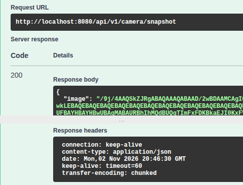
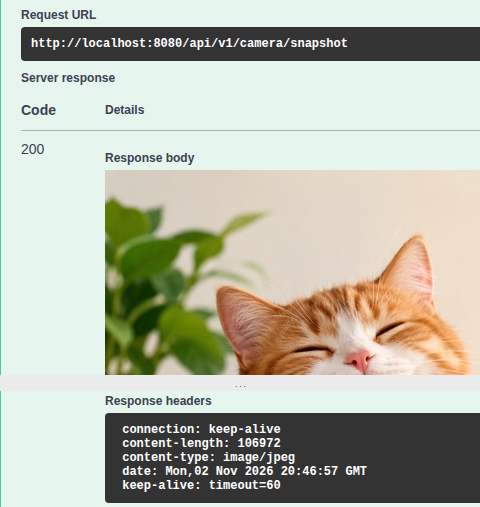

# 1. Мета й постановка

Створити мікросервіс камери на Spring Boot 3.3.5 (Java 21), який через OpenFeign отримує дані зовнішнього сервісу DummyJSON, і перевірити його у Swagger UI. Етап 1: `POST /snapshot` повертає JSON із Base64. Фінальне завдання: той самий ендпоїнт повертає JPEG. Збірка й запуск у docker `maven:3.9-eclipse-temurin-21`, перевірка у Swagger UI і через `curl`.

# 2. Налаштування проєкту

`pom.xml` я написав вручну за методичкою: parent `spring-boot-starter-parent` 3.3.5, `java.version` 21, залежності `spring-boot-starter-web`, `springdoc-openapi-starter-webmvc-ui` 2.6.0, `lombok` (optional), `spring-cloud-starter-openfeign` і `dependencyManagement` зі `spring-cloud-dependencies` 2023.0.3. Пакети за шарами в `com.example.demo`: `client`, `controller`, `dto`, `service`. `application.properties`: `spring.application.name=demo`, `server.port=8080`.

# 3. Реалізація

Feign-клієнт (`@EnableFeignClients` над `DemoApplication`). `url` винесено у властивість із типовим значенням із методички, щоб адресу можна було змінити без перекомпіляції:

```java
@FeignClient(name = "camera-client", url = "${camera.client.url:https://dummyjson.com/c}")
public interface CameraClient {

    @GetMapping("/0716-c5cb-4391-afc3")
    CameraInfoDto getCameraInfo();

    @PutMapping("/382a-be11-44ef-8b0c")  // у відповіді поле image з Base64
    SnapshotDto captureSnapshot();
}
```

DTO відповідають JSON, назви полів збігаються з ключами:

```java
public record CameraInfoDto(
        int id, String device_type, String status, List<String> features, Location location) {
    public record Location(String room, int floor) {
    }
}

public record SnapshotDto(String image) {
}
```

Сервіс. `@RequiredArgsConstructor` створює конструктор для `final`-поля, залежність передає Spring; `@Slf4j` дає `log`, повідомлення йдуть до виклику клієнта й після відповіді:

```java
@Service
@RequiredArgsConstructor
@Slf4j
public class CameraService {

    private final CameraClient cameraClient;

    public SnapshotDto captureSnapshot() {
        log.info("Capturing snapshot");
        SnapshotDto response = cameraClient.captureSnapshot();
        log.info("Snapshot received");
        return response;
    }
    // getCameraInfo(): аналогічно
}
```

Контролер етапу 1 має анотації `@RestController`, `@RequestMapping("/api/v1/camera")` і `@Tag(name = "Camera")`. Метод `GET /info` повертає `CameraInfoDto`, а `POST /snapshot` повертає `SnapshotDto`, обидва через `cameraService`. Код етапу 1 лежить у `demo/stages/CameraController.stage1.java`.

# 4. Запуск і перевірка (етап 1)

`mvn package`, `java -jar target/demo-0.0.1-SNAPSHOT.jar`, без параметрів. Обидва ендпоїнти повертають 200; у Swagger UI (Try it out) видно поля `id`, `device_type`, `status`, `features`, `location` та об'єкт `{"image": "…"}`.

```{.text .small}
> curl -i http://localhost:8080/api/v1/camera/info
HTTP/1.1 200 
Content-Type: application/json
…
{"id":123,"device_type":"camera","status":"online","features":["motion_detection","night_vision","audio"],"location":{"room":"office","floor":2}}
```

Логи сервісу:

```{.text .small}
> grep CameraService app_stage1.log | cut -c1-200
…CameraService   : Getting camera info
…CameraService   : Camera info received: CameraInfoDto[id=123, device_type=camera, …
…CameraService   : Capturing snapshot
…CameraService   : Snapshot received
…
```

Поле `image` я перевірив своїм скриптом `demo/check_image.sh`:

```{.text .small}
> ./check_image.sh
довжина поля image: 142632 символи
після декодування: 106972 байти, початок: ffd8ff
```

# 5. Фінальне завдання: Base64 у зображення

Для фінального завдання я замінив метод контролера, тож для `POST /snapshot` лишився один метод; клієнт і сервіс я не змінював:

```java
    @PostMapping(
            value = "/snapshot",
            produces = MediaType.IMAGE_JPEG_VALUE
    )
    public ResponseEntity<byte[]> captureSnapshot() {
        SnapshotDto snapshot = cameraService.captureSnapshot();
        byte[] image = Base64.getDecoder().decode(snapshot.image());
        return ResponseEntity.ok()
                .contentType(MediaType.IMAGE_JPEG)
                .body(image);
    }
```

Декодується поле `image`, а не весь JSON; `produces` бере участь в узгодженні з `Accept`. Swagger UI показує відповідь на `POST /snapshot` до і після зміни:

::: {.pair}
{width=48%} {width=48%}

Рисунок 1 (зліва). `POST /snapshot` після етапу 1: 200, `application/json`, Base64. Рисунок 2 (справа). Після фінального завдання: 200, `image/jpeg`, зображення
:::

```{.text .small}
> curl -X POST http://localhost:8080/api/v1/camera/snapshot -H "Accept: image/jpeg" -D snapshot-headers.txt -o snapshot.jpg
> cat snapshot-headers.txt
HTTP/1.1 200 
Content-Type: image/jpeg
Content-Length: 106972
> file snapshot.jpg
snapshot.jpg: JPEG image data, JFIF standard 1.01, …, 900x600, components 3
ba6a02acbdac0f745f7bbe7ff52529aa87b727b8454ec3370a901a78edfd67c6  (мок напряму)
ba6a02acbdac0f745f7bbe7ff52529aa87b727b8454ec3370a901a78edfd67c6  results/snapshot.jpg
```

Файл відкривається як зображення, його хеш збігається з незалежно декодованою відповіддю мока. Запит із `Accept: application/json` дає 406, бо ендпоїнт тепер оголошує лише `image/jpeg`.

# 6. Порівняння «до» і «після»

| | Етап 1 (до) | Етап 2 (після) |
|---|---|---|
| Тип результату методу | `SnapshotDto` | `ResponseEntity<byte[]>` |
| `Content-Type` | `application/json` | `image/jpeg` |
| Тіло | JSON із полем `image` (Base64, 142632 символи) | байти зображення (106972 байти) |
| Що бачить користувач | текст | картинка |
| Хто декодує Base64 | той, хто викликає API | контролер |

Дані зовнішнього сервісу ті самі, змінилась лише відповідь контролера: Base64 передає двійкові дані текстом усередині JSON (на третину більше), а контролер повертає їх назад у байти.

# 7. Висновки

Створено мікросервіс камери на Spring Boot 3.3.5 з OpenFeign, DTO-записами, сервісом із логуванням, REST-контролером і Swagger UI; залежності передає Spring через конструктор. Спершу `POST /snapshot` повертав JSON із Base64, у фіналі той самий ендпоїнт повертає `ResponseEntity<byte[]>` з `Content-Type: image/jpeg`. Результат я перевірив у Swagger UI й через `curl`: 200, коректний тип, файл 900x600 з тим самим хешем, що й незалежне декодування. Логи показали пари повідомлень «до виклику» й «після відповіді». Опановано створення REST-сервісу, інтеграцію через Feign, роботу з DTO та узгодження типу відповіді.

# 8. Посилання на репозиторій

<https://github.com/brizzinck/krinzhrepoduta/tree/main/java/sr-1>
