<style>
.pair p { text-indent: 0; text-align: center; }
.pair img { vertical-align: top; }
.pair p + p { font-size: 12pt; margin: 3pt 0 6pt; }
</style>

# 1. Мета роботи

Підключити до застосунку Camera API файлову базу H2, зберігати список камер із зовнішнього сервісу через Spring Data JPA та Hibernate, а результат перевірити у Swagger UI та H2 Console. У методичці робота має назву «Практична робота № 2», у Classroom це самостійна робота № 2.

Проєкт зібрано Maven на JDK 21 у docker-образі `maven:3.9-eclipse-temurin-21`. IntelliJ IDEA не використовувалась, тому код показано знімками термінала зі справжніх файлів проєкту.

# 2. Хід виконання

Крок 1. Я продовжив проєкт із самостійної роботи № 1. Попередні ендпоїнти працюють:

```{.text .small}
> curl -i http://localhost:8080/api/v1/camera/info
HTTP/1.1 200 
{"id":123,"device_type":"camera","status":"online","features":["motion_detection","night_vision","audio"],"location":{"room":"office","floor":2}}(код завершення: 0)
> curl -s -X POST http://localhost:8080/api/v1/camera/snapshot -H 'Accept: image/jpeg' -D - -o results/snapshot.jpg
HTTP/1.1 200 
Content-Type: image/jpeg
Content-Length: 106972
```

Крок 2. У `pom.xml` я додав Spring Data JPA та H2 зі scope `runtime`. Spring Data JPA дає інтерфейси, Hibernate відображає об'єкти на таблиці, H2 зберігає дані.

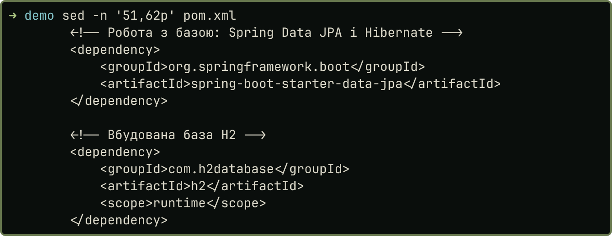{width=62%}

Крок 3. У `application.properties` я налаштував файлову базу, JPA, H2 Console, шлях списку камер і таймаути Feign. Тека `data/` є в `.gitignore`, файл бази не комітиться.

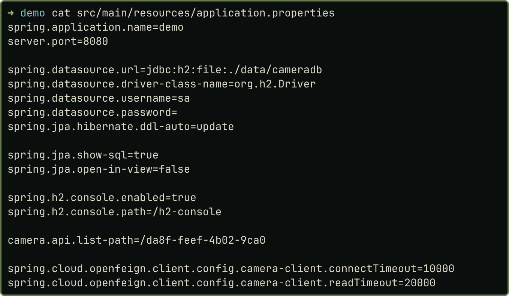{width=62%}

Кроки 4 і 5. Відповідь сервісу описано двома DTO, `@JsonProperty` зіставляє `device_type` із полем `deviceType`, а `location` використовує record із попередньої роботи. У `CameraClient` додано третій метод, два попередні збережено.

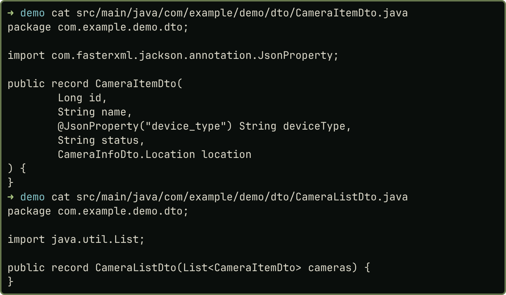{width=62%}

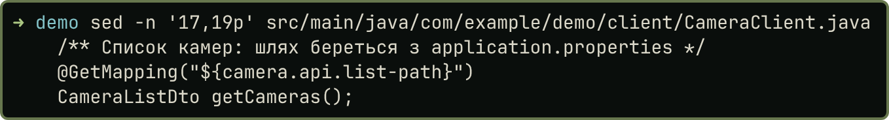{width=62%}

Кроки 6 і 7. DTO описує JSON зовнішнього сервісу з вкладеним `location`, а `CameraEntity` описує рядок таблиці `cameras`, де `location` розкладено на два стовпці. Поле `id` приходить ззовні, тому `@GeneratedValue` немає. `CameraRepository` успадковує від `JpaRepository` методи `saveAll`, `findAll`, `findById` і `delete`.

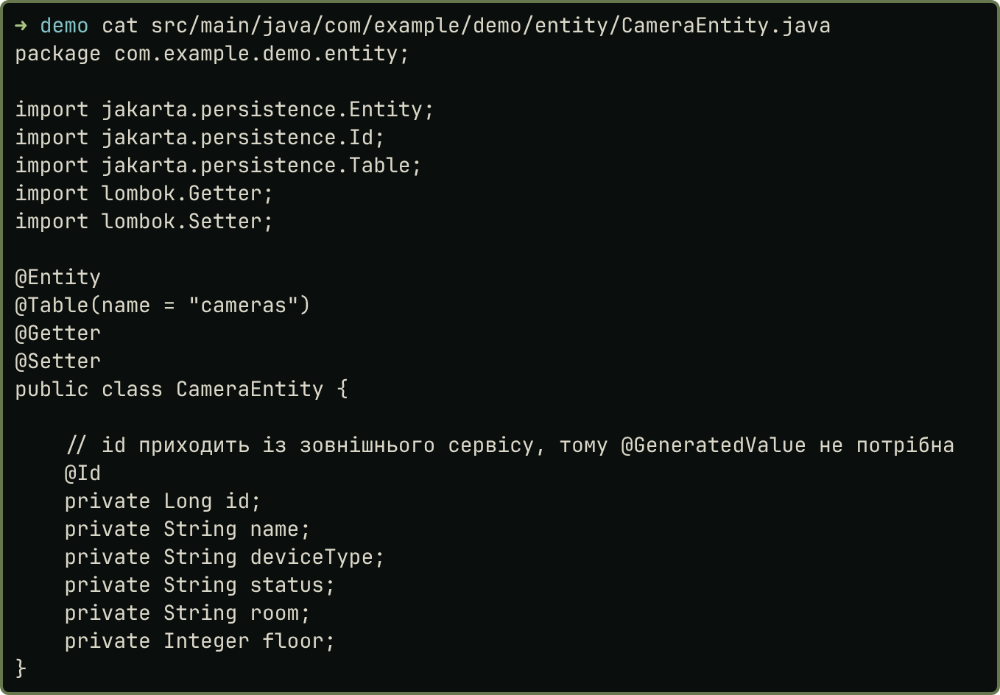{width=62%}

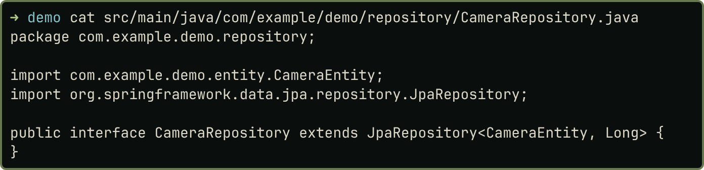{width=62%}

Крок 8. `CameraService` отримує список через Feign, перевіряє його, перетворює DTO на Entity і зберігає. Порожній список або камера без `id` дають 502, відсутня камера дає 404.

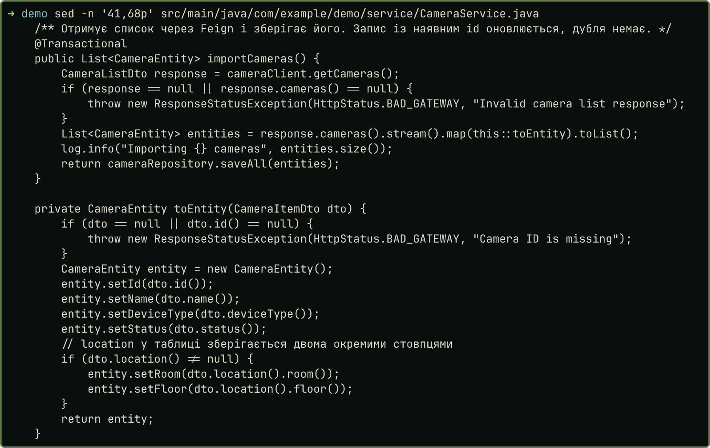{width=80%}

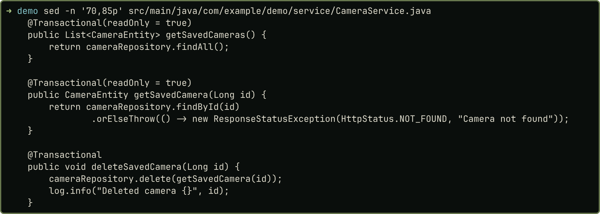{width=80%}

Крок 9. `CameraController` доповнено чотирма операціями. `GET /saved` читає записи лише з H2, а `DELETE` повертає 204.

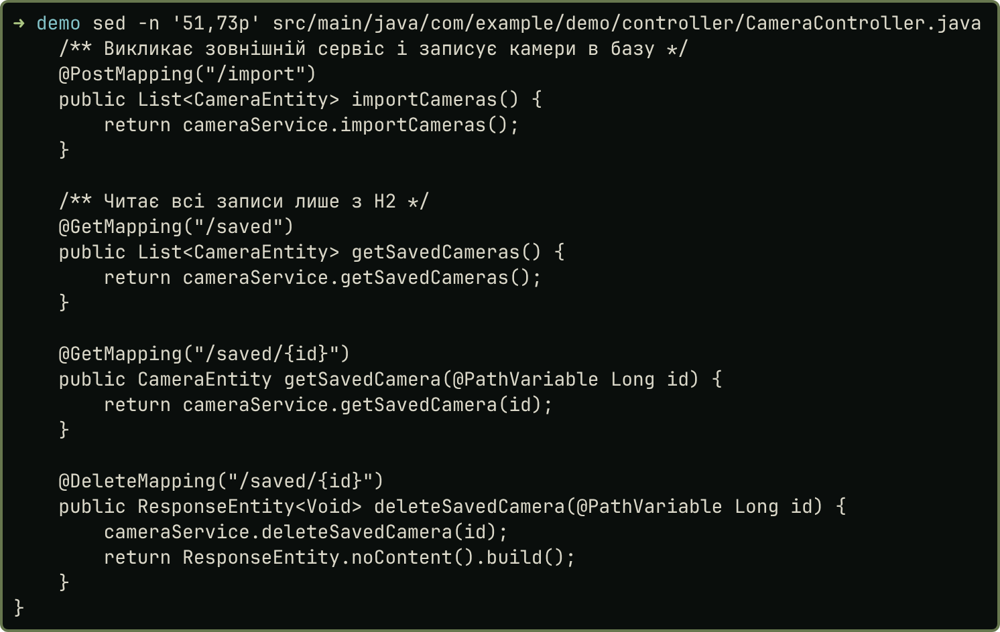{width=64%}

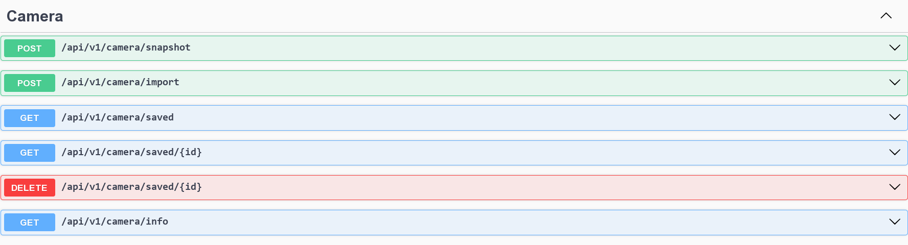{width=62%}

Крок 10. У H2 Console (`jdbc:h2:file:./data/cameradb`, користувач `sa`, порожній пароль) таблиця `CAMERAS` має чотири записи, із них три зі статусом `ONLINE`.

::: {.pair}
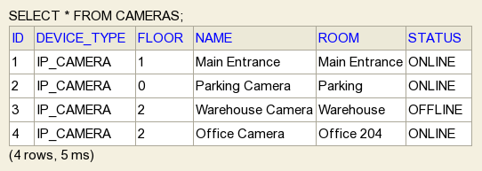{width=49%} 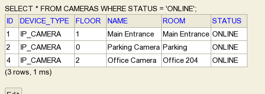{width=49%}

Рисунок 11. H2 Console: усі камери та фільтр за статусом
:::

Крок 11. У Swagger UI послідовно виконано всі дії з методички.

::: {.pair}
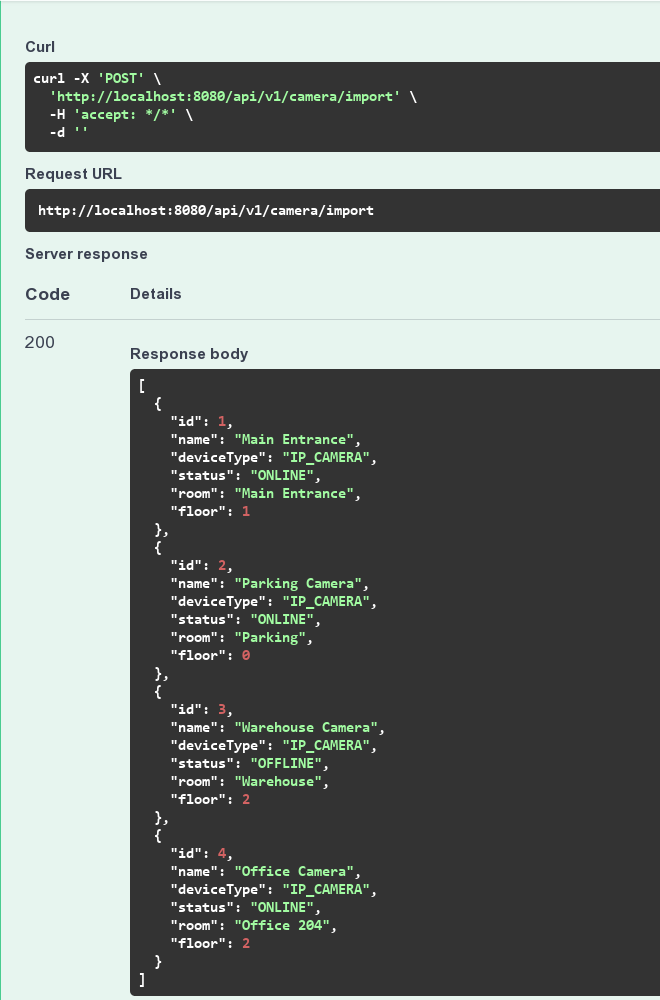{width=49%} 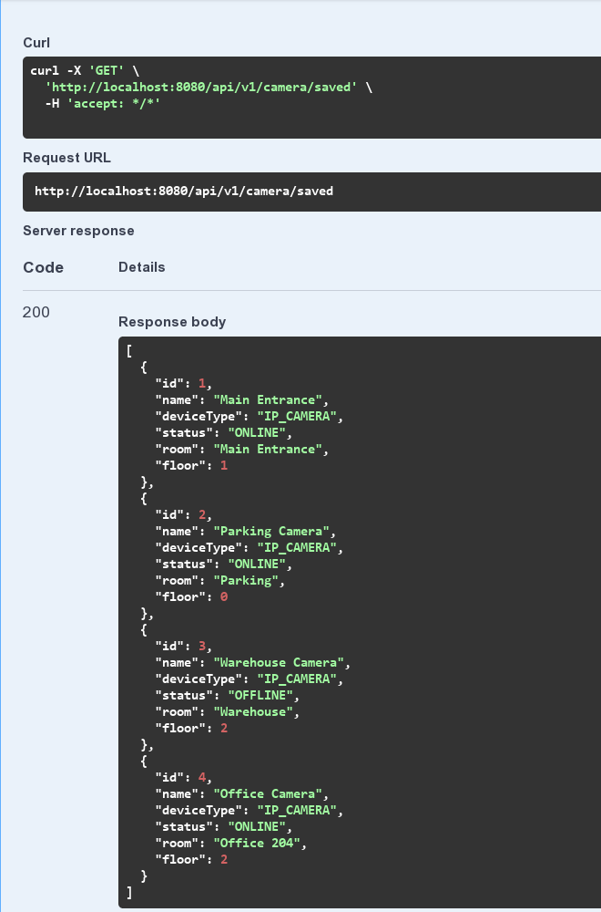{width=49%}

Рисунок 12. POST /import і GET /saved: код 200, чотири камери

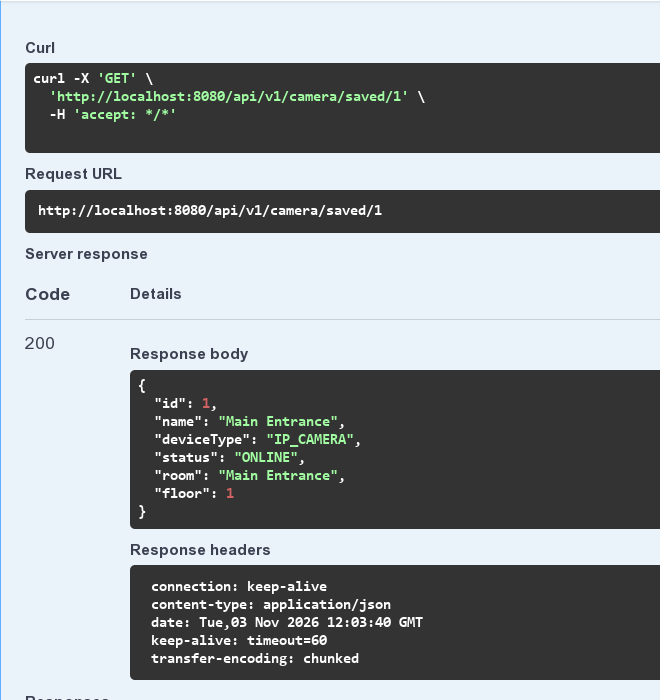{width=49%} 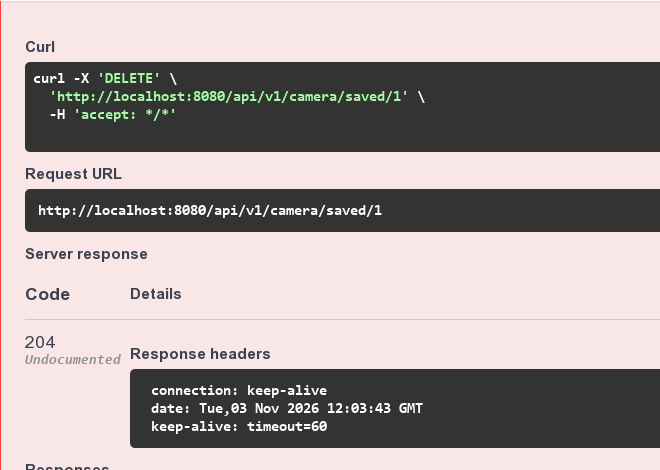{width=49%}

Рисунок 13. GET /saved/1: код 200; DELETE /saved/1: код 204

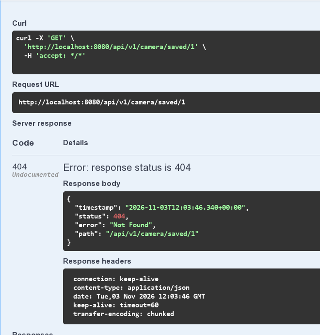{width=49%} 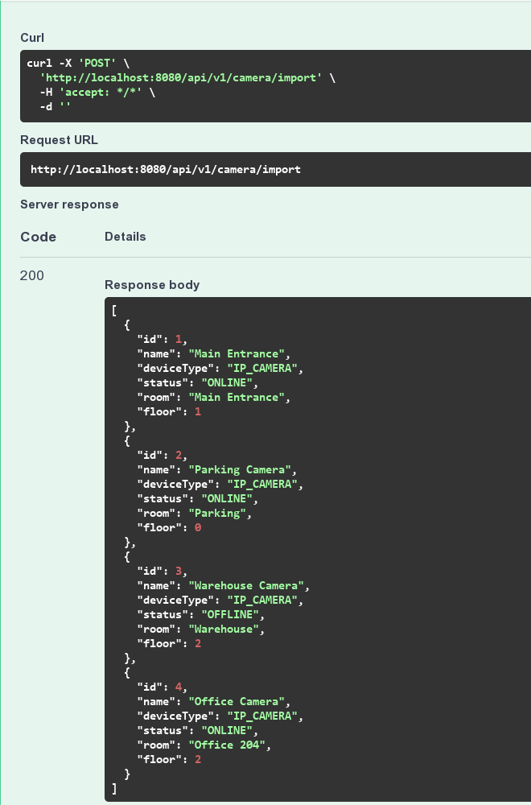{width=49%}

Рисунок 14. GET /saved/1 після видалення: код 404; повторний POST /import: код 200
:::

Крок 12. Підсумкова схема шляху даних: контролер викликає сервіс, а той бере дані із зовнішнього сервісу через Feign і зберігає їх у H2 через репозиторій.

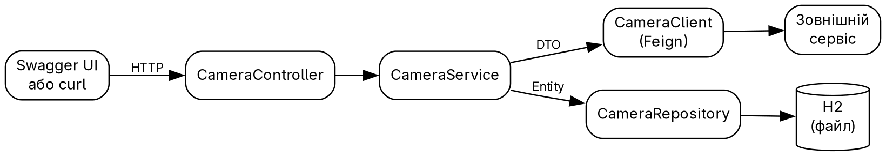{width=78%}

# 3. HTTP-відповіді та результат видалення

Спершу я перевірив послідовність через `curl` на чистій базі, далі перезапустив застосунок і повторив її у Swagger UI. Вивід скорочено, повний лежить у `demo/results/api_curl.txt`:

```{.text .small}
> curl -i http://localhost:8080/api/v1/camera/saved/1
HTTP/1.1 200 
{"id":1,"name":"Main Entrance","deviceType":"IP_CAMERA","status":"ONLINE","room":"Main Entrance","floor":1}(код завершення: 0)
> curl -i -X DELETE http://localhost:8080/api/v1/camera/saved/1
HTTP/1.1 204 
> curl -i http://localhost:8080/api/v1/camera/saved/1
HTTP/1.1 404 
{"timestamp":"2026-11-03T12:00:34.170+00:00","status":404,"error":"Not Found","path":"/api/v1/camera/saved/1"}(код завершення: 0)
```

Журнал Hibernate показує, чому дублів немає. Метод `saveAll` спершу шукає запис за `id`. Перший імпорт виконав чотири `select` і чотири `insert`. Повторний імпорт після видалення виконав чотири `select` і один `insert`, лише для камери 1; решта записів не змінилась:

```{.text .small}
2026-11-03T12:00:33.983Z  INFO 1 --- [demo] [nio-8080-exec-5] com.example.demo.service.CameraService   : Importing 4 cameras
Hibernate: select ce1_0.id,ce1_0.device_type,ce1_0.floor,ce1_0.name,ce1_0.room,ce1_0.status from cameras ce1_0 where ce1_0.id=?
…
Hibernate: insert into cameras (device_type,floor,name,room,status,id) values (?,?,?,?,?,?)
…
2026-11-03T12:00:34.250Z  INFO 1 --- [demo] [nio-8080-exec-3] com.example.demo.service.CameraService   : Importing 4 cameras
Hibernate: select ce1_0.id,ce1_0.device_type,ce1_0.floor,ce1_0.name,ce1_0.room,ce1_0.status from cameras ce1_0 where ce1_0.id=?
…
Hibernate: insert into cameras (device_type,floor,name,room,status,id) values (?,?,?,?,?,?)
```

Запит `SELECT COUNT(*) FROM CAMERAS` після повторного імпорту повернув 4. Після перезапуску застосунку `GET /saved` без імпорту повернув ті самі чотири записи, бо база лежить у файлі (`demo/results/after_restart.txt`).

# 4. Висновки

До застосунку Camera API підключено файлову базу H2, а попередні ендпоїнти `GET /info` і `POST /snapshot` працюють як раніше. Список із чотирьох камер надходить через OpenFeign, перетворюється з DTO на `CameraEntity` і зберігається через `JpaRepository`. Чотири нові операції дають імпорт, перегляд, пошук за `id` і видалення з кодами 200, 204 та 404. У H2 Console таблиця має чотири записи, три з них `ONLINE`. Повторний імпорт повернув видалену камеру й не створив дублів, що видно з журналу Hibernate. Під час роботи я розібрався, чому зовнішній `id` не дає `saveAll` вставити дубль.

# 5. Посилання на репозиторій

<https://github.com/brizzinck/krinzhrepoduta/tree/main/java/sr-2>
