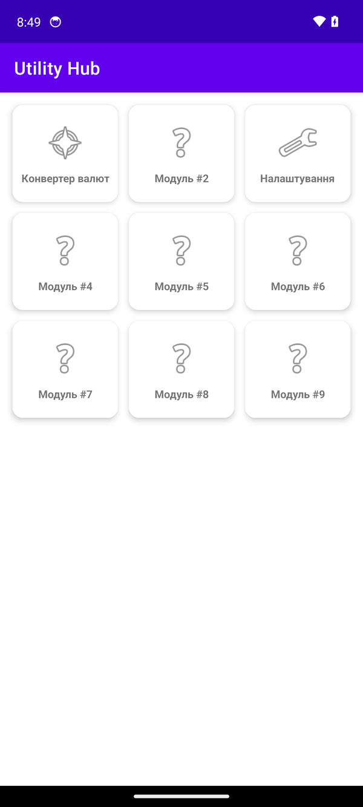
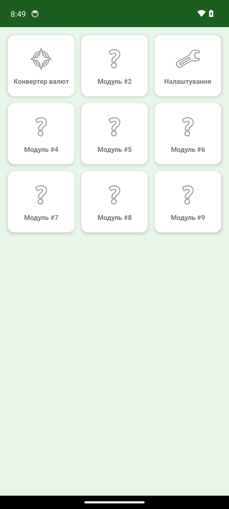
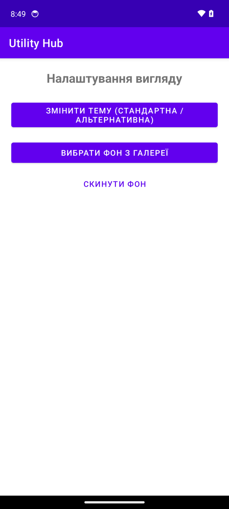
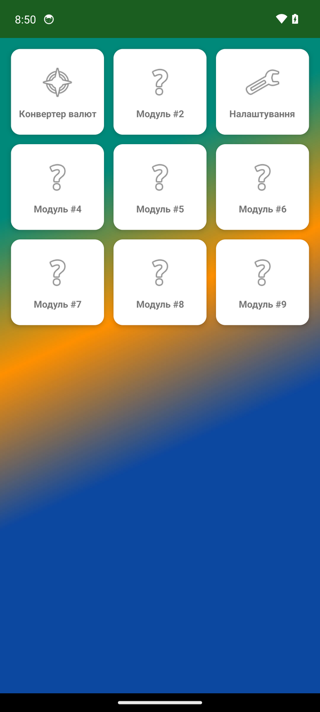
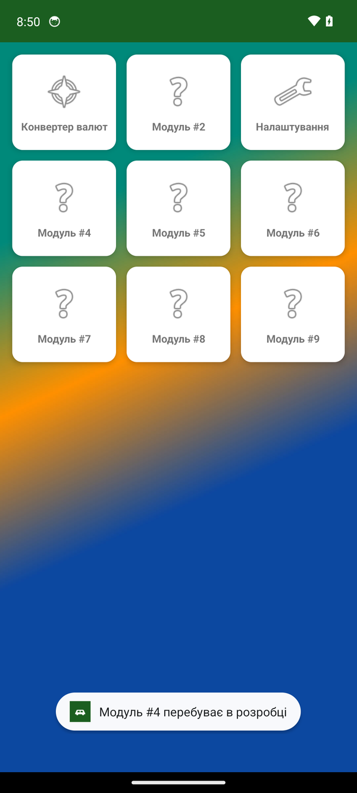

# 1. Мета роботи та завдання

Мета роботи: оволодіння навичками роботи з кастомними темами, `SharedPreferences` та вибором файлів через Storage Access Framework (`ActivityResultLauncher`); індивідуалізація додатка «Utility Hub» з практичної роботи № 1.

Завдання.

1. У `themes.xml` створити теми `Theme.UtilityHub` (базова, фіолетова) і `Theme.UtilityHub.Custom` (NoActionBar, зелена `#2E7D32` / `#1B5E20`, фон `#E8F5E9`); базову тему задати для `<application>`.
2. Створити `activity_settings.xml` з кнопками `btnToggleTheme`, `btnSelectBackground`, `btnResetBackground`.
3. Реалізувати `SettingsActivity`: `SharedPreferences` (`is_custom_theme`, `bg_uri`), вибір зображення через `GetContent()`, `takePersistableUriPermission`, `recreate()`, скидання фону.
4. У `MainActivity.onResume()` встановити зображення з `bg_uri` фоном `ViewPager2`.
5. Зареєструвати `SettingsActivity` в маніфесті (`exported="false"`).
6. Виправити й доповнити додаток «під свій лад».
7. Зібрати, запустити й зробити скриншоти.

# 2. Опис реалізації та коду

Java 17, View Binding, Material Components 1.12.0, `minSdk 24`, `targetSdk 34`. Збірка: `./gradlew assembleDebug` у Docker (`app-debug.apk`). Запускав на емуляторі Android 14 (Pixel 6), скриншоти зроблено командою `adb exec-out screencap -p`. Проєкт і оригінали знімків: [тека роботи](https://github.com/brizzinck/krinzhrepoduta/tree/main/mobile_dev/lr-1).

## 2.1. Створені та змінені файли

| Файл | Дія | Призначення |
|---|---|---|
| `res/values/themes.xml` | створено | базова й альтернативна теми (крок 1) |
| `res/layout/activity_settings.xml` | створено | екран із трьома кнопками (крок 2) |
| `activities/SettingsActivity.java` | створено | тема, вибір і скидання фону (крок 3) |
| `util/ThemeHelper.java` | створено | спільне застосування теми в усіх Activity |
| `MainActivity.java` | змінено | фон у `onResume()` (крок 4), відстеження зміни теми |
| `AndroidManifest.xml` | змінено | тема `<application>`, `SettingsActivity` з `exported="false"` (крок 5) |
| `GridPageFragment.java`, `TileAdapter.java`, `CurrencyActivity.java` | змінено | плитка «Налаштування», текст `Toast`, `ThemeHelper` |
| `res/drawable/ic_launcher.xml` | створено | власна іконка застосунку |

## 2.2. Основні фрагменти коду

Теми (`themes.xml`). Альтернативна тема успадковує `NoActionBar`, тому панелі дій у ній немає (рис. 1–2).

```xml
<style name="Theme.UtilityHub" parent="Theme.MaterialComponents.DayNight.DarkActionBar">
    <item name="colorPrimary">@color/purple_500</item>
    <item name="colorPrimaryVariant">@color/purple_700</item>
    <item name="colorOnPrimary">@color/white</item>
    <item name="android:windowBackground">@color/white</item>
</style>
<style name="Theme.UtilityHub.Custom" parent="Theme.MaterialComponents.DayNight.NoActionBar">
    <item name="colorPrimary">#2E7D32</item>
    <item name="colorPrimaryVariant">#1B5E20</item>
    <item name="colorOnPrimary">#FFFFFF</item>
    <item name="android:windowBackground">#E8F5E9</item>
</style>
```

Екран налаштувань (`SettingsActivity`, скорочено). Тему застосовано до `super.onCreate()`, бо інакше вона не діє на вже створене вікно. Кнопка теми інвертує `is_custom_theme` і викликає `recreate()`; `ActivityResultLauncher` повертає `Uri` зображення, який зберігається в `bg_uri`.

```java
private final ActivityResultLauncher<String> imagePickerLauncher =
    registerForActivityResult(new ActivityResultContracts.GetContent(), uri -> {
        if (uri != null) {
            try { getContentResolver().takePersistableUriPermission(
                    uri, Intent.FLAG_GRANT_READ_URI_PERMISSION); } catch (Exception ignored) {}
            prefs.edit().putString("bg_uri", uri.toString()).apply();
        }
    });

protected void onCreate(Bundle savedInstanceState) {
    prefs = getSharedPreferences("app_prefs", Context.MODE_PRIVATE);
    ThemeHelper.applyTheme(this);            // тема ДО super.onCreate()
    super.onCreate(savedInstanceState);
    // … binding, setContentView
    binding.btnToggleTheme.setOnClickListener(v -> {
        prefs.edit().putBoolean("is_custom_theme",
                !prefs.getBoolean("is_custom_theme", false)).apply();
        recreate();
    });
    binding.btnSelectBackground.setOnClickListener(v -> imagePickerLauncher.launch("image/*"));
    binding.btnResetBackground.setOnClickListener(v -> prefs.edit().remove("bg_uri").apply());
}
```

Фон головного екрана (`MainActivity.onResume()`, скорочено). Зображення відкривається через `ContentResolver`; за помилки фон прибирається.

```java
String bgUriStr = prefs.getString(ThemeHelper.KEY_BG_URI, null);
if (bgUriStr != null) {
    try {
        Uri bgUri = Uri.parse(bgUriStr);
        InputStream in = getContentResolver().openInputStream(bgUri);
        binding.viewPager.setBackground(Drawable.createFromStream(in, bgUri.toString()));
        if (in != null) in.close();
    } catch (Exception e) {
        binding.viewPager.setBackground(null);   // файл недоступний
    }
} else {
    binding.viewPager.setBackground(null);
}
```

## 2.3. Доповнення «під свій лад»

Під свій лад додано:

- Вхід у налаштування: плитка «Налаштування» в сітці відкриває `SettingsActivity`.
- Тема на всіх екранах: логіку винесено в `ThemeHelper.applyTheme()` (викликають `MainActivity`, `CurrencyActivity`, `SettingsActivity`); `MainActivity.onResume()` після повернення з налаштувань за потреби викликає `recreate()`.
- Колір рядка стану: `ThemeHelper` задає його зі значення `colorPrimaryVariant` поточної теми, інакше в зеленій темі він лишався фіолетовим.

Також додано іконку-автомобіль, українські назви плиток і `Toast` «Модуль #N перебуває в розробці».

::: {style="break-inside: avoid"}
# 3. Скриншоти працюючого додатка

| Рис. 1 | Рис. 2 | Рис. 3 |
|:---:|:---:|:---:|
| {width=4.8cm} | {width=4.8cm} | {width=4.8cm} |
| **Рис. 4** | **Рис. 5** | |
| {width=4.8cm} | {width=4.8cm} | |
:::

На рис. 1 головний екран у базовій темі, на рис. 2 у кастомній (зеленій), на рис. 3 екран налаштувань, на рис. 4 головний екран із фоном із галереї, на рис. 5 `Toast` на плитці-заглушці.

# 4. Висновки

До додатка «Utility Hub» додано дві теми (базову фіолетову й альтернативну зелену) та налаштування фону з пам’яті пристрою. Тему й посилання на зображення збережено в `SharedPreferences` (`is_custom_theme`, `bg_uri`), перемикання теми виконується через `recreate()`. Вибір зображення реалізовано через `ActivityResultLauncher` з `GetContent()`, а `MainActivity.onResume()` встановлює або прибирає фон. Опановано застосування тем Material Components (`setTheme` до `super.onCreate`), роботу з `SharedPreferences`, отримання `Uri` та відкриття зображення через `ContentResolver`. `SettingsActivity` зареєстровано в маніфесті, а додаток доповнено трьома елементами: входом у налаштування, застосуванням теми на всіх екранах і кольором рядка стану. Проєкт зібрано Gradle у Docker, запущено на емуляторі, зроблено чотири обов’язкові скриншоти й п’ятий, із `Toast` на плитці-заглушці, який методичка просить за наявності.
